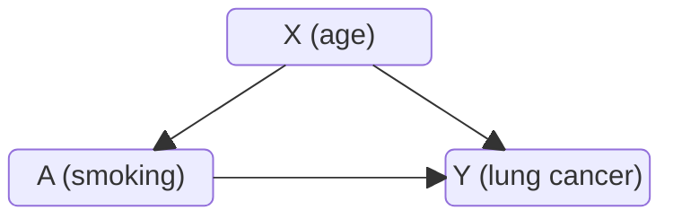

## StatArena data contribution

**Track** · Real-data problem

**Case file** · [Link the single case Markdown file changed by this PR.]

**Summary** · [State the scientific question, target and what the observed study design supports.]

**Materials** · [Link the data source or authorized access procedure and any shareable code.]

## Causal design preview (optional)

<!-- Replace the illustrative smoking diagram with your study's variables and arrows, or omit this section if you explain identification in the case file. -->

## Checklist

- [ ] This PR adds or updates one Markdown proposal under `website/data-submissions/real-data/submissions/`.
- [ ] The case file maps variables to dataset columns and explains identification in a diagram or in prose.
- [ ] I checked sharing permissions and kept restricted data in the agreed review channel.
