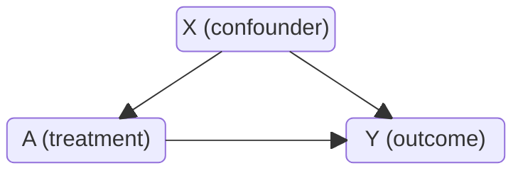

## StatArena data contribution

**Track** · Simulated DGP

**Case file** · [Link the single case Markdown file changed by this PR.]

**Summary** · [State the question, target and what the design tests.]

**Materials** · [Link shareable sources. Name any materials available through the agreed private review channel.]

## Causal design preview

### DAG

<!-- Replace the example with your case's DAG arrows. Match both edge lists in the case. Here X -> A is present because the equations make treatment depend on X. Describe disturbances in the equations. -->



### Structural equations

<!-- Replace the example equations and the table with those from the case's Structural equations subsection. Keep the contents and order of the display-math blocks and share exact protected settings through private review. -->

```math
\begin{aligned}
X_i &\sim \mathcal N(0,1),\\
A_i\mid X_i &\sim \operatorname{Bernoulli}\{g(X_i)\},\\
\epsilon_{Y,i} &\sim \mathcal N(0,1), \quad \epsilon_{Y,i}\perp (X_i,A_i),\\
Y_i &= \mu_{A_i}(X_i)+\epsilon_{Y,i} .
\end{aligned}
```

The numeric settings in this example are fixed teaching choices.

| Symbol | Meaning | Definition or setting |
| --- | --- | --- |
| $i$ | Row within a simulated table | Repeat the draws independently across rows and tables. |
| $X_i$ | Confounder | Draw first from $\mathcal N(0,1)$ with fixed mean $0$ and variance $1$. |
| $A_i$ | Binary treatment | Draw from $\operatorname{Bernoulli}\{g(X_i)\}$ given $X_i$. |
| $\epsilon_{Y,i}$ | Outcome disturbance | Draw from $\mathcal N(0,1)$ with fixed mean $0$ and variance $1$, independently of $X_i$ and $A_i$. |
| $Y_i$ | Continuous outcome | Add the outcome disturbance to the mean for arm $A_i$ evaluated at $X_i$. |
| $x$ | Covariate argument | A real-valued realization of $X_i$. |
| $g(x)$ | Treatment propensity | $g(x)=1/[1+\exp(-x)]$, with fixed logit intercept $0$ and slope $1$. |
| $\mu_0(x)$ | Control-arm mean | $\mu_0(x)=0+1\cdot x$. |
| $\mu_1(x)$ | Treatment-arm mean | $\mu_1(x)=1+1\cdot x$. |
| $\mu_{A_i}(X_i)$ | Mean selected by the unit's treatment | Evaluate $\mu_0(X_i)$ for $A_i=0$ and $\mu_1(X_i)$ for $A_i=1$. |

## Checklist

- [ ] This PR adds or updates one Markdown proposal under `website/data-submissions/simulated-dgp/submissions/`.
- [ ] The preview DAG shows the same arrows as the case's DAG edges and structural parents.
- [ ] The preview contains every structural equation from the case in the same order, with one table covering its variables, indices, functions and parameter settings.
- [ ] I checked sharing permissions and kept protected values in the agreed review channel.
