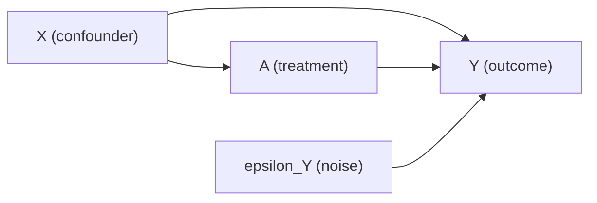

## StatArena data contribution

**Track** · Simulated DGP

**Case file** · [Link the single case Markdown file changed by this PR.]

**Summary** · [State the question, target and what the design tests.]

**Materials** · [Link shareable sources. Name any materials available through the agreed private review channel.]

## Causal design preview

### DAG

<!-- Replace the example with your case's DAG arrows. Use the same arrow directions and IDs as both edge lists in the case. Use X for covariates and confounders and epsilon for noise. Add subscripts when helpful. -->



### Structural equations

<!-- Replace the example with all display-math blocks from the case's Structural equations subsection. Keep their contents and order. -->

```math
\begin{aligned}
X &\sim \mathcal N(0,1),\\
A\mid X &\sim \operatorname{Bernoulli}\{\operatorname{logit}^{-1}(X)\},\\
\epsilon_Y &\sim \mathcal N(0,1), \quad \epsilon_Y\perp (X,A),\\
Y &= A+X+\epsilon_Y .
\end{aligned}
```

## Checklist

- [ ] This PR adds or updates one Markdown proposal under `website/data-submissions/simulated-dgp/submissions/`.
- [ ] The preview DAG shows the same arrows as the case's DAG edges and structural parents.
- [ ] The preview contains every structural equation from the case in the same order.
- [ ] I checked sharing permissions and kept protected values in the agreed review channel.
