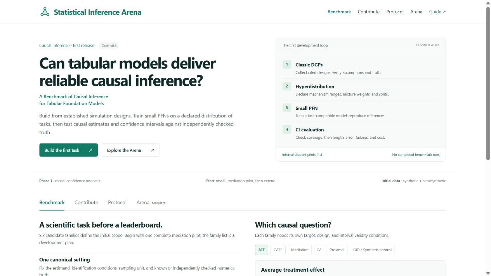

<h1 align="center">Statistical Inference Arena</h1>

<p align="center"><strong>Benchmarking reliable causal inference and uncertainty quantification for tabular foundation models.</strong></p>

<p align="center">
  
</p>

<p align="center">
  <a href="site/leaderboard-demo.html" title="Open the illustrative leaderboard HTML template"></a>
  <a href="#getting-started-for-students" title="Student onboarding steps"></a>
  <a href="CONTRIBUTING.md" title="Contribution requirements"></a>
</p>

<p align="center"><strong>Internal research prototype</strong> · Protocol v0.3 (18 October 2026) · Output schema v0.2.0<br/>
Initial scope: six causal inference task families · Student onboarding and task templates</p>

> **For student contributors:** Start with the [English walkthrough](docs/student_guide_en.md) or [中文贡献指南](docs/student_guide_zh.md), review the [reference-demo specification](starter/demo/README.md), then use the [task starter](starter/README.md). A fully runnable reference demo is **not yet included** in this snapshot.

**Quick navigation:** [Overview](#overview) · [Getting Started](#getting-started-for-students) · [Six Task Families](#task-coverage) · [How to Contribute](#contributing-a-new-task) · [Scientific Protocol](#benchmark-design) · [Citation](#citation)

## Overview

**Statistical Inference Arena (StatsArena)** is a research benchmark in development for evaluating whether tabular foundation models and established statistical methods can produce **trustworthy estimates and confidence intervals for causal quantities**. The first release focuses on six families of causal inference problems; it is not yet a benchmark of every type of statistical inference.

Our goal is to move beyond point-estimation accuracy alone. For each specified causal target and data-generating process (DGP), we aim to assess:

- **Validity:** Does an interval achieve its stated frequentist coverage under repeated sampling?
- **Precision:** How wide are the intervals *when* they satisfy the pre-specified validity and availability requirements?
- **Point accuracy:** What are the bias and estimation error of the point estimate?
- **Reliability:** How often does a method return a valid answer, abstain, fail or report that a target is not identified?
- **Cost:** What are the training, loading and end-to-end inference costs under comparable data-use budgets?

The planned workflow is **register a scientifically justified DGP → independently verify its true target → define a task-specific training distribution → implement and compare methods → evaluate CIs on independent repeated datasets at fixed DGP settings**.

This repository is intended **first for collaborating students and researchers building the initial task families**. Public benchmark releases, external submissions and a leaderboard are later milestones, not current services.

### Leaderboard interface preview

The **[Leaderboard Demo](site/leaderboard-demo.html)** is a standalone, interactive HTML **interface template**, included for early discussion of the future results page. **Every rank, score, coverage number, cost and trend in the template is simulated; no benchmark model evaluations have been run.** Its example tabs (including general regression tasks) demonstrate possible UI features and **are not the authoritative six-family task taxonomy**; use [Task Coverage](#task-coverage) below for the initial benchmark scope.

**How to view it during private development:** select `site/leaderboard-demo.html` in GitHub, download the raw HTML file, and open it in a browser. GitHub itself displays HTML source rather than executing the interactive dashboard. A one-click hosted demo can be linked here after the team provisions a protected preview deployment; it is **not live yet**.

## Getting started for students

You do not need to read every protocol document before beginning. Follow this order:

| Step | What to do | Start here |
| --- | --- | --- |
| **1. Understand the goal** | Read the project overview and choose which causal question you want to study. | [Task coverage](#task-coverage) · [Full contribution requirements (EN)](docs/contribution_en.md) / [中文](docs/contribution_zh.md) |
| **2. Study the worked-example plan** | Read the mediation/NIE reference-demo *specification* to see how a scientific task is decomposed. | [Reference-demo guide](starter/demo/README.md) · [Illustrative mediation DGP card](starter/dgps/cards/mediation_illustrative.md) |
| **3. Choose one task** | Coordinate with the internal team, choose **one family and one estimand**, and identify a scientific reviewer. | [Student walkthrough (EN)](docs/student_guide_en.md) / [中文](docs/student_guide_zh.md) |
| **4. Make a task package** | Copy the starter into a separate task workspace; document the DGP, target, independently checked truth, methods and evaluation plan. | [Starter package](starter/README.md) · [Contribution checklist](CONTRIBUTING.md) |
| **5. Check and submit for review** | Run the available structural checks. Attach scientific evidence and state what has **actually** been implemented. | [Validation commands](#run-the-available-checks) · [Internal PR checklist](.github/PULL_REQUEST_TEMPLATE.md) |

**Reference demo status.** A runnable demo is being prepared for use by the team, but **it is not included in this repository snapshot**. The existing [`starter/demo/README.md`](starter/demo/README.md) is the planned end-to-end walkthrough; [`starter/dgps/cards/mediation_illustrative.md`](starter/dgps/cards/mediation_illustrative.md) is an *illustrative scientific specification*, not a completed DGP generator. Once the reviewed demo is committed, this section should link to its actual code, environment and one-command run instructions. **Do not mistake a template or example JSON for a benchmark result.**

### What does a student work on?

A useful first contribution is **one well-defined causal task**, not a new leaderboard or a multi-task model. For example, a student assigned to IV could begin by specifying one IV estimand, registering a source-grounded DGP, implementing a trustworthy truth check and documenting an appropriate classical reference procedure. Only after this scientific core has been reviewed should training and CI evaluation be treated as ready.

See the [complete 11-step guide (EN)](docs/student_guide_en.md) / [中文十一阶段指南](docs/student_guide_zh.md) for the scientific and implementation details.

## Task coverage

The initial benchmark has **six task families**. The scientific assumptions, estimands, target/query interfaces and uncertainty rules are **family-specific**.

| Family | Main question / illustrative target | Contributor focus | Status in this snapshot |
| --- | --- | --- | --- |
| **ATE** · Average Treatment Effect | What is the population-average effect of treatment? | Treatment assignment, overlap, confounding, ATE truth and CI | Planned |
| **CATE** · Conditional Average Treatment Effect | How does the effect vary at a specified covariate value or query? | Explicit query, conditional target and coverage scope | Planned |
| **Mediation** · NIE / NDE | What are the indirect and direct effects through a mediator? | Mediator assumptions, effect convention and independent truth check | **Illustrative specification only** |
| **IV** · Instrumental Variables | What effect is identified using an instrument? | Instrument validity, identification and weak-IV uncertainty | Planned |
| **Proximal Causal Inference** | Can proxy variables identify effects under unmeasured confounding? | Proximal assumptions, bridge functions and truth verification | Planned |
| **DiD / Synthetic Control** | What treatment effects can be inferred from panel or time-series designs? | Design-specific identification and valid uncertainty | Planned; **two distinct sub-designs** |

The six rows above describe the **intended scientific coverage**, not six finished implementations. DiD and synthetic control share a high-level family identifier in the present protocol but require **separate scientific and uncertainty contracts**.

**Adding a new task does not mean simply changing a `family` field.** Each contribution needs a correct estimand, identification assumptions, DGP, truth oracle and uncertainty construction.

## Contributing a new task

The initial contribution workflow is **internal and coordinated**: team members select complementary tasks, discuss designs with the relevant scientific lead and submit work for review. An open call for outside experts is **not** part of the current development process.

### 1. Select and specify the scientific problem

- Choose one of the [six families](#task-coverage) and fix a **precise estimand**, population, sampling unit and (if applicable) covariate/query contract.
- Read the original paper and/or official simulation code supporting the DGP; record equations, parameters, source location, version and deviations.
- Independently verify the DGP's true target. Only observed variables may be passed to evaluated methods; oracle labels stay separate.

### 2. Adapt the starter (do not overwrite it)

The [`starter/`](starter/README.md) directory is a **template**, not a completed mediation experiment. Copy it to a task-specific workspace and update the relevant files:

| File in starter | Contributor responsibility |
| --- | --- |
| [`task.yaml`](starter/task.yaml) · [`task.md`](starter/task.md) | Task identity, estimand, inputs, outputs, assumptions and scope |
| [`scientific_spec.md`](starter/scientific_spec.md) | Target definition, identification and scientific justification |
| [`dgps/catalog.csv`](starter/dgps/catalog.csv) · [`dgps/`](starter/dgps/README.md) | Mechanism provenance, generator specification and independent truth |
| [`hyperdistribution.yaml`](starter/hyperdistribution.yaml) | Task-conditional DGP mixture/parameter support and train–dev–evaluation separation |
| [`configs/train.yaml`](starter/configs/train.yaml) | **If applicable:** PFN target, teacher, architecture, loss, seeds and training plan |
| [`solution/methods.json`](starter/solution/methods.json) | Appropriate classical reference and PFN adapter, or a justified `unsupported` result |
| [`configs/evaluate.yaml`](starter/configs/evaluate.yaml) · [`evaluation/protocol.yaml`](starter/evaluation/protocol.yaml) | Fixed-DGP independent repeated-sample CI study, metrics, failure policy and budget |
| [`reports/validation_report.md`](starter/reports/validation_report.md) | Actual checks, scientific evidence, limitations and review outcome |

A classical reference is required before a meaningful PFN comparison. **Every student is not required to pretrain a PFN**: use a compatible existing checkpoint or document why a method cannot support the selected target. Never change the target just to make a baseline run.

### 3. Run the available checks

From the repository root, with **Python 3.9+**, run:

```bash
cd starter
python validate_submission.py --mode scaffold
python evaluation/check_contract.py
python validate_submission.py --mode submission
```

**Expected with the untouched starter:** the first two commands **pass**; the last **fails intentionally** because the starter contains unresolved placeholders and illustrative records. This is **not** a failed installation. Once you have an implemented task package, run the same checkers against your copy and address applicable submission errors.

The checkers validate structure and selected output contracts. They **do not** run a DGP, train a model, certify causal identification, evaluate empirical coverage or approve a scientific task.

To check document and website consistency from the **repository root**, run:

```bash
python scripts/check_repository.py
```

### 4. Request review and state the correct milestone

Progress must be supported by evidence. Use the following meanings consistently:

| Milestone | Minimum claim |
| --- | --- |
| **Proposal** | Target and intended design described; implementation may not exist |
| **Reference-demo-ready** | A reviewed, runnable task example with real implementation evidence |
| **Training-ready** | Scientifically reviewed data/teacher/model plan and executable training interfaces |
| **Statistically validated** | Actual repeated-sampling CI evaluation with uncertainty, failures and independent review |

The current repository provides a **proposal/scaffold starting point**, not evidence of later milestones. Details and scientific acceptance requirements are in [CONTRIBUTING.md](CONTRIBUTING.md) and the [full protocol (EN)](docs/contribution_en.md) / [中文](docs/contribution_zh.md).

## Benchmark design

StatsArena's initial goal is **method-level numerical evaluation (Layer B)**: compare procedures that estimate a declared causal quantity and report uncertainty. A separate, end-to-end scientific-analysis layer (Layer A) may be added later; it is **not required** for initial task contributions.

| Design principle | Practical implication |
| --- | --- |
| **Truth first** | For every fixed DGP, the target must be known analytically or checked independently with bounded numerical error. |
| **Task-conditional distributions** | The training hyperdistribution `Pi_k` is specific to the declared family, target and permitted information; six unrelated scalar targets cannot be pooled without conditioning. |
| **Fixed-DGP coverage** | At each fixed mechanism, parameter configuration and sample size `n`, generate `R` independent datasets to estimate frequentist CI coverage. |
| **Paired evaluation** | Give competing methods the same observed datasets and agreed information/budgets, including any tuning or calibration data. |
| **Failures count** | Retain every attempted run, including `unsupported`, `abstained`, `failed` and `not_identified`. Report coverage denominators and availability. |
| **Coverage before width** | Compare interval widths only under the pre-registered validity/availability rules, with Monte Carlo uncertainty. |
| **Leakage and generalization** | Separate training, development and evaluation mechanisms/regions/seeds. New seeds alone do **not** establish unseen mechanisms. |

Read the [evaluation protocol](starter/evaluation/protocol.yaml), [output JSON schema](starter/evaluation/result.schema.json) and [full scientific specification](docs/contribution_en.md) before proposing new output types. Some targets (for example, disconnected weak-IV confidence sets) need an explicit schema extension rather than silently changing the estimand or reporting an incompatible interval.

## Repository map

```text
Statistical-Inference-Arena/
├── README.md                  # GitHub homepage with logo and student entry points
├── CONTRIBUTING.md            # Separate contributor guide / GitHub Contributing tab
├── docs/
│   ├── student_guide_en.md    # Full student walkthrough (English)
│   ├── student_guide_zh.md    # Full student walkthrough (Chinese)
│   ├── contribution_en.md     # Canonical scientific protocol (English)
│   ├── contribution_zh.md     # Canonical scientific protocol (Chinese)
│   └── CITATION.md            # Citation / release policy (draft)
├── starter/                   # Task scaffolding and format validators
│   ├── demo/README.md         # Planned reference-demo walkthrough
│   ├── dgps/                  # Registry and illustrative DGP card
│   ├── configs/               # Planned train / evaluation configs
│   ├── evaluation/            # Protocol and output contract checker
│   └── reports/               # Illustrative records, NOT measured results
├── site/                      # Static site and standalone leaderboard template
│   ├── index.html             # Existing project website prototype
│   └── leaderboard-demo.html  # Interactive MOCK leaderboard (all values simulated)
├── scripts/                   # Documentation / site consistency checks
└── VERSION.json               # Current protocol and implementation status
```

The `site/` folder is a **static preview**, not a working leaderboard or statistical evaluator. To view it locally, run `python -m http.server 8000 --bind 127.0.0.1` from the repository root, then open `http://127.0.0.1:8000/site/`.

<details>
<summary><strong>Preview of the static website prototype</strong></summary>



</details>

## Development roadmap

- [x] Define the initial six task families and protocol v0.3.
- [x] Prepare bilingual scientific requirements and student instructions.
- [x] Publish a task starter, illustrative mediation card, output schema and structural checkers.
- [ ] Integrate and review **one runnable reference demo** with a verified DGP and classical estimator.
- [ ] Extend the same scientific/implementation contract to the other task families.
- [ ] Implement a shared evaluation runner and publish reproducible **measured** results.
- [ ] Prepare a versioned public release, citation metadata and (later) a leaderboard.

Checkboxes reflect **repository artifacts in this snapshot**, not acceptance of a completed scientific benchmark.

## Academic collaboration and contributors

This is a collaborative research effort involving researchers affiliated with **Boston University** and **Shanghai University of Finance and Economics**. The initial tasks are being developed by the internal research team and student contributors.

Named project leadership, task authors, scientific reviewers and any confirmed industry sponsors/supporters will be listed here **after internal confirmation**. Affiliations describe the participants' research context and should not be read as an institutional endorsement.

## Citation

**No official paper citation or DOI has been released for this development snapshot.** Do not cite an invented paper, author list or DOI. See the [citation and authorship guidance](docs/CITATION.md) for the interim policy and the plan for adding `CITATION.cff` when the first public release and its citation metadata are approved.

## License and artifact status

A repository-wide open-source license has **not yet been selected**. See [NOTICE.md](NOTICE.md). The `starter/LICENSE.md` file is a task-level rights template, **not** a blanket license for the repository or third-party data and checkpoints. Discuss rights and provenance before committing external assets or opening this repository to the public.
