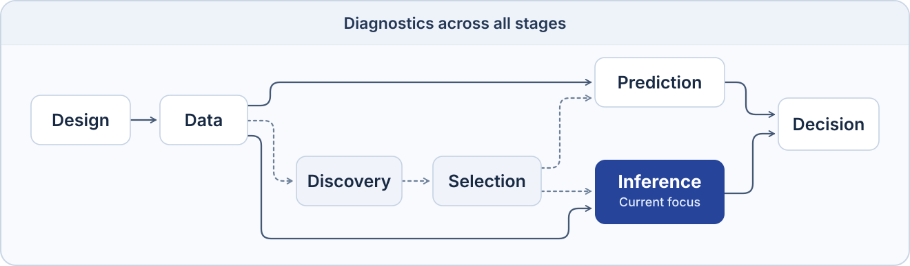
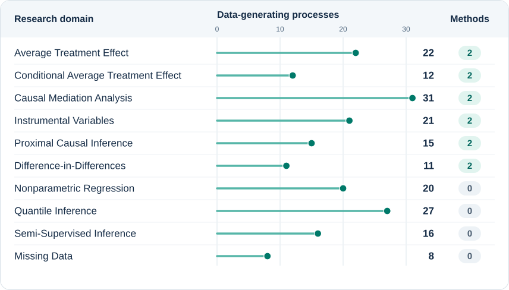

<h1 align="center">
  
  <picture>
    <source media="(prefers-color-scheme: dark)" srcset="docs/assets/statarena-wordmark-dark.svg" />
    
  </picture>
</h1>

<p align="center">
  <strong>The Statistical Intelligence Arena</strong>
</p>

<p align="center">
  <a href="https://statsinference.github.io/" title="Open the StatArena leaderboard website">
    
  </a>
  <a href="method-submissions/README.md" title="Contribute a method">
    
  </a>
  <a href="CONTRIBUTING.md#contribute-data" title="Contribute a DGP or data">
    
  </a>
</p>

## Overview

**StatArena** is an open platform for benchmarking and research across the full statistical research workflow. Study design determines how data are collected. Researchers can use data directly for prediction or inference, or first explore patterns and select variables or models. Prediction and inference both inform decisions, and diagnostics are used throughout the workflow. StatArena compares methods under the same conditions by standardizing tasks, data-generating mechanisms, and evaluation criteria such as accuracy, bias, variance, interval length, coverage, statistical power, uncertainty calibration, and computational efficiency. *Building the Foundation for Statistical Intelligence.*



**StatArena Inference** is our current focus. It covers parameter estimation, confidence intervals, and causal inference. For a policy intervention, these methods help answer the question “How large was the policy's effect, and how reliable is that estimate?” StatArena will gradually expand its benchmarks to other stages of the research workflow, including hypothesis testing, policy learning, experimental design, multi-armed bandits, and sequential decision-making. **StatArena Decision** will evaluate how models choose actions under uncertainty and adapt their decisions as new evidence arrives.

## Run an IV example with StatArena Lite

This quickstart runs the built-in instrumental variables (IV) baseline on **16 simulated studies in the public development split**. The target is the local average treatment effect (LATE). For each study, the method returns a point estimate and a nominal 95% confidence interval. For the official leaderboard, see the [submission workflow](method-submissions/README.md).

### 1. Run the built-in baseline

Use Python 3.10 or later. On the first run, Lite downloads and verifies the pinned IV starter from Hugging Face.

```bash
git clone https://github.com/Statsinference/Statistical-Intelligence-Arena.git
cd Statistical-Intelligence-Arena
python -m pip install -e ./lite
statarena-lite run --domain iv --split dev --method baseline
```

Lite saves one prediction per study to `lite-results/iv-dev-baseline.csv`, scores the predictions against the starter's reference values and prints the metrics as JSON. For this example, expect an RMSE of about **1.144** and coverage of **68.75%** (reported as `0.6875` in the JSON).

### 2. Try a bundled Python method

The runnable example implements an unadjusted IV Wald estimator. Pass the file directly to `--method`, or copy it and edit `estimate(study)` to try your own estimator.

```bash
statarena-lite run --domain iv --split dev --method ./lite/examples/my_method.py
```

This run writes `lite-results/iv-dev-my_method.csv` and scores it automatically. If you already have predictions from another pipeline, use `statarena-lite score` with the matching domain and split.

Run `statarena-lite list` to see all supported domains. Use `dev` to develop a method and `test` to evaluate a fixed method on the 32-study public reference split. See the [Lite guide](lite/README.md) for input schemas, CSV format and scoring commands.

## Domain Coverage

**183 DGPs** across **10 research domains**. **6 domains** list methods.

<picture>
  <source media="(prefers-color-scheme: dark)" srcset="docs/assets/domain-coverage-dark.svg" />
  
</picture>

<details>
<summary>View the data table</summary>

| Research domain | DGPs | Methods |
| :--- | ---: | ---: |
| Average Treatment Effect | 22 | 5 |
| Conditional Average Treatment Effect | 12 | 5 |
| Causal Mediation Analysis | 31 | 5 |
| Instrumental Variables | 21 | 5 |
| Proximal Causal Inference | 15 | 5 |
| Difference-in-Differences | 11 | 5 |
| Nonparametric Regression | 20 | 0 |
| Quantile Inference | 27 | 0 |
| Semi-Supervised Inference | 16 | 0 |
| Missing Data | 8 | 0 |

</details>

## Contributors

<table>
  <thead>
    <tr><th colspan="4" align="left">Project Leadership (Alphabetical Order)</th></tr>
  </thead>
  <tbody>
    <tr>
      <td width="25%"><a href="mailto:shibo@bu.edu">Shi Bo</a><br><small><sub>Boston University</sub></small></td>
      <td width="25%"><a href="https://www.linkedin.com/in/jiaming-h-24400a1b8/">Jiaming Hu</a><br><small><sub>Boston University</sub></small></td>
      <td width="25%"><a href="https://zhzhang01.github.io/">Zhiheng Zhang</a><br><small><sub>Shanghai University of Finance and Economics</sub></small></td>
      <td width="25%"></td>
    </tr>
    <tr><th colspan="4" align="left">Method Contributors (Alphabetical Order)</th></tr>
    <tr>
      <td>Yao Fu<br><small><sub>Southern University of Science and Technology</sub></small></td>
      <td>Suo Li<br><small><sub>Shanghai University of Finance and Economics</sub></small></td>
      <td>Kongchang Zhou<br><small><sub>Southern University of Science and Technology</sub></small></td>
      <td></td>
    </tr>
    <tr><th colspan="4" align="left">Data Contributors (Alphabetical Order)</th></tr>
    <tr>
      <td>Ruihan Huang<br><small><sub>Shanghai University of Finance and Economics</sub></small></td>
      <td>Ziyang Huang<br><small><sub>Shanghai University of Finance and Economics</sub></small></td>
      <td>Xuyuxin Ma<br><small><sub>Shanghai University of Finance and Economics</sub></small></td>
      <td>Mingyuan Ma<br><small><sub>Beijing Jiaotong University</sub></small></td>
    </tr>
    <tr>
      <td>Jianying Su<br><small><sub>Shanghai University of Finance and Economics</sub></small></td>
      <td>Cong Wang<br><small><sub>Shanghai University of Finance and Economics</sub></small></td>
      <td>Hangfei Wu<br><small><sub>Shanghai University of Finance and Economics</sub></small></td>
      <td>Qimiao Xu<br><small><sub>Shanghai University of Finance and Economics</sub></small></td>
    </tr>
    <tr>
      <td>Yidan Xu<br><small><sub>Shanghai University of Finance and Economics</sub></small></td>
      <td>Zhuoxin Yan<br><small><sub>Shanghai University of Finance and Economics</sub></small></td>
      <td>Jiayi Zhang<br><small><sub>Shanghai University of Finance and Economics</sub></small></td>
      <td>Weibo Zhang<br><small><sub>Shanghai University of Finance and Economics</sub></small></td>
    </tr>
    <tr>
      <td>Junhong Zheng<br><small><sub>Shanghai University of Finance and Economics</sub></small></td>
      <td>Yuan Zhong<br><small><sub>Shanghai University of Finance and Economics</sub></small></td>
      <td></td>
      <td></td>
    </tr>
    <tr><th colspan="4" align="left">Advisors (Alphabetical Order)</th></tr>
    <tr>
      <td><a href="https://ssds.sufe.edu.cn/ssds_en/03/30/c20066a262960/page.htm">Xingdong Feng</a><br><small><sub>Shanghai University of Finance and Economics</sub></small></td>
      <td><a href="https://www.gbu.edu.cn/sz_details_g7yU_92/791.html">Yiyan Huang</a><br><small><sub>Great Bay University</sub></small></td>
      <td><a href="https://sustech.edu.cn/en/faculties/fangkong.html">Fang Kong</a><br><small><sub>Southern University of Science and Technology</sub></small></td>
      <td><a href="https://ssds.sufe.edu.cn/ssds_en/03/1b/c20064a262939/page.htm">Ting Li</a><br><small><sub>Shanghai University of Finance and Economics</sub></small></td>
    </tr>
    <tr>
      <td><a href="https://www.lse.ac.uk/people/chengchun-shi">Chengchun Shi</a><br><small><sub>The London School of Economics and Political Science</sub></small></td>
      <td><a href="https://ssds.sufe.edu.cn/ssds_en/03/3e/c20066a262974/page.htm">Fan Zhou</a><br><small><sub>Shanghai University of Finance and Economics</sub></small></td>
      <td></td>
      <td></td>
    </tr>
  </tbody>
</table>


## Citation

If you use StatArena in your research, please cite the documentation below. GitHub's **Cite this repository** button uses the same reference from [CITATION.cff](CITATION.cff). The DOI below identifies [this version on Zenodo](https://doi.org/10.5281/zenodo.24443872). Use the [concept DOI](https://doi.org/10.5281/zenodo.24443871) to cite the documentation across versions.

```bibtex
@misc{StatArena_2026,
  author = {{The Statistical Intelligence Arena Team}},
  doi = {10.5281/zenodo.24443872},
  month = {11},
  publisher = {Zenodo},
  title = {{The Statistical Intelligence Arena: Building the Foundation for Statistical Intelligence}},
  url = {https://doi.org/10.5281/zenodo.24443872},
  year = {2026}
}
```


## Contact

For questions and feedback, please contact the project leads: [Shi Bo](mailto:shibo@bu.edu) · [Jiaming Hu](https://www.linkedin.com/in/jiaming-h-24400a1b8/) · [Zhiheng Zhang](https://zhzhang01.github.io/)

## License

The repository includes the [Apache License 2.0](LICENSE). Please see [NOTICE.md](NOTICE.md) for the current release status and rights information concerning other project materials.

## Acknowledgements

**StatArena is an open academic benchmark developed by researchers and students affiliated with several institutions, including Shanghai University of Finance and Economics and Boston University.**
