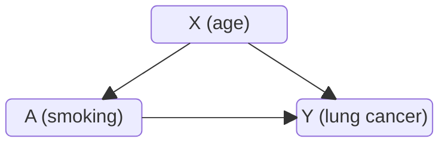

# Real-data problem

Propose one statistically answerable question about an existing dataset. A reviewer should be able to identify the outcome and its timing, understand what the design supports, and run the same comparison on the same analysis sample.

[Copy the Markdown template](#3-copy-the-markdown-template) · [Submission steps](#4-check-and-open-the-pull-request) · [Worked example](#worked-public-example)

## 1. Check that the problem fits

- Start with a real decision or scientific question. Name the target population, analysis unit, intervention or contrast, outcome, and follow-up period. Identify which StatArena domain the question fits and state what claim the study design supports.
- Explain what the design can support. State how treatment, exposure or group membership arose, what was measured before and after it, and which assumptions matter. For a causal claim, explain identification using a DAG or a written account of the relevant pathways.
- Give competing methods the same eligible units and information. Propose an appropriate conventional baseline and at least one quantity a reviewer can compare, such as point estimates, interval widths, runtime or sensitivity to a documented design choice.

## 2. Prepare the evidence

| Required section | What a reviewer should be able to verify |
| --- | --- |
| Research question | Why the question matters, who it concerns, and what result is expected from a method. |
| Study design and data source | The study citation and dataset version, sampling or assignment, measurement dates, observation unit, and variable roles. Specify inclusion and exclusion rules, missing-data handling, transformations, and the final sample size or a way to obtain it. |
| DAG and identification | Whether the proposed contrast follows from the design and assumptions. Map nodes to columns, specify relevant unmeasured variables, and describe a credible limitation or check. A DAG is helpful when the relationships can be shown. |
| Target estimand and reference estimate | The estimand, contrast direction, target population and units. A reference needs a reproducible calculation or citation and a description of its design and uncertainty. |
| Benchmark comparison | What each method receives and returns, which estimator serves as the baseline, and how sampling, preprocessing, and metrics are shared. State whether the evaluation uses a single study or repeated datasets. |
| Materials and access | A durable study and data link, a codebook, a script or exact instructions to reproduce the sample, and the conditions for access and reuse. For restricted data, give the official access procedure and arrange the review with a maintainer. |

### Label variables in a causal diagram

Use `A` for the treatment, exposure or assignment, `Y` for the outcome, and `X` for baseline covariates, including measured confounders. For multiple baseline covariates, use indexed IDs such as `X_1` and `X_2`, or named IDs such as `X_age` and `X_earnings`. Give unobserved confounders distinct IDs and short labels such as `X_latent (unobserved confounder)`. If a design has a mediator, use a separate ID such as `M` and explain when it is measured. In the case file, map each observed variable to its actual column or columns and describe its timing.

For an illustrative smoking study, short labels describe the roles directly. The arrows below represent an assumed causal structure.



The three-column grid keeps the baseline covariate above treatment and outcome. Draw `X --> A` only when the study's causal assumptions include that relationship. Keep the diagram focused on substantive variables. Larger designs can use `flowchart LR`.

You can include a diagram in the PR description. A written account of the pathways and identification assumptions in the case file is also sufficient. [Mermaid block diagrams](https://mermaid.js.org/syntax/block.html)

### Choose an evaluation that matches the reference

- **A comparable reference estimate exists.** Say how it was obtained and whether it matches the proposed target, population, timing and units. For example, a randomized contrast can anchor a comparison on the corresponding experimental sample. Report its standard error or interval when available.
- **A comparable reference estimate is unavailable.** Say so in the estimand section. Propose a comparison with a documented baseline, uncertainty reporting, and a concrete stability or sensitivity check. A single observed study can show estimator agreement or disagreement and interval length. Absolute bias and repeated-sampling coverage require a design that supports those quantities.

## 3. Copy the Markdown template

Copy only the contents of the block into `website/data-submissions/real-data/submissions/<slug>.md`. Use a lowercase, hyphenated slug and keep the six section headings in order. Replace every placeholder with your own proposal. The same text is available as [TEMPLATE.md](TEMPLATE.md).

```markdown
# [TODO: Case title]

## Research question

- **Question and population.** [TODO: Define the units and target population, intervention or exposure, comparison, outcome and time horizon.]
- **Intended use.** [TODO: Explain the applied question and what comparing methods on this case would establish.]

## Study design and data source

- **Source and version.** [TODO: Cite the study, data release and codebook or official access instructions.]
- **Design and timing.** [TODO: Describe sampling or assignment and when covariates, treatment and outcomes are measured.]
- **Analysis table.** [TODO: State row grain, column roles, inclusion criteria, preprocessing, missingness and clustering where relevant.]

## DAG and identification

- **Causal structure.** [TODO: Describe the relevant pathways in a DAG or in prose. Use `A` for treatment or exposure, `Y` for the outcome and `X` or named `X` variants for baseline covariates. Label substantive variables with their meanings and map them to dataset columns. Describe plausible unmeasured causes or selection separately from random disturbances.]
- **Assumptions and checks.** [TODO: State the assumptions the design requires, how you would check what is observable, and what remains uncertain.]

## Target estimand and reference estimate

- **Estimand.** [TODO: Define the contrast, population, scale and units.]
- **Reference or alternative evaluation.** [TODO: Give a matching reference estimate, its uncertainty and a reproducible source when available. If unavailable, say so and describe what evidence reviewers can use instead.]

## Benchmark comparison

- **Inputs, outputs and baseline.** [TODO: Specify the shared analysis sample, method inputs, expected output and baseline.]
- **Comparisons and limits.** [TODO: State the metrics or sensitivity checks, how exclusions and failures are handled, and what the results can support.]

## Materials and access

- **Permissions.** [TODO: Link the public source or authorized access process and state any restrictions.]
- **Reproducibility.** [TODO: Link a shareable preparation and analysis recipe with relevant versions or commands. Arrange a private review route for restricted files.]
```

## 4. Check and open the pull request

1. Create a branch from `main` in your fork of the [StatArena repository](https://github.com/Statsinference/Statistical-Intelligence-Arena). If you have write access, you can create the branch in StatArena directly. Add the single Markdown proposal.
2. Check the section headings and follow the preparation steps from the cited data source. Verify sample counts and the reference calculation, if supplied. Keep restricted records, credentials, and links that require temporary access out of the PR.
3. Run the format check locally from the repository root. Replace `your-study` with your file slug.

   ```bash
   python website/scripts/check_data_contribution.py --track real-data --local-file website/data-submissions/real-data/submissions/your-study.md
   ```

4. [Open a pull request](https://github.com/Statsinference/Statistical-Intelligence-Arena/compare) to `main` using the [Real-data PR template](../../../.github/PULL_REQUEST_TEMPLATE/real-data.md). If you include the optional DAG preview, use the same variables and pathways as in the case file. Address check failures or reviewer feedback in that PR. The automated check validates structure. A reviewer assesses the design, the proposed comparison and reproducibility. Evaluation inclusion is a separate curator decision.

Copy the PR template into the description, or replace `your-branch` with your branch name in this GitHub comparison URL.

```text
https://github.com/Statsinference/Statistical-Intelligence-Arena/compare/main...your-branch?template=real-data.md
```

## Worked public example

The National Supported Work example uses the experimental RE74 sample to ask how program assignment affected 1978 earnings. The worked submission specifies the eligibility rules and column roles, names the causal assumptions, and provides code to reproduce the randomized reference estimate and interval. [Read the example](EXAMPLE.md)

[All contribution tracks](../README.md) · [Reviewer checklist](../REVIEWING.md)
