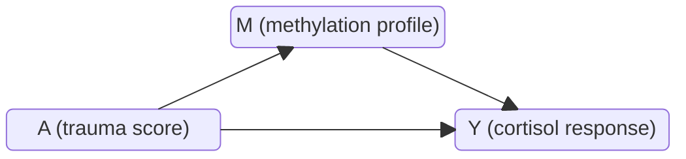

# Childhood trauma, DNA methylation and cortisol reactivity

Public worked example for the [simulated DGP track](README.md).

## Research question

- **Primary domain.** `mediation`
- **Keywords.** Multiple mediators; Correlated mediators

For a one-standard-deviation increase in the childhood trauma score, what is the joint indirect effect through the DNA methylation profile on a continuous cortisol stress-response outcome?

## Study design and data source

Guo, Li, Liu and Zeng use a DNA methylation study to motivate a semi-synthetic experiment. The simulation keeps observed exposure scores and uses fitted exposure-to-probe coefficients and fitted outcome residual variance. The authors retain the signs of the outcome coefficients for 11 selected probes and choose their magnitudes for the simulation. They model residual dependence across the ordered probe columns with an AR(1) structure and correlation parameter 0.5. This example uses the no-confounder setting in Section 4.1. [Original article](https://doi.org/10.1080/01621459.2022.2053136)

## DAG and identification

- **DAG edges.** `A -> M, M -> Y, A -> Y`



The observed exposure is `trauma_z`, the mediator is the vector of methylation probe columns, and the observed outcome is `cortisol_response`. The arrow lists and diagram show the union across scenarios. The zero-effect scenario with $c_1=0$ omits `A -> M`.

## Variables and data-generating process

Each row represents one subject. The standardized exposure $A_i=a_i$ is fixed to one of the 85 observed scores in the pinned snapshot. The continuous mediator vector $M_i$ has $p=1008$ probe values, and $Y_i$ is a continuous outcome. Methods receive only the exposure, probe columns and outcome.

### Structural equations

- **Structural parents.** `A -> M, M -> Y, A -> Y`
- **Symbols.** The index $i$ denotes a subject, and $j,k$ index the $p$ methylation probes. The fixed exposure is $a_i$, the mediator vector is $M_i$, and the outcome is $Y_i$. The parameter $c_1$ scales the exposure-to-mediator coefficient vector $\widehat{\Gamma}_A$. The vector $\alpha_M$ gives the mediator-to-outcome coefficients. The disturbances $\epsilon_{M,i}$ and $\epsilon_{Y,i}$ have covariance $\Sigma$ and variance $\widehat{\sigma}_Y^2$, respectively. The two constants of $0.5$ specify the residual AR(1) correlation and the direct exposure coefficient.

For every row $i$, draw $\epsilon_{M,i}$ and $\epsilon_{Y,i}$ independently of one another and the fixed exposure design. The draws are independent across rows and across replicate tables. The fixed coefficient vector $\widehat{\Gamma}_A$ and outcome residual standard deviation $\widehat{\sigma}_Y$ come from the pinned snapshot. The code below constructs the outcome coefficient vector $\alpha_M$ using the 11 selected probes.

$$
\begin{aligned}
\epsilon_{M,i} &\sim \mathcal N_p(0,\Sigma), & \Sigma_{jk}&=0.5^{|j-k|},\qquad 1\le j,k\le p,\\
\epsilon_{Y,i} &\sim \mathcal N(0,\widehat{\sigma}_Y^2),\\
M_i &= c_1\widehat{\Gamma}_A a_i+\epsilon_{M,i},\\
Y_i &= \alpha_M^{\mathsf T}M_i+0.5a_i+\epsilon_{Y,i} .
\end{aligned}
$$

The scenarios vary $c_1$ while holding the exposure design, outcome coefficients and disturbance distributions fixed.

## Data-generating process and estimand

For a one-unit contrast on the standardized exposure scale, the joint natural indirect effect is

$$
\operatorname{NIE}(a+1,a)
=\mathbb{E}\{Y(a+1,M(a+1))-Y(a+1,M(a))\}
=c_1\alpha_M^{\mathsf T}\widehat{\Gamma}_A .
$$

| Scenario | Exposure-to-mediator scale | Joint NIE on the outcome scale |
| --- | ---: | ---: |
| Zero indirect effect | $c_1=0$ | $0$ |
| Nonzero indirect effect | $c_1=0.5$ | Approximately $-0.7989$ |

## Benchmark comparison

Compare a mediation estimator and a documented baseline on repeated, independently simulated tables. Report each method's point estimate and interval. Compare error and interval coverage at zero and nonzero effects; compute reference values using the stored full-precision coefficients.

## Materials and access

The pinned simulator snapshot in the authors' repository has 85 exposure observations and 1,008 methylation columns. Their screening code keeps 1,000 candidates and appends eight probes from prior studies. Download the snapshot from the source, retain the original column names and run this base R example. Change `c1 <- 0` to reproduce the zero-effect scenario. [Authors' code](https://github.com/zengmudong/High-dimensional-mediation-analysis) · [Pinned simulation snapshot](https://github.com/zengmudong/High-dimensional-mediation-analysis/blob/1ea646ab2c705284a8b393dc06867b5fc9093144/results/simulation_allS.Rdata)

```r
inputs <- new.env()
load("simulation_allS.Rdata", envir = inputs)
a <- inputs$dt$X
gamma <- inputs$coefs$Gamma["trauma", ]
w <- as.numeric(inputs$coefs$alpha0)
w[w != 0] <- c(1, .9, .8, -.9, -.8, -.7, .6, .5, .4, .3, .2)
c1 <- 0.5
n <- nrow(a)
p <- length(gamma)
set.seed(1729)
epsilon_m <- matrix(0, n, p)
epsilon_m[, 1] <- rnorm(n)
for (j in 2:p) {
    epsilon_m[, j] <- 0.5 * epsilon_m[, j - 1L] + sqrt(0.75) * rnorm(n)
}
m <- a %*% (c1 * gamma) + epsilon_m
colnames(m) <- colnames(inputs$dt$M)
epsilon_y <- rnorm(n, sd = inputs$coefs$sigma1)
y <- m %*% w + 0.5 * a + epsilon_y
observed <- data.frame(trauma_z = c(a), m, cortisol_response = c(y),
                       check.names = FALSE)
print(c1 * sum(gamma * w))
```

The public example uses materials linked from the authors' repository. Check their redistribution terms before rehosting the snapshot or other source materials.
