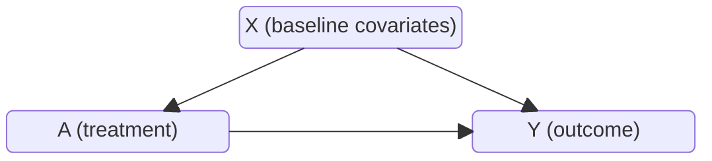

# Fixed-query CATE with hinge heterogeneity under nonlinear confounding

## Research question

- **Question and intended use.** Propose a source-grounded evaluation candidate for one scalar fixed-query CATE and an optional 95% pointwise interval. A continuous hinge has an exact zero region and a derivative kink; unlike the public binary exceptional law, the response is Gaussian with variance 9.
- **Behavior under test.** Preserve the source joint observed law and explicitly define the additive intervention contrast. Family membership is based on structural form; seeds and parameter variants are not additional contributions.

## Study design and data source

- **Motivation and references.** Dukes, O., Stensrud, M. J., Brioschi, R., and Hudson, A. (2026). Nonparametric Tests of Treatment Effect Homogeneity for Policy-Makers. Journal of the American Statistical Association, published online 2 July 2026. DOI: 10.1080/01621459.2026.2670746. [Article](https://doi.org/10.1080/01621459.2026.2670746); [source version](https://arxiv.org/abs/2410.00985v4). Exact location: Setting 2; arXiv:2410.00985v4, 4 April 2026; the journal publication is verified, but final typeset equations were not available for a line-by-line comparison.
- **Population and sampling.** Independent synthetic individuals, with proposed evaluation table size n=1000. The collection interface additionally supports other positive n for checks. One declared scenario, source_fixed_query. Fixed query, exact parameters and seeds are available in the separate private review ZIP. This proposal is not a completed estimator comparison.
- **Adaptations.** Choose a fixed scalar CATE query before data generation; the query and reported scalar reference are defined for this contribution, not a paper-reported estimate. Use an independently authored Python/NumPy PCG64 reconstruction; no claim to identical R or MATLAB random samples. Run n=128 for the interface check, using the seed recorded in the private checks/report.json. The source/evaluation table size is documented separately; no method training or CI comparison is performed.

## DAG and identification

- **Variables and causal structure.** Each row contains X1, X2, X3, A, Y. X denotes the complete observed baseline covariate vector. All outcome disturbances are independent exogenous errors. No latent common cause of treatment and outcome is introduced. Latent pre-clipping draws and auxiliary noises, where used, are not supplied to methods.
- **DAG edges.** `X -> Y, A -> Y, X -> A`
- **Assumptions.** Consistency, well-defined treatment versions and no interference. Independent individuals within the declared sampling design; no latent common cause of treatment and outcome after adjustment. Conditional exchangeability given all observed baseline adjustment variables. Positive treatment probability at supported queries and finite conditional means; continuous conditional response version at continuous queries. The source distribution and mechanism are fixed. Uniform overlap is supported by bounded predictors where used; randomization is exactly one half for the trial designs. Adjustment set: all X columns.



## Variables and data-generating process

- **Variables and observed input.** The schema lists only observed numeric columns. Potential outcomes, nuisance functions and true effects stay internal. All methods receive the same table, role definitions and fixed query, with no oracle features. Treatment is A, the outcome is Y and the baseline columns are X1 through X3.
- **Draw order and scenarios.** Baseline variables first, then treatment conditional on its stated parents, followed by independent outcome noise and observed outcome.  All source coefficients below are fixed across tables.

### Structural equations

- **Structural parents.** `X -> Y, A -> Y, X -> A`

```math
\begin{aligned}
X_{ij}&\overset{iid}{\sim}U[-1,1],\quad j=1,2,3,\\
e(x)&=\mathrm{expit}(x_1/8+\sin(\pi x_2)/4),\quad A_i\mid X_i\sim\mathrm{Bernoulli}(e(X_i)),\\
b(x)&=x_1+\mathrm{expit}((x_2+x_3)/2),\quad h(x)=15\max(x_3-0.5,0),\\
\epsilon_i&\sim N(0,9),\quad \epsilon_i\perp(X_i,A_i),\\
\mu_0(x)&=b(x),\quad \mu_1(x)=b(x)+h(x),\\
Y_i&=b(X_i)+A_i h(X_i)+\epsilon_i.
\end{aligned}
```

| Symbol | Meaning | Definition or setting |
| --- | --- | --- |
| i | Independent individual index | One independently sampled individual per row. |
| X_i,x,j | Three observed baseline coordinates, argument and coordinate index | X1,X2,X3 are independent U[-1,1]; j=1,2,3. |
| e,expit | Propensity and logistic function | expit(t)=1/(1+exp(-t)); coefficients 1/8 and 1/4 are source fixed values. |
| b,h | Prognostic mean and conditional contrast | Explicit functions above; the effect shape is the selected source setting. |
| epsilon_i | Independent outcome disturbance | Normal with mean zero and variance 9; not an observed column. |
| A_i,Y_i | Observed treatment and outcome | Treatment column A in {0,1}; outcome column Y; units and generation law above. |
| mu_a or m_a | Intervention-specific conditional means | Defined explicitly above; internal simulator quantities are not exported. |
| x_star or v_star | Prespecified scalar-target query | Exact coordinates in private config.json; common to all methods and held fixed across tables. |
| tau | Additive conditional average treatment effect | E[Y(1)-Y(0)|conditioning variables at query]; no population averaging over the query. |
| n | Number of observed rows | Selected source-supported evaluation size 1000; interface smoke uses 128; no simulated estimator study is claimed. |

## Data-generating process and estimand

- **Estimand.** tau(x_star)=E[Y(1)-Y(0)|X=x_star], scalar fixed-query difference in outcome units. The query is prespecified and identical across repeated tables. Coverage means P(tau(query) in CI(D_n)) with query held fixed, not a simultaneous band or an ATE.
- **Truth check.** Independence and zero-mean noise give E[Y(a)|X=x]=b(x)+a*h(x), so the intervention mean difference is h(x). Given X3 alone, averaging b over X1,X2 also cancels. This package fixes the full-X query so that the adjustment set is explicit. A separate scalar reconstruction and numerical integration are provided in verify.py; special cases and multiple queries are checked. The scenario-specific numeric reference is reserved for the private ZIP. The two code routes share the source specification and NumPy primitives and are not independent human replication.

## Benchmark comparison

- **Output and comparator.** One scalar estimate and optionally a nominal 95% pointwise interval; baseline: An arm-specific regression T-learner with flexible spline and interaction terms on the same observed inputs. Every comparator uses the same observed table and query. This package implements generation and oracle checks only, not the comparison methods.
- **Scoring and replication.** Proposed, unexecuted plan: 1,000 independent repeated tables at n=1000 with the same scenario, equal weights and paired data across methods. Freeze seeds and queries before evaluation. Report bias, RMSE, success/availability, 95% coverage and mean interval length for valid results, plus all-attempt valid-and-covering frequency. Comparisons of interval length require a prespecified common coverage/availability gate; the gate and estimator tuning are future evaluation work. No length ranking or coverage result is claimed here. Record all failures/timeouts/nonfinite estimates and do not replace failed seeds. A Monte Carlo standard error or binomial interval must accompany coverage; small-sample oracle checks do not establish coverage.

## Materials and access

- **Public materials.** [Journal of the American Statistical Association article](https://doi.org/10.1080/01621459.2026.2670746) and [source version](https://arxiv.org/abs/2410.00985v4). arXiv v4 is CC BY 4.0; attribution retained. No paper PDF or author code is redistributed.
- **Reproduction and protected materials.** The separate cate-dukes-2026-hinge-v1-review2.zip contains the complete eight-file student contribution, actual checks and SHA-256 manifest. Exact query, scenario-specific truths, seeds and generated samples are for private maintainer review through the submitter's agreed channel. Run `python collect.py check path/to/cate-dukes-2026-hinge-v1 --run --n 128 --seed REVIEW_SEED` with the student tool and NumPy. Replace REVIEW_SEED by the run seed in the private checks/report.json. The recorded generation/verification environment is CPython 3.12.14 with NumPy 2.3.5. Published formula coefficients shown above are public source settings; the contribution-specific query, run seeds, generated samples and scalar reference stay in the private ZIP. No official evaluation tables have been created. Formal scientific review, independent human rerun, submission and acceptance remain pending. AI assisted source reconstruction, code and prose; it does not sign off scientific acceptance.
