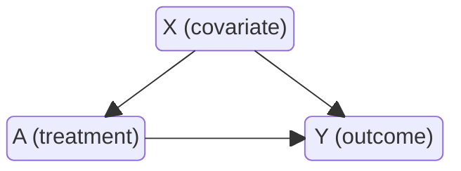

# Fixed-stratum CATE with an effect in one of four covariate levels under covariate-dependent treatment

## Research question

- **Primary domain.** `cate`
- **Keywords.** Confounding; Binary outcome; Discrete covariate; Effect heterogeneity; Zero-effect strata
- **Question and intended use.** Propose a candidate for scalar CATE evaluation on the probability scale at one prespecified covariate value, in an observational design with a single measured confounder.
- **Behavior under test.** The covariate has four equally likely levels. Treatment probability rises with the level (0.5 to 0.8), so the arm comparison is confounded, while the effect is 0.2 at level 0 and exactly zero at levels 1 to 3. This is the source's exceptional law: for three of four strata the treatment has no effect, so the optimal rule is not unique. The design tests covariate adjustment and pointwise inference for a binary outcome when most strata carry no effect.

## Study design and data source

- **Motivation and references.** Luedtke and van der Laan (2016), *Statistical inference for the mean outcome under a possibly non-unique optimal treatment strategy*, The Annals of Statistics 44(2), 713–742, [DOI](https://doi.org/10.1214/15-AOS1384); [arXiv](https://arxiv.org/abs/1603.07573). Section 8, simulation D-E, supplies the covariate law, the covariate-dependent treatment probability and the outcome probabilities below; the source reports the optimal value 0.45. The source infers the optimal value; the fixed-query CATE target, the renaming of $W$ to $X$, the implementation and the comparison are adaptations.
- **Population and sampling.** Independent synthetic individuals. Each table has $n=1000$, one of the source sizes 1000 and 4000. One scenario, `source_fixed_query`, with fixed source values.

## DAG and identification

- **Variables and causal structure.** $X$ is the observed baseline covariate (source $W$), $A$ the binary treatment and $Y$ the binary outcome. $X$ affects both the treatment probability and the outcome probability, so it is a measured confounder; it also modifies the effect. There are no latent variables.
- **DAG edges.** `X -> A, X -> Y, A -> Y`
- **Assumptions.** Independent units, consistency, no interference, no unmeasured confounding given $X$, and positivity ($0.4\le P(A=1\mid X)\le0.8$) identify $\tau(x)=E[Y\mid A=1,X=x]-E[Y\mid A=0,X=x]$. No assumption is deliberately violated.

*X causes A and Y; A causes Y.*



## Variables and data-generating process

- **Variables and observed input.** One row per individual. Every method receives the columns `X,A,Y` and the same query. Outcome probabilities, potential outcomes and reference values are not given to methods.
- **Draw order and scenarios.** Per row: $X$, then $A$ given $X$, then $Y$ given $(A,X)$. Rows and tables are independent; all values are fixed source settings. The query and evaluation seeds stay in private review.

### Structural equations

- **Structural parents.** `X -> A, X -> Y, A -> Y`

```math
\begin{aligned}
X_i &\sim \mathrm{Uniform}\{0,1,2,3\}, && i=1,\ldots,n,\\
A_i\mid X_i &\sim \mathrm{Bernoulli}(0.5+0.1X_i),\\
\bar Q(a,x) &= 0.4+0.2\,\mathbf 1\{a=1,\,x=0\},\\
Y_i\mid A_i,X_i &\sim \mathrm{Bernoulli}\{\bar Q(A_i,X_i)\}.
\end{aligned}
```

| Symbol | Meaning | Definition or setting |
| --- | --- | --- |
| $i,n$ | Row index and table size | $n=1000$, one of the source sizes 1000 and 4000. |
| $X_i$ | Observed discrete covariate | Column `X`; levels 0, 1, 2, 3 with probability 1/4 each (source $W$). |
| $A_i$ | Observed binary treatment | Column `A`; $P(A_i=1\mid X_i)=0.5+0.1X_i\in\{0.5,0.6,0.7,0.8\}$. |
| $\bar Q(a,x)$ | Outcome probability | $0.4+0.2\,\mathbf 1\{a=1,x=0\}$; fixed source values. |
| $Y_i$ | Observed binary outcome | Column `Y`; Bernoulli with probability $\bar Q(A_i,X_i)$ (source writes Binomial for a single binary draw). |
| $\tau(x)$ | CATE function | $\bar Q(1,x)-\bar Q(0,x)=0.2\,\mathbf 1\{x=0\}$. |
| $x_\star$ | Fixed query level | One prespecified level, fixed across tables; given in the private `config.json`. |
| $a,Y_i(a)$ | Intervention level and potential outcome | $a\in\{0,1\}$; set $A_i=a$ in the outcome law. |

## Data-generating process and estimand

- **Estimand.** $\tau(x)=0.2\,\mathbf 1\{x=0\}$ at the fixed query $x_\star$, on the probability scale: $P(Y(1)=1\mid X=x_\star)-P(Y(0)=1\mid X=x_\star)$. Pointwise, not an ATE or the optimal value.
- **Truth check.** `truth.py` evaluates the closed form. `verify.py` reproduces the source's optimal value 0.45 from the generator's outcome probabilities, checks the generator against the closed form, and confirms $\tau=0$ on levels 1, 2 and 3. The reference value stays private.

## Benchmark comparison

- **Output and comparator.** A scalar CATE estimate at the query and optionally a nominal 95% pointwise interval. Baselines: a logistic-regression T-learner with a flexible term in $X$ and an AIPW-based DR-learner with known-form nuisance models fitted on the same table.
- **Scoring and replication.** 1,000 independent tables at $n=1000$, identical across methods, equal weights. Report bias and RMSE with the success rate; coverage and mean length for valid intervals and the all-attempt valid-and-covering rate. Report failures separately; no seed replacement. No completed comparison is claimed.

## Materials and access

- **Public materials.** [DOI](https://doi.org/10.1214/15-AOS1384) and [arXiv](https://arxiv.org/abs/1603.07573); the paper and author code are not redistributed.
- **Reproduction and protected materials.** The standard ZIP `cate-luedtke-vdl-2016-discrete-exceptional-v1.zip` (collection.json, card.md, config.json, schema.csv, generator.py, truth.py, verify.py, requirements.txt, checks, MANIFEST.json) is available for private review. Run the collection check from the student package root:

```bash
python collect.py check path/to/cate-luedtke-vdl-2016-discrete-exceptional-v1 --run --n 128 --seed 1729
```
