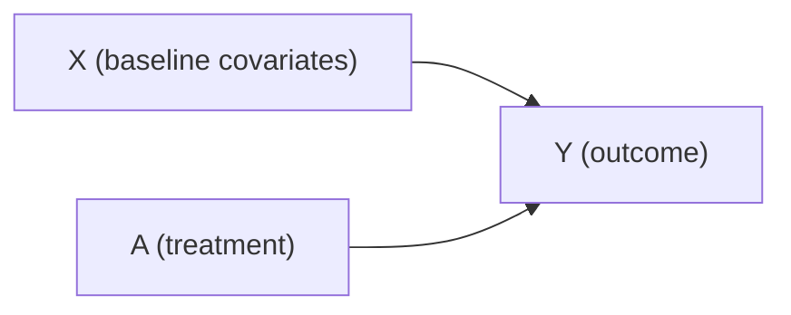

# Fixed-query CATE under a null treatment effect in a randomized five-covariate trial

## Research question

- **Primary domain.** `cate`
- **Keywords.** Randomized treatment; Null treatment effect; Linear prognostic function; Irrelevant covariates
- **Question and intended use.** Propose a candidate for scalar CATE evaluation at one prespecified interior covariate query: the conditional mean response under treatment minus that under control.
- **Behavior under test.** The treatment has no effect while the outcome has a strong linear prognostic signal in $X_1$, $X_2$ and $X_3$. This tests whether a method returns an estimate near zero at the query instead of leaking prognostic variation into the contrast, and whether its intervals keep nominal coverage under the null. A single fixed query assesses local accuracy, not recovery of the whole effect surface.

## Study design and data source

- **Motivation and references.** Qian and Murphy (2011), *Performance guarantees for individualized treatment rules*, The Annals of Statistics 39(2), 1180–1210; [DOI](https://doi.org/10.1214/10-AOS864), [arXiv](https://arxiv.org/abs/1105.3369), [PMC](https://pmc.ncbi.nlm.nih.gov/articles/PMC3110016/). The source's example (1) supplies the covariate law, randomization, Gaussian response (variance 1), $\mu_0$, $g$ and $c$ below. The source evaluates treatment rules; the 0/1 recoding, the fixed-query CATE target, the implementation and the proposed comparison are adaptations.
- **Population and sampling.** Independent synthetic individuals, no clusters. Each table has $n=256$, one of the source sizes $n=2^k$, $k=5,\ldots,10$, with 5 independent uniform covariates and per-individual randomization. One scenario, `source_fixed_query`, with fixed source coefficients.

## DAG and identification

- **Variables and causal structure.** $X=(X_1,\ldots,X_{5})$ is the observed covariate vector; covariates outside $\mu_0$ and $g$ are inert. No covariate modifies the effect. $A$ is the randomized treatment and $Y$ the continuous outcome. No latent common causes; the outcome noise appears only in the equations.
- **DAG edges.** `X -> Y, A -> Y`
- **Assumptions.** Independent units, consistency, no interference, randomization independent of covariates and potential outcomes, and constant propensity $1/2$ identify the contrast. No assumption is deliberately violated.

*X and the randomized treatment A cause Y; there is no X-to-A arrow.*



## Variables and data-generating process

- **Variables and observed input.** One row per individual. Every method receives the columns `X1,...,X5,A,Y` and the same query. Noise, arm means and reference values are not given to methods.
- **Draw order and scenarios.** Per row: covariates, then treatment, then noise. Rows and tables are independent. All coefficients are fixed source values; the query and evaluation seeds stay in private review.

### Structural equations

- **Structural parents.** `X -> Y, A -> Y`

```math
\begin{aligned}
X_{ij} &\overset{\mathrm{iid}}{\sim} \mathrm{Uniform}(-1,1), && i=1,\ldots,n,\quad j=1,\ldots,5,\\
A_i &\sim \mathrm{Bernoulli}(1/2), && A_i\perp X_i,\\
\epsilon_{Y,i} &\sim \mathcal N(0,1), && \epsilon_{Y,i}\perp (X_i,A_i),\\
\mu_0(x) &= 1+2x_1+x_2+0.5x_3,\\
g(x) &= 0,\\
Q_0(x,a) &= \mu_0(x)+c\,g(x)\,a, && a\in\{-1,+1\},\\
Y_i &= Q_0(X_i,\,2A_i-1)+\epsilon_{Y,i}.
\end{aligned}
```

| Symbol | Meaning | Definition or setting |
| --- | --- | --- |
| $i,n$ | Row index and table size | $i=1,\ldots,n$; proposed $n=256$, one of the source sizes $n=2^k$, $k=5,\ldots,10$. |
| $j$ | Covariate index | $j=1,\ldots,5$, fixed by the source. |
| $X_{ij},X_i$ | Observed covariates | Columns `X1`–`X5`; iid $\mathrm{Uniform}(-1,1)$; $X_i=(X_{i1},\ldots,X_{i5})$. |
| $x,x_j$ | Covariate argument | A point of the support and its $j$th coordinate. |
| $A_i$ | Observed treatment | Column `A`; $\mathrm{Bernoulli}(1/2)$, constant propensity $1/2$. |
| $2A_i-1$ | Source coding | Maps 0/1 to the source's $-1/+1$; deterministic. |
| $\epsilon_{Y,i}$ | Outcome noise | $\mathcal N(0,1)$ (source: variance 1); not given to methods. |
| $\mu_0(x)$ | Prognostic term | $\mu_0(x) = 1+2x_1+x_2+0.5x_3$; fixed source coefficients. |
| $g(x)$ | Effect shape | $g(x) = 0$; fixed source form. |
| $c$ | Effect scale | $c=0$, fixed source value. |
| $a$ | Source treatment level | $a=+1$ treatment, $a=-1$ control. |
| $Q_0(x,a)$ | Arm mean | $\mu_0(x)+c\,g(x)\,a$. |
| $Y_i$ | Observed outcome | Column `Y`; arm mean plus noise. |
| $\tau(x)$ | CATE function | $\tau(x)=Q_0(x,+1)-Q_0(x,-1)=2c\,g(x)$. |
| $x_\star$ | Fixed query | One interior point of the support, fixed across tables; coordinates in the private `config.json`, given equally to all methods. |

## Data-generating process and estimand

- **Estimand.** $\tau(x_\star)=\mathbb E[Y(1)-Y(0)\mid X=x_\star]=2c\,g(x_\star)$, treatment $A=1$ versus control $A=0$. $\mu_0$ cancels; the factor 2 comes from the source's $\pm1$ coding. Pointwise, not an ATE or policy value.
- **Truth check.** `truth.py` evaluates the closed form. `verify.py` integrates the generator's arm means against the noise by Gauss–Hermite quadrature and matches the closed form, reproduces the source's no effect, d = 0 by Monte Carlo over $X$ (tolerance 0.03), and confirms $\tau=0$ on everywhere (null effect). The reference value stays private.

## Benchmark comparison

- **Output and comparator.** A scalar CATE estimate at the query and optionally a nominal 95% pointwise interval. Baselines: an OLS T-learner with main effects and a random-forest T-learner, differencing arm-mean estimates at the query, tuned on development seeds only.
- **Scoring and replication.** 1,000 independent tables at $n=256$, identical across methods, equal weights. Report bias and RMSE with the success rate; coverage and mean length for valid intervals and the all-attempt valid-and-covering rate. Report failures separately; no seed replacement. No completed comparison is claimed.

## Materials and access

- **Public materials.** [DOI](https://doi.org/10.1214/10-AOS864), [arXiv](https://arxiv.org/abs/1105.3369), [PMC](https://pmc.ncbi.nlm.nih.gov/articles/PMC3110016/) identify the source; the paper and author code are not redistributed.
- **Reproduction and protected materials.** The standard ZIP `cate-qian-murphy-2011-null-effect-v1.zip` (collection.json, card.md, config.json, schema.csv, generator.py, truth.py, verify.py, requirements.txt, checks, MANIFEST.json) is available for private review. Run the collection check from the student package root:

```bash
python collect.py check path/to/cate-qian-murphy-2011-null-effect-v1 --run --n 128 --seed 1729
```
