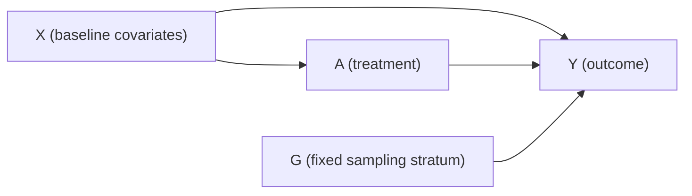

# Fixed-stratum CATE with group-specific effect directions and probit confounding

## Research question

- **Question and intended use.** Propose a source-grounded evaluation candidate for one scalar fixed-query CATE and an optional 95% pointwise interval. Four fixed sampling strata retain distinct effect directions. Group is observed; source 200-per-group sampling is retained. Groups and parameter scenarios count as one family.
- **Behavior under test.** Preserve the source joint observed law and explicitly define the additive intervention contrast. Family membership is based on structural form; seeds and parameter variants are not additional contributions.

## Study design and data source

- **Motivation and references.** Shi, C., Song, R., Lu, W., and Fu, B. (2018). Maximin Projection Learning for Optimal Treatment Decision with Heterogeneous Individualized Treatment Effects. Journal of the Royal Statistical Society: Series B 80(4), 681-702. DOI: 10.1111/rssb.12273. [Article](https://doi.org/10.1111/rssb.12273); [source version](https://academic.oup.com/jrsssb/article/80/4/681/7048347). Exact location: Section 5, nonlinear baseline + probit assignment, first beta-vector scenario; Journal HTML Section 5, corroborated with LSE author manuscript maximinfinal.pdf Section 5, PDF p.16.
- **Population and sampling.** Four fixed strata, equal counts and independent units. Source n=800 has 200 per stratum; the n=128 check has 32 per stratum. One declared scenario, source_fixed_query. Fixed query, exact parameters and seeds are available in the separate private review ZIP. This proposal is not a completed estimator comparison.
- **Adaptations.** Choose a fixed scalar CATE query before data generation; the query and reported scalar reference are defined for this contribution, not a paper-reported estimate. Use an independently authored Python/NumPy PCG64 reconstruction; no claim to identical R or MATLAB random samples. Run n=128 for the interface check, using the seed recorded in the private checks/report.json. The source/evaluation table size is documented separately; no method training or CI comparison is performed. Target fixed-stratum CATE instead of maximin projection parameters; preserve four strata and equal fixed counts, with n required to be divisible by four.

## DAG and identification

- **Variables and causal structure.** Each row contains G, X1, X2, A, Y. X denotes the two Gaussian baseline covariates and G is the observed fixed sampling stratum. All outcome disturbances are independent exogenous errors. No latent common cause of treatment and outcome is introduced. Latent pre-clipping draws and auxiliary noises, where used, are not supplied to methods.
- **DAG edges.** `X -> Y, A -> Y, X -> A, G -> Y`
- **Assumptions.** Consistency, well-defined treatment versions and no interference. Independent individuals within the declared sampling design; no latent common cause of treatment and outcome after adjustment. Conditional exchangeability given all observed baseline adjustment variables. Positive treatment probability at supported queries and finite conditional means; continuous conditional response version at continuous queries. Sampling is stratified with fixed equal stratum counts; it is not globally iid. Probit propensity has pointwise positivity but no uniform global positivity bound. Pointwise positivity only; no uniform lower propensity bound on Gaussian support. Adjustment set: G,X1,X2.



## Variables and data-generating process

- **Variables and observed input.** The schema lists only observed numeric columns. Potential outcomes, nuisance functions and true effects stay internal. All methods receive the same table, role definitions and fixed query, with no oracle features. G records fixed stratum membership and is retained in the target and observed table.
- **Draw order and scenarios.** Baseline variables first, then treatment conditional on its stated parents, followed by independent outcome noise and observed outcome. Fixed group allocation precedes all row-level draws. All source coefficients below are fixed across tables.

### Structural equations

- **Structural parents.** `X -> Y, A -> Y, X -> A, G -> Y`

```math
\begin{aligned}
G_{gj}&=g,\quad g=1,2,3,4,\quad j=1,\ldots,m,\quad n=4m,\\
X_{gj}&\overset{iid}{\sim}N_2(0,I_2),\quad e(x)=\Phi(x_1-x_2),\quad A_{gj}\mid X_{gj}\sim\mathrm{Bernoulli}(e(X_{gj})),\\
b(x)&=1+\sin\{\pi(x_1+x_2)/2\},\\
\beta_1&=(2,0)^T,\quad\beta_2=(2\cos15^\circ,2\sin15^\circ)^T,\\
\beta_3&=(2\cos70^\circ,2\sin70^\circ)^T,\quad\beta_4=(0,2)^T,\\
\epsilon_{gj}&\overset{iid}{\sim}N(0,0.25),\quad\epsilon_{gj}\perp(X_{gj},A_{gj}),\\
\mu_a(g,x)&=b(x)+a x^T\beta_g,\quad Y_{gj}=b(X_{gj})+A_{gj}X_{gj}^T\beta_g+\epsilon_{gj}.
\end{aligned}
```

| Symbol | Meaning | Definition or setting |
| --- | --- | --- |
| (g,j) | Independent individual within a fixed stratum | g indexes the fixed stratum and j the individual within it. |
| g,G_gj | Fixed sampling stratum and observed stratum column | g=1,2,3,4. Column G has m rows per group; it is not an iid random group draw. |
| j,m,n | Within-stratum index, group size and total | Source m=200, n=800. Interface smoke n=128 means m=32; n must be divisible by four. |
| X_gj,x,I_2 | Two observed covariates, argument and identity matrix | Columns X1,X2; independent standard normals within and across strata. |
| e,Phi | Probit treatment propensity and standard normal CDF | Phi(x1-x2); no clipping is introduced. |
| b,beta_g | Prognostic function and stratum-specific effect vector | Exact nonlinear-baseline, first-direction-scenario source parameters above. |
| epsilon_gj | Unobserved independent Gaussian noise | Mean zero, variance .25, SD .5. |
| mu_a,a | Conditional intervention mean and arm | a=0 or1; target includes the stratum g. |
| A_gj,Y_gj | Observed treatment and outcome | Treatment column A in {0,1}; outcome column Y; units and generation law above. |
| mu_a or m_a | Intervention-specific conditional means | Defined explicitly above; internal simulator quantities are not exported. |
| x_star or v_star | Prespecified scalar-target query | Exact coordinates in private config.json; common to all methods and held fixed across tables. |
| tau | Additive conditional average treatment effect | E[Y(1)-Y(0)|conditioning variables at query]; no population averaging over the query. |
| n | Number of observed rows | Selected source-supported evaluation size 800; interface smoke uses 128; no simulated estimator study is claimed. |

## Data-generating process and estimand

- **Estimand.** tau(g_star,x_star)=E[Y(1)-Y(0)|G=g_star,X=x_star], with fixed sampling strata and group-specific coefficients. The query is prespecified and identical across repeated tables. Coverage means P(tau(query) in CI(D_n)) with query held fixed, not a simultaneous band or an ATE.
- **Truth check.** The stratum-specific conditional arm means differ by x^T beta_g. This is the CATE given G=g and X=x; it is not the maximin projection vector or the value of a treatment policy. Each fixed stratum contributes independent individuals, with source-balanced sample sizes retained. A pooled iid mixture would be an additional adaptation and is not used. A separate scalar reconstruction and numerical integration are provided in verify.py; special cases and multiple queries are checked. The scenario-specific numeric reference is reserved for the private ZIP. The two code routes share the source specification and NumPy primitives and are not independent human replication.

## Benchmark comparison

- **Output and comparator.** One scalar estimate and optionally a nominal 95% pointwise interval; baseline: Stratum-specific arm regression with flexible prognostic terms, estimating the mean contrast within the fixed query stratum. Every comparator uses the same observed table and query. This package implements generation and oracle checks only, not the comparison methods.
- **Scoring and replication.** Proposed, unexecuted plan: 1,000 independent repeated tables at n=800 with the same scenario, equal weights and paired data across methods. Freeze seeds and queries before evaluation. Report bias, RMSE, success/availability, 95% coverage and mean interval length for valid results, plus all-attempt valid-and-covering frequency. Comparisons of interval length require a prespecified common coverage/availability gate; the gate and estimator tuning are future evaluation work. No length ranking or coverage result is claimed here. Record all failures/timeouts/nonfinite estimates and do not replace failed seeds. Intervals and resampling must respect the fixed strata. A Monte Carlo standard error or binomial interval must accompany coverage; small-sample oracle checks do not establish coverage.

## Materials and access

- **Public materials.** [Journal of the Royal Statistical Society: Series B article](https://doi.org/10.1111/rssb.12273) and [source version](https://academic.oup.com/jrsssb/article/80/4/681/7048347). No original PDF, study data or author code is redistributed. Independently authored mathematical reconstruction.
- **Reproduction and protected materials.** The separate cate-shi-2018-stratified-probit-v1-review2.zip contains the complete eight-file student contribution, actual checks and SHA-256 manifest. Exact query, scenario-specific truths, seeds and generated samples are for private maintainer review through the submitter's agreed channel. Run `python collect.py check path/to/cate-shi-2018-stratified-probit-v1 --run --n 128 --seed REVIEW_SEED` with the student tool and NumPy. Replace REVIEW_SEED by the run seed in the private checks/report.json. The recorded generation/verification environment is CPython 3.12.14 with NumPy 2.3.5. Published formula coefficients shown above are public source settings; the contribution-specific query, run seeds, generated samples and scalar reference stay in the private ZIP. No official evaluation tables have been created. Formal scientific review, independent human rerun, submission and acceptance remain pending. AI assisted source reconstruction, code and prose; it does not sign off scientific acceptance.
