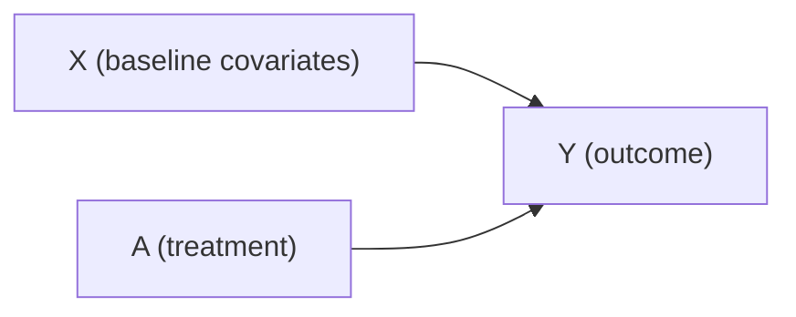

# Fixed-query CATE with a cosine projection and an independent squared amplitude

## Research question

- **Question and intended use.** Propose a source-grounded evaluation candidate for one scalar fixed-query CATE and an optional 95% pointwise interval. A cosine of a two-coordinate projection is multiplied by the square of a disjoint five-coordinate projection. Unlike a fixed-amplitude univariate cosine, its amplitude varies with a disjoint covariate block and is unbounded; unlike a quartic projection product, its surface is non-polynomial. It is not a scalar amplitude or dimension variant of either mechanism.
- **Behavior under test.** Preserve the source joint observed law and explicitly define the additive intervention contrast. Family membership is based on structural form; seeds and parameter variants are not additional contributions.

## Study design and data source

- **Motivation and references.** Shi, C., Lu, W., and Song, R. (2020 issue; 2019 online). A Sparse Random Projection-based Test for Overall Qualitative Treatment Effects. Journal of the American Statistical Association 115(531), 1201-1213. DOI: 10.1080/01621459.2019.1604368. [Article](https://doi.org/10.1080/01621459.2019.1604368); [source version](https://pmc.ncbi.nlm.nih.gov/articles/PMC7730172/). Exact location: Section 4.1 Scenario 2, p=50, N=500; source VD=.2 determines delta by the normal cosine integral; PMC author manuscript and author-hosted June 2019 OQTE.pdf, Section 4.1, PDF pp.20-21. Journal metadata verified on the PMC manuscript page.
- **Population and sampling.** Independent synthetic individuals, with proposed evaluation table size n=500. The collection interface additionally supports other positive n for checks. One declared scenario, source_fixed_query. Fixed query, exact parameters and seeds are available in the separate private review ZIP. This proposal is not a completed estimator comparison.
- **Adaptations.** Choose a fixed scalar CATE query before data generation; the query and reported scalar reference are defined for this contribution, not a paper-reported estimate. Use an independently authored Python/NumPy PCG64 reconstruction; no claim to identical R or MATLAB random samples. Run n=128 for the interface check, using the seed recorded in the private checks/report.json. The source/evaluation table size is documented separately; no method training or CI comparison is performed.

## DAG and identification

- **Variables and causal structure.** Each row contains X1, X2, X3, X4, X5, X6, X7, X8, X9, X10, X11, X12, X13, X14, X15, X16, X17, X18, X19, X20, X21, X22, X23, X24, X25, X26, X27, X28, X29, X30, X31, X32, X33, X34, X35, X36, X37, X38, X39, X40, X41, X42, X43, X44, X45, X46, X47, X48, X49, X50, A, Y. X denotes the complete observed baseline covariate vector. All outcome disturbances are independent exogenous errors. No latent common cause of treatment and outcome is introduced. Latent pre-clipping draws and auxiliary noises, where used, are not supplied to methods.
- **DAG edges.** `X -> Y, A -> Y`
- **Assumptions.** Consistency, well-defined treatment versions and no interference. Independent individuals within the declared sampling design; no latent common cause of treatment and outcome after adjustment. Conditional exchangeability given all observed baseline adjustment variables. Positive treatment probability at supported queries and finite conditional means; continuous conditional response version at continuous queries. The source distribution and mechanism are fixed. Uniform overlap is supported by bounded predictors where used; randomization is exactly one half for the trial designs. Adjustment set: all X columns.



## Variables and data-generating process

- **Variables and observed input.** The schema lists only observed numeric columns. Potential outcomes, nuisance functions and true effects stay internal. All methods receive the same table, role definitions and fixed query, with no oracle features. Treatment is A, the outcome is Y and the baseline columns are X1 through X50.
- **Draw order and scenarios.** Baseline variables first, then treatment conditional on its stated parents, followed by independent outcome noise and observed outcome.  All source coefficients below are fixed across tables.

### Structural equations

- **Structural parents.** `X -> Y, A -> Y`

```math
\begin{aligned}
X_i&\sim N_{50}(0,I_{50}),\quad A_i\sim\mathrm{Bernoulli}(1/2),\quad A_i\perp X_i,\\
U(x)&=(x_1+x_2)/\sqrt{2},\quad W(x)=\sum_{j=3}^{7}x_j/\sqrt{5},\\
K&=\int_{-\infty}^{\infty}\max\{-\cos(\pi z),0\}\,\varphi(z)\,dz,\quad\delta=0.2/K,\\
h(x)&=\delta\cos\{\pi U(x)\}W(x)^2,\quad b(x)=1+(x_1-x_2)/2,\\
\mu_0(x)&=b(x),\quad\mu_1(x)=b(x)+h(x),\\
\epsilon_i&\sim N(0,0.25),\quad\epsilon_i\perp(X_i,A_i),\quad Y_i=b(X_i)+A_i h(X_i)+\epsilon_i.
\end{aligned}
```

| Symbol | Meaning | Definition or setting |
| --- | --- | --- |
| i | Independent individual index | One independently sampled individual per row. |
| X_i,x,j,I_50 | Observed Gaussian vector, argument, index and identity matrix | X1-X50 iid standard normals; seven coordinates affect the response. |
| U,W | Two independent normalized projections | Source Scenario 2: U=(X1+X2)/sqrt(2), W=(X3+...+X7)/sqrt(5), both standard normal. |
| K,varphi,z | Negative cosine moment and standard normal density | K=E[max(-cos(pi*Z),0)] for Z~N(0,1); varphi is its density, varphi(z)=exp(-z^2/2)/sqrt(2*pi); z is the integration argument. |
| delta | Strength calibrated to source VD=.2 | delta=.2/K=0.635497737328522; K is computed analytically by a rapidly converging Fourier-Gaussian series and independently checked by quadrature. |
| b,h | Baseline and non-polynomial effect | Explicit functions above; the random squared amplitude is not a fixed scale. |
| epsilon_i | Independent outcome disturbance | Normal mean zero, variance .25, SD .5. |
| A_i,Y_i | Observed treatment and outcome | Treatment column A in {0,1}; outcome column Y; units and generation law above. |
| mu_a or m_a | Intervention-specific conditional means | Defined explicitly above; internal simulator quantities are not exported. |
| x_star or v_star | Prespecified scalar-target query | Exact coordinates in private config.json; common to all methods and held fixed across tables. |
| tau | Additive conditional average treatment effect | E[Y(1)-Y(0)|conditioning variables at query]; no population averaging over the query. |
| n | Number of observed rows | Selected source-supported evaluation size 500; interface smoke uses 128; no simulated estimator study is claimed. |

## Data-generating process and estimand

- **Estimand.** tau(x_star)=E[Y(1)-Y(0)|X=x_star], scalar fixed-query difference in outcome units. The query is prespecified and identical across repeated tables. Coverage means P(tau(query) in CI(D_n)) with query held fixed, not a simultaneous band or an ATE.
- **Truth check.** Independent standard normal projections U and W imply VD=E[(-h(X))_+]=delta*K*E[W^2]=delta*K. The source VD=.2 therefore uniquely determines delta=.2/K. Compute K=(E|cos(pi*Z)|-exp(-pi^2/2))/2 using the Fourier series of |cos|: E|cos(pi*Z)|=2/pi+(4/pi)*sum_{k>=1} (-1)^(k+1)*exp(-2*pi^2*k^2)/(4*k^2-1). Retaining 19 terms is well beyond double precision because of Gaussian damping. verify.py instead integrates the negative cosine over intervals split at its zeros and obtains VD=.2. Fixed-query truth is the full h(x); this differs from a single-variable cosine with fixed amplitude. A separate scalar reconstruction and numerical integration are provided in verify.py; special cases and multiple queries are checked. The scenario-specific numeric reference is reserved for the private ZIP. The two code routes share the source specification and NumPy primitives and are not independent human replication.

## Benchmark comparison

- **Output and comparator.** One scalar estimate and optionally a nominal 95% pointwise interval; baseline: An arm-specific regression T-learner with flexible spline and interaction terms on the same observed inputs. Every comparator uses the same observed table and query. This package implements generation and oracle checks only, not the comparison methods.
- **Scoring and replication.** Proposed, unexecuted plan: 1,000 independent repeated tables at n=500 with the same scenario, equal weights and paired data across methods. Freeze seeds and queries before evaluation. Report bias, RMSE, success/availability, 95% coverage and mean interval length for valid results, plus all-attempt valid-and-covering frequency. Comparisons of interval length require a prespecified common coverage/availability gate; the gate and estimator tuning are future evaluation work. No length ranking or coverage result is claimed here. Record all failures/timeouts/nonfinite estimates and do not replace failed seeds. A Monte Carlo standard error or binomial interval must accompany coverage; small-sample oracle checks do not establish coverage.

## Materials and access

- **Public materials.** [Journal of the American Statistical Association article](https://doi.org/10.1080/01621459.2019.1604368) and [source version](https://pmc.ncbi.nlm.nih.gov/articles/PMC7730172/). No original PDF or author code is redistributed. New mathematical reconstruction with attribution.
- **Reproduction and protected materials.** The separate cate-shi-2020-cosine-projection-v1-review2.zip contains the complete eight-file student contribution, actual checks and SHA-256 manifest. Exact query, scenario-specific truths, seeds and generated samples are for private maintainer review through the submitter's agreed channel. Run `python collect.py check path/to/cate-shi-2020-cosine-projection-v1 --run --n 128 --seed REVIEW_SEED` with the student tool and NumPy. Replace REVIEW_SEED by the run seed in the private checks/report.json. The recorded generation/verification environment is CPython 3.12.14 with NumPy 2.3.5. Published formula coefficients shown above are public source settings; the contribution-specific query, run seeds, generated samples and scalar reference stay in the private ZIP. No official evaluation tables have been created. Formal scientific review, independent human rerun, submission and acceptance remain pending. AI assisted source reconstruction, code and prose; it does not sign off scientific acceptance.
