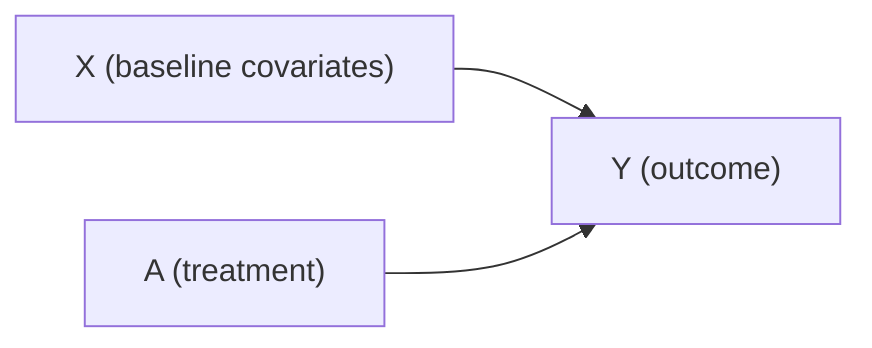

# Fixed-query CATE with a difference of squared projections and a multiplicative quadratic factor

## Research question

- **Primary domain.** `cate`
- **Keywords.** Randomized treatment; High-dimensionality; Effect heterogeneity; Interactions; Quartic effect
- **Question and intended use.** Propose a source-grounded evaluation candidate for one scalar fixed-query CATE and an optional 95% pointwise interval. The effect is a fourth-degree product of a difference of squared projections and a third squared projection, involving 25 active coordinates. This cannot be reduced to the public quadratic, sigmoid or two-coordinate radial-annulus designs.
- **Behavior under test.** Preserve the source joint observed law and explicitly define the additive intervention contrast. Family membership is based on structural form; seeds and parameter variants are not additional contributions.

## Study design and data source

- **Motivation and references.** Shi, C., Lu, W., and Song, R. (2020 issue; 2019 online). A Sparse Random Projection-based Test for Overall Qualitative Treatment Effects. Journal of the American Statistical Association 115(531), 1201-1213. DOI: 10.1080/01621459.2019.1604368. [Article](https://doi.org/10.1080/01621459.2019.1604368); [source version](https://pmc.ncbi.nlm.nih.gov/articles/PMC7730172/). Exact location: Section 4.1 Scenario 4, $p=50$, $N=1000$; source $\mathrm{VD}=0.2$ implies $\delta=\pi/10$; PMC author manuscript and author-hosted June 2019 OQTE.pdf, Section 4.1, PDF pp.20-21. Journal metadata verified on the PMC manuscript page.
- **Population and sampling.** Independent synthetic individuals, with proposed evaluation table size $n=1000$. The collection interface additionally supports other positive $n$ for checks. One declared scenario, `source_fixed_query`. Fixed query, exact parameters and seeds are available in the separate private review ZIP. This proposal is not a completed estimator comparison.
- **Adaptations.** Choose a fixed scalar CATE query before data generation; the query and reported scalar reference are defined for this contribution, not a paper-reported estimate. Use an independently authored Python/NumPy PCG64 reconstruction; no claim to identical R or MATLAB random samples. Run $n=128$ for the interface check, using the seed recorded in the private checks/report.json. The source/evaluation table size is documented separately; no method training or CI comparison is performed.

## DAG and identification

- **Variables and causal structure.** Each row contains $X_{1}$, $X_{2}$, $X_{3}$, $X_{4}$, $X_{5}$, $X_{6}$, $X_{7}$, $X_{8}$, $X_{9}$, $X_{10}$, $X_{11}$, $X_{12}$, $X_{13}$, $X_{14}$, $X_{15}$, $X_{16}$, $X_{17}$, $X_{18}$, $X_{19}$, $X_{20}$, $X_{21}$, $X_{22}$, $X_{23}$, $X_{24}$, $X_{25}$, $X_{26}$, $X_{27}$, $X_{28}$, $X_{29}$, $X_{30}$, $X_{31}$, $X_{32}$, $X_{33}$, $X_{34}$, $X_{35}$, $X_{36}$, $X_{37}$, $X_{38}$, $X_{39}$, $X_{40}$, $X_{41}$, $X_{42}$, $X_{43}$, $X_{44}$, $X_{45}$, $X_{46}$, $X_{47}$, $X_{48}$, $X_{49}$, $X_{50}$, A, $Y$. $X$ denotes the complete observed baseline covariate vector. All outcome disturbances are independent exogenous errors. No latent common cause of treatment and outcome is introduced. Latent pre-clipping draws and auxiliary noises, where used, are not supplied to methods.
- **DAG edges.** `X -> Y, A -> Y`
- **Assumptions.** Consistency, well-defined treatment versions and no interference. Independent individuals within the declared sampling design; no latent common cause of treatment and outcome after adjustment. Conditional exchangeability given all observed baseline adjustment variables. Positive treatment probability at supported queries and finite conditional means; continuous conditional response version at continuous queries. The source distribution and mechanism are fixed. Uniform overlap is supported by bounded predictors where used; randomization is exactly one half for the trial designs. Adjustment set: all $X$ columns.



## Variables and data-generating process

- **Variables and observed input.** The schema lists only observed numeric columns. Potential outcomes, nuisance functions and true effects stay internal. All methods receive the same table, role definitions and fixed query, with no oracle features. Treatment is A, the outcome is $Y$ and the baseline columns are $X_{1}$ through $X_{50}$.
- **Draw order and scenarios.** Baseline variables first, then treatment conditional on its stated parents, followed by independent outcome noise and observed outcome.  All source coefficients below are fixed across tables.

### Structural equations

- **Structural parents.** `X -> Y, A -> Y`

```math
\begin{aligned}
X_i&\sim N_{50}(0,I_{50}),\quad A_i\sim\mathrm{Bernoulli}(1/2),\quad A_i\perp X_i,\\
U(x)&=(x_1+x_2)/\sqrt{2},\quad V(x)=\sum_{j=3}^{20}x_j/\sqrt{18},\quad W(x)=\sum_{j=21}^{25}x_j/\sqrt{5},\\
h(x)&=\delta\{U(x)^2-V(x)^2\}W(x)^2,\quad\delta=\pi/10,\\
b(x)&=1+(x_1-x_2)/2,\quad\mu_0(x)=b(x),\quad\mu_1(x)=b(x)+h(x),\\
\epsilon_i&\sim N(0,0.25),\quad\epsilon_i\perp(X_i,A_i),\quad Y_i=b(X_i)+A_i h(X_i)+\epsilon_i.
\end{aligned}
```

| Symbol | Meaning | Definition or setting |
| --- | --- | --- |
| $i$ | Independent individual index | One independently sampled individual per row. |
| $X_i,\ x,\ j,\ I_{50}$ | Observed Gaussian covariates, argument, coordinate and identity matrix | Columns `X1` through `X50` are independent $N(0,1)$ draws; $j=1,\ldots,50$ and $I_{50}$ is the identity matrix. Twenty-five coordinates affect the response. |
| $U,\ V,\ W$ | Three normalized covariate projections | Functions of disjoint coordinate sets; independently standard normal at population draws. They are not additional exported columns. |
| $h,\ b$ | Quartic contrast and baseline | Source Scenario 4 formulas above. |
| $\delta$ | Strength calibrated to source VD=.2 | Source value difference $\mathrm{VD}=0.2$; $\mathrm{VD}=2\delta/\pi$, hence $\delta=\pi/10$. |
| $\epsilon_i$ | Independent Gaussian outcome disturbance | Independent Gaussian error with mean $0$, variance $0.25$ and standard deviation $0.5$; not exported. |
| $A_i,\ Y_i$ | Observed treatment and outcome | Treatment column `A` takes values in $\{0,1\}$; outcome column `Y` follows the law above. |
| $\mu_a$ | Intervention-specific conditional means | Defined explicitly above; internal simulator quantities are not exported. |
| $x_\star$ | Prespecified scalar-target query | Exact coordinates in private config.json; common to all methods and held fixed across tables. |
| $\tau$ | Additive conditional average treatment effect | $\mathbb{E}[Y(1)-Y(0)\mid\text{target conditioning variables at the fixed query}]$; the conditioning set is specified in the estimand section. No averaging over the fixed query. |
| $n$ | Number of observed rows | Selected source-supported evaluation size $1000$; interface smoke uses $128$; no simulated estimator study is claimed. |

## Data-generating process and estimand

- **Estimand.** $\tau(x_\star)=\mathbb{E}[Y(1)-Y(0)\mid X=x_\star]$. This is one prespecified scalar difference in outcome units; identify it by adjustment for $X$. The query is fixed across repeated datasets. The pointwise coverage probability is $\Pr\{\tau(q_\star)\in C(D_n;q_\star)\}$, where $q_\star$ denotes the declared query and $C$ an interval computed from the observed dataset $D_n$. It is not a simultaneous band or a population-average effect.
- **Truth check.** For independent $U,V,W\sim N(0,1)$, $\mathrm{VD}=\mathbb{E}[(-h(X))_+]=\delta\mathbb{E}[(V^2-U^2)_+]\mathbb{E}[W^2]=2\delta/\pi$. Since $U^2-V^2=(U-V)(U+V)$ with independent normal factors, the source setting $\mathrm{VD}=0.2$ yields $\delta=\pi/10$. The verifier independently integrates the absolute-normal first moment. The CATE is $\tau(x)=h(x)$. A separately written scalar reconstruction and numerical integration in `verify.py` check multiple queries and structural controls. The fixed-query scalar reference stays in the private ZIP. These checks share the source specification and numerical library and do not replace independent human replication.

## Benchmark comparison

- **Output and comparator.** One scalar estimate and optionally a nominal 95% pointwise interval; baseline: An arm-specific regression T-learner with flexible spline and interaction terms on the same observed inputs. Every comparator uses the same observed table and query. This package implements generation and oracle checks only, not the comparison methods.
- **Scoring and replication.** Proposed, unexecuted plan: 1,000 independent repeated tables at $n=1000$ with the same scenario, equal weights and paired data across methods. Freeze seeds and queries before evaluation. Report bias, RMSE, success/availability, 95% coverage and mean interval length for valid results, plus all-attempt valid-and-covering frequency. Comparisons of interval length require a prespecified common coverage/availability gate; the gate and estimator tuning are future evaluation work. No length ranking or coverage result is claimed here. Record all failures/timeouts/nonfinite estimates and do not replace failed seeds. A Monte Carlo standard error or binomial interval must accompany coverage; small-sample oracle checks do not establish coverage.

## Materials and access

- **Public materials.** [Journal of the American Statistical Association article](https://doi.org/10.1080/01621459.2019.1604368) and [source version](https://pmc.ncbi.nlm.nih.gov/articles/PMC7730172/). No original PDF or author code is redistributed. New mathematical reconstruction with attribution.
- **Reproduction and protected materials.** The separate cate-shi-2020-quartic-projection-v1-review2.zip contains the complete eight-file student contribution, actual checks and SHA-256 manifest. Exact query, scenario-specific truths, seeds and generated samples are for private maintainer review through the submitter's agreed channel. Run `python collect.py check path/to/cate-shi-2020-quartic-projection-v1 --run --n 128 --seed REVIEW_SEED` with the student tool and NumPy. Replace REVIEW_SEED by the run seed in the private checks/report.json. The recorded generation/verification environment is CPython 3.12.14 with NumPy 2.3.5. Published formula coefficients shown above are public source settings; the contribution-specific query, run seeds, generated samples and scalar reference stay in the private ZIP. No official evaluation tables have been created. Formal scientific review, independent human rerun, acceptance remain pending. AI assisted source reconstruction, code and prose; it does not sign off scientific acceptance.
