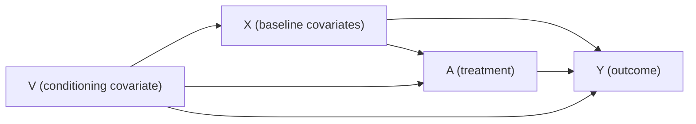

# Partially conditioned CATE with correlated adjustment covariates

## Research question

- **Question and intended use.** Propose a source-grounded evaluation candidate for one scalar fixed-query CATE and an optional 95% pointwise interval. The estimand conditions on V only while identification adjusts for V,X1,X2,X3 and integrates out X. Its truth is a fifth-degree polynomial, not the full-covariate product.
- **Behavior under test.** Preserve the source joint observed law and explicitly define the additive intervention contrast. Family membership is based on structural form; seeds and parameter variants are not additional contributions.

## Study design and data source

- **Motivation and references.** Singh, R., Xu, L., and Gretton, A. (2024 issue; 2023 online). Kernel methods for causal functions: dose, heterogeneous and incremental response curves. Biometrika 111(2), 497-516. DOI: 10.1093/biomet/asad042. [Article](https://doi.org/10.1093/biomet/asad042); [source version](https://arxiv.org/abs/2010.04855v7). Exact location: arXiv v7 Supplement J.2, PDF p.42; arXiv:2010.04855v7, 21 October 2022, Supplement J.2 PDF p.42. Cross-checked against 2023 accepted manuscript section 8.1 and author Python synthetic.py; the arXiv supplement and accepted manuscript section numbering differ.
- **Population and sampling.** Independent synthetic individuals, with proposed evaluation table size n=1000. The collection interface additionally supports other positive n for checks. One declared scenario, source_fixed_query. Fixed query, exact parameters and seeds are available in the separate private review ZIP. This proposal is not a completed estimator comparison.
- **Adaptations.** Choose a fixed scalar CATE query before data generation; the query and reported scalar reference are defined for this contribution, not a paper-reported estimate. Use an independently authored Python/NumPy PCG64 reconstruction; no claim to identical R or MATLAB random samples. Run n=128 for the interface check, using the seed recorded in the private checks/report.json. The source/evaluation table size is documented separately; no method training or CI comparison is performed. Select the additive contrast of the two source partially conditioned response curves, retaining the complete adjustment set and treated-only noise.

## DAG and identification

- **Variables and causal structure.** Each row contains V, X1, X2, X3, A, Y. V is the target conditioning variable and X denotes the three additional adjustment covariates. All outcome disturbances are independent exogenous errors. No latent common cause of treatment and outcome is introduced. Latent pre-clipping draws and auxiliary noises, where used, are not supplied to methods.
- **DAG edges.** `X -> Y, A -> Y, X -> A, V -> X, V -> A, V -> Y`
- **Assumptions.** Consistency, well-defined treatment versions and no interference. Independent individuals within the declared sampling design; no latent common cause of treatment and outcome after adjustment. Conditional exchangeability given all observed baseline adjustment variables. Positive treatment probability at supported queries and finite conditional means; continuous conditional response version at continuous queries. Exchangeability conditions on V,X1,X2,X3, then integrates X given V; conditioning only on V is insufficient. The source distribution and mechanism are fixed. Uniform overlap is supported by bounded predictors where used; randomization is exactly one half for the trial designs. Adjustment set: V,X1,X2,X3.



## Variables and data-generating process

- **Variables and observed input.** The schema lists only observed numeric columns. Potential outcomes, nuisance functions and true effects stay internal. All methods receive the same table, role definitions and fixed query, with no oracle features. The target conditions on V; adjustment additionally uses X1, X2 and X3.
- **Draw order and scenarios.** Baseline variables first, then treatment conditional on its stated parents, followed by independent outcome noise and observed outcome.  All source coefficients below are fixed across tables.

### Structural equations

- **Structural parents.** `X -> Y, A -> Y, X -> A, V -> X, V -> A, V -> Y`

```math
\begin{aligned}
U_{ij}&\overset{iid}{\sim}U[-0.5,0.5],\quad j=1,2,3,4,\quad V_i=U_{i1},\\
X_{i1}&=1+2V_i+U_{i2},\quad X_{i2}=1+2V_i+U_{i3},\quad X_{i3}=(V_i-1)^2+U_{i4},\\
e(v,x)&=\mathrm{expit}\{(v+x_1+x_2+x_3)/2\},\quad A_i\mid V_i,X_i\sim\mathrm{Bernoulli}(e(V_i,X_i)),\\
\nu_i&\sim N(0,1/16),\quad \nu_i\perp(V_i,X_i,A_i),\\
m_0(v,x)&=0,\quad m_1(v,x)=vx_1x_2x_3,\quad Y_i=A_i(V_iX_{i1}X_{i2}X_{i3}+\nu_i).
\end{aligned}
```

| Symbol | Meaning | Definition or setting |
| --- | --- | --- |
| i | Independent individual index | One independently sampled individual per row. |
| U_ij,j | Independent auxiliary uniform draws and index | j=1,...,4; U variables are not exported; V=U1 is observed. |
| V_i,v | Observed conditioning variable and query argument | Column V in [-.5,.5]; only V conditions the target. |
| X_i,x | Three observed adjustment variables and arguments | Columns X1,X2 in [-.5,2.5], X3 in [-.25,2.75]. These must be retained for confounding adjustment. |
| e,expit | Propensity and logistic function | expit(t)=1/(1+exp(-t)); all four observed pretreatment variables enter. |
| nu_i | Unobserved treated-outcome disturbance | Mean zero, variance 1/16, SD=.25. |
| m_a | Arm mean given the entire adjustment set | m0=0; m1=v*x1*x2*x3. These are not the partially conditioned target. |
| A_i,Y_i | Observed treatment and outcome | Treatment column A in {0,1}; outcome column Y; units and generation law above. |
| mu_a or m_a | Intervention-specific conditional means | Defined explicitly above; internal simulator quantities are not exported. |
| x_star or v_star | Prespecified scalar-target query | Exact coordinates in private config.json; common to all methods and held fixed across tables. |
| tau | Additive conditional average treatment effect | E[Y(1)-Y(0)|conditioning variables at query]; no population averaging over the query. |
| n | Number of observed rows | Selected source-supported evaluation size 1000; interface smoke uses 128; no simulated estimator study is claimed. |

## Data-generating process and estimand

- **Estimand.** tau(v_star)=E[Y(1)-Y(0)|V=v_star], integrating X|V; adjustment set is V,X1,X2,X3. The query is prespecified and identical across repeated tables. Coverage means P(tau(query) in CI(D_n)) with query held fixed, not a simultaneous band or an ATE.
- **Truth check.** For potential outcomes, intervention sets A, not the distribution of X given V. Given V=v, the three independent uniform errors have zero means, so E[X1*X2*X3|V=v]=(1+2v)^2*(v-1)^2. Thus tau(v)=v*(1+2v)^2*(v-1)^2. truth.py evaluates its expansion, while verify.py integrates the unexpanded product over all three errors. Adjusting only for V would not remove confounding. A separate scalar reconstruction and numerical integration are provided in verify.py; special cases and multiple queries are checked. The scenario-specific numeric reference is reserved for the private ZIP. The two code routes share the source specification and NumPy primitives and are not independent human replication.

## Benchmark comparison

- **Output and comparator.** One scalar estimate and optionally a nominal 95% pointwise interval; baseline: A cross-fitted DR-learner adjusted for V and X, followed by regression of its pseudo-outcome on V. Every comparator uses the same observed table and query. This package implements generation and oracle checks only, not the comparison methods.
- **Scoring and replication.** Proposed, unexecuted plan: 1,000 independent repeated tables at n=1000 with the same scenario, equal weights and paired data across methods. Freeze seeds and queries before evaluation. Report bias, RMSE, success/availability, 95% coverage and mean interval length for valid results, plus all-attempt valid-and-covering frequency. Comparisons of interval length require a prespecified common coverage/availability gate; the gate and estimator tuning are future evaluation work. No length ranking or coverage result is claimed here. Record all failures/timeouts/nonfinite estimates and do not replace failed seeds. A Monte Carlo standard error or binomial interval must accompany coverage; small-sample oracle checks do not establish coverage.

## Materials and access

- **Public materials.** [Biometrika article](https://doi.org/10.1093/biomet/asad042) and [source version](https://arxiv.org/abs/2010.04855v7). No source PDF, author code or Job Corps data is redistributed. New implementation from mathematical specification; source code is used read-only for corroboration.
- **Reproduction and protected materials.** The separate cate-singh-2024-partial-polynomial-v1-review2.zip contains the complete eight-file student contribution, actual checks and SHA-256 manifest. Exact query, scenario-specific truths, seeds and generated samples are for private maintainer review through the submitter's agreed channel. Run `python collect.py check path/to/cate-singh-2024-partial-polynomial-v1 --run --n 128 --seed REVIEW_SEED` with the student tool and NumPy. Replace REVIEW_SEED by the run seed in the private checks/report.json. The recorded generation/verification environment is CPython 3.12.14 with NumPy 2.3.5. Published formula coefficients shown above are public source settings; the contribution-specific query, run seeds, generated samples and scalar reference stay in the private ZIP. No official evaluation tables have been created. Formal scientific review, independent human rerun, submission and acceptance remain pending. AI assisted source reconstruction, code and prose; it does not sign off scientific acceptance.
