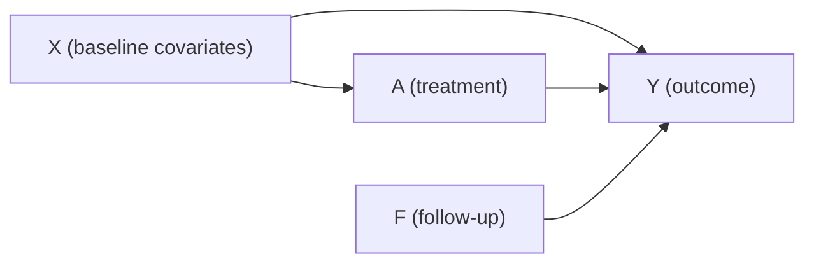

# Fixed-query mean-difference CATE for Poisson counts with random follow-up

## Research question

- **Question and intended use.** Propose a source-grounded evaluation candidate for one scalar fixed-query CATE and an optional 95% pointwise interval. Clipped block-correlated covariates, folded log rates and Poisson counts with observed random exposure are absent from the public CATE inventory. Other rate settings are not counted separately.
- **Behavior under test.** Preserve the source joint observed law and explicitly define the additive intervention contrast. Family membership is based on structural form; seeds and parameter variants are not additional contributions.

## Study design and data source

- **Motivation and references.** Yadlowsky, S., Pellegrini, F., Lionetto, F., Braune, S., and Tian, L. (2021 issue; 2020 online). Estimation and Validation of Ratio-based Conditional Average Treatment Effects Using Observational Data. Journal of the American Statistical Association 116(533), 335-352. DOI: 10.1080/01621459.2020.1772080. [Article](https://doi.org/10.1080/01621459.2020.1772080); [source version](https://pmc.ncbi.nlm.nih.gov/articles/PMC7985957/). Exact location: Section 3, Setting 4 Large contrast mis-specification; PMC author manuscript NIHMS1618326; the article page identifies the 2021 issue and 7 July 2020 online publication.
- **Population and sampling.** Independent synthetic individuals, with proposed evaluation table size n=1000. The collection interface additionally supports other positive n for checks. One declared scenario, source_fixed_query. Fixed query, exact parameters and seeds are available in the separate private review ZIP. This proposal is not a completed estimator comparison.
- **Adaptations.** Choose a fixed scalar CATE query before data generation; the query and reported scalar reference are defined for this contribution, not a paper-reported estimate. Use an independently authored Python/NumPy PCG64 reconstruction; no claim to identical R or MATLAB random samples. Run n=128 for the interface check, using the seed recorded in the private checks/report.json. The source/evaluation table size is documented separately; no method training or CI comparison is performed. Change the source rate-ratio target to the additive conditional mean difference for counts, marginal over the source follow-up distribution. Use an arm-independent observed follow-up draw with the same source marginal law under each arm. This is a marginal-law reconstruction and not a claim about original cross-world coupling. The proposed evaluation n=1000 is introduced here; the source Section 3 does not give a simulation sample size in the paragraphs inspected. It is not asserted to be a source fixed parameter.

## DAG and identification

- **Variables and causal structure.** Each row contains X1, X2, X3, X4, X5, X6, X7, X8, X9, X10, A, F, Y. X denotes the clipped baseline vector and F is the observed follow-up exposure. All outcome disturbances are independent exogenous errors. No latent common cause of treatment and outcome is introduced. Latent pre-clipping draws and auxiliary noises, where used, are not supplied to methods.
- **DAG edges.** `X -> Y, A -> Y, X -> A, F -> Y`
- **Assumptions.** Consistency, well-defined treatment versions and no interference. Independent individuals within the declared sampling design; no latent common cause of treatment and outcome after adjustment. Conditional exchangeability given all observed baseline adjustment variables. Positive treatment probability at supported queries and finite conditional means; continuous conditional response version at continuous queries. The source distribution and mechanism are fixed. Uniform overlap is supported by bounded predictors where used; randomization is exactly one half for the trial designs. Adjustment set: all X columns.



## Variables and data-generating process

- **Variables and observed input.** The schema lists only observed numeric columns. Potential outcomes, nuisance functions and true effects stay internal. All methods receive the same table, role definitions and fixed query, with no oracle features. F is observed follow-up exposure and is integrated out of the target.
- **Draw order and scenarios.** Baseline variables first, then treatment conditional on its stated parents, followed by independent outcome noise and observed outcome. Follow-up is independently drawn before the count. All source coefficients below are fixed across tables.

### Structural equations

- **Structural parents.** `X -> Y, A -> Y, X -> A, F -> Y`

```math
\begin{aligned}
Z_i&\sim N_{10}(0,\Sigma),\quad X_{ij}=\min(2,\max(-2,Z_{ij})),\\
\Sigma_{jj}&=1,\quad \Sigma_{jk}=0.5\ (6\le j\ne k\le10),\quad \Sigma_{jk}=0\ \text{otherwise},\\
e(x)&=\mathrm{expit}(-x_1-0.5x_2+0.5x_6),\quad A_i\mid X_i\sim\mathrm{Bernoulli}(e(X_i)),\\
F_i&\sim U[0,0.75],\quad F_i\perp(X_i,A_i),\\
\ell_0(x)&=0.320+0.125|x_1+x_6+1|+0.3|x_2+0.5|+0.125x_6+0.5(|x_1|+|x_6|),\\
\ell_1(x)&=1.235-0.125|x_1+x_6+1|-0.3|x_2+0.5|-0.125x_6+0.5(|x_1|+|x_6|),\\
\mu_a(x)&=\exp(\ell_a(x)),\quad Y_i\mid X_i,A_i,F_i\sim\mathrm{Poisson}(F_i\mu_{A_i}(X_i)).
\end{aligned}
```

| Symbol | Meaning | Definition or setting |
| --- | --- | --- |
| i | Independent individual index | One independently sampled individual per row. |
| Z_i,Sigma,j,k | Pre-clipping latent draw, covariance and coordinate indices | j,k=1,...,10. First five coordinates independent; last five equicorrelated at .5; blocks independent. Z is not exported. |
| X_i,x | Observed clipped baseline vector and its value | X1-X10, each in [-2,2]; point masses at clipping boundaries retained. |
| e,expit | Propensity and logistic function | expit(t)=1/(1+exp(-t)); logit signs follow the denominator in the source. |
| F_i | Observed follow-up exposure | Column F in [0,.75], independent with identical law under both interventions. |
| ell_a,mu_a | Log rate and rate | Explicit Setting 4 equations; these are rates, not count means. |
| a | Binary intervention index | a=0 or 1. Count mean given X,F is F*mu_a(X). |
| A_i,Y_i | Observed treatment and outcome | Treatment column A in {0,1}; outcome column Y; units and generation law above. |
| E[Y(a) given X=x] | Intervention-specific marginal count mean | 0.375*mu_a(x); mu_a itself is a rate. Internal quantities are not exported. |
| x_star or v_star | Prespecified scalar-target query | Exact coordinates in private config.json; common to all methods and held fixed across tables. |
| tau | Additive conditional average treatment effect | E[Y(1)-Y(0)|conditioning variables at query]; no population averaging over the query. |
| n | Number of observed rows | Proposed evaluation size 1000, introduced here; not a source-reported sample size; interface smoke uses 128; no simulated estimator study is claimed. |

## Data-generating process and estimand

- **Estimand.** tau(x_star)=E[Y(1)-Y(0)|X=x_star], scalar fixed-query difference in outcome units. Marginal over F|X; units are expected counts over the random follow-up, not a rate ratio. The query is prespecified and identical across repeated tables. Coverage means P(tau(query) in CI(D_n)) with query held fixed, not a simultaneous band or an ATE.
- **Truth check.** The source targets the rate ratio D(x)=mu1(x)/mu0(x). This contribution explicitly changes the target to the usual additive CATE for counts. Since E[F(a)|X=x]=0.75/2 in both arms, E[Y(a)|X=x]=0.375*mu_a(x). Therefore tau(x)=0.375*(mu1(x)-mu0(x)). It is neither the ratio nor the effect per unit exposure. F is observed but is integrated out of this target. A separate scalar reconstruction and numerical integration are provided in verify.py; special cases and multiple queries are checked. The scenario-specific numeric reference is reserved for the private ZIP. The two code routes share the source specification and NumPy primitives and are not independent human replication.

## Benchmark comparison

- **Output and comparator.** One scalar estimate and optionally a nominal 95% pointwise interval; baseline: Cross-fitted arm-specific Poisson regression with log(F) offset and flexible folded covariate terms, then integrate over the known follow-up law. Every comparator uses the same observed table and query. This package implements generation and oracle checks only, not the comparison methods.
- **Scoring and replication.** Proposed, unexecuted plan: 1,000 independent repeated tables at n=1000 with the same scenario, equal weights and paired data across methods. Freeze seeds and queries before evaluation. Report bias, RMSE, success/availability, 95% coverage and mean interval length for valid results, plus all-attempt valid-and-covering frequency. Comparisons of interval length require a prespecified common coverage/availability gate; the gate and estimator tuning are future evaluation work. No length ranking or coverage result is claimed here. Record all failures/timeouts/nonfinite estimates and do not replace failed seeds. A Monte Carlo standard error or binomial interval must accompany coverage; small-sample oracle checks do not establish coverage.

## Materials and access

- **Public materials.** [Journal of the American Statistical Association article](https://doi.org/10.1080/01621459.2020.1772080) and [source version](https://pmc.ncbi.nlm.nih.gov/articles/PMC7985957/). No paper, patient data or author code is redistributed. Independent implementation of the public simulation equations.
- **Reproduction and protected materials.** The separate cate-yadlowsky-2021-folded-poisson-v1-review2.zip contains the complete eight-file student contribution, actual checks and SHA-256 manifest. Exact query, scenario-specific truths, seeds and generated samples are for private maintainer review through the submitter's agreed channel. Run `python collect.py check path/to/cate-yadlowsky-2021-folded-poisson-v1 --run --n 128 --seed REVIEW_SEED` with the student tool and NumPy. Replace REVIEW_SEED by the run seed in the private checks/report.json. The recorded generation/verification environment is CPython 3.12.14 with NumPy 2.3.5. Published formula coefficients shown above are public source settings; the contribution-specific query, run seeds, generated samples and scalar reference stay in the private ZIP. No official evaluation tables have been created. Formal scientific review, independent human rerun, submission and acceptance remain pending. AI assisted source reconstruction, code and prose; it does not sign off scientific acceptance.
