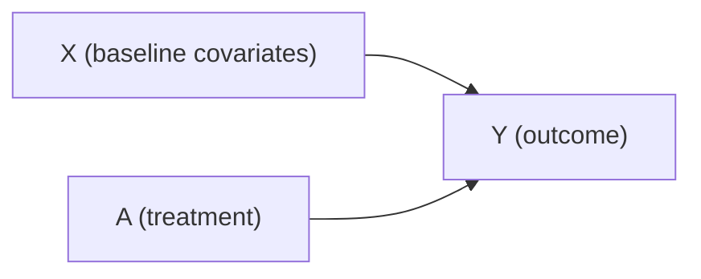

# Fixed-query CATE in a randomized radial-annulus design

## Research question

- **Question and intended use.** Propose a candidate for scalar conditional average treatment effect (CATE) evaluation at one prespecified interior covariate query. The target is the conditional mean response under treatment minus that under control.
- **Behavior under test.** The treatment effect is a nonlinear radial polynomial with two circular sign-change boundaries, embedded in 50 observed baseline coordinates. This tests estimation of effect magnitude with nonlinear heterogeneity and many inactive covariates. A single fixed query assesses local accuracy; it does not evaluate recovery of the entire effect surface or both boundaries. The proposal adds a literature-grounded candidate, without claiming that the current collection lacks related mechanisms.

## Study design and data source

- **Motivation and references.** Zhao, Zeng, Rush and Kosorok (2012), *Estimating Individualized Treatment Rules Using Outcome Weighted Learning*, Journal of the American Statistical Association 107(499), 1106–1118, [DOI](https://doi.org/10.1080/01621459.2012.695674). The [author manuscript](https://pmc.ncbi.nlm.nih.gov/articles/PMC3636816/), Section 4, opening paragraph and Scenario 3, supplies the covariate distribution, randomization, Gaussian response, baseline coefficients and radial interaction below. The publisher issue number is used; the archived PMC metadata display a conflicting issue number. The source evaluates treatment rules. Binary recoding, a fixed-query CATE target, Python implementation, new random streams and the proposed CATE comparison are adaptations, not results of the source paper.
- **Population and sampling.** Units are independent synthetic individuals, with no clusters or longitudinal observations. Each table has total sample size $n=100$, one of the source paper's sample sizes, and 50 independent uniform baseline coordinates. Treatment is randomized independently for each individual, so arm counts are random rather than fixed at 50 each. There is one proposed evaluation scenario, `source_fixed_query`; its source coefficients remain fixed across tables. This is a methodological simulation, not a calibrated clinical population.

## DAG and identification

- **Variables and causal structure.** $X$ denotes the full observed baseline vector; only its first three coordinates affect $Y$, and only its first two modify the treatment effect. $A$ is observed randomized treatment and $Y$ is the observed continuous outcome. Baseline covariates precede treatment and outcome. There are no shared latent causes; the independent outcome disturbance is specified in the equations and omitted from the DAG. The graph below represents `source_fixed_query`.
- **DAG edges.** `X -> Y, A -> Y`
- **Assumptions.** Independent units, consistency, no interference, randomized assignment independent of the baseline variables and potential outcomes, and positivity identify the conditional contrast. The continuous conditional response functions select its version at the fixed query. Estimation and pointwise interval validity still require appropriate structural or smoothness conditions; randomization alone does not guarantee accurate pointwise inference with 50 covariates and $n=100$. No intentional identification violation is introduced.

*The baseline vector X and randomized treatment A cause outcome Y. There is no X-to-A arrow because assignment is independent of X.*



## Variables and data-generating process

- **Variables and observed input.** One row is one individual. Every method receives the same 52 columns, `X1,...,X50,A,Y`, and the same fixed query vector as task metadata. Each baseline coordinate lies in $[-1,1]$, $A$ is coded as 0 or 1, and $Y$ is real-valued in arbitrary response units. The query is not estimated from evaluation outcomes. Disturbances, potential outcomes, oracle arm means, reference effects and the evaluation seed ledger are excluded from estimator inputs. The reproduction file `reference.json` combines query and truth metadata; the evaluator must extract only the query for methods, never pass that file wholesale.
- **Draw order and scenarios.** For each individual, draw all 50 independent baseline coordinates, then an independent Bernoulli treatment, then independent Gaussian outcome noise, and compute the response. Repeat independently across individuals and tables. All coefficients below are fixed source settings used in the proposed run, with no random coefficients or scenario mixture. The one fixed query $x_\star$ is recorded in the private configuration and shared with each method at evaluation. The planned 1,000-table seed ledger uses newly assigned SHA-256-derived unsigned 32-bit seeds; development and smoke-check seeds are separate. The exact ledger and query stay in private review and are not yet curator-frozen.

### Structural equations

- **Structural parents.** `X -> Y, A -> Y`

```math
\begin{aligned}
X_{ij} &\overset{\mathrm{iid}}{\sim} \operatorname{Uniform}[-1,1],
&& i=1,\ldots,n,\quad j=1,\ldots,p,\quad n=100,\quad p=50,\\
X_i &= (X_{i1},\ldots,X_{ip}),\\
A_i &\sim \operatorname{Bernoulli}(1/2),
&& A_i\perp X_i,\\
\epsilon_{Y,i} &\sim \mathcal N(0,1),
&& \epsilon_{Y,i}\perp (X_i,A_i),\\
r(x) &= x_1^2+x_2^2,\\
b(x) &= 1+2x_1+x_2+0.5x_3,\\
h(x) &= (0.5-x_1^2-x_2^2)(x_1^2+x_2^2-0.3),\\
\mu_0(x) &= 1+2x_1+x_2+0.5x_3-(0.5-x_1^2-x_2^2)(x_1^2+x_2^2-0.3),\\
\mu_1(x) &= 1+2x_1+x_2+0.5x_3+(0.5-x_1^2-x_2^2)(x_1^2+x_2^2-0.3),\\
Y_i &= b(X_i)+(2A_i-1)h(X_i)+\epsilon_{Y,i}
=\mu_{A_i}(X_i)+\epsilon_{Y,i}.
\end{aligned}
```

All random draws are independent across individuals and tables. The factor $2A_i-1$ maps the proposed 0/1 coding back to the source's -1/+1 coding.

| Symbol | Meaning | Definition or setting |
| --- | --- | --- |
| $i,n$ | Individual index and table size | $i=1,\ldots,n$; fixed total $n=100$ in the proposed evaluation. |
| $j,p$ | Covariate index and dimension | $j=1,\ldots,p$; fixed $p=50$ from the source. |
| $X_{ij},X_i$ | Observed baseline coordinates and vector | Independent $\operatorname{Uniform}[-1,1]$ draws; coordinate $j$ is column `Xj`. Only coordinates 1, 2 and 3 enter the outcome equation. |
| $x,x_j$ | Covariate argument and coordinate | $x\in[-1,1]^{50}$ is a realization of the baseline vector; $x_j$ is its $j$th coordinate. |
| $A_i$ | Observed binary treatment | Column `A`; independent $\operatorname{Bernoulli}(1/2)$. The propensity is the constant $1/2$ for every baseline vector. |
| $2A_i-1$ | Source treatment encoding | Equals $-1$ under control and $+1$ under treatment; a deterministic recoding, not an additional draw or table column. |
| $\epsilon_{Y,i}$ | Unobserved outcome disturbance | Independent normal noise with fixed mean 0 and variance 1; not supplied to methods. |
| $r(x)$ | Squared radial coordinate | $r(x)=x_1^2+x_2^2$; deterministic, with support $[0,2]$. |
| $b(x)$ | Baseline response component | $b(x)=1+2x_1+x_2+0.5x_3$; intercept and coefficients are fixed source values. |
| $h(x)$ | Signed-treatment interaction coefficient | $h(x)=(0.5-x_1^2-x_2^2)(x_1^2+x_2^2-0.3)$; source squared-radius boundaries 0.3 and 0.5 and multiplicative scale 1 are fixed. This is half the treatment-versus-control mean contrast. |
| $\mu_0(x)$ | Control-arm conditional mean | $\mu_0(x)=1+2x_1+x_2+0.5x_3-(0.5-x_1^2-x_2^2)(x_1^2+x_2^2-0.3)$. |
| $\mu_1(x)$ | Treatment-arm conditional mean | $\mu_1(x)=1+2x_1+x_2+0.5x_3+(0.5-x_1^2-x_2^2)(x_1^2+x_2^2-0.3)$. |
| $\mu_{A_i}(X_i)$ | Selected arm mean | Evaluate $\mu_0(X_i)$ when $A_i=0$ and $\mu_1(X_i)$ when $A_i=1$. |
| $Y_i$ | Observed continuous outcome | Column `Y`; selected arm mean plus unit-variance Gaussian noise, in arbitrary response units. |
| $x_\star$ | Fixed evaluation query | One prespecified vector in $(-1,1)^{50}$, unchanged across all evaluation tables; exact coordinates in private `config.json`, supplied equally to all methods as query metadata. |
| $a,Y_i(a)$ | Intervention level and potential outcome | $a\in\{0,1\}$; set $A_i=a$ in the outcome equation. Its conditional mean is $\mu_a(X_i)$. No individual-effect distribution is evaluated. |
| $\tau(x_\star)$ | Scalar CATE target | $\tau(x_\star)=\mu_1(x_\star)-\mu_0(x_\star)$, in the same units as $Y$. |

## Data-generating process and estimand

- **Estimand.** The target is $\tau(x_\star)=\mathbb E[Y(1)-Y(0)\mid X=x_\star]=2(0.5-r(x_\star))(r(x_\star)-0.3)$. Treatment is $A=1$ and control is $A=0$. The baseline component cancels, and the factor of two is required by the source's signed treatment coding. This is a pointwise conditional mean difference, not an ATE, a policy value, an individual treatment effect or a simultaneous band.
- **Truth check.** `truth.py` evaluates the analytical contrast using 60-digit decimal arithmetic and records conversion error. `verify.py` separately expands the interaction as $-r(x)^2+0.8r(x)-0.15$, constructs each arm mean and integrates against standard Gaussian noise using composite Simpson quadrature on $[-12,12]$ with 2,048 subintervals. It compares the arm difference with the analytical value at absolute tolerance $10^{-10}$. Further checks cover the two zero-effect circles, radial coordinate swapping, a zero-effect control, baseline cancellation and the factor-of-two error. The numerical check is diagnostic; the reference is analytical, not Monte Carlo truth. The verifier shares the declared configuration and standard-library arithmetic, so it is not independent human reproduction. Case-specific reference values remain in private materials.

## Benchmark comparison

- **Output and comparator.** Methods return a scalar CATE estimate and optionally a nominal 95% pointwise confidence interval. Proposed conventional baselines are a ridge T-learner and a random-forest T-learner, each estimating the two arm means and taking their difference at the same query. Every method uses all 50 observed baseline columns, the treatment, outcome and query. Hyperparameters and any interval construction must be specified and frozen using separate development resources before evaluation; an interval is not presumed valid merely because a learner produces one.
- **Scoring and replication.** The proposed protocol attempts 1,000 independent datasets at fixed $n=100$, with exactly the same table used by every method in each replicate. There is one scenario and each replicate has equal weight. Report bias and RMSE over finite point estimates with their denominator and success rate. For interval-producing methods, report coverage and mean length over valid intervals, their denominator, and the all-attempt valid-and-covering rate; missing or invalid intervals count as not valid-and-covering for the latter. Retain every attempt and report unsupported outputs, failures, abstentions, nonfinite results and timeouts separately, with no silent seed replacement or exclusion. These are proposed rules; no 1,000-replicate method comparison or coverage result is claimed. The public source mechanism is not claimed to be unseen or disjoint from model pretraining.

## Materials and access

- **Public materials.** The DOI and author-manuscript links identify the source. This proposal links the paper without redistributing its PDF or original-author code, and does not presume an open license for those materials. The Python reconstruction is separately authored. Any redistribution of the full package remains subject to agreed sharing terms.
- **Reproduction and protected materials.** The existing `cate-zhao-2012-radial-annulus-v1.zip` is available for agreed private review. It contains `generator.py`, `settings.py`, `truth.py`, `verify.py`, `reproduce.py`, `requirements.txt`, `config.json`, `evaluation_plan.json`, `schema.csv`, `collection.json`, `source_audit.json`, `PROVENANCE.md`, saved checks and a per-file SHA-256 `MANIFEST.json`. After extracting and checking the manifest, use Python 3.10 or newer (standard library only), select `source_fixed_query`, and run the command below from the extracted package directory with the private smoke seed and a fresh output directory outside that directory. Record the exact Python version and package checksum for the reproduction. `observed.csv` must contain 100 rows and the 52 declared columns; `reference.json` stays separate. The reproduction command runs the truth verifier before exporting. Full configurations, exact query coordinates, seeds, generated tables and reference values are supplied only through the maintainer-agreed private channel. Local checks are not scientific acceptance; human review, independent-person reproduction and evaluation inclusion remain separate decisions.

```bash
python3 reproduce.py --scenario source_fixed_query --n 100 --seed "$SMOKE_SEED" --out ../zhao-review-output
```

Set `SMOKE_SEED` to the integer `smoke_seed` in the privately supplied `evaluation_plan.json` before running the command. Use a new output directory for each run; the command refuses to overwrite existing samples.
