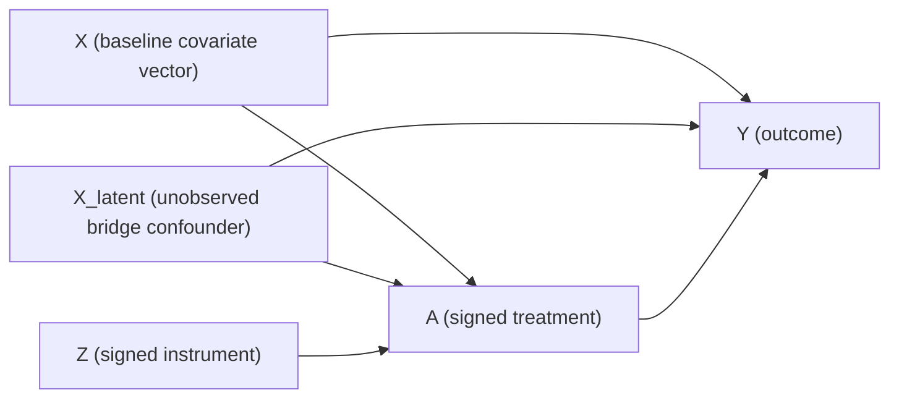

# Signed treatment contrast under bridge-distributed IV confounding

## Research question

- **Question and intended use.** Estimate the conditional effect of changing signed treatment from -1 to +1 at the zero covariate vector in an IV model originally used for optimal treatment rules. Candidate for evaluation after scientific review.
- **Behavior under test.** Test conditional IV estimation under nonlinear latent-confounded assignment and signed treatment coding; converting a per-unit slope into a -1 to +1 contrast is essential.

## Study design and data source

- **Motivation and references.** Yifan Cui; Eric Tchetgen Tchetgen (2021). A semiparametric instrumental variable approach to optimal treatment regimes under endogeneity. JASA. DOI: 10.1080/01621459.2020.1783272. [Journal record](https://doi.org/10.1080/01621459.2020.1783272); [version actually read](https://arxiv.org/pdf/1911.09260v8), arXiv:1911.09260v8; Section 2 coding convention and Section 4.1, physical PDF pp.16–17, source scenario 2. Source snapshot SHA-256: `25b4dd3762ba84fe3d7969686e7889d7c7517481f592b670039af928737d3822`.

**Status and provenance.** Candidate for scientific review (`awaiting_scientific_review`), not accepted evaluation data. Config scenario: `explicit_adaptation`. Source scenario 2 outcome retained. Simulation prose calls Z a Bernoulli event, but methods define Z in {-1,+1}; this explicit variant uses symmetric {-1,+1}, with no claim to resolve author implementation. Scalar CATE at L=0 selected from source treatment effect function; no rule estimation is run. Author simulation code or a maintainer decision is needed to settle source instrument coding. The signed-Z adaptation and fixed-query target require approval; exact source computational reproduction is not claimed.

**Family scope.** This is one proposed family, not a count of its seeds, sample sizes or parameter settings. Same-paper and project-wide deduplication must be confirmed by the maintainer; no global novelty guarantee is made.

- **Population and sampling.** Independent subjects with five uniform covariates. The paper's methods use signed A,Z but simulation prose describes a Bernoulli instrument. This local mechanism explicitly chooses signed Z and therefore is an adaptation, not an asserted resolution of the source coding discrepancy. Source numerical coefficients are fixed, not table-level random hyperparameters.

## DAG and identification

- **Variables and causal structure.** The nodes represent X: baseline covariate vector; X_latent: unobserved bridge confounder; Z: signed instrument; A: signed treatment; Y: outcome. Column aliases and supports are defined in the symbol table. The graph uses the stated fixed scenario; vector nodes collect their explicitly defined coordinates. Unobserved shared causes appear as substantive latent nodes. Independent epsilon disturbances appear only in the equations.
- **DAG edges.** `X -> A, X_latent -> A, Z -> A, X -> Y, X_latent -> Y, A -> Y`



- **Assumptions.** Consistency, no interference, randomized Z, exclusion, positivity and a nonzero first stage. There is a shared latent confounder of A and Y. The conditional treatment effect is independent of that confounder, so the conditional reduced-form/first-stage ratio identifies q(X), and multiplying by two gives the signed treatment contrast.

## Variables and data-generating process

- **Variables and observed input.** Observed columns L1,...,L5,Z,A,Y only. Alias X_j=L_j; no bridge U or nuisance labels returned. Dimension/effective dimension 5/5; only X1 enters assignment directly, but all five enter the outcome. Treatment interactions are A*X1 and A*X2; the assignment link is nonlinear. Actual available columns: `L1`, `L2`, `L3`, `L4`, `L5`, `Z`, `A`, `Y`. All methods receive the same observed table; no oracle nuisance values or potential outcomes.
- **Draw order and scenarios.** Draw independent covariates, signed randomized instrument, bridge latent variable and noises, then signed A, then Y. The sole `explicit_adaptation` retains source scenario-2 h/q coefficients, uses z_values=[-1,1], and fixes latent outcome coefficient .5. Query zero is the contributor-selected target. All roots declared independent above are mutually independent; dependence within a row arises exactly through the parent equations. Unless a conditional law is stated, root draws are independent. No interference, cluster dependence or unreported repeated measurements are added.

### Structural equations

- **Structural parents.** `X -> A, X_latent -> A, Z -> A, X -> Y, X_latent -> Y, A -> Y`

```math
X_j\sim\mathrm{Uniform}(-1,1),\quad j=1,\ldots,5,\quad
P(Z=-1)=P(Z=1)=1/2,\quad X_{\mathrm{latent}}\sim f_U(u)=\{2\pi\cosh(u/2)\}^{-1},\quad
\epsilon_A\sim\mathrm{Uniform}(0,1),\quad\epsilon_Y\sim N(0,1).
```

```math
\begin{aligned}
X&=(X_1,\ldots,X_5),\quad
A=2\mathbf{1}\{\epsilon_A<\mathrm{expit}(2X_1+2.5Z-.5X_{\mathrm{latent}})\}-1,\\
h(x)&=.5+.5x_1+.8x_2+.3x_3-.5x_4+.7x_5,\\
q(x)&=.2-.6x_1-.8x_2,\\
Y&=h(X)+q(X)A+.5X_{\mathrm{latent}}+\epsilon_Y.
\end{aligned}
```

| Symbol | Meaning | Definition or setting |
| --- | --- | --- |
| $X,X_j,x_j,j$ | Baseline vector, coordinates, arguments and index | Independent uniform(-1,1), five coordinates; columns `L1` through `L5`. Total/effective baseline dimension 5/5. |
| $X_{\mathrm{latent}},u,f_U$ | Unobserved bridge confounder, argument and density | Real-valued, bridge parameter .5 with displayed density; independent of X and Z. |
| $Z$ | Random signed instrument | Column `Z`; values -1,+1 with equal probabilities. This coding choice is an explicit adaptation. |
| $A,Y$ | Signed treatment and continuous outcome | Columns `A,Y`; treatment is -1 or +1; response is real-valued. |
| $h,q$ | Baseline mean and treatment slope functions | Numeric coefficients substituted above. q is a slope per unit of signed A, not the -1 to +1 treatment contrast. |
| $\epsilon_A,\epsilon_Y$ | Unit disturbances | Independent uniform(0,1) and standard normal; independent of all roots and between subjects. |
| $\mathrm{expit},\mathbf{1}$ | Logistic link and indicator | Standard logistic link and event indicator. |
| $x^*$ | Fixed query | Five-dimensional zero vector; $q(x^*)=.2$ and contrast $2q(x^*)=.4$. |
| Numeric coefficients | Fixed adaptation/source settings | All displayed h and q coefficients are from source scenario 2; .5 is the latent outcome coefficient and 2.5 the signed instrument coefficient. |
| $\theta$ | Registered scalar target | $\theta=E\{Y(+1)-Y(-1)\mid X=x^*\}=2q(0)=.4$. Reporting the IV slope .2 as this contrast would be a factor-of-two error. |

## Data-generating process and estimand

- **Estimand.** $\theta=E\{Y(+1)-Y(-1)\mid X=x^*\}=2q(0)=.4$. Reporting the IV slope .2 as this contrast would be a factor-of-two error.
- **Truth check.** The structural contrast is 2q(x). Independent bridge quadrature computes treatment and outcome differences between Z=+1 and -1 and checks twice their ratio at the query. It also checks bridge normalization and the zero-q path. The source coefficients and standard numerical distribution functions remain shared.

## Benchmark comparison

- **Output and comparator.** Propose a conditional IV varying-coefficient estimator and a conditional IV forest/sieve estimator for q(x*), converting both to the signed contrast by multiplying by two. Both receive the same observed columns. The paper's policy-value output is not directly comparable to this CATE and is not claimed to have been implemented.
- **Scoring and replication.** Proposed comparison only; no benchmark estimator, PFN training, coverage study or large simulation has been run. After approval, use n=128 and n=512 with 1000 attempted independent tables per n, one fixed scenario (weight 1). Use the same table for all methods in each replicate. Precommit a private seed ledger mapping (case, scenario, n, replicate) to a distinct table seed, independent of the method; the seed is not a model input. Generation failures also consume an attempted replicate and are reported separately. Reserve benchmark seeds privately; the existing n=128, seed=1729 run is a reproducibility smoke test, not a benchmark result. Per n and method, report attempted count, finite completed count, failure count/reasons, bias and RMSE over finite completed estimates with their denominator. Do not drop finite extreme estimates. Score missing/nonfinite runs as failures and publish the failure rate over all 1000 attempts; never present conditional error without that rate. If methods provide nominal 95% intervals, report coverage of this case's stated target, mean finite interval length and interval-failure rate separately. Predeclare numerical tolerances, nuisance fits, fold rules and tuning before running; do not use truth for tuning. Do not average incomparable ATT, CATE, bound, function-value and slope errors into an unscaled cross-family score.

## Materials and access

- **Public materials.** The paper/version links above are the primary sources. This locally prepared proposal is not yet published or rights-approved. Paper copyright remains with the authors/publisher; no source PDF, restricted data, copied author implementation, model weights or credentials are included. Generator/truth/verification code was independently written with AI assistance; AI checks are not named scientific review. Any proposed public code license or redistribution permission requires maintainer confirmation.
- **Reproduction and protected materials.** The accompanying private candidate packet contains `contributions/iv-cui-tchetgen-2021-bridge-iv-treatment-rule-v1/` with collection.json, card.md, config.json, schema.csv, generator.py, truth.py, verify.py, requirements.txt, source audit and local check report (and calibration.py where needed). Use the supplied student collector from its package root with this contribution copied into contributions. Install the pinned/ranged requirements, then run `python collect.py check contributions/iv-cui-tchetgen-2021-bridge-iv-treatment-rule-v1 --run --n 128 --seed 1729`. Review local code before --run. Hooks take the selected scenario parameter object, not the entire config file; generation returns observed numeric columns only. The existing smoke report records truth value `0.4` and estimated_error `0.0`. These are analytic/numerical error descriptions, not sampling standard errors. The private code archive is IV_v02_新增10候选机制_待科学审核_20261126_r2.zip (SHA-256 1c375954c47b3f4afedb98e6bc649a344fa4ef000c9aa72c4d7d0e41b602cb4c). Full generators, exact configs, smoke samples/reports and future benchmark seeds/tables are supplied through the maintainer-approved private channel, not committed alongside this public proposal. No future official held-out seeds/tables have been created.
