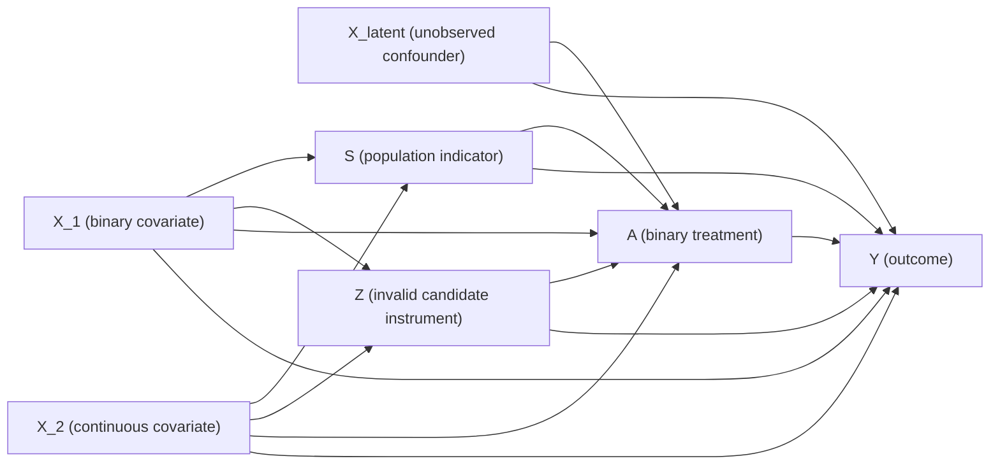

# Negative-control population with a directly invalid instrument

## Research question

- **Question and intended use.** Estimate the average treatment effect among treated subjects in the population S=1, using a treatment-free reference population to remove the instrument's direct outcome association. Candidate for evaluation after scientific review.
- **Behavior under test.** Test whether a negative-control population can remove a direct instrument-outcome pathway without assuming ordinary exclusion; conventional IV can remain biased even with a strong first stage.

## Study design and data source

- **Motivation and references.** Oliver Dukes; David B. Richardson; Zachary Shahn; James M. Robins; Eric J. Tchetgen Tchetgen (2025). Using negative controls to identify causal effects with invalid instrumental variables. Biometrika. DOI: 10.1093/biomet/asae064. [Journal record](https://doi.org/10.1093/biomet/asae064); [version actually read](https://arxiv.org/pdf/2204.04119v6), arXiv:2204.04119v6 (2025-01-23); Appendix C.2, physical PDF pp.58–60, initial experiments 1–5. Source snapshot SHA-256: `d17cd3987d8b7973b6a9aae8b9f051df0b194696e401dc9c3c4ec01fc0312a50`.

**Status and provenance.** Candidate for scientific review (`awaiting_scientific_review`), not accepted evaluation data. Config scenario: `source_fixed`. No additional generator parameter scenario is introduced; only the fixed mechanism described below is included. The source narrative says conventional exclusion and unconfoundedness fail, but the displayed sampling law directly establishes exclusion failure without specifying extra Z–U dependence. This discrepancy is recorded, not repaired by inventing dependence.

**Family scope.** This is one proposed family, not a count of its seeds, sample sizes or parameter settings. Same-paper and project-wide deduplication must be confirmed by the maintainer; no global novelty guarantee is made.

- **Population and sampling.** Independent subjects are sampled from the joint population, with observed S defining two populations. This is not a case-control resampling scheme. Selection and instrument probabilities depend on two observed baseline covariates. Source numerical coefficients are fixed, not table-level random hyperparameters.

## DAG and identification

- **Variables and causal structure.** The nodes represent X_1: binary covariate; X_2: continuous covariate; X_latent: unobserved confounder; S: population indicator; Z: invalid candidate instrument; A: binary treatment; Y: outcome. Column aliases and supports are defined in the symbol table. The graph uses the stated fixed scenario; vector nodes collect their explicitly defined coordinates. Unobserved shared causes appear as substantive latent nodes. Independent epsilon disturbances appear only in the equations.
- **DAG edges.** `X_1 -> S, X_2 -> S, X_1 -> Z, X_2 -> Z, X_1 -> A, X_2 -> A, X_latent -> A, S -> A, Z -> A, X_1 -> Y, X_2 -> Y, X_latent -> Y, S -> Y, Z -> Y, A -> Y`



- **Assumptions.** Consistency, no interference, overlap for Z and population membership given covariates, and nonzero first stage in S=1 are required. The negative-control reference has A=0. Identification uses the source parallel baseline Z-association and no-effect-modification restrictions (source assumptions 1–5 and Appendix C); the equations have the same direct Z term in both populations. Ordinary IV exclusion is deliberately false. The displayed source equations do not introduce a Z–U association, so none is added here.

## Variables and data-generating process

- **Variables and observed input.** One row is one subject. Only C1,C2,S,Z,A,Y are supplied to estimators. S=0 subjects must remain available. No U, propensity, conditional mean or individual treatment effect is returned. Logistic links and the explicit products X1*X2 and Z*X1*X2 create nonlinearity/interactions; there is no high-dimensional claim. Actual available columns: `C1`, `C2`, `S`, `Z`, `A`, `Y`. All methods receive the same observed table; no oracle nuisance values or potential outcomes.
- **Draw order and scenarios.** Draw independent baseline roots and disturbances per subject, then S and Z, then A, then Y. The single `source_fixed` scenario uses effect=1. The shared latent variable is a substantive confounder; the epsilon disturbances stay outside the DAG. All roots declared independent above are mutually independent; dependence within a row arises exactly through the parent equations. Unless a conditional law is stated, root draws are independent. No interference, cluster dependence or unreported repeated measurements are added.

### Structural equations

- **Structural parents.** `X_1 -> S, X_2 -> S, X_1 -> Z, X_2 -> Z, X_1 -> A, X_2 -> A, X_latent -> A, S -> A, Z -> A, X_1 -> Y, X_2 -> Y, X_latent -> Y, S -> Y, Z -> Y, A -> Y`

```math
X_1\sim\mathrm{Bernoulli}(1/2),\quad X_2\sim N(0,1),\quad
X_{\mathrm{latent}}\sim\mathrm{Bernoulli}(1/2),\quad
\epsilon_S,\epsilon_Z,\epsilon_A\sim\mathrm{Uniform}(0,1),\quad\epsilon_Y\sim N(0,1).
```

```math
\begin{aligned}
\mathrm{expit}(v)&=(1+e^{-v})^{-1},\\
S&=\mathbf{1}\{\epsilon_S<\mathrm{expit}(-.5+X_1+.6X_2+.5X_1X_2)\},\\
Z&=\mathbf{1}\{\epsilon_Z<\mathrm{expit}(.25X_1-.25X_2+.5X_1X_2)\},\\
A&=S\mathbf{1}\{\epsilon_A<\mathrm{expit}(1-1.5Z-.75X_1-.3X_2-.5X_1X_2+X_{\mathrm{latent}})\},\\
Y&=1+X_{\mathrm{latent}}+.5X_1+.5X_2-.5X_1X_2
+Z(1-.4X_1-.4X_2+.5X_1X_2)\\
&\qquad+S(A+.5X_1+.5X_2+.5X_1X_2)+\epsilon_Y.
\end{aligned}
```

| Symbol | Meaning | Definition or setting |
| --- | --- | --- |
| $X_1,X_2$ | Observed baseline covariates | Columns `C1,C2`; Bernoulli(.5) and standard normal; total/effective dimension 2/2. |
| $X_{\mathrm{latent}}$ | Unobserved confounder | Source $U$; independent Bernoulli(.5), shared by treatment and outcome equations; never exported. |
| $S$ | Observed population indicator | Column `S`; 1 = population of interest, 0 = treatment-free reference. |
| $Z$ | Observed candidate instrument | Column `Z`; binary logistic equation above. Direct effect on outcome deliberately present. |
| $A,Y$ | Observed treatment and outcome | Columns `A,Y`; binary and real-valued, respectively; $A=0$ when $S=0$. |
| $\epsilon_S,\epsilon_Z,\epsilon_A,\epsilon_Y$ | Unit disturbances | Independent uniform thresholds and standard normal outcome noise; independent of baseline roots and between rows. |
| $\mathrm{expit},v,\mathbf{1}$ | Link, argument, indicator | Logistic link, real argument, and event indicator. |
| Numeric coefficients | Fixed source settings | Every number in the displayed equations is fixed at the source initial-experiments setting; treatment coefficient is 1. No coefficient is estimated from generated data. |
| $\theta$ | Registered scalar target | $\theta=E\{Y(1)-Y(0)\mid A=1,S=1\}=1$, treatment 0 to 1, in outcome units. Potential outcomes are defined by replacing A in the S=1 outcome equation while holding baseline variables fixed. |

## Data-generating process and estimand

- **Estimand.** $\theta=E\{Y(1)-Y(0)\mid A=1,S=1\}=1$, treatment 0 to 1, in outcome units. Potential outcomes are defined by replacing A in the S=1 outcome equation while holding baseline variables fixed.
- **Truth check.** The intervention contrast is exactly 1. Independently enumerate the binary latent confounder at several fixed covariates; subtract the S=0 Z-outcome contrast from the S=1 contrast and divide by the S=1 Z-treatment contrast. This also gives 1. A zero treatment-coefficient special case gives zero while the direct Z term remains. The independent verification shares the stated coefficients, but does not import generator.py or truth.py; it is not an independent scientific review.

## Benchmark comparison

- **Output and comparator.** Propose the source negative-control multiply robust ATT estimator versus a parametric reference-adjusted conditional Wald/ATT estimator, both using the full observed table including S=0 and targeting ATT in S=1. A conventional exclusion-based IV estimator may be added only as an explicitly misspecified stress comparator. The constant conditional effect makes the conditional adjusted ratio equal to the stated ATT here; it does not justify using that equality in other DGPs.
- **Scoring and replication.** Proposed comparison only; no benchmark estimator, PFN training, coverage study or large simulation has been run. After approval, use n=128 and n=512 with 1000 attempted independent tables per n, one fixed scenario (weight 1). Use the same table for all methods in each replicate. Precommit a private seed ledger mapping (case, scenario, n, replicate) to a distinct table seed, independent of the method; the seed is not a model input. Generation failures also consume an attempted replicate and are reported separately. Reserve benchmark seeds privately; the existing n=128, seed=1729 run is a reproducibility smoke test, not a benchmark result. Per n and method, report attempted count, finite completed count, failure count/reasons, bias and RMSE over finite completed estimates with their denominator. Do not drop finite extreme estimates. Score missing/nonfinite runs as failures and publish the failure rate over all 1000 attempts; never present conditional error without that rate. If methods provide nominal 95% intervals, report coverage of this case's stated target, mean finite interval length and interval-failure rate separately. Predeclare numerical tolerances, nuisance fits, fold rules and tuning before running; do not use truth for tuning. Do not average incomparable ATT, CATE, bound, function-value and slope errors into an unscaled cross-family score.

## Materials and access

- **Public materials.** The paper/version links above are the primary sources. This locally prepared proposal is not yet published or rights-approved. Paper copyright remains with the authors/publisher; no source PDF, restricted data, copied author implementation, model weights or credentials are included. Generator/truth/verification code was independently written with AI assistance; AI checks are not named scientific review. Any proposed public code license or redistribution permission requires maintainer confirmation.
- **Reproduction and protected materials.** The accompanying private candidate packet contains `contributions/iv-dukes-et-al-2025-negative-control-invalid-iv-v1/` with collection.json, card.md, config.json, schema.csv, generator.py, truth.py, verify.py, requirements.txt, source audit and local check report (and calibration.py where needed). Use the supplied student collector from its package root with this contribution copied into contributions. Install the pinned/ranged requirements, then run `python collect.py check contributions/iv-dukes-et-al-2025-negative-control-invalid-iv-v1 --run --n 128 --seed 1729`. Review local code before --run. Hooks take the selected scenario parameter object, not the entire config file; generation returns observed numeric columns only. The existing smoke report records truth value `1.0` and estimated_error `0.0`. These are analytic/numerical error descriptions, not sampling standard errors. The private code archive is IV_v02_新增10候选机制_待科学审核_20261126_r2.zip (SHA-256 1c375954c47b3f4afedb98e6bc649a344fa4ef000c9aa72c4d7d0e41b602cb4c). Full generators, exact configs, smoke samples/reports and future benchmark seeds/tables are supplied through the maintainer-approved private channel, not committed alongside this public proposal. No future official held-out seeds/tables have been created.
