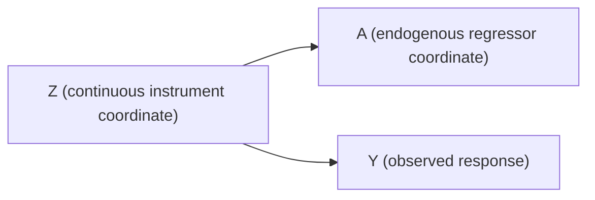

# Exact infinite sine-series NPIV conditional-moment model

## Research question

- **Question and intended use.** Recover the nonparametric IV moment-solution value g(.5) in an ill-posed inverse problem. This candidate evaluates a statistical IV functional; it does not assert that the simulator has a causal treatment effect g. Candidate for evaluation after scientific review.
- **Behavior under test.** Test regularization of an ill-posed nonparametric conditional-moment inverse problem without relabeling a statistical function value as a causal treatment effect.

## Study design and data source

- **Motivation and references.** Peter Hall; Joel L. Horowitz (2005). Nonparametric methods for inference in the presence of instrumental variables. AoS. DOI: 10.1214/009053605000000714. [Journal record](https://doi.org/10.1214/009053605000000714); [version actually read](https://arxiv.org/pdf/math/0603130v1), arXiv:math/0603130v1, electronic reprint of AoS33(6),2904–2929; Section5 Monte Carlo experiments, physical PDF p.12; mathematical infinite-series model and author computational truncation j=100. Source snapshot SHA-256: `ff09af10a0c62bd12ed465874496558d7210d0ac4d093a76e374a726663363ea`.

**Status and provenance.** Candidate for scientific review (`awaiting_scientific_review`), not accepted evaluation data. Config scenario: `explicit_adaptation`. The paper displays an infinite mathematical DGP and reports truncating series at j=100 for computation. Direct j=100 joint-density evaluation gives negative values (e.g. x=w≈.99489). This contribution implements the exact infinite mathematical model via analytic summation and rejection sampling; it does NOT claim to reproduce the author finite-truncation simulator. No clipping/renormalizing of negative finite-series density is performed. The failed finite100 density audit is preserved outside runnable scenarios. Author code/explanation is needed for the finite-100 negative-density issue. This is an exact-infinite-model adaptation, not computational reproduction of the author simulator. Maintainer must decide whether this noncausal conditional-moment task is eligible for the causal-IV collection; scientific acceptance is explicitly pending.

**Family scope.** This is one proposed family, not a count of its seeds, sample sizes or parameter settings. Same-paper and project-wide deduplication must be confirmed by the maintainer; no global novelty guarantee is made.

- **Population and sampling.** Independent pairs of continuous regressor and instrument generated from the source infinite joint sine-series density. Code uses exact-law rejection sampling and a special-function conditional mean. The source computational truncation at 100 terms is not used because its raw truncated density can be negative. Source numerical coefficients are fixed, not table-level random hyperparameters.

## DAG and identification

- **Variables and causal structure.** The nodes represent Z: continuous instrument coordinate; A: endogenous regressor coordinate; Y: observed response. Column aliases and supports are defined in the symbol table. The graph uses the stated fixed scenario; vector nodes collect their explicitly defined coordinates. Unobserved shared causes appear as substantive latent nodes. Independent epsilon disturbances appear only in the equations.
- **DAG edges.** `Z -> A, Z -> Y`



- **Assumptions.** The identifying restriction is the source conditional moment E[Y-g(A)|Z]=0 together with the relevant injectivity/completeness and regularity conditions for the inverse problem. Those conditions and numerical regularization must be reviewed for the evaluation task. The displayed DAG is the observational sampling factorization Z->A and Z->Y. There is no A->Y arrow in this generator: adding one to suggest conventional causal exclusion would misrepresent the actual equation. A causal do-intervention interpretation is not established by a conditional moment alone.

## Variables and data-generating process

- **Variables and observed input.** Observed columns X,W,Y map to A,Z,Y. No baseline X covariate exists in this case. The response is generated from Z, while g solves the conditional-moment problem. Infinite sums/log/dilogarithm terms are nonlinear; baseline interaction and high-dimensional-confounding labels are false. Actual available columns: `X`, `W`, `Y`. All methods receive the same observed table; no oracle nuisance values or potential outcomes.
- **Draw order and scenarios.** The mathematical law can be factored as drawing Z, A given Z, and then independent epsilon_Y. The implementation instead draws the equivalent joint (A,Z) law by rejection sampling, then Y; this computational order does not add an A->Y causal arrow. Sole `explicit_adaptation`: exact_infinite_mathematical_model, noise_sd=.1, query=.5. The source finite-100 computational version is a retained failed diagnostic, not a passing scenario. All roots declared independent above are mutually independent; dependence within a row arises exactly through the parent equations. Unless a conditional law is stated, root draws are independent. No interference, cluster dependence or unreported repeated measurements are added.

### Structural equations

- **Structural parents.** `Z -> A, Z -> Y`

```math
\begin{aligned}
C_f&=\frac{\pi^2}{7\zeta(3)},\qquad 0<a,z<1,\\
f_{AZ}(a,z)&=2C_f\sum_{j=1}^{\infty}\frac{(-1)^{j+1}}{j}\sin(j\pi a)\sin(j\pi z)\\
&=C_f\log\left\{\frac{\cos(\pi(a-z)/2)}{|\cos(\pi(a+z)/2)|}\right\},\\
S(z)&=\mathrm{Im}\mathrm{Li}_2(e^{i\pi z})-\tfrac14\mathrm{Im}\mathrm{Li}_2(e^{2i\pi z}),\qquad
f_Z(z)=\frac{4C_f}{\pi}S(z),\\
Z&\sim f_Z,\qquad A\mid Z=z\sim f_{AZ}(a,z)/f_Z(z).
\end{aligned}
```

```math
\begin{aligned}
g(a)&=\sqrt2\sum_{j=1}^{\infty}\frac{(-1)^{j+1}}{j^2}\sin(j\pi a),\\
r(z)&=\frac{\sqrt2\pi^4z(1-z)(2-z)}{48S(z)},\qquad
\epsilon_Y\sim N(0,.1^2),\qquad Y=r(Z)+\epsilon_Y,\\
E\{Y-g(A)\mid Z\}&=0.
\end{aligned}
```

| Symbol | Meaning | Definition or setting |
| --- | --- | --- |
| $A,Z,a,z$ | Endogenous regressor, instrument coordinates and arguments | Columns `X,W` in the code correspond to A,Z, respectively; both continuous on (0,1). No baseline covariates: dimension/effective dimension 0/0. |
| $f_{AZ},f_Z,C_f$ | Joint density, instrument marginal density and normalization | Explicit infinite-law formulas above; log density has an integrable singularity on a+z=1. Conditional density divides joint by the positive marginal. |
| $j,\pi,\zeta$ | Series index, circle constant and Riemann zeta function | j is positive integer; normalization uses zeta(3); constants are not table-level draws. |
| $S,\mathrm{Li}_2,\mathrm{Im},i$ | Odd dilogarithmic sine sum, dilogarithm, imaginary part and imaginary unit | Complex dilogarithm on the unit circle, standard analytic branch; i squared=-1. |
| $g,r$ | Structural moment solution and conditional response mean | Fully specified infinite sine series and rational/special-function expression above. These are not observed nuisance columns. |
| $Y,\epsilon_Y$ | Observed response and equation-only noise | Column `Y`; independent normal noise with SD .1, independent of the joint (A,Z) draw and across rows. |
| $a^*,G_{\rm Cat}$ | Query and Catalan constant | a*=.5; $G_{\rm Cat}=\int_0^1\arctan(t)/t\,dt$, with continuous integrand limit at t=0. |
| $\theta$ | Registered scalar target | $\theta=g(.5)=\sqrt2\,G_{\rm Cat}\approx1.2953709659525536$. This is a function value in regressor units, not ATE, LATE or an effect of changing A from 0 to 1. |

## Data-generating process and estimand

- **Estimand.** $\theta=g(.5)=\sqrt2\,G_{\rm Cat}\approx1.2953709659525536$. This is a function value in regressor units, not ATE, LATE or an effect of changing A from 0 to 1.
- **Truth check.** At .5 the even sine terms vanish and the odd terms yield sqrt(2) times Catalan's constant. Adaptive quadrature of atan(t)/t reports estimated error 1.44e-14. Independent complex dilogarithm and alternating odd-series calculation with a remainder bound verify the value; separate density/conditional-mean integrals verify the moment law and normalization. SciPy functions and the infinite model remain shared. A finite-100 grid diagnostic found minimum density about -.00490227 with 2618 negative grid values; these failures are preserved and never clipped.

## Benchmark comparison

- **Output and comparator.** Propose a sieve NPIV/regularized two-stage least-squares function estimator versus the source kernel/Tikhonov-style NPIV estimator. Both use observed X,W,Y and output g(.5); select basis size/regularization by a predeclared training-only rule. A conventional causal linear 2SLS slope is not a same-estimand baseline. No true g or r is supplied as an estimator input.
- **Scoring and replication.** Proposed comparison only; no benchmark estimator, PFN training, coverage study or large simulation has been run. After approval, use n=128 and n=512 with 1000 attempted independent tables per n, one fixed scenario (weight 1). Use the same table for all methods in each replicate. Precommit a private seed ledger mapping (case, scenario, n, replicate) to a distinct table seed, independent of the method; the seed is not a model input. Generation failures also consume an attempted replicate and are reported separately. Reserve benchmark seeds privately; the existing n=128, seed=1729 run is a reproducibility smoke test, not a benchmark result. Per n and method, report attempted count, finite completed count, failure count/reasons, bias and RMSE over finite completed estimates with their denominator. Do not drop finite extreme estimates. Score missing/nonfinite runs as failures and publish the failure rate over all 1000 attempts; never present conditional error without that rate. If methods provide nominal 95% intervals, report coverage of this case's stated target, mean finite interval length and interval-failure rate separately. Predeclare numerical tolerances, nuisance fits, fold rules and tuning before running; do not use truth for tuning. Do not average incomparable ATT, CATE, bound, function-value and slope errors into an unscaled cross-family score.

## Materials and access

- **Public materials.** The paper/version links above are the primary sources. This locally prepared proposal is not yet published or rights-approved. Paper copyright remains with the authors/publisher; no source PDF, restricted data, copied author implementation, model weights or credentials are included. Generator/truth/verification code was independently written with AI assistance; AI checks are not named scientific review. Any proposed public code license or redistribution permission requires maintainer confirmation.
- **Reproduction and protected materials.** The accompanying private candidate packet contains `contributions/iv-hall-horowitz-2005-sine-series-npiv-v1/` with collection.json, card.md, config.json, schema.csv, generator.py, truth.py, verify.py, requirements.txt, source audit and local check report (and calibration.py where needed). Use the supplied student collector from its package root with this contribution copied into contributions. Install the pinned/ranged requirements, then run `python collect.py check contributions/iv-hall-horowitz-2005-sine-series-npiv-v1 --run --n 128 --seed 1729`. Review local code before --run. Hooks take the selected scenario parameter object, not the entire config file; generation returns observed numeric columns only. The existing smoke report records truth value `1.2953709659525536` and estimated_error `1.438150671831455e-14`. These are analytic/numerical error descriptions, not sampling standard errors. The private code archive is IV_v02_新增10候选机制_待科学审核_20261126_r2.zip (SHA-256 1c375954c47b3f4afedb98e6bc649a344fa4ef000c9aa72c4d7d0e41b602cb4c). Full generators, exact configs, smoke samples/reports and future benchmark seeds/tables are supplied through the maintainer-approved private channel, not committed alongside this public proposal. No future official held-out seeds/tables have been created.
