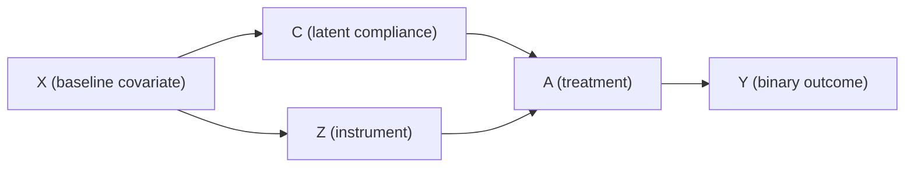

# Probit compliance with calibrated instrument strength and sharpness

## Research question

- **Question and intended use.** Estimate the complier risk difference under a compliance model with separately calibrated strength and sharpness, without treating calibrated nuisance functions as observed inputs. Candidate for evaluation after scientific review.
- **Behavior under test.** Test the distinct roles of instrument strength and compliance sharpness, while recovering a risk difference without observing the calibrated compliance function.

## Study design and data source

- **Motivation and references.** Edward H. Kennedy; Sivaraman Balakrishnan; Max G’Sell (2020). Sharp instruments for classifying compliers and generalizing causal effects. AoS. DOI: 10.1214/19-AOS1874. [Journal record](https://doi.org/10.1214/19-AOS1874); [version actually read](https://arxiv.org/pdf/1801.03635v1), arXiv:1801.03635v1; displayed PDF header May 24 2022; version/date discrepancy retained; Section 6.1, physical PDF pp.18–19; Appendix C and Appendix G simulation code p.36. Source snapshot SHA-256: `9104c7ef89bc26ebf4a30904a2b25521c396bac1449513f0fa6a29635848dbe7`.

**Status and provenance.** Candidate for scientific review (`awaiting_scientific_review`), not accepted evaluation data. Config scenario: `source_fixed`. No additional generator parameter scenario is introduced; only the fixed mechanism described below is included. The archived arXiv v1 identifier and displayed manuscript date are not fully aligned; the source PDF hash and exact sections identify the version actually read. Final journal-to-preprint equivalence and same-paper family granularity remain review items.

**Family scope.** This is one proposed family, not a count of its seeds, sample sizes or parameter settings. Same-paper and project-wide deduplication must be confirmed by the maintainer; no global novelty guarantee is made.

- **Population and sampling.** Independent subjects with a scalar normal covariate. The source Bernoulli risks and finite-grid calibration are retained. This one fixed strength/sharpness setting counts as one candidate mechanism, not 10,000 mechanisms. Source numerical coefficients are fixed, not table-level random hyperparameters.

## DAG and identification

- **Variables and causal structure.** The nodes represent X: baseline covariate; C: latent compliance; Z: instrument; A: treatment; Y: binary outcome. Column aliases and supports are defined in the symbol table. The graph uses the stated fixed scenario; vector nodes collect their explicitly defined coordinates. Unobserved shared causes appear as substantive latent nodes. Independent epsilon disturbances appear only in the equations.
- **DAG edges.** `X -> C, X -> Z, C -> A, Z -> A, A -> Y`

- **Assumptions.** Consistency, no interference, conditional random instrument given X, exclusion, nonzero first stage, and monotonicity. For C=0 the same epsilon_A determines treatment under both Z values; for C=1 treatment follows Z. There is no direct X->Y or C->Y arrow because the two potential outcome risks are constant and independent of those variables.

## Variables and data-generating process

- **Variables and observed input.** Only X,Z,A,Y are observed. C, potential outcomes, calibrated compliance probabilities and individual effects are not returned. Dimension/effective dimension 1/1; probit/logit links are nonlinear. No covariate interaction is added. Actual available columns: `X`, `Z`, `A`, `Y`. All methods receive the same observed table; no oracle nuisance values or potential outcomes.
- **Draw order and scenarios.** First calibrate fixed b0,b1 on the source log grid, then draw X and all unit disturbances, C, Z, A, Y. `source_fixed`: mu=.3, sharpness=.2, effect=.2, grid_size=10000, grid_log_min=-2.8, grid_log_max=5.5. The local monotone search checks the two bracketing grid points rather than changing the source grid. All roots declared independent above are mutually independent; dependence within a row arises exactly through the parent equations. Unless a conditional law is stated, root draws are independent. No interference, cluster dependence or unreported repeated measurements are added.

### Structural equations

- **Structural parents.** `X -> C, X -> Z, C -> A, Z -> A, A -> Y`

$$
\begin{aligned}
\mu&=.3,\quad\psi=.2,\quad q=\Phi^{-1}(\mu),\quad c_j=\exp(-2.8+8.3j/9999),\quad j=0,\ldots,9999,\\
G(b)&=\frac{\int_{-q}^{\infty}\Phi(q\sqrt{1+b^2}+bx)\phi(x)\,dx-\mu^2}{\mu-\mu^2},\\
j^*&=\operatorname*{arg\,min}_{j\in\{0,\ldots,9999\}}|G(c_j)-\psi|,\quad
b_1=c_{j^*},\quad b_0=q\sqrt{1+b_1^2}.
\end{aligned}
$$

$$
\begin{aligned}
X&\sim N(0,1),\qquad \epsilon_C,\epsilon_Z,\epsilon_A,\epsilon_0,\epsilon_1\sim\operatorname{Uniform}(0,1),\\
C&=\mathbf1\{\epsilon_C<\Phi(b_0+b_1X)\},\qquad
Z=\mathbf1\{\epsilon_Z<\operatorname{expit}(X)\},\\
A&=CZ+(1-C)\mathbf1\{\epsilon_A<.5\},\\
Y&=(1-A)\mathbf1\{\epsilon_0<.4\}+A\mathbf1\{\epsilon_1<.6\}.
\end{aligned}
$$

| Symbol | Meaning | Definition or setting |
| --- | --- | --- |
| $\mu,\psi$ | Source strength and sharpness settings | .3 and .2; fixed for the entire dataset; not the treatment effect. |
| $\Phi,\phi,q$ | Standard-normal CDF, density and quantile | $q=\Phi^{-1}(.3)$, used in the analytic strength identity. |
| $j,j^*,c_j,b$ | Calibration grid, minimizing index, grid slope and argument | 10,000 positive slopes exp(-2.8+8.3j/9999); choose closest sharpness, smaller index on a tie. No continuous-root replacement. |
| $G,x$ | Sharpness functional and integration variable | Explicit integral above; x is a dummy covariate value. Numerical implementation integrates to 12; omitted normal tail is below 2e-33. |
| $b_0,b_1$ | Frozen intercept and slope | Calibrated once by the displayed finite grid for (.3,.2); shared across all subjects/tables. |
| $X,C,Z$ | Baseline, compliance and instrument | X and Z are columns `X,Z`; C is latent. Total/effective covariate dimension 1/1. |
| $A,Y$ | Treatment and observed binary outcome | Columns `A,Y`; noncompliers have a randomized fixed treatment state, and all subjects have outcome risks .4/.6 under treatment 0/1. |
| $\epsilon_C,\epsilon_Z,\epsilon_A,\epsilon_0,\epsilon_1$ | Unit disturbances | Mutually independent uniform(0,1), independent of X and across subjects. The shared noncomplier treatment draw is held fixed when intervening on Z. |
| $\operatorname{expit},\mathbf1$ | Logistic link and indicator | Logistic link and event indicator. |
| $\theta$ | Registered scalar target | $\theta=E\{Y(1)-Y(0)\mid C=1\}=.6-.4=.2$, an additive risk difference for treatment 0 to 1. |

## Data-generating process and estimand

- **Estimand.** $\theta=E\{Y(1)-Y(0)\mid C=1\}=.6-.4=.2$, an additive risk difference for treatment 0 to 1.
- **Truth check.** The independent potential outcome risks give .2 analytically. Verification separately integrates compliance strength and sharpness and checks neighboring grid indices and a zero-effect case. The calibration helper is shared by the sampling implementation; the independent integral checks use the same mathematical normal CDF library, so this is not complete software independence.

## Benchmark comparison

- **Output and comparator.** Propose a conditional Wald/complier-weighted risk-difference estimator motivated by the source against covariate-adjusted 2SLS for the homogeneous effect. Both receive X,Z,A,Y only and output the same additive complier contrast. Compliance classification sharpness may be an auxiliary diagnostic, not a replacement score for the treatment effect.
- **Scoring and replication.** Proposed comparison only; no benchmark estimator, PFN training, coverage study or large simulation has been run. After approval, use n=128 and n=512 with 1000 attempted independent tables per n, one fixed scenario (weight 1). Use the same table for all methods in each replicate. Precommit a private seed ledger mapping (case, scenario, n, replicate) to a distinct table seed, independent of the method; the seed is not a model input. Generation failures also consume an attempted replicate and are reported separately. Reserve benchmark seeds privately; the existing n=128, seed=1729 run is a reproducibility smoke test, not a benchmark result. Per n and method, report attempted count, finite completed count, failure count/reasons, bias and RMSE over finite completed estimates with their denominator. Do not drop finite extreme estimates. Score missing/nonfinite runs as failures and publish the failure rate over all 1000 attempts; never present conditional error without that rate. If methods provide nominal 95% intervals, report coverage of this case's stated target, mean finite interval length and interval-failure rate separately. Predeclare numerical tolerances, nuisance fits, fold rules and tuning before running; do not use truth for tuning. Do not average incomparable ATT, CATE, bound, function-value and slope errors into an unscaled cross-family score.

## Materials and access

- **Public materials.** The paper/version links above are the primary sources. This locally prepared proposal is not yet published or rights-approved. Paper copyright remains with the authors/publisher; no source PDF, restricted data, copied author implementation, model weights or credentials are included. Generator/truth/verification code was independently written with AI assistance; AI checks are not named scientific review. Any proposed public code license or redistribution permission requires maintainer confirmation.
- **Reproduction and protected materials.** The accompanying private candidate packet contains `contributions/iv-kennedy-balakrishnan-gsell-2020-probit-sharpness-compliance-v1/` with collection.json, card.md, config.json, schema.csv, generator.py, truth.py, verify.py, requirements.txt, source audit and local check report (and calibration.py where needed). Use the supplied student collector from its package root with this contribution copied into contributions. Install the pinned/ranged requirements, then run `python collect.py check contributions/iv-kennedy-balakrishnan-gsell-2020-probit-sharpness-compliance-v1 --run --n 128 --seed 1729`. Review local code before --run. Hooks take the selected scenario parameter object, not the entire config file; generation returns observed numeric columns only. The existing smoke report records truth value `0.2` and estimated_error `0.0`. These are analytic/numerical error descriptions, not sampling standard errors. The private code archive is IV_v02_新增10候选机制_待科学审核_20261126_r2.zip (SHA-256 1c375954c47b3f4afedb98e6bc649a344fa4ef000c9aa72c4d7d0e41b602cb4c). Full generators, exact configs, smoke samples/reports and future benchmark seeds/tables are supplied through the maintainer-approved private channel, not committed alongside this public proposal. No future official held-out seeds/tables have been created.
