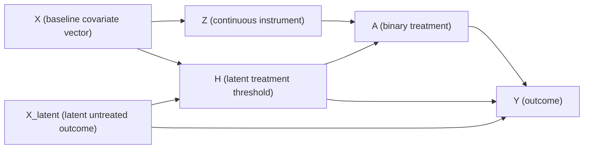

# Continuous-instrument latent-threshold local IV curve

## Research question

- **Question and intended use.** Estimate the slope of a local instrumental-variable effect curve under continuous-instrument threshold selection. Candidate for evaluation after scientific review.
- **Behavior under test.** Test whether continuous-instrument methods recover an interior LIV-curve slope under latent threshold confounding and truncated support rather than substituting the marginal ATE.

## Study design and data source

- **Motivation and references.** Edward H. Kennedy; Scott Lorch; Dylan S. Small (2019). Robust causal inference with continuous instruments using the local instrumental variable curve. JRSS-B. DOI: 10.1111/rssb.12300. [Journal record](https://doi.org/10.1111/rssb.12300); [version actually read](https://arxiv.org/pdf/1607.02566v3), arXiv:1607.02566v3; Section 4 Simulation Study, physical PDF pp.18–19. Source snapshot SHA-256: `d79d676c063921645ffd6737a30b70df53afe02854958bb4bca8bc0915476ec1`.

**Status and provenance.** Candidate for scientific review (`awaiting_scientific_review`), not accepted evaluation data. Config scenario: `source_fixed`. No additional generator parameter scenario is introduced; only the fixed mechanism described below is included. Author computational replication and final-journal equivalence of the pinned arXiv version have not been established. The statistical target is the LIV curve slope, not a renamed ATE.

**Family scope.** This is one proposed family, not a count of its seeds, sample sizes or parameter settings. Same-paper and project-wide deduplication must be confirmed by the maintainer; no global novelty guarantee is made.

- **Population and sampling.** Independent subjects. The source joint (Y0,X) standard multivariate normal makes Y0 independent of four baseline covariates. Conditional instrument sampling is a truncated normal, independent of the latent untreated outcome and threshold disturbance given X. Source numerical coefficients are fixed, not table-level random hyperparameters.

## DAG and identification

- **Variables and causal structure.** The nodes represent X: baseline covariate vector; X_latent: latent untreated outcome; Z: continuous instrument; H: latent treatment threshold; A: binary treatment; Y: outcome. Column aliases and supports are defined in the symbol table. The graph uses the stated fixed scenario; vector nodes collect their explicitly defined coordinates. Unobserved shared causes appear as substantive latent nodes. Independent epsilon disturbances appear only in the equations.
- **DAG edges.** `X -> Z, X -> H, X_latent -> H, Z -> A, H -> A, X_latent -> Y, H -> Y, A -> Y`



- **Assumptions.** Consistency, no interference, conditional instrument independence and exclusion, monotonic selection A=1{Z>=H}, continuous instrument support and positive threshold density in the interior. These identify the LIV curve on the supported threshold interval. The curve is linear with slope psi. Nothing here identifies a general curve outside the observed instrument support.

## Variables and data-generating process

- **Variables and observed input.** Observed columns X1,...,X4,Z,A,Y. Alias X_latent=source Y0 and H=source latent T. Neither is returned. Dimension/effective dimension 4/4. Nonlinearity is due to sign, truncation and treatment threshold, not an invented treatment-by-baseline interaction. Actual available columns: `X1`, `X2`, `X3`, `X4`, `Z`, `A`, `Y`. All methods receive the same observed table; no oracle nuisance values or potential outcomes.
- **Draw order and scenarios.** Draw baseline and latent roots, then Z conditionally on X, H, A, Y. `source_fixed`: psi=1, alpha=[1,1,-1,-1], beta=[1,-1,-1,1], z_sd=2 and bounds[-2,2]. All draws are at subject level and independent between rows. All roots declared independent above are mutually independent; dependence within a row arises exactly through the parent equations. Unless a conditional law is stated, root draws are independent. No interference, cluster dependence or unreported repeated measurements are added.

### Structural equations

- **Structural parents.** `X -> Z, X -> H, X_latent -> H, Z -> A, H -> A, X_latent -> Y, H -> Y, A -> Y`

```math
\begin{aligned}
X&=(X_1,X_2,X_3,X_4)\sim N_4(0,I_4),\quad X_{\mathrm{latent}},\epsilon_H\sim N(0,1),\\
\alpha&=(1,1,-1,-1)^\top,\qquad\beta=(1,-1,-1,1)^\top,\qquad\psi=1,\\
m_Z(x)&=1.5\mathrm{sign}(\alpha^\top x),\quad
Z\mid X=x\sim\mathrm{TN}_{[-2,2]}(m_Z(x),2^2),\\
H&=\beta^\top X+X_{\mathrm{latent}}+\epsilon_H,\qquad A=\mathbf{1}\{Z\geq H\},\\
Y&=X_{\mathrm{latent}}+A\psi H.
\end{aligned}
```

```math
f_Z(z\mid x)=\frac{\phi((z-m_Z(x))/2)}{2\{\Phi((2-m_Z(x))/2)-\Phi((-2-m_Z(x))/2)\}}\mathbf{1}\{-2\leq z\leq2\}.
```

| Symbol | Meaning | Definition or setting |
| --- | --- | --- |
| $X,X_j,x,I_4$ | Baseline vector, coordinates, argument and identity matrix | Columns `X1` through `X4`; independent standard normals; total/effective dimension 4/4. |
| $X_{\mathrm{latent}}$ | Untreated potential outcome | Source Y0; independent standard normal and unobserved, shared by threshold and outcome. |
| $\alpha,\beta,\psi$ | Instrument-mean vector, threshold vector, effect-curve slope | Fixed values substituted above; beta is not the causal slope. |
| $m_Z,\mathrm{sign}$ | Truncated-instrument location function and sign | $1.5\mathrm{sign}(\alpha^\top x)$; sign(0)=0, an event of probability zero. |
| $Z,f_Z,\mathrm{TN}_{[-2,2]}$ | Instrument, conditional density and truncated normal | Column `Z`; location m_Z, pre-truncation SD 2; conditional support [-2,2]. |
| $H,A,Y$ | Latent threshold, observed treatment and outcome | H is source threshold T, not a time index; columns `A,Y` observed; H never exported. |
| $\epsilon_H$ | Threshold disturbance | N(0,1), independent of X and latent untreated outcome. The conditional TN instrument draw is independent of both latent roots given X. |
| $\Phi,\phi,\mathbf{1}$ | Normal CDF, density and indicator | Standard normal functions and event indicator. |
| $t$ | Threshold argument in the LIV curve | Within instrument support (-2,2); curve $\gamma(t)=\psi t$. |
| $\gamma$ | LIV effect-curve function | $\gamma(t)=\psi t$, the conditional treatment contrast at threshold t, not an outcome-regression nuisance. |
| $\theta$ | Registered scalar target | $\gamma(t)=E\{Y(1)-Y(0)\mid H=t\}=\psi t$, with registered scalar target $\theta=\psi=1$. This is a LIV-curve slope; the unconditional ATE in this simulator is zero and is a different target. |

## Data-generating process and estimand

- **Estimand.** $\gamma(t)=E\{Y(1)-Y(0)\mid H=t\}=\psi t$, with registered scalar target $\theta=\psi=1$. This is a LIV-curve slope; the unconditional ATE in this simulator is zero and is a different target.
- **Truth check.** Conditional on X=x, H is normal with mean beta-transpose-x and variance 2. The derivative in z of E[Y|Z=z,X=x] divided by the derivative of E[A|Z=z,X=x] equals psi*z. Independent finite-difference and quadrature checks recover this curve and its slope at nonzero interior instrument points, plus a zero-effect special case. Standard normal functions and coefficients are shared, but not generator/truth code.

## Benchmark comparison

- **Output and comparator.** Propose the source doubly robust LIV curve-slope estimator versus an inverse-probability LIV slope estimator, using the same observed inputs and interior instrument region. Both must fit/estimate instrument and outcome nuisances rather than read their simulator values. ATE or binary-instrument Wald estimates cannot be scored as psi.
- **Scoring and replication.** Proposed comparison only; no benchmark estimator, PFN training, coverage study or large simulation has been run. After approval, use n=128 and n=512 with 1000 attempted independent tables per n, one fixed scenario (weight 1). Use the same table for all methods in each replicate. Precommit a private seed ledger mapping (case, scenario, n, replicate) to a distinct table seed, independent of the method; the seed is not a model input. Generation failures also consume an attempted replicate and are reported separately. Reserve benchmark seeds privately; the existing n=128, seed=1729 run is a reproducibility smoke test, not a benchmark result. Per n and method, report attempted count, finite completed count, failure count/reasons, bias and RMSE over finite completed estimates with their denominator. Do not drop finite extreme estimates. Score missing/nonfinite runs as failures and publish the failure rate over all 1000 attempts; never present conditional error without that rate. If methods provide nominal 95% intervals, report coverage of this case's stated target, mean finite interval length and interval-failure rate separately. Predeclare numerical tolerances, nuisance fits, fold rules and tuning before running; do not use truth for tuning. Do not average incomparable ATT, CATE, bound, function-value and slope errors into an unscaled cross-family score.

## Materials and access

- **Public materials.** The paper/version links above are the primary sources. This locally prepared proposal is not yet published or rights-approved. Paper copyright remains with the authors/publisher; no source PDF, restricted data, copied author implementation, model weights or credentials are included. Generator/truth/verification code was independently written with AI assistance; AI checks are not named scientific review. Any proposed public code license or redistribution permission requires maintainer confirmation.
- **Reproduction and protected materials.** The accompanying private candidate packet contains `contributions/iv-kennedy-lorch-small-2019-continuous-latent-threshold-v1/` with collection.json, card.md, config.json, schema.csv, generator.py, truth.py, verify.py, requirements.txt, source audit and local check report (and calibration.py where needed). Use the supplied student collector from its package root with this contribution copied into contributions. Install the pinned/ranged requirements, then run `python collect.py check contributions/iv-kennedy-lorch-small-2019-continuous-latent-threshold-v1 --run --n 128 --seed 1729`. Review local code before --run. Hooks take the selected scenario parameter object, not the entire config file; generation returns observed numeric columns only. The existing smoke report records truth value `1.0` and estimated_error `0.0`. These are analytic/numerical error descriptions, not sampling standard errors. The private code archive is IV_v02_新增10候选机制_待科学审核_20261126_r2.zip (SHA-256 1c375954c47b3f4afedb98e6bc649a344fa4ef000c9aa72c4d7d0e41b602cb4c). Full generators, exact configs, smoke samples/reports and future benchmark seeds/tables are supplied through the maintainer-approved private channel, not committed alongside this public proposal. No future official held-out seeds/tables have been created.
