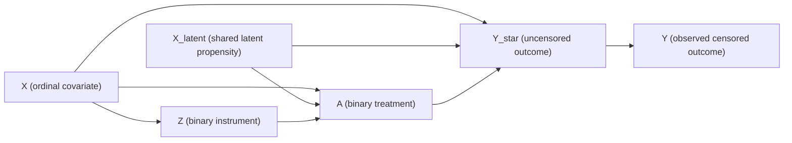

# Ordinal-covariate probit IV with a censored outcome

## Research question

- **Question and intended use.** Estimate the treatment effect on the observed mixed/censored response among compliers, distinguishing it from the latent linear response coefficient. Candidate for evaluation after scientific review.
- **Behavior under test.** Test how outcome censoring and endogenous treatment change the complier observed-response contrast relative to a latent linear coefficient.

## Study design and data source

- **Motivation and references.** Myoung-jae Lee (2021). Instrument Residual Estimator for Any Response Variable with Endogenous Binary Treatment. JRSS-B. DOI: 10.1111/rssb.12442. [Journal record](https://doi.org/10.1111/rssb.12442); [version actually read](https://oup.silverchair-cdn.com/article-minimal/7056018), Publisher full HTML, retrieved 2026-11-26; Section5 Simulation Study, displayed DGP and following true-effect formulas; publisher HTML lines324–336 (retrieval snapshot). Source snapshot SHA-256: `d7b48518e9f6a051628d27e3a565001f3ad479b7535c3b4cb31362acbb9add35`.

**Status and provenance.** Candidate for scientific review (`awaiting_scientific_review`), not accepted evaluation data. Config scenario: `explicit_adaptation`. Source says U=kappa+epsilon (standardized) without spelling out population versus sample operation. This explicit adaptation sets U=(kappa+epsilon)/sqrt(2), never sample-centers or sample-scales. Source mixed-outcome case and psi3=.5,beta3=.25 selected. No raw Y* or latent epsilon is exported. Source author GAUSS code or clarification is still needed to settle population versus sample standardization. This scenario remains an explicit adaptation. Benchmark estimators are proposed, not implemented or run.

**Family scope.** This is one proposed family, not a count of its seeds, sample sizes or parameter settings. Same-paper and project-wide deduplication must be confirmed by the maintainer; no global novelty guarantee is made.

- **Population and sampling.** Independent subjects with one four-level ordinal baseline variable. Source Section 5 mixed-response design is retained except that the ambiguous standardization operation is explicitly defined as a population standardization. Source numerical coefficients are fixed, not table-level random hyperparameters.

## DAG and identification

- **Variables and causal structure.** The nodes represent X: ordinal covariate; X_latent: shared latent propensity; Z: binary instrument; A: binary treatment; Y_star: uncensored outcome; Y: observed censored outcome. Column aliases and supports are defined in the symbol table. The graph uses the stated fixed scenario; vector nodes collect their explicitly defined coordinates. Unobserved shared causes appear as substantive latent nodes. Independent epsilon disturbances appear only in the equations.
- **DAG edges.** `X -> Z, X -> A, X_latent -> A, Z -> A, X -> Y_star, X_latent -> Y_star, A -> Y_star, Y_star -> Y`

- **Assumptions.** Consistency, no interference, conditional instrument randomization given X, exclusion, and monotonicity under the common treatment error. At X=x, compliers have 1-x<X_latent<3-x. Instrument probabilities are strictly interior at each ordinal level. The standardized shared latent propensity creates treatment-outcome confounding; censoring creates a nonlinear observed effect.

## Variables and data-generating process

- **Variables and observed input.** Observed columns X2,Z,A,Y only; latent Y_star and shared propensity are not returned. Dimension/effective dimension 1/1, no high-dimensional claim. Nonlinearity is the squared covariate, threshold assignment and censoring. No extra covariate interaction is introduced. Actual available columns: `X2`, `Z`, `A`, `Y`. All methods receive the same observed table; no oracle nuisance values or potential outcomes.
- **Draw order and scenarios.** Draw ordinal X and independent normal roots, then Z,A,Y_star,Y. Sole `explicit_adaptation`: probabilities=[.2,.3,.3,.2], psi3=.5, beta3=.25, effect=1, u_sd_scale=sqrt(2). This implements population variance-one U, not the unconfirmed author finite-sample scaling. All roots declared independent above are mutually independent; dependence within a row arises exactly through the parent equations. Unless a conditional law is stated, root draws are independent. No interference, cluster dependence or unreported repeated measurements are added.

### Structural equations

- **Structural parents.** `X -> Z, X -> A, X_latent -> A, Z -> A, X -> Y_star, X_latent -> Y_star, A -> Y_star, Y_star -> Y`

$$
\bigl(P(X=0),P(X=1),P(X=2),P(X=3)\bigr)=(.2,.3,.3,.2),\quad
X_{\mathrm{latent}},\epsilon_Z,\epsilon_Y\sim N(0,1).
$$

$$
\begin{aligned}
Z&=\mathbf1\{-3+X+.5X^2+\epsilon_Z>0\},\\
A&=\mathbf1\{-3+X+2Z+X_{\mathrm{latent}}>0\},\\
Y_{\mathrm{star}}&=-3+X+.25X^2+A+(X_{\mathrm{latent}}+\epsilon_Y)/\sqrt2,\\
Y&=\min(0,Y_{\mathrm{star}}).
\end{aligned}
$$

| Symbol | Meaning | Definition or setting |
| --- | --- | --- |
| $X$ | Observed ordinal covariate | Column `X2`, numeric codes 0,1,2,3 with probabilities .2,.3,.3,.2; total/effective dimension 1/1. |
| $X_{\mathrm{latent}}$ | Shared latent treatment propensity | Source treatment error; independent N(0,1), affects treatment and uncensored outcome, not exported. |
| $\epsilon_Z,\epsilon_Y$ | Unit disturbances | Source xi and kappa; independent standard normals, independent of X and the shared latent propensity and between rows. |
| $Z,A$ | Observed instrument and treatment | Columns `Z,A`; binary probit-threshold variables. The source calls treatment D. |
| $Y_{\mathrm{star}},Y$ | Unobserved continuous outcome and observed mixed outcome | Y_star is latent; column `Y` equals min(0,Y_star), with mass at zero and continuous negative values. |
| $\sqrt2$ | Population standardization divisor | Explicit adaptation of source phrase standardized: sum of two independent N(0,1) terms divided by sqrt(2); no sample centering/scaling. |
| Numeric coefficients | Fixed selected scenario | Probit quadratic coefficient .5; outcome quadratic coefficient .25; treatment coefficient 1; instrument treatment shift 2; intercepts -3. |
| $\mathbf1,\min$ | Indicator and censoring map | Standard event indicator and deterministic upper censoring at 0. |
| $\beta_{cp}$ | Complier observed-outcome effect | Treatment 0-to-1 effect after censoring, conditional on the common-error complier interval; not the latent response coefficient 1. |
| $\theta$ | Registered scalar target | $\theta=\beta_{cp}=E\{\min(0,Y_{\mathrm{star}}(1))-\min(0,Y_{\mathrm{star}}(0))\mid A(1)>A(0)\}\approx .4293336071138788$. The effect is for the observed outcome, treatment 0 to 1. |

## Data-generating process and estimand

- **Estimand.** $\theta=\beta_{cp}=E\{\min(0,Y_{\mathrm{star}}(1))-\min(0,Y_{\mathrm{star}}(0))\mid A(1)>A(0)\}\approx .4293336071138788$. The effect is for the observed outcome, treatment 0 to 1.
- **Truth check.** For x and latent e in the complier interval, set m=-3+x+.25x^2+e/sqrt(2), s=1/sqrt(2). The normal negative-part mean F(m)=m*Phi(-m/s)-s*phi(m/s) gives conditional effect F(m+1)-F(m). Sum its integral against phi(e) over 1-x<e<3-x with the four source covariate masses and divide by the total complier probability. Adaptive quadrature error estimate is 4.77e-15, not a universal rigorous bound. Independent Gauss–Legendre integration of a Gaussian-CDF tail identity agrees to machine precision; common SciPy CDF routines remain shared. Zero treatment and uncensored-response special cases are checked.

## Benchmark comparison

- **Output and comparator.** Propose the complier-weighted estimator discussed as TAN in the source versus an aggregated conditional Wald estimator using complier first-stage weights. Both target beta_cp on the observed response and receive X2,Z,A,Y. Source overlap-weighted IRE slopes and the latent coefficient 1 are different targets and cannot be placed in the same error column. No outcome or instrument trimming that changes the target is silently applied.
- **Scoring and replication.** Proposed comparison only; no benchmark estimator, PFN training, coverage study or large simulation has been run. After approval, use n=128 and n=512 with 1000 attempted independent tables per n, one fixed scenario (weight 1). Use the same table for all methods in each replicate. Precommit a private seed ledger mapping (case, scenario, n, replicate) to a distinct table seed, independent of the method; the seed is not a model input. Generation failures also consume an attempted replicate and are reported separately. Reserve benchmark seeds privately; the existing n=128, seed=1729 run is a reproducibility smoke test, not a benchmark result. Per n and method, report attempted count, finite completed count, failure count/reasons, bias and RMSE over finite completed estimates with their denominator. Do not drop finite extreme estimates. Score missing/nonfinite runs as failures and publish the failure rate over all 1000 attempts; never present conditional error without that rate. If methods provide nominal 95% intervals, report coverage of this case's stated target, mean finite interval length and interval-failure rate separately. Predeclare numerical tolerances, nuisance fits, fold rules and tuning before running; do not use truth for tuning. Do not average incomparable ATT, CATE, bound, function-value and slope errors into an unscaled cross-family score.

## Materials and access

- **Public materials.** The paper/version links above are the primary sources. This locally prepared proposal is not yet published or rights-approved. Paper copyright remains with the authors/publisher; no source PDF, restricted data, copied author implementation, model weights or credentials are included. Generator/truth/verification code was independently written with AI assistance; AI checks are not named scientific review. Any proposed public code license or redistribution permission requires maintainer confirmation.
- **Reproduction and protected materials.** The accompanying private candidate packet contains `contributions/iv-lee-2021-ordinal-probit-mixed-outcome-v1/` with collection.json, card.md, config.json, schema.csv, generator.py, truth.py, verify.py, requirements.txt, source audit and local check report (and calibration.py where needed). Use the supplied student collector from its package root with this contribution copied into contributions. Install the pinned/ranged requirements, then run `python collect.py check contributions/iv-lee-2021-ordinal-probit-mixed-outcome-v1 --run --n 128 --seed 1729`. Review local code before --run. Hooks take the selected scenario parameter object, not the entire config file; generation returns observed numeric columns only. The existing smoke report records truth value `0.4293336071138788` and estimated_error `4.766560558631991e-15`. These are analytic/numerical error descriptions, not sampling standard errors. The private code archive is IV_v02_新增10候选机制_待科学审核_20261126_r2.zip (SHA-256 1c375954c47b3f4afedb98e6bc649a344fa4ef000c9aa72c4d7d0e41b602cb4c). Full generators, exact configs, smoke samples/reports and future benchmark seeds/tables are supplied through the maintainer-approved private channel, not committed alongside this public proposal. No future official held-out seeds/tables have been created.
