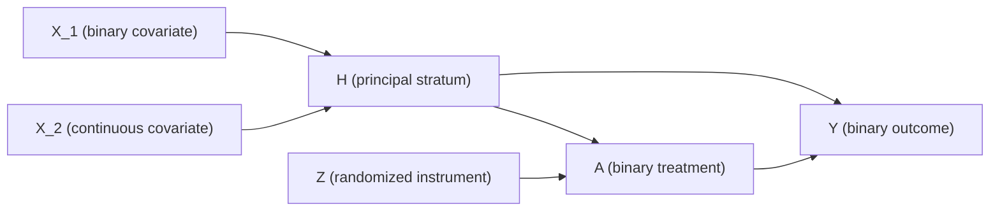

# Covariate-assisted sharp IV bounds with defiers

## Research question

- **Question and intended use.** Estimate the covariate-adjusted sharp lower bound on the ATE under the basic binary IV model with defiers. Candidate for evaluation after scientific review.
- **Behavior under test.** Test partial-identification methods when defiers invalidate monotonicity, and distinguish estimation of an identified bound endpoint from estimation of a simulator-specific ATE.

## Study design and data source

- **Motivation and references.** Alexander W Levis; Matteo Bonvini; Zhenghao Zeng; Luke Keele; Edward H Kennedy (2025). Covariate-assisted bounds on causal effects with instrumental variables. JRSS-B. DOI: 10.1093/jrsssb/qkaf028. [Journal record](https://doi.org/10.1093/jrsssb/qkaf028); [version actually read](https://arxiv.org/pdf/2301.12106v3), arXiv:2301.12106v3; Section 3.2 Motivating Illustration, physical PDF p.6; Theorem1 bound expressions. Source snapshot SHA-256: `cbb9c856571eecab7883ad37bdb6f96c8ef9cb2b3f852904663ad2f1ec9d0ae4`.

**Status and provenance.** Candidate for scientific review (`awaiting_scientific_review`), not accepted evaluation data. Config scenario: `source_fixed`. No additional generator parameter scenario is introduced; only the fixed mechanism described below is included. Global family novelty and whether partial-identification endpoints belong in the same IV leaderboard require maintainer confirmation. The simulator ATE is known, but the proposed information model does not point-identify it.

**Family scope.** This is one proposed family, not a count of its seeds, sample sizes or parameter settings. Same-paper and project-wide deduplication must be confirmed by the maintainer; no global novelty guarantee is made.

- **Population and sampling.** Independent subjects with two baseline variables. Source motivating illustration deliberately makes compliance type a deterministic function of the observed covariates. The model used for the sharp bounds is weaker than full knowledge of the simulator. Source numerical coefficients are fixed, not table-level random hyperparameters.

## DAG and identification

- **Variables and causal structure.** The nodes represent X_1: binary covariate; X_2: continuous covariate; H: principal stratum; Z: randomized instrument; A: binary treatment; Y: binary outcome. Column aliases and supports are defined in the symbol table. The graph uses the stated fixed scenario; vector nodes collect their explicitly defined coordinates. Unobserved shared causes appear as substantive latent nodes. Independent epsilon disturbances appear only in the equations.
- **DAG edges.** `X_1 -> H, X_2 -> H, H -> A, Z -> A, H -> Y, A -> Y`



- **Assumptions.** Consistency, no interference, randomized instrument and exclusion hold. Monotonicity is deliberately false: defiers have positive probability. Identification is partial. The observed conditional distribution alone constrains the unknown counterfactual outcome risks for always/never-takers; supplying their simulator counterfactual risks to the estimator would over-identify the bound and change the task.

## Variables and data-generating process

- **Variables and observed input.** Observed X1,X2,Z,A,Y only. H and potential treatments/outcomes are not exported. Dimension/effective dimension 2/2; nonlinearity and interaction arise in the X1-dependent middle-interval defier rule. No independent rows are dropped at thresholds. Actual available columns: `X1`, `X2`, `Z`, `A`, `Y`. All methods receive the same observed table; no oracle nuisance values or potential outcomes.
- **Draw order and scenarios.** Draw independent roots, classify H, compute A, then draw observed Y. `source_fixed`: x1_probability=.7, threshold=.99, defier_low=-.5, defier_high=.5, risks/differences as displayed. The Bernoulli observed law does not require choosing an unreported joint law for Y(0),Y(1). All roots declared independent above are mutually independent; dependence within a row arises exactly through the parent equations. Unless a conditional law is stated, root draws are independent. No interference, cluster dependence or unreported repeated measurements are added.

### Structural equations

- **Structural parents.** `X_1 -> H, X_2 -> H, H -> A, Z -> A, H -> Y, A -> Y`

```math
X_1\sim\mathrm{Bernoulli}(.7),\quad X_2\sim\mathrm{Uniform}(-1,1),\quad
Z\sim\mathrm{Bernoulli}(.5),\quad\epsilon_Y\sim\mathrm{Uniform}(0,1).
```

```math
\begin{aligned}
H&=\begin{cases}
\mathrm{AT},&X_2\geq .99,\\
\mathrm{NT},&X_2\leq -.99,\\
\mathrm{DF},&X_1=0\ \text{and}\ -.5<X_2\leq .5,\\
\mathrm{CP},&\text{otherwise},
\end{cases}\\
A&=\mathbf{1}\{H=\mathrm{AT}\}+(1-Z)\mathbf{1}\{H=\mathrm{DF}\}+Z\mathbf{1}\{H=\mathrm{CP}\},\\
(r_{0,h},d_h)_{h=\mathrm{AT},\mathrm{NT},\mathrm{DF},\mathrm{CP}}
&=((.20,.10),(.90,.05),(.65,.05),(.25,.10)),\\
r_{a,h}&=r_{0,h}+a d_h,\qquad Y=\mathbf{1}\{\epsilon_Y<r_{A,H}\}.
\end{aligned}
```

| Symbol | Meaning | Definition or setting |
| --- | --- | --- |
| $X_1,X_2$ | Baseline covariates | Columns `X1,X2`; independent roots with the laws shown. Total/effective dimension 2/2. |
| $Z,A,Y$ | Observed instrument, treatment and outcome | Columns `Z,A,Y`, all binary. Z randomized independently of X and noise. |
| $H,h$ | Principal stratum and its index | AT always-taker, NT never-taker, DF defier, CP complier; deterministic covariate function, unexported. This is not an unknown random disturbance. |
| $r_{0,h},r_{a,h},d_h,a$ | Untreated risk, treated/untreated risk function, risk difference and treatment argument | Explicit numeric pairs above; a=0 or 1. Values are fixed across subjects, indexed by stratum. |
| $\epsilon_Y,\mathbf{1}$ | Outcome disturbance and indicator | Independent uniform(0,1) per row and event indicator. Only observed-outcome Bernoulli sampling is required; no source-specified joint potential-outcome coupling is asserted. |
| Thresholds and root probabilities | Fixed source values | .99,-.99,-.5,.5 and probabilities .7,.5; boundaries have zero probability for continuous X2. |
| $L(P),U(P)$ | Covariate-adjusted sharp ATE bound endpoints | Defined under the basic binary IV model conditional on X, without monotonicity or hidden counterfactual-risk restrictions. |
| $\theta$ | Registered scalar target | $\theta=L(P)=.0835$, the sharp lower endpoint for $E[Y(1)-Y(0)]$ conditional-IV bounds averaged over X. The upper endpoint is .0935; the simulator ATE .09225 is auxiliary and must not replace the lower-bound target. |

## Data-generating process and estimand

- **Estimand.** $\theta=L(P)=.0835$, the sharp lower endpoint for $E[Y(1)-Y(0)]$ conditional-IV bounds averaged over X. The upper endpoint is .0935; the simulator ATE .09225 is auxiliary and must not replace the lower-bound target.
- **Truth check.** AT,NT,DF,CP masses are .005,.005,.15,.84. Their sharp conditional lower endpoints are -.7,-.9,.05,.10; weighted averaging gives .0835. Independent linear programming over the 16 deterministic binary response types with observed cell constraints yields both endpoints. ATE inclusion and perfect-compliance/zero-effect special cases are checked. With zero effects the bounds need not collapse to zero.

## Benchmark comparison

- **Output and comparator.** Propose the source one-step covariate-assisted lower-bound estimator versus a conditional Balke–Pearl plug-in estimator. Both receive only X1,X2,Z,A,Y, fit conditional observed cell probabilities, and output the lower endpoint. The deterministic H partition is not supplied as an oracle column. Any common basis/covariate partition must be predeclared for both methods. Interval coverage, if evaluated, refers to L(P), not to the simulator ATE.
- **Scoring and replication.** Proposed comparison only; no benchmark estimator, PFN training, coverage study or large simulation has been run. After approval, use n=128 and n=512 with 1000 attempted independent tables per n, one fixed scenario (weight 1). Use the same table for all methods in each replicate. Precommit a private seed ledger mapping (case, scenario, n, replicate) to a distinct table seed, independent of the method; the seed is not a model input. Generation failures also consume an attempted replicate and are reported separately. Reserve benchmark seeds privately; the existing n=128, seed=1729 run is a reproducibility smoke test, not a benchmark result. Per n and method, report attempted count, finite completed count, failure count/reasons, bias and RMSE over finite completed estimates with their denominator. Do not drop finite extreme estimates. Score missing/nonfinite runs as failures and publish the failure rate over all 1000 attempts; never present conditional error without that rate. If methods provide nominal 95% intervals, report coverage of this case's stated target, mean finite interval length and interval-failure rate separately. Predeclare numerical tolerances, nuisance fits, fold rules and tuning before running; do not use truth for tuning. Do not average incomparable ATT, CATE, bound, function-value and slope errors into an unscaled cross-family score.

## Materials and access

- **Public materials.** The paper/version links above are the primary sources. This locally prepared proposal is not yet published or rights-approved. Paper copyright remains with the authors/publisher; no source PDF, restricted data, copied author implementation, model weights or credentials are included. Generator/truth/verification code was independently written with AI assistance; AI checks are not named scientific review. Any proposed public code license or redistribution permission requires maintainer confirmation.
- **Reproduction and protected materials.** The accompanying private candidate packet contains `contributions/iv-levis-et-al-2025-defier-balke-pearl-bounds-v1/` with collection.json, card.md, config.json, schema.csv, generator.py, truth.py, verify.py, requirements.txt, source audit and local check report (and calibration.py where needed). Use the supplied student collector from its package root with this contribution copied into contributions. Install the pinned/ranged requirements, then run `python collect.py check contributions/iv-levis-et-al-2025-defier-balke-pearl-bounds-v1 --run --n 128 --seed 1729`. Review local code before --run. Hooks take the selected scenario parameter object, not the entire config file; generation returns observed numeric columns only. The existing smoke report records truth value `0.0835` and estimated_error `0.0`. These are analytic/numerical error descriptions, not sampling standard errors. The private code archive is IV_v02_新增10候选机制_待科学审核_20261126_r2.zip (SHA-256 1c375954c47b3f4afedb98e6bc649a344fa4ef000c9aa72c4d7d0e41b602cb4c). Full generators, exact configs, smoke samples/reports and future benchmark seeds/tables are supplied through the maintainer-approved private channel, not committed alongside this public proposal. No future official held-out seeds/tables have been created.
