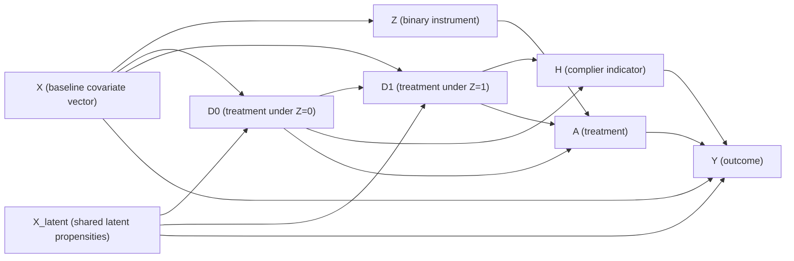

# Gaussian principal-stratum selection with 200 correlated covariates


## Research question


- **Question and intended use.** Recover the constant complier treatment contrast in a high-dimensional observational-IV design where outcome noise depends on principal stratum. Candidate for evaluation after scientific review.

- **Behavior under test.** Test inference with p greater than n, correlated baseline covariates, and principal-stratum-dependent confounding noise; only five covariates enter the structural laws directly.


## Study design and data source


- **Motivation and references.** Yumou Qiu; Jing Tao; Xiao-Hua Zhou (2021). Inference of Heterogeneous Treatment Effects Using Observational Data with High-Dimensional Covariates. JRSS-B. DOI: 10.1111/rssb.12469. [Journal record](https://doi.org/10.1111/rssb.12469); [version actually read](https://www.aeaweb.org/conference/2021/preliminary/paper/24kBb6Qz), Author manuscript hosted for AEA 2021; frozen by SHA-256; Section 6 DGP1, equation (6.1), physical PDF pp.20–21; p,n grid p.21. Source snapshot SHA-256: `6902ae4d6c28c1e0a8a70a0e5f64fc1dcddf711c33243ff1d4bf08bf4d7ef594`.


**Status and provenance.** Candidate for scientific review (`awaiting_scientific_review`), not accepted evaluation data. Config scenario: `source_fixed`. No additional generator parameter scenario is introduced; only the fixed mechanism described below is included. The project already contains a same-paper Poisson principal-stratum design. Gaussian DGP1 is a different observed noise/selection law, but whether it counts as an independent family rather than a same-family scenario must be decided by the maintainer. Global novelty is not certified.


**Family scope.** This is one proposed family, not a count of its seeds, sample sizes or parameter settings. Same-paper and project-wide deduplication must be confirmed by the maintainer; no global novelty guarantee is made.


- **Population and sampling.** Independent subjects with 200 correlated Gaussian baseline variables, source Section 6 DGP1 only. This is the Gaussian error design, not the distinct DGP2 Poisson error design already represented elsewhere in the project. Source numerical coefficients are fixed, not table-level random hyperparameters.


## DAG and identification


- **Variables and causal structure.** The nodes represent X: baseline covariate vector; X_latent: shared latent propensities; Z: binary instrument; D0: treatment under Z=0; D1: treatment under Z=1; H: complier indicator; A: treatment; Y: outcome. Column aliases and supports are defined in the symbol table. The graph uses the stated fixed scenario; vector nodes collect their explicitly defined coordinates. Unobserved shared causes appear as substantive latent nodes. Independent epsilon disturbances appear only in the equations.

- **DAG edges.** `X -> Z, X -> D0, X_latent -> D0, X -> D1, X_latent -> D1, D0 -> D1, D0 -> H, D1 -> H, Z -> A, D0 -> A, D1 -> A, X -> Y, X_latent -> Y, H -> Y, A -> Y`





- **Assumptions.** Consistency, no interference, conditional instrument randomization given X, exclusion, positive conditional first stage and monotonicity D1>=D0. The source gives separate normal treatment disturbances but forces monotonicity by a maximum. The graph expands those shared latent propensities and principal-stratum selection; epsilon_Y and epsilon_C remain equation-only disturbances.


## Variables and data-generating process


- **Variables and observed input.** Observed columns are X1,...,X200,Z,A,Y; latent propensities, potential treatment states and H are excluded. Only the first five coordinates enter structural equations directly. p=200 exceeds the smoke-test n=128, which is the stated high-dimensional meaning; neither redundant variables nor correlation are counted as 200 effective confounders. Actual available columns: `X1`–`X200`, `Z`, `A`, `Y`. All methods receive the same observed table; no oracle nuisance values or potential outcomes.

- **Draw order and scenarios.** Per subject, draw X and independent latent/noise roots, Z, D0, D1, H, A, then Y. `source_fixed`: p=200, rho=.2, alpha=1, covariance_scale=.5, ar=.5. No heterogeneous-effect or interaction extension is added. H-dependent error selection is explicit, not an exported interaction label. All roots declared independent above are mutually independent; dependence within a row arises exactly through the parent equations. Unless a conditional law is stated, root draws are independent. No interference, cluster dependence or unreported repeated measurements are added.


### Structural equations


- **Structural parents.** `X -> Z, X -> D0, X_latent -> D0, X -> D1, X_latent -> D1, D0 -> D1, D0 -> H, D1 -> H, Z -> A, D0 -> A, D1 -> A, X -> Y, X_latent -> Y, H -> Y, A -> Y`


```math
\begin{aligned}

X&\sim N_p(0,\Sigma),\quad p=200,\quad\Sigma_{jk}=.5(.5)^{|j-k|},\quad 1\leq j,k\leq p,\\

X_{\mathrm{latent}}&=(L_0,L_1),\quad L_0,L_1,\epsilon_Y,\epsilon_C\sim N(0,1),\quad

\epsilon_Z\sim\mathrm{Uniform}(0,1),\\

s(x)&=.5\sum_{j=1}^{5}x_j,\quad Z=\mathbf{1}\{\epsilon_Z<\mathrm{expit}(s(X))\}.

\end{aligned}

```


```math
\begin{aligned}

D0&=\mathbf{1}\{s(X)-1+L_0\geq0\},\\

D1&=\max\{\mathbf{1}\{s(X)+1+L_1\geq0\},D0\},\qquad H=\mathbf{1}\{D1>D0\},\\

A&=Z\,D1+(1-Z)D0,\\

Y&=\alpha A+\sum_{j=1}^{5}X_j+(1-H)\{\rho L_0+\rho L_1+\sqrt{1-2\rho^2}\epsilon_Y\}+H\epsilon_C,\\

\alpha&=1,\qquad\rho=.2.

\end{aligned}

```


| Symbol | Meaning | Definition or setting |

| --- | --- | --- |

| $X,X_j,x_j,p,j,k,\Sigma$ | Baseline vector, dimensions, indices and covariance | Columns `X1` through `X200`; p=200; j,k index coordinates. Covariance diagonal is .5, not standard deviation .5. |

| $s$ | Assignment score | Half the sum of the first five covariates. Total dimension 200; effective structural dimension 5; correlation does not change this definition. |

| $X_{\mathrm{latent}},L_0,L_1$ | Shared latent propensity components | Source treatment disturbances reexpressed as a substantive latent vector; independent N(0,1), used in both compliance and outcome. Not exported. |

| $Z,D0,D1,H,A$ | Instrument, two potential treatment states, complier status and observed treatment | Z and A are observed columns `Z,A`; D0,D1,H are latent deterministic binary quantities. |

| $Y$ | Outcome | Observed column `Y`; real-valued. Complier noise is independent of both treatment propensity components. |

| $\epsilon_Z,\epsilon_Y,\epsilon_C$ | Remaining unit disturbances | Independent uniform(0,1), N(0,1), N(0,1), respectively; independent of X and the latent vector and between rows. |

| $\alpha,\rho$ | Fixed effect and noise correlations | 1 and .2, respectively; residual normal coefficient $\sqrt{1-2(.2)^2}$ preserves variance 1. |

| $\mathrm{expit},\mathbf{1},\max$ | Link, indicator and monotonicity construction | Logistic link; event indicator; maximum enforces D1 greater than or equal to D0. |

| $\theta$ | Registered scalar target | $\theta=E\{Y(1)-Y(0)\mid D1>D0\}=\alpha=1$. Treatment 0 to 1 leaves stratum H and latent propensities fixed. |


## Data-generating process and estimand


- **Estimand.** $\theta=E\{Y(1)-Y(0)\mid D1>D0\}=\alpha=1$. Treatment 0 to 1 leaves stratum H and latent propensities fixed.

- **Truth check.** The structural intervention changes only alpha*A. Independent integration uses the complier probability Phi(1-s)Phi(1+s), obtains the reduced-form/first-stage ratio, and checks covariance and variance construction. The null treatment path yields zero. Source coefficients are shared; the independent verifier does not import generator/truth code.


## Benchmark comparison


- **Output and comparator.** Propose the source high-dimensional IV/debiased complier regression procedure versus a cross-fitted regularized IV estimator, both targeting the common complier intercept alpha and using the same 200 covariates, Z,A,Y. Any nuisance-fitting tuning uses training folds only. No true H, covariance oracle or fitted nuisance truth is available to either method.

- **Scoring and replication.** Proposed comparison only; no benchmark estimator, PFN training, coverage study or large simulation has been run. After approval, use n=128 and n=512 with 1000 attempted independent tables per n, one fixed scenario (weight 1). Use the same table for all methods in each replicate. Precommit a private seed ledger mapping (case, scenario, n, replicate) to a distinct table seed, independent of the method; the seed is not a model input. Generation failures also consume an attempted replicate and are reported separately. Reserve benchmark seeds privately; the existing n=128, seed=1729 run is a reproducibility smoke test, not a benchmark result. Per n and method, report attempted count, finite completed count, failure count/reasons, bias and RMSE over finite completed estimates with their denominator. Do not drop finite extreme estimates. Score missing/nonfinite runs as failures and publish the failure rate over all 1000 attempts; never present conditional error without that rate. If methods provide nominal 95% intervals, report coverage of this case's stated target, mean finite interval length and interval-failure rate separately. Predeclare numerical tolerances, nuisance fits, fold rules and tuning before running; do not use truth for tuning. Do not average incomparable ATT, CATE, bound, function-value and slope errors into an unscaled cross-family score.


## Materials and access


- **Public materials.** The paper/version links above are the primary sources. This locally prepared proposal is not yet published or rights-approved. Paper copyright remains with the authors/publisher; no source PDF, restricted data, copied author implementation, model weights or credentials are included. Generator/truth/verification code was independently written with AI assistance; AI checks are not named scientific review. Any proposed public code license or redistribution permission requires maintainer confirmation.

- **Reproduction and protected materials.** The accompanying private candidate packet contains `contributions/iv-qiu-tao-zhou-2021-principal-stratum-gaussian-v1/` with collection.json, card.md, config.json, schema.csv, generator.py, truth.py, verify.py, requirements.txt, source audit and local check report (and calibration.py where needed). Use the supplied student collector from its package root with this contribution copied into contributions. Install the pinned/ranged requirements, then run `python collect.py check contributions/iv-qiu-tao-zhou-2021-principal-stratum-gaussian-v1 --run --n 128 --seed 1729`. Review local code before --run. Hooks take the selected scenario parameter object, not the entire config file; generation returns observed numeric columns only. The existing smoke report records truth value `1.0` and estimated_error `0.0`. These are analytic/numerical error descriptions, not sampling standard errors. The private code archive is IV_v02_新增10候选机制_待科学审核_20261126_r2.zip (SHA-256 1c375954c47b3f4afedb98e6bc649a344fa4ef000c9aa72c4d7d0e41b602cb4c). Full generators, exact configs, smoke samples/reports and future benchmark seeds/tables are supplied through the maintainer-approved private channel, not committed alongside this public proposal. No future official held-out seeds/tables have been created.

