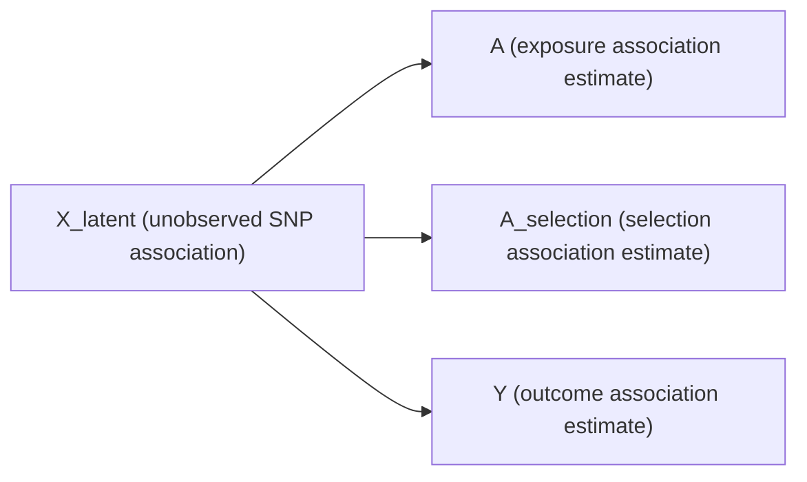

# Three-sample SNP association measurements for debiased IVW

## Research question

- **Question and intended use.** Estimate the common no-pleiotropy slope beta from noisy SNP-exposure and SNP-outcome association summaries with an independent SNP-selection sample. Candidate for evaluation after scientific review.
- **Behavior under test.** Test errors-in-variables attenuation and debiasing with noisy SNP summaries, preserving the distinction between association estimates and patient-level treatments/outcomes.

## Study design and data source

- **Motivation and references.** Ting Ye; Jun Shao; Hyunseung Kang (2021). Debiased inverse-variance weighted estimator in two-sample summary-data Mendelian randomization. AoS. DOI: 10.1214/20-AOS2027. [Journal record](https://doi.org/10.1214/20-AOS2027); [version actually read](https://arxiv.org/pdf/1911.09802v2), arXiv:1911.09802v2 (2020-10-10); Section2 Assumption2, physical PDF pp.4–5; Section5.3 Case4, physical pp.16–17, synthetic coefficient population. Source snapshot SHA-256: `9f3495efe6c04cec0a0a2baf41b4843e687a2aa7f07209f1ff4676057511bf94`.

**Status and provenance.** Candidate for scientific review (`awaiting_scientific_review`), not accepted evaluation data. Config scenario: `explicit_adaptation`. This is an explicit synthetic summary-data adaptation of Assumption2 and Case4, not exact reproduction of Section5.3 individual-level GWAS simulations. Case4 draws and freezes a finite Gaussian coefficient vector; this variant samples iid SNP records using a Bernoulli non-null mixture. n is the number of SNP records requested, while n_gwas=10000 remains the reference GWAS sample size. Constant analytic SDs use the source Case4 expected exposure variance1 and outcome variance beta²+2 beta Var(U)+(1-h²); they are NOT the author estimated SEs from marginal regressions. Original Case4 raw-data coefficient draw/seed and the separate three-GWAS simulation are not implemented or counted as passed. Maintainer confirmation is required for the SNP-summary sampling unit and the constant-SE/iid-mixture adaptations. Exact original individual-level Case4 reproduction is unimplemented. This is a candidate measurement-model family, not a claim of a newly validated causal patient-level DGP.

**Family scope.** This is one proposed family, not a count of its seeds, sample sizes or parameter settings. Same-paper and project-wide deduplication must be confirmed by the maintainer; no global novelty guarantee is made.

- **Population and sampling.** One independent SNP summary record per row, drawn from an explicitly adapted iid coefficient superpopulation. This is not the source individual-level GWAS simulation or its estimated SNP-specific standard errors. n_G=10000 stays fixed while requested n counts SNP rows. Source numerical coefficients are fixed, not table-level random hyperparameters.

## DAG and identification

- **Variables and causal structure.** The nodes represent X_latent: unobserved SNP association; A: exposure association estimate; A_selection: selection association estimate; Y: outcome association estimate. Column aliases and supports are defined in the symbol table. The graph uses the stated fixed scenario; vector nodes collect their explicitly defined coordinates. Unobserved shared causes appear as substantive latent nodes. Independent epsilon disturbances appear only in the equations.
- **DAG edges.** `X_latent -> A, X_latent -> A_selection, X_latent -> Y`



- **Assumptions.** Independent exposure/outcome/selection GWAS samples, independent SNP records, centered independent normal association measurement errors with the given known variances, no horizontal pleiotropy, and positive latent association second moment. The DAG describes summary-measurement dependence through a shared latent association. There is no A->Y arrow: manipulating an exposure association estimate is not intervening on a patient exposure. Interpreting beta causally in an underlying population requires the usual genetic-IV relevance, independence and exclusion assumptions; they are encoded in the source association relation, not identified anew by this summary generator.

## Variables and data-generating process

- **Variables and observed input.** Observed six numeric columns gamma_hat,gamma_se,Gamma_hat,Gamma_se,gamma_selection,gamma_selection_se; all three SEs are retained. No true gamma is exported. Baseline dimension/effective dimension 0/0. p_reference counts instruments, not baseline covariates or effective confounders; high_dimensional is not claimed. Conditional association equations are linear with no interaction. Actual available columns: `gamma_hat`, `gamma_se`, `Gamma_hat`, `Gamma_se`, `gamma_selection`, `gamma_selection_se`. All methods receive the same observed table; no oracle nuisance values or potential outcomes.
- **Draw order and scenarios.** Fix calibration constants, draw an iid spike-normal latent coefficient and three independent measurement disturbances per SNP, then compute the three summaries and constant SE columns. Sole `explicit_adaptation`: iid_snp_superpopulation and analytic_constant_population_approximation. The original individual-GWAS coefficient draw, marginal regressions and estimated SEs are not implemented. All roots declared independent above are mutually independent; dependence within a row arises exactly through the parent equations. Unless a conditional law is stated, root draws are independent. No interference, cluster dependence or unreported repeated measurements are added.

### Structural equations

- **Structural parents.** `X_latent -> A, X_latent -> A_selection, X_latent -> Y`

```math
\begin{aligned}
\beta&=.4,\quad n_G=10000,\quad p_{\rm ref}=2000,\quad s_{\rm ref}=200,\quad h^2=.1,\\
q&=s_{\rm ref}/p_{\rm ref}=.1,\qquad\tau^2=2h^2/s_{\rm ref}=.001,\\
v_U&=.6(1-h^2)=.54,\qquad v_Y=\beta^2+2\beta v_U+1-h^2=1.492,\\
\sigma_A^2&=2/n_G=.0002,\qquad\sigma_Y^2=2v_Y/n_G=.0002984,\quad\sigma_{\rm sel}=\sigma_A.
\end{aligned}
```

```math
\begin{aligned}
X_{\mathrm{latent}}&\sim(1-q)\delta_0+qN(0,\tau^2),\qquad
\epsilon_A,\epsilon_Y,\epsilon_{\rm sel}\sim N(0,1),\\
A&=X_{\mathrm{latent}}+\sigma_A\epsilon_A,\\
A_{\mathrm{selection}}&=X_{\mathrm{latent}}+\sigma_{\rm sel}\epsilon_{\rm sel},\\
Y&=\beta X_{\mathrm{latent}}+\sigma_Y\epsilon_Y.
\end{aligned}
```

| Symbol | Meaning | Definition or setting |
| --- | --- | --- |
| $X_{\mathrm{latent}},\delta_0$ | Latent SNP-exposure association and point mass at zero | Source gamma; iid spike-normal draw for each SNP row. Never exported. This is not a baseline covariate. |
| $A,A_{\mathrm{selection}},Y$ | Observed association estimates from three independent samples | Columns `gamma_hat,gamma_selection,Gamma_hat`, respectively. A is not a patient-level treatment, Y not a patient outcome. |
| $\sigma_A,\sigma_{\rm sel},\sigma_Y$ | Known association-estimation SDs | Observed constant columns `gamma_se,gamma_selection_se,Gamma_se`; positive square roots of the displayed variances. |
| $\epsilon_A,\epsilon_Y,\epsilon_{\rm sel}$ | Measurement disturbances | Mutually independent standard normals, independent of latent SNP association and between rows; separate GWAS samples. |
| $\beta$ | Common association/causal slope parameter | .4; source no-pleiotropy relation connects underlying outcome and exposure associations. |
| $n_G,p_{\rm ref},s_{\rm ref}$ | Reference GWAS size and instrument/signal counts | 10000,2000,200, fixed calibration numbers. Requested n is the number of SNP records, not n_G and not p_ref. |
| $h^2,q,\tau^2$ | Heritability calibration, signal fraction and nonzero coefficient variance | .1,.1,.001; source-inspired superpopulation adaptation, not a frozen finite vector with exactly s_ref nonzero entries. |
| $v_U,v_Y$ | Population variance calibration constants | .54,1.492; used for constant SE approximation, not subject-level variables being sampled here. |
| $\theta$ | Registered scalar target | $\theta=\beta=.4$, the common slope for a unit change of the underlying exposure under the source IV interpretation. Within the summary model it equals $E[AY]/E[A^2-\sigma_A^2]$; it is not a do-effect of A=gamma_hat. |

## Data-generating process and estimand

- **Estimand.** $\theta=\beta=.4$, the common slope for a unit change of the underlying exposure under the source IV interpretation. Within the summary model it equals $E[AY]/E[A^2-\sigma_A^2]$; it is not a do-effect of A=gamma_hat.
- **Truth check.** E[latent association squared]=q*tau^2=.0001. Independent centered measurement errors imply E[AY]=beta*.0001 and E[A^2-sigma_A^2]=.0001, so the ratio is .4. Independent Gaussian quadrature integrates the latent mixture and both errors; null beta and naive-IVW attenuation (.1333333) are checked. It does not validate original GWAS SE estimation or the unimplemented author Case4 experiment.

## Benchmark comparison

- **Output and comparator.** Propose debiased IVW versus conventional inverse-variance weighted slope, using the same observed summary estimates, SEs, and, if selection is enabled, the same independent selection rule. Both output beta; naive IVW is an explicitly error-in-variables misspecified baseline. Use no selection in this fixed primary scenario. Report zero/near-zero/negative corrected denominator diagnostics separately; do not silently discard large or negative estimates.
- **Scoring and replication.** Proposed comparison only; no benchmark estimator, PFN training, coverage study or large simulation has been run. After approval, use n=128 and n=512 with 1000 attempted independent tables per n, one fixed scenario (weight 1). Use the same table for all methods in each replicate. Precommit a private seed ledger mapping (case, scenario, n, replicate) to a distinct table seed, independent of the method; the seed is not a model input. Generation failures also consume an attempted replicate and are reported separately. Reserve benchmark seeds privately; the existing n=128, seed=1729 run is a reproducibility smoke test, not a benchmark result. Per n and method, report attempted count, finite completed count, failure count/reasons, bias and RMSE over finite completed estimates with their denominator. Do not drop finite extreme estimates. Score missing/nonfinite runs as failures and publish the failure rate over all 1000 attempts; never present conditional error without that rate. If methods provide nominal 95% intervals, report coverage of this case's stated target, mean finite interval length and interval-failure rate separately. Predeclare numerical tolerances, nuisance fits, fold rules and tuning before running; do not use truth for tuning. Do not average incomparable ATT, CATE, bound, function-value and slope errors into an unscaled cross-family score.

## Materials and access

- **Public materials.** The paper/version links above are the primary sources. This locally prepared proposal is not yet published or rights-approved. Paper copyright remains with the authors/publisher; no source PDF, restricted data, copied author implementation, model weights or credentials are included. Generator/truth/verification code was independently written with AI assistance; AI checks are not named scientific review. Any proposed public code license or redistribution permission requires maintainer confirmation.
- **Reproduction and protected materials.** The accompanying private candidate packet contains `contributions/iv-ye-shao-kang-2021-three-sample-summary-mr-v1/` with collection.json, card.md, config.json, schema.csv, generator.py, truth.py, verify.py, requirements.txt, source audit and local check report (and calibration.py where needed). Use the supplied student collector from its package root with this contribution copied into contributions. Install the pinned/ranged requirements, then run `python collect.py check contributions/iv-ye-shao-kang-2021-three-sample-summary-mr-v1 --run --n 128 --seed 1729`. Review local code before --run. Hooks take the selected scenario parameter object, not the entire config file; generation returns observed numeric columns only. The existing smoke report records truth value `0.4` and estimated_error `0.0`. These are analytic/numerical error descriptions, not sampling standard errors. The private code archive is IV_v02_新增10候选机制_待科学审核_20261126_r2.zip (SHA-256 1c375954c47b3f4afedb98e6bc649a344fa4ef000c9aa72c4d7d0e41b602cb4c). Full generators, exact configs, smoke samples/reports and future benchmark seeds/tables are supplied through the maintainer-approved private channel, not committed alongside this public proposal. No future official held-out seeds/tables have been created.
