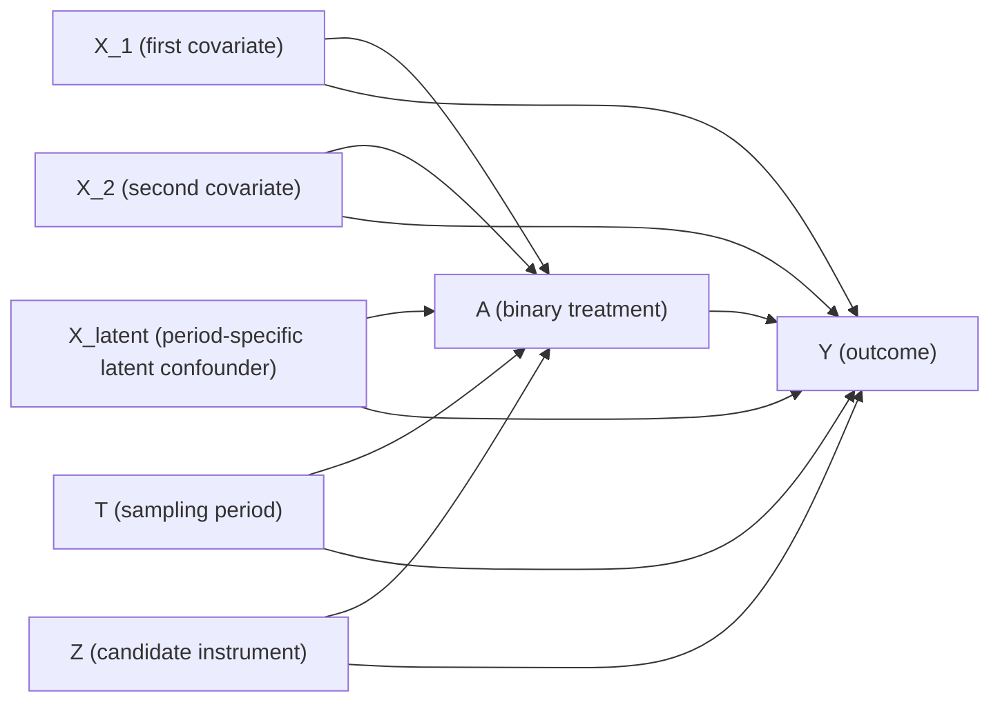

# Instrumented difference-in-differences with bridge confounding


## Research question


- **Question and intended use.** Estimate a treatment CATE at the fixed covariate query (0,0), using an instrumented time contrast when single-period exclusion fails. Candidate for evaluation after scientific review.

- **Behavior under test.** Test recovery when direct Z effects cancel across periods but individual-period IV exclusion fails, and prevent confusion of a treatment contrast with a time contrast.


## Study design and data source


- **Motivation and references.** Pan Zhao; Yifan Cui (2025). A semiparametric instrumented difference-in-differences approach to policy learning. Biometrika. DOI: 10.1093/biomet/asaf043. [Journal record](https://doi.org/10.1093/biomet/asaf043); [version actually read](https://arxiv.org/pdf/2310.09545v1), arXiv:2310.09545v1; Section 6, physical PDF pp.13–14 and footnote 1. Source snapshot SHA-256: `c0cae9297cecce5934be0125a8537b59fc63a5976e999859f056de8c10afa394`.


**Status and provenance.** Candidate for scientific review (`awaiting_scientific_review`), not accepted evaluation data. Config scenario: `source_fixed`. Source policy-learning DGP retained; scalar CATE evaluated at the benchmark query (0,0), rather than implementing policy estimation. Only the observed time point is generated; the joint coupling of unobserved Y0,Y1 is not supplied by the source and is unnecessary for repeated cross-sectional data. The fixed-query estimation task is newly specified. No full panel coupling or implemented CATE adaptation of the source policy learner is claimed; reviewer confirmation of the benchmark comparator is required.


**Family scope.** This is one proposed family, not a count of its seeds, sample sizes or parameter settings. Same-paper and project-wide deduplication must be confirmed by the maintainer; no global novelty guarantee is made.


- **Population and sampling.** Independent repeated cross-sections with two observed periods, not repeated measurements on the same person. The observed-period law equals the source marginal law using U_T. No joint distribution of both period outcomes for one person is imposed or exported. Source numerical coefficients are fixed, not table-level random hyperparameters.


## DAG and identification


- **Variables and causal structure.** The nodes represent X_1: first covariate; X_2: second covariate; X_latent: period-specific latent confounder; T: sampling period; Z: candidate instrument; A: binary treatment; Y: outcome. Column aliases and supports are defined in the symbol table. The graph uses the stated fixed scenario; vector nodes collect their explicitly defined coordinates. Unobserved shared causes appear as substantive latent nodes. Independent epsilon disturbances appear only in the equations.

- **DAG edges.** `X_1 -> A, X_2 -> A, X_latent -> A, T -> A, Z -> A, X_1 -> Y, X_2 -> Y, X_latent -> Y, T -> Y, Z -> Y, A -> Y`





- **Assumptions.** Use consistency, no interference, source instrumented-DiD exogeneity/parallel-association restrictions, a treatment effect stable over time, and a nonzero difference in first stages. The direct 20Z term violates conventional exclusion but cancels in the difference over time of Z-outcome contrasts. The union DAG has both covariates as treatment parents: one coefficient vanishes in each period, as stated explicitly in the equations.


## Variables and data-generating process


- **Variables and observed input.** Columns X1,X2,T,Z,A,Y form one observed-period subject record. U_T, counterfactual periods and CATE labels are withheld. Baseline dimension is 2 and effective dimension is 2. Treatment-by-covariate and time-by-covariate terms are explicit; the logistic link is nonlinear. Actual available columns: `X1`, `X2`, `T`, `Z`, `A`, `Y`. All methods receive the same observed table; no oracle nuisance values or potential outcomes.

- **Draw order and scenarios.** Draw independent X,T,Z, bridge confounder and noises per row, then A,Y. The sole `source_fixed` config uses query=[0,0] and effect_scale=10. The source law is retained but the fixed-query CATE is a contributor-selected target instead of the paper's policy objective. All roots declared independent above are mutually independent; dependence within a row arises exactly through the parent equations. Unless a conditional law is stated, root draws are independent. No interference, cluster dependence or unreported repeated measurements are added.


### Structural equations


- **Structural parents.** `X_1 -> A, X_2 -> A, X_latent -> A, T -> A, Z -> A, X_1 -> Y, X_2 -> Y, X_latent -> Y, T -> Y, Z -> Y, A -> Y`


```math
X_1,X_2\sim N(0,1),\quad T,Z\sim\mathrm{Bernoulli}(1/2),\quad

X_{\mathrm{latent}}\sim f_U(u)=\{2\pi\cosh(u/2)\}^{-1},\quad

\epsilon_A\sim\mathrm{Uniform}(0,1),\quad\epsilon_Y\sim N(0,1).

```


```math
\begin{aligned}

\eta_0(z,u,x)&=2-7z+.2u+2x_1,&\eta_1(z,u,x)&=-1.5+5z-.15u+1.5x_2,\\

\tau(x)&=10(1.5x_1+2x_2-.5),\\

b_0(x)&=200+10(1.5x_1+2x_2),&b_1(x)&=240+10(2x_1+1.5x_2),\\

A&=\mathbf{1}\{\epsilon_A<\mathrm{expit}((1-T)\eta_0(Z,X_{\mathrm{latent}},X)+T\eta_1(Z,X_{\mathrm{latent}},X))\},\\

\mu_t(a,z,u,x)&=b_t(x)+a\tau(x)+5u+20z,\\

Y&=\mu_T(A,Z,X_{\mathrm{latent}},X)+\epsilon_Y,\qquad X=(X_1,X_2).

\end{aligned}

```


| Symbol | Meaning | Definition or setting |

| --- | --- | --- |

| $X,X_1,X_2,x,x_1,x_2$ | Observed baseline vector and arguments | Columns `X1,X2`; independent standard normals; total/effective dimension 2/2. Lowercase denotes a fixed value. |

| $T,t$ | Observed period and its index | Column `T`; 0 or 1, sampled independently with equal probabilities. One observed period per row. |

| $Z,z$ | Observed candidate instrument and argument | Column `Z`; binary randomized with probability .5; direct outcome coefficient 20. |

| $X_{\mathrm{latent}},u,f_U$ | Unobserved selected-period bridge variable and density | Source $U_T$ has density shown on the real line, bridge parameter .5; independent of T,X,Z; one fresh selected-period draw per row. |

| $A,a,Y$ | Observed treatment, its argument, and outcome | Columns `A,Y`; binary and continuous. |

| $\eta_0,\eta_1$ | Treatment linear predictors | Fully substituted period-specific formulas above; X2 is absent at t=0, X1 absent at t=1. |

| $b_0,b_1,\tau,\mu_t$ | Baseline and treatment/outcome functions | Explicit formulas above; treatment coefficient function $\tau$ is common over time. |

| $\epsilon_A,\epsilon_Y$ | Unit disturbances | Independent uniform(0,1) and N(0,1); independent of all roots and between rows. |

| $\mathrm{expit},\mathbf{1}$ | Logistic link and event indicator | $\mathrm{expit}(v)=1/(1+e^{-v})$; indicator is 1 for a true event. |

| $x^*$ | Contributor-selected query | $(0,0)$, fixed across tables; not a policy-learning target. |

| Numeric coefficients | Fixed scenario values | All source numbers are substituted above, including outcome scale 10, latent coefficient 5 and direct Z coefficient 20. |

| $\theta$ | Registered scalar target | $\theta=E\{Y_t(1)-Y_t(0)\mid X=x^*\}=\tau(0,0)=-5$ for either t=0 or 1. The intervention is treatment 0 to 1 at a fixed period, not a period-1 versus period-0 contrast. |


## Data-generating process and estimand


- **Estimand.** $\theta=E\{Y_t(1)-Y_t(0)\mid X=x^*\}=\tau(0,0)=-5$ for either t=0 or 1. The intervention is treatment 0 to 1 at a fixed period, not a period-1 versus period-0 contrast.

- **Truth check.** Subtracting the two treatment-specific outcome means gives tau(x). Independent numerical integration over the bridge distribution verifies that the time difference of reduced-form Z contrasts divided by the time difference of first stages gives -5 at x*. It also checks the normalized bridge density. The deterministic formula has zero numerical integration error; the verification quadrature is an additional diagnostic, not an identification proof.


## Benchmark comparison


- **Output and comparator.** Propose an instrumented-DiD CATE estimator constructed from the source multiply robust policy score, versus a parametric instrumented-DiD conditional Wald estimator. Both must output the treatment contrast at the same fixed query and use X,T,Z,A,Y only. Any conversion of a policy score into a CATE estimator must be specified and reviewed before implementation; policy classification accuracy cannot substitute for CATE error.

- **Scoring and replication.** Proposed comparison only; no benchmark estimator, PFN training, coverage study or large simulation has been run. After approval, use n=128 and n=512 with 1000 attempted independent tables per n, one fixed scenario (weight 1). Use the same table for all methods in each replicate. Precommit a private seed ledger mapping (case, scenario, n, replicate) to a distinct table seed, independent of the method; the seed is not a model input. Generation failures also consume an attempted replicate and are reported separately. Reserve benchmark seeds privately; the existing n=128, seed=1729 run is a reproducibility smoke test, not a benchmark result. Per n and method, report attempted count, finite completed count, failure count/reasons, bias and RMSE over finite completed estimates with their denominator. Do not drop finite extreme estimates. Score missing/nonfinite runs as failures and publish the failure rate over all 1000 attempts; never present conditional error without that rate. If methods provide nominal 95% intervals, report coverage of this case's stated target, mean finite interval length and interval-failure rate separately. Predeclare numerical tolerances, nuisance fits, fold rules and tuning before running; do not use truth for tuning. Do not average incomparable ATT, CATE, bound, function-value and slope errors into an unscaled cross-family score.


## Materials and access


- **Public materials.** The paper/version links above are the primary sources. This locally prepared proposal is not yet published or rights-approved. Paper copyright remains with the authors/publisher; no source PDF, restricted data, copied author implementation, model weights or credentials are included. Generator/truth/verification code was independently written with AI assistance; AI checks are not named scientific review. Any proposed public code license or redistribution permission requires maintainer confirmation.

- **Reproduction and protected materials.** The accompanying private candidate packet contains `contributions/iv-zhao-cui-2025-bridge-instrumented-did-v1/` with collection.json, card.md, config.json, schema.csv, generator.py, truth.py, verify.py, requirements.txt, source audit and local check report (and calibration.py where needed). Use the supplied student collector from its package root with this contribution copied into contributions. Install the pinned/ranged requirements, then run `python collect.py check contributions/iv-zhao-cui-2025-bridge-instrumented-did-v1 --run --n 128 --seed 1729`. Review local code before --run. Hooks take the selected scenario parameter object, not the entire config file; generation returns observed numeric columns only. The existing smoke report records truth value `-5.0` and estimated_error `0.0`. These are analytic/numerical error descriptions, not sampling standard errors. The private code archive is IV_v02_新增10候选机制_待科学审核_20261126_r2.zip (SHA-256 1c375954c47b3f4afedb98e6bc649a344fa4ef000c9aa72c4d7d0e41b602cb4c). Full generators, exact configs, smoke samples/reports and future benchmark seeds/tables are supplied through the maintainer-approved private channel, not committed alongside this public proposal. No future official held-out seeds/tables have been created.

