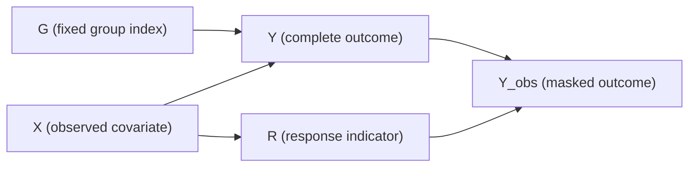

# Small-sample balanced ANCOVA slope under high-rate MAR outcome missingness

## Research question

- **Question and intended use.** Estimate the fixed-model common ANCOVA regression slope $\beta = 1$ and construct a nominal 95% confidence interval in a small balanced two-group study ($`n = 50`$) where $62.13\%$ of outcomes are missing at random as a logistic function of the continuous covariate $X$. This case is proposed as a small-sample stress-test candidate for missing-data regression inference.
- **Behavior under test.** With an expected $18.93$ observed outcomes per table split across two group intercepts ($`\mu_1 = 1`$, $`\mu_2 = -1`$) and a common slope (the probability that either 25-row group has $\le 1$ respondent is only $`0.0221\%`$), small residual degrees of freedom ($`m - 3`$), variable response counts, and Gaussian-tail inverse-probability weights challenge asymptotic Wald intervals and propensity-weighted estimators relative to exact small-sample conditional $t$-inference.

## Study design and data source

- **Motivation and references.** Jiang, Nguyen and Rao (2015), *The E-MS Algorithm: Model Selection With Incomplete Data*, *Journal of the American Statistical Association* 110(511), 1136–1147, [DOI](https://doi.org/10.1080/01621459.2014.948545), verified from the [PMC author manuscript (PMC4714800)](https://pmc.ncbi.nlm.nih.gov/articles/PMC4714800/), Section 6.1 (equation (14), Model IV, Mechanism B, Table 3, $`n = 50`$). The balanced two-group layout ($`25 + 25`$), group intercepts $(1, -1)$, unit common slope, standard normal covariate and error, and logistic missingness $\Pr(R = 0 \mid X) = \mathrm{expit}(0.5 + 0.2X)$ (i.e., response $`\mathrm{expit}(-0.5 - 0.2X)`$) follow the source verbatim. Adaptations designate the fixed full-model common ANCOVA slope $\beta = 1$ as the scalar benchmark target (separating fixed-model estimation from the source's post-selection E-MS Table 3 accuracy experiment), represent missing outcomes as finite placeholder `0` (serialized as float `0.0`) in `Y_obs` paired with `R`, and assign $\lceil n/2 \rceil$ rows to group 1 and $\lfloor n/2 \rfloor$ rows to group 2 for off-design CLI sizes (requiring $n \ge 2$ so both groups are present).
- **Population and sampling.** Each table fixes 25 units in group 1 and 25 units in group 2 ($`n = 50`$); rows are mutually independent under the fixed group layout with group-specific outcome distributions. The population response rate is $37.8671\%$ (expected missingness $62.1329\%$, expected observed count $`18.9336`$).

## DAG and identification

- **Variables and causal structure.** $G$ (`G`) is the fixed observed group index, $X$ (`X`) is the observed standard normal covariate, $Y$ is the latent complete outcome, $R$ (`R`) is the MAR response indicator governed solely by $X$, and $`Y_{\mathrm{obs}}`$ (`Y_obs`) is the masked observed outcome.
- **DAG edges.** `G -> Y, X -> Y, X -> R, Y -> Y_obs, R -> Y_obs`
- **Assumptions.** Rows are independent under the fixed balanced group layout with $`(X_i, \epsilon_i) \overset{\mathrm{iid}}{\sim} \mathcal{N}_2(\mathbf{0}_2, I_2)`$, and missingness satisfies MAR ($`R \perp Y \mid (G, X)`$) with pointwise positive propensity $\mathrm{expit}(-0.5 - 0.2X)$ (approaching zero only in the Gaussian tail). Because MAR transfers $\mathbb{E}[Y \mid G, X]$ to respondents and the response-weighted within-group covariate variance is positive, $\beta = 1$ is identified. For finite-sample inference under the Gaussian full model, the exact conditional Student $t$ interval requires a rank-3 respondent design matrix (both groups represented, non-constant within-group $`X`$) and $m > 3$ observed outcomes ($`m - 3`$ residual degrees of freedom).



## Variables and data-generating process

- **Variables and observed input.** Each row is one unit. Methods receive the four observed columns `G` ($`\in \{1, 2\}`$), `X` ($`\in \mathbb{R}`$), `R` ($`\in \{0, 1\}`$), and `Y_obs` (equal to $`Y_i`$ when `R == 1` and finite placeholder `0` / `0.0` when `R == 0`). Unobserved outcomes, errors, and oracle propensities are excluded from estimator inputs.
- **Draw order and scenarios.** Under the single scenario `original` ($`n = 50`$): assign $`G_i = 1`$ for $i \le 25$ and $`G_i = 2`$ for $i > 25$, draw independent $`X_i, \epsilon_i \sim \mathcal{N}(0, 1)`$, compute $`Y_i = \mu_{G_i} + X_i + \epsilon_i`$, draw $`R_i \sim \mathrm{Bernoulli}\{\mathrm{expit}(-0.5 - 0.2X_i)\}`$, and record $`Y_{\mathrm{obs},i} = R_i Y_i`$.

### Structural equations

- **Structural parents.** `G -> Y, X -> Y, X -> R, Y -> Y_obs, R -> Y_obs`

```math
\begin{aligned}
G_i &= 1 + \mathbf{1}\{i > 25\}, && i = 1, \ldots, n, \quad n = 50, \\
X_i &\overset{\mathrm{iid}}{\sim} \mathcal{N}(0, 1), \qquad \epsilon_i \overset{\mathrm{iid}}{\sim} \mathcal{N}(0, 1), && X_i \perp \epsilon_i, \\
Y_i &= \mu_{G_i} + X_i + \epsilon_i, && \mu_1 = 1, \quad \mu_2 = -1, \\
R_i \mid (G_i, X_i, Y_i) &\sim \mathrm{Bernoulli}\bigl\{\mathrm{expit}(-0.5 - 0.2 X_i)\bigr\}, && \\
Y_{\mathrm{obs},i} &= R_i Y_i.
\end{aligned}
```

Under the fixed balanced group layout ($`25`$ rows in each group), rows are independent with group-specific outcome distributions; $\mathrm{expit}(t) = (1 + e^{-t})^{-1}$, and missing outcomes ($`R_i = 0`$) carry finite placeholder $`Y_{\mathrm{obs},i} = 0`$.

| Symbol | Meaning | Definition or setting |
| --- | --- | --- |
| $i, n$ | Unit index and sample size | $i = 1, \ldots, n$; fixed $n = 50$ from source Section 6.1, Table 3 (`original`). |
| $`G_i`$ | Fixed two-group indicator | Equals $1$ for rows $1 \le i \le 25$ and $2$ for rows $26 \le i \le 50$ (off-design: $\lceil n/2 \rceil$ in group 1, $\lfloor n/2 \rfloor$ in group 2); column `G`. |
| $`X_i`$ | Observed continuous control | Independent $\mathcal{N}(0, 1)$ draws; column `X`. |
| $`\epsilon_i`$ | Outcome disturbance | Independent $\mathcal{N}(0, 1)$ noise, independent of $`X_i`$; latent. |
| $`\mu_1, \mu_2`$ | Group-specific intercepts | Fixed source Model IV intercepts $`\mu_1 = 1`$ and $`\mu_2 = -1`$. |
| $`Y_i`$ | Complete continuous outcome | Common-slope ANCOVA model $`Y_i = \mu_{G_i} + X_i + \epsilon_i`$ with true slope $\beta = 1$; latent when $`R_i = 0`$. |
| $\mathrm{expit}(t)$ | Logistic response link | $\mathrm{expit}(t) = 1/(1 + e^{-t})$; Mechanism B gives missingness $`\mathrm{expit}(0.5 + 0.2X_i)`$, i.e., response probability $`\mathrm{expit}(-0.5 - 0.2X_i)`$ (expected missingness $`62.13\%`$). |
| $`R_i`$ | Response indicator | Drawn from $`\mathrm{Bernoulli}\{\mathrm{expit}(-0.5 - 0.2X_i)\}`$ given $`X_i`$; column `R`. |
| $`Y_{\mathrm{obs},i}`$ | Observed masked outcome | Equals $`Y_i`$ when $`R_i = 1`$ and finite placeholder `0` when $`R_i = 0`$; column `Y_obs`. |
| $\beta$ | Target common ANCOVA slope | $\beta = \mathrm{Cov}(X, Y \mid G = g)/\mathrm{Var}(X \mid G = g) = 1$ for $`g \in \{1, 2\}`$. |

## Data-generating process and estimand

- **Estimand.** The scalar target is the full-data common ANCOVA regression slope $\beta = 1$ (outcome units per covariate unit).
- **Truth check.** The structural conditional mean $`\mathbb{E}[Y \mid G = g, X = x] = \mu_g + x`$ gives $\beta = 1$ analytically. Independent verification in `verify.py` solves the response-weighted complete-case population normal equations separately within groups $g = 1$ and $g = 2$ (recovering $\beta = 1$, $`\mu_1 = 1`$, and $`\mu_2 = -1`$ within $`10^{-12}`$), confirms the expected response rate $0.37867136$ via Gaussian quadrature, verifies group counts ($`\lceil n/2 \rceil`$, $`\lfloor n/2 \rfloor`$), and validates the generated conditional ANCOVA slope on respondents.

## Benchmark comparison

- **Output and comparator.** Methods output a scalar estimate of $\beta$ and a nominal 95% confidence interval where applicable from `G`, `X`, `R`, and `Y_obs`. All scored comparators prespecify the full ANCOVA model: (1) prespecified full-model complete-case ANCOVA with exact Gaussian conditional $`t_{m-3}`$ interval at rank 3 and $m > 3$, (2) prespecified full-model observed likelihood or EM using the same conditional outcome likelihood and exact $`t_{m-3}`$ interval (with EM required to converge to the observed-likelihood solution), and (3) inverse probability weighted full-model ANCOVA using the known $\mathrm{expit}(-0.5 - 0.2X)$ weights and a sandwich 95% Wald interval (reporting empirical coverage under weak overlap). Post-selection E-MS is a separate source experiment whose outcome is model-selection accuracy, distinct from these scored fixed-model slope comparators.
- **Scoring and replication.** Evaluate all methods on 1,000 paired independent replicate tables at $n = 50$. Report bias, RMSE, empirical 95% coverage, mean interval width, Monte Carlo uncertainty, valid denominators, and exact counts of any non-estimable or zero-residual-df replicates (respondent design rank $< 3$, e.g., an absent group, or $m \le 3$ observed responses leaving $m - 3 \le 0$ residual degrees of freedom).

## Materials and access

- **Public materials.** The simulation design is documented in Jiang, Nguyen and Rao (2015), [DOI](https://doi.org/10.1080/01621459.2014.948545) and [PMC4714800](https://pmc.ncbi.nlm.nih.gov/articles/PMC4714800/), governed by publisher terms.
- **Reproduction and protected materials.** The private review archive `mdi-jiang-nguyen-rao-2015-mar-ancova-slope-v1.zip` (SHA-256 `08fd1a9235ba93ae3bb8b905201b93e6bb120a87da7896c6939467bd2567193c`) bundles `generator.py`, `truth.py`, `verify.py`, `reproduce.py`, `collection.json`, `config.json`, `schema.csv`, `card.md`, `PROVENANCE.md`, `source_audit.json`, `requirements.txt` (`numpy==2.3.5`, `scipy==1.16.3`), check records, and `MANIFEST.json`. After verifying the manifest in Python 3.12, run:

```bash
python3 reproduce.py --scenario original --n 50 --seed 1729 --out ../jiang-nguyen-rao-2015-check
```

The command validates all normal-equation, group-layout, generated-slope, and actual-table checks and writes `observed.csv` (`G,X,R,Y_obs`, 50 rows) separately from `reference.json`.
