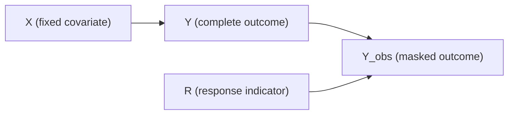

# Fixed-design linear regression mean under uniform MCAR outcome nonresponse

## Research question

- **Question and intended use.** Evaluate point estimation and 95% confidence-interval inference for the full-design expected mean outcome $`\mu = n^{-1}\sum_{i=1}^n \mathbb{E}[Y_i \mid x_i] = 42`$ when 40% of outcomes are missing completely at random under a fixed-quota simple random subset design. This case serves as a benchmark candidate for missing-data inference.
- **Behavior under test.** Although missingness is completely at random, the strongly informative linear predictor $X$ creates a wide efficiency gap between complete-case averaging and covariate-assisted imputation estimators. Under finite sample size $n = 200$ and fixed respondent count $r = 120$, classical multiple-imputation variance estimators exhibit documented finite-sample bias relative to modified variance formulas (Kim 2004, Table 2), making this design a sharp test of both efficiency and finite-sample interval calibration.

## Study design and data source

- **Motivation and references.** Kim (2004), *Finite sample properties of multiple imputation estimators*, *The Annals of Statistics* 32(2), 766–783, [DOI](https://doi.org/10.1214/009053604000000175), verified from the published electronic reprint [arXiv:math/0406453v1](https://arxiv.org/pdf/math/0406453v1), Section 5, equation (34) and Tables 1–2 ($`n = 200`$, $`r/n = 0.6`$). The fixed equally spaced interior grid, linear Gaussian response parameters, and uniform size-120 respondent subset follow the source verbatim. Adaptations select the scalar full-design mean $\mu = 42$ and 1,000 benchmark replicates (from a source study that also examined the slope using 50,000 replications per cell and 5 imputations), represent missing outcomes via `R` and finite placeholder `0` (serialized as float `0.0`) in `Y_obs`, and use integer quota $r = \lfloor (3n + 2)/5 \rfloor$ for off-design sizes (with $n = 1$ yielding one observed row for simulation-only use).
- **Population and sampling.** Each table contains $n = 200$ units on a deterministic interior covariate grid strictly inside $(5, 15)$ with independent $\mathcal{N}(0, 1)$ errors. Conditional on the fixed design, complete outcomes $`Y_1, \ldots, Y_{200}`$ are mutually independent with distinct means $`2 + 4x_i`$, whereas response indicators $`R_1, \ldots, R_{200}`$ have fixed sum $`\sum_{i=1}^{200} R_i = 120`$ and pairwise covariance $`\mathrm{Cov}(R_i, R_j) = -0.6(0.4)/199`$ ($`i \neq j`$).

## DAG and identification

- **Variables and causal structure.** $X$ is the fully observed fixed covariate (`X`), $Y$ is the latent complete continuous response, $R$ is the observed response indicator (`R`), and $`Y_{\mathrm{obs}}`$ is the masked observed outcome (`Y_obs`). Because $S$ is drawn uniformly independently of $X$ and $\epsilon$, there are no incoming arrows to $R$.
- **DAG edges.** `X -> Y, Y -> Y_obs, R -> Y_obs`
- **Assumptions.** Complete outcomes are independent given the deterministic grid $`x_1, \ldots, x_n`$; the respondent index set $S$ is drawn uniformly over all $\binom{200}{120}$ size-120 subsets ($`\Pr(S = A) = 1/\binom{200}{120}`$) independently of $`(x_1, \ldots, x_n, \epsilon_1, \ldots, \epsilon_n)`$, implying marginal inclusion probability $`\Pr(R_i = 1) = r/n = 0.6 > 0`$ for every unit. Consequently, the Horvitz–Thompson mean $`n^{-1}\sum_{i=1}^n R_i Y_i / (r/n)`$ has expectation $\mu = 42$ over response sampling and Gaussian errors, identifying $\mu$ from $`(X, R, Y_{\mathrm{obs}})`$. Under Gaussian linear regression, exact conditional $t$-intervals require rank-2 respondent design and $r > 2$ respondents (giving $r - 2 > 0$ residual degrees of freedom).



## Variables and data-generating process

- **Variables and observed input.** Each row corresponds to one study unit. Every method receives the three columns `X`, `R`, and `Y_obs`. The column `X` takes fixed values strictly inside $(5, 15)$, `R` is binary ($`1`$ for observed, $0$ for missing), and `Y_obs` equals $`Y_i`$ when $`R_i = 1`$ and finite placeholder `0` (serialized as float `0.0`) when $`R_i = 0`$. Estimators must read `Y_obs` only where `R == 1`. Unobserved $`Y_i`$ values ($`R_i = 0`$), disturbances $`\epsilon_i`$, and reference truths are excluded from estimator inputs.
- **Draw order and scenarios.** Under the single source scenario `original` ($`n = 200`$, $`r = 120`$): (1) construct the deterministic interior grid $`x_i = 5 + 10i/(n + 1)`$; (2) draw independent standard normal errors $`\epsilon_i`$ and compute $`Y_i = 2 + 4x_i + \epsilon_i`$; (3) draw a uniform subset $S$ of size $r$ without replacement from $`\{1, \ldots, n\}`$ and set $`R_i = \mathbf{1}\{i \in S\}`$; (4) mask outcomes as $`Y_{\mathrm{obs},i} = R_i Y_i`$. All parameters remain fixed across replicate tables.

### Structural equations

- **Structural parents.** `X -> Y, Y -> Y_obs, R -> Y_obs`

```math
\begin{aligned}
x_i &= 5 + \frac{10i}{n + 1}, && i = 1, \ldots, n, \quad n = 200, \\
\epsilon_i &\overset{\mathrm{iid}}{\sim} \mathcal{N}(0, 1), && i = 1, \ldots, n, \\
Y_i &= 2 + 4x_i + \epsilon_i, && \\
S &\sim \mathrm{Uniform}\bigl\{A \subseteq \{1, \ldots, n\} : |A| = r\bigr\}, && r = 120, \\
R_i &= \mathbf{1}\{i \in S\}, \qquad Y_{\mathrm{obs},i} = R_i Y_i.
\end{aligned}
```

The fixed covariates $`x_i`$ lie strictly inside $(5, 15)$ symmetrically around $10$ (from $5 + 10/201$ to $`15 - 10/201`$), errors $`\epsilon_i`$ are mutually independent of $S$, and missing rows ($`R_i = 0`$) carry finite placeholder $`Y_{\mathrm{obs},i} = 0`$.

| Symbol | Meaning | Definition or setting |
| --- | --- | --- |
| $i, n$ | Unit index and sample size | $i = 1, \ldots, n$; fixed $n = 200$ in the source design (`original` scenario). |
| $`x_i`$ | Fixed scalar covariate | Deterministic interior grid $`x_i = 5 + 10i/(n+1) \in [5 + 10/201,\, 15 - 10/201] \subset (5, 15)`$; observed in column `X`. |
| $`\epsilon_i`$ | Outcome disturbance | Independent $\mathcal{N}(0, 1)$ draws across units, independent of $S$; latent. |
| $`Y_i`$ | Complete continuous outcome | Linear Gaussian response $`Y_i = 2 + 4x_i + \epsilon_i`$ in response units (independent across $i$ with distinct means); latent when $`R_i = 0`$. |
| $r, S$ | Respondent quota and index set | Fixed count $r = 120$ ($`60\%`$ observed, $40\%$ missing); $S$ drawn uniformly over all $\binom{200}{120}$ subsets ($`\Pr(S = A) = 1/\binom{200}{120}`$). |
| $`R_i`$ | Response indicator | $`R_i = \mathbf{1}\{i \in S\} \in \{0, 1\}`$ with marginal $`\Pr(R_i = 1) = 0.6`$ and pairwise $`\mathrm{Cov}(R_i, R_j) = -0.24/199`$ ($`i \neq j`$); column `R`. |
| $`Y_{\mathrm{obs},i}`$ | Observed masked outcome | Equals $`Y_i`$ when $`R_i = 1`$ and finite placeholder $0$ when $`R_i = 0`$; observed in column `Y_obs`. |
| $\mu$ | Full-design target mean | $`\mu = n^{-1}\sum_{i=1}^{n} \mathbb{E}[Y_i \mid x_i] = 2 + 4\bar{x} = 42`$. |

## Data-generating process and estimand

- **Estimand.** The scalar target is the full-design expected mean response $`\mu = \frac{1}{200}\sum_{i=1}^{200} \mathbb{E}[Y_i \mid x_i] = 42`$ in response units.
- **Truth check.** Because $`x_i + x_{n+1-i} = 20`$ for every $i = 1, \ldots, n$, the covariate average is identically $\bar{x} = 10$, yielding the exact closed-form target $\mu = 2 + 4(10) = 42$. Independent verification in `verify.py` confirms $\mu = 42$ via exact rational summation across all 200 grid points, checks the generated `X` vector against the full analytical interior grid, asserts the exact deterministic integer quota $`\sum_i R_i = 120`$, and verifies the design-adjusted respondent mean residual and generated respondent linear-regression slope.

## Benchmark comparison

- **Output and comparator.** Each method outputs a scalar point estimate of $\mu$ and a nominal 95% confidence interval where applicable using `X`, `R`, and `Y_obs`. Comparators follow the protocol: (1) complete-case mean with a nominal 95% normal interval using the fixed-design variance estimate $`(1/r - 1/n)s_{\mathrm{obs}}^2 + 1/n`$ (incorporating the known unit disturbance variance for the expected fixed-design mean), (2) Gaussian regression standardized to the full design (fitting respondent intercept and slope, averaging fitted values over the full grid, and using the exact conditional $`t_{r-2}`$ interval when rank is 2 and $`r > 2`$), (3) Schenker–Welsh multiple imputation ($`M = 5`$ imputations, inverse $\chi^2$ degrees of freedom $r - 2$, Rubin variance with Barnard–Rubin $t$ degrees of freedom as in Table 3), and (4) Kim's modified multiple imputation ($`M = 5`$ imputations, modified inverse $\chi^2$ degrees of freedom $r$, Rubin variance with Barnard–Rubin $t$ degrees of freedom as in Table 3).
- **Scoring and replication.** Evaluate all methods on 1,000 paired independent replicate tables at $n = 200$. Report point-estimate bias and RMSE, empirical 95% interval coverage, mean interval width, Monte Carlo standard errors across replicates, and exact counts of any failed, nonfinite, or timed-out runs alongside valid denominators.

## Materials and access

- **Public materials.** The source design is documented in Kim (2004), [DOI](https://doi.org/10.1214/009053604000000175) and the [electronic reprint](https://arxiv.org/pdf/math/0406453v1), governed by the publisher's license terms.
- **Reproduction and protected materials.** The private review archive `mdi-kim-2004-fixed-design-mcar-v1.zip` (SHA-256 `591ec103f2b0389b44d2011e007538f2a5acc09725e47349e20a3702988e3886`) contains `generator.py`, `truth.py`, `verify.py`, `reproduce.py`, `collection.json`, `config.json`, `schema.csv`, `card.md`, `PROVENANCE.md`, `source_audit.json`, `requirements.txt` (`numpy==2.3.5`, `scipy==1.16.3`), saved check reports, and `MANIFEST.json`. After verifying the manifest in Python 3.12, run:

```bash
python3 reproduce.py --scenario original --n 200 --seed 1729 --out ../kim-2004-check
```

The command verifies all truth, deterministic-grid, generated-outcome, and actual-table contract checks, exports the 200-row observed table `observed.csv` (`X,R,Y_obs`), and writes `reference.json` separately.
