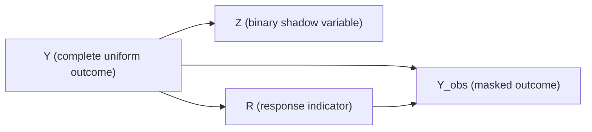

# Full-data population mean under nonignorable nonresponse identified via a binary shadow bridge

## Research question

- **Question and intended use.** Estimate the full-data population mean $\mu = \mathbb{E}[Y] = 0.5$ and construct a nominal 95% confidence interval when two-thirds of continuous outcomes are missing not at random according to a non-monotone polynomial response propensity $\pi(y) = 4y^2(1 - y)$ and only a binary shadow variable $Z$ is observed for every unit. This case is proposed as an evaluation benchmark candidate for nonparametric MNAR bridge-function inference.
- **Behavior under test.** The full joint distribution of $(Y, Z, R)$ is nonparametrically nonidentifiable—as witnessed in Example 1 of the paper by $Y \sim \mathrm{Beta}(2, 2)$ with $\pi(y) = 2y/3$ and the same $Z \mid Y$, which produces the identical respondent subdensity $4y^2(1 - y)$ and marginal $\Pr(Z = 1) = 1/2$—and the complete-case mean is $0.6$ (upward bias $+0.1$). Nevertheless, the outcome bridge function $h(Z) = Z$ satisfies $\mathbb{E}[h(Z) \mid Y, R = 1] = Y$ almost surely, uniquely identifying $\mu = \mathbb{E}[Y_{\mathrm{obs}} + (1 - R)Z] = 0.5$ without identifying $\pi(y)$ or the joint density.

## Study design and data source

- **Motivation and references.** Li, Miao and Tchetgen Tchetgen (2023), *Non-parametric inference about mean functionals of non-ignorable non-response data without identifying the joint distribution*, *Journal of the Royal Statistical Society Series B: Statistical Methodology* 85(3), 913–935, [DOI](https://doi.org/10.1093/jrsssb/qkad047), verified from the published version of record and [PMC10376447](https://pmc.ncbi.nlm.nih.gov/articles/PMC10376447/), Section 2 (Corollary 1 and Example 1, DGP 1, pp. 918–919) and Section 4.1 (Case II, pp. 929–930, Table 2). The uniform outcome law, binary shadow conditional distribution, polynomial propensity $4y^2(1-y)$, and sample size $n = 1000$ follow the source verbatim. Adaptations encode unobserved outcomes as finite placeholder `0` (serialized as float `0.0`) in `Y_obs` paired with `R` and allow off-design sample sizes via the CLI.
- **Population and sampling.** Each table draws $n = 1000$ i.i.d. units from $(Y, Z, R)$. Exact integration gives response probability $\int_0^1 4y^2(1-y)\,dy = 1/3$, corresponding to $66.67\%$ expected missingness.

## DAG and identification

- **Variables and causal structure.** $Y$ is the latent complete uniform outcome, $Z$ (`Z`) is the observed binary shadow variable generated from $Y$, $R$ (`R`) is the response indicator depending on $Y$ alone, and $Y_{\mathrm{obs}}$ (`Y_obs`) is the masked observed outcome.
- **DAG edges.** `Y -> Z, Y -> R, Y -> Y_obs, R -> Y_obs`
- **Assumptions.** Units are i.i.d.; common support holds almost surely because $\pi(y) = 4y^2(1 - y) > 0$ on $(0, 1)$ (vanishing only at zero-probability endpoints, with no uniform positive lower bound); shadow conditional independence $Z \perp R \mid Y$ holds with respondent relevance; and there exists an outcome bridge function $h(Z)$ solving $\mathbb{E}[h(Z) \mid Y, R = 1] = Y$ almost surely (here $h(z) = z$). By common support and $Z \perp R \mid Y$, the respondent bridge equation transports across $(0, 1)$, uniquely identifying $\mu = \mathbb{E}[Y_{\mathrm{obs}} + (1 - R)h(Z)] = 0.5$ without identifying $\pi(y)$ (as confirmed by the $\mathrm{Beta}(2, 2)$ / $2y/3$ witness above).



## Variables and data-generating process

- **Variables and observed input.** Each row is one unit. Every method receives the three observed columns `Z` ($\in \{0, 1\}$), `R` ($\in \{0, 1\}$), and `Y_obs` ($\in [0, 1]$, equal to $Y_i$ when `R == 1` and finite placeholder `0` / `0.0` when `R == 0`). Unobserved $Y_i$ values and oracle response propensities are excluded from estimator inputs.
- **Draw order and scenarios.** Under the single scenario `original` ($n = 1000$): independently per row, draw $Y_i \sim \mathrm{Uniform}(0, 1)$, draw $Z_i \mid Y_i \sim \operatorname{Bernoulli}(Y_i)$, draw $R_i \mid Y_i \sim \operatorname{Bernoulli}\{4Y_i^2(1 - Y_i)\}$, and record $Y_{\mathrm{obs},i} = R_i Y_i$.

### Structural equations

- **Structural parents.** `Y -> Z, Y -> R, Y -> Y_obs, R -> Y_obs`

```math
\begin{aligned}
Y_i &\overset{\mathrm{iid}}{\sim} \mathrm{Uniform}(0, 1), && i = 1, \ldots, n, \quad n = 1000, \\
Z_i \mid Y_i &\sim \operatorname{Bernoulli}(Y_i), && \\
R_i \mid (Y_i, Z_i) &\sim \operatorname{Bernoulli}\bigl\{4 Y_i^2 (1 - Y_i)\bigr\}, && \\
Y_{\mathrm{obs},i} &= R_i Y_i.
\end{aligned}
```

Rows are i.i.d. across units and tables; note that $0 < 4y^2(1-y) \le 16/27 < 1$ on $(0, 1)$ (vanishing only at zero-probability endpoints), yielding theoretical response rate $1/3$ (missingness $2/3$), and missing outcomes ($R_i = 0$) carry finite placeholder $Y_{\mathrm{obs},i} = 0$.

| Symbol | Meaning | Definition or setting |
| --- | --- | --- |
| $i, n$ | Unit index and sample size | $i = 1, \ldots, n$; fixed $n = 1000$ from source Section 4.1, Case II (`original`). |
| $Y_i$ | Complete continuous outcome | Drawn from $\mathrm{Uniform}(0, 1)$ on $[0, 1]$ (with $\operatorname{Var}(Y \mid Z = 0) = \operatorname{Var}(Y \mid Z = 1) = 1/18$); latent when $R_i = 0$. |
| $Z_i$ | Observed binary shadow variable | Drawn from $\operatorname{Bernoulli}(Y_i)$, satisfying $\mathbb{E}[Z \mid Y] = Y$ and $Z \perp R \mid Y$; column `Z`. |
| $R_i$ | Response indicator | Drawn from $\operatorname{Bernoulli}\{4Y_i^2(1-Y_i)\}$ given $Y_i$, with $\Pr(R = 1) = 1/3$ ($66.67\%$ missing); column `R`. |
| $Y_{\mathrm{obs},i}$ | Observed masked outcome | Equals $Y_i \in [0, 1]$ when $R_i = 1$ and finite placeholder `0` when $R_i = 0$; column `Y_obs`. |
| $\mu$ | Full-data outcome mean | $\mu = \mathbb{E}[Y] = \mathbb{E}[Y_{\mathrm{obs}} + (1 - R)Z] = 0.5$. |

## Data-generating process and estimand

- **Estimand.** The scalar target is the full-data population mean $\mu = \mathbb{E}[Y] = 0.5$ in outcome units.
- **Truth check.** Both direct integration of $Y \sim \mathrm{Uniform}(0, 1)$ and the observed-data bridge identity $\mathbb{E}[Y_{\mathrm{obs}} + (1 - R)Z] = \int_0^1 [4y^3(1-y) + (1 - 4y^2(1-y))y]\,dy = 0.5$ yield the exact truth. Independent verification in `verify.py` integrates the observed bridge functional, confirms $\Pr(R = 1) = 1/3$ and the complete-case mean $0.6$ (bias $+0.1$) within $10^{-13}$, checks binary `Z` and `Y_obs` $\in [0, 1]$, and verifies generated joint shadow/outcome moments ($\mathbb{E}[RZ] = \mathbb{E}[RY] = 1/5$ and $\mathbb{E}[RYZ] = \mathbb{E}[RY^2] = 2/15$).

## Benchmark comparison

- **Output and comparator.** Methods return a scalar point estimate of $\mu$ and a nominal 95% confidence interval where applicable from `Z`, `R`, and `Y_obs`. Comparators follow the protocol: (1) known-bridge mean averaging $Y_{\mathrm{obs}} + (1 - R)Z$ with a nominal normal interval using the sample SD of these bounded summands divided by $\sqrt{n}$, (2) the Li–Miao–Tchetgen Tchetgen **debiased representer estimator** (`REP-DB`) with Theorem 5 influence-function variance and normal critical value (relying on Assumptions 3–7, sieve/nuisance rates, and recorded tuning, with empirical coverage), (3) oracle Horvitz–Thompson IPW stress comparator averaging $RY/\pi(Y)$ with fixed oracle $\pi(y) = 4y^2(1 - y)$ on respondents—a point-only comparator with infinite variance ($\int_0^1 \frac{y^2}{4y^2(1-y)}\,dy = \infty$) receiving no nominal interval or coverage score (distinct from the source's initialization-dependent fitted Case II IPW runs), and (4) complete-case mean with nominal Student $t_{m-1}$ interval.
- **Scoring and replication.** Evaluate all methods on 1,000 paired independent replicate tables at $n = 1000$. Report bias, RMSE, empirical 95% coverage, mean interval width, Monte Carlo uncertainty, valid denominators, and full failure counts.

## Materials and access

- **Public materials.** The design is published in Li, Miao and Tchetgen Tchetgen (2023), [DOI](https://doi.org/10.1093/jrsssb/qkad047) and [PMC10376447](https://pmc.ncbi.nlm.nih.gov/articles/PMC10376447/), governed by the publisher's open-access terms.
- **Reproduction and protected materials.** The private review archive `mdi-li-miao-tchetgen-2023-shadow-bridge-mean-v1.zip` (SHA-256 `d1789407319409a16dee3365c9c52f74371e68585c2f379c98cf78dbb8c05d4e`) bundles `generator.py`, `truth.py`, `verify.py`, `reproduce.py`, `collection.json`, `config.json`, `schema.csv`, `card.md`, `PROVENANCE.md`, `source_audit.json`, `requirements.txt` (`numpy==2.3.5`, `scipy==1.16.3`), check records, and `MANIFEST.json`. After verifying the manifest in Python 3.12, run:

```bash
python3 reproduce.py --scenario original --n 1000 --seed 1729 --out ../li-miao-2023-check
```

The command validates all bridge-identity, generated joint-moment, and actual-table checks and writes `observed.csv` (`Z,R,Y_obs`, 1,000 rows) separately from `reference.json`.
