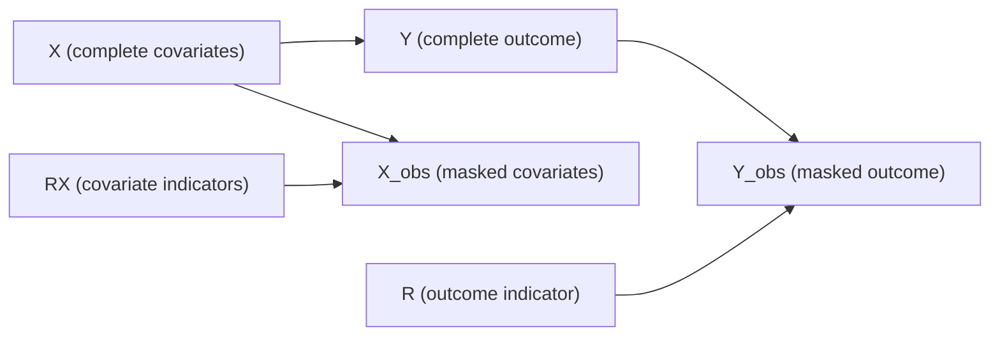

# Multivariate Gaussian regression with column-wise missing predictors and outcomes

## Research question

- **Question and intended use.** Estimate the full-data first regression coefficient $\beta_1 = 1$ and construct a nominal 95% confidence interval when all seven correlated covariates and the continuous outcome each experience 30% MCAR missingness applied via eight mutually independent exact-size column subsets. This case is proposed as an evaluation benchmark candidate for multivariate missing-data imputation and regression inference.
- **Behavior under test.** Although each column misses 30% of entries, independent column-wise subsets reduce each row's complete-case probability to $0.7^8 = 0.05764801$, yielding an expected $57.648$ complete rows out of 1,000 (with weakly dependent row-completeness indicators). Under the Gaussian linear model, the usual conditional Student-$t$ complete-case OLS interval retains exact conditional coverage on full-rank complete subsets with positive residual degrees of freedom, but suffers large efficiency loss compared with chained-equation iterative imputation, joint multivariate Gaussian imputation, and EM/full-information likelihood estimators.

## Study design and data source

- **Motivation and references.** Liu, Gelman, Hill, Su and Kropko (2014), *On the stationary distribution of iterative imputations*, *Biometrika* 101(1), 155–173, [DOI](https://doi.org/10.1093/biomet/ast044), verified from the [coauthor manuscript](https://sites.stat.columbia.edu/gelman/research/published/mi_theory7.pdf) (Section 5) and [supplemental material](https://sites.stat.columbia.edu/gelman/research/unpublished/mi_theory4.pdf) (Section 1.2, Figure 3). The equicorrelated seven-dimensional Gaussian predictor covariance ($\rho = 0.4$), linear Gaussian response with sign-changing slopes $b = (1,1,1,1,-1,-1,-1)^{\top}$, intercept $-2$, unit error variance, sample size $n = 1000$, and 30% column missingness follow the source. Adaptations specify mutually independent column subsets of size $m = \lfloor 0.3n + 0.5 \rfloor$ (half-up rounding; the supplement specifies 30% per variable without prescribing joint column coupling), extract the scalar first slope $\beta_1 = 1$ and evaluate bias/RMSE/95% coverage across comparators (extending the source's coefficient-distribution comparison), and represent missing entries via explicit binary indicators paired with finite placeholder `0` (serialized as float `0.0`).
- **Population and sampling.** Complete rows $(X_i, Y_i)$ are i.i.d. draws from an 8-dimensional multivariate normal distribution ($n = 1000$). Across columns $k = 1, \ldots, 8$, missing index sets $M_1, \ldots, M_8$ are mutually independent uniform size-300 subsets; within any single column, distinct rows have indicator covariance $-0.7(0.3)/999$, and row-completeness indicators are therefore mildly dependent with expected complete-row count $57.648$.

## DAG and identification

- **Variables and causal structure.** $X$ is the latent complete seven-covariate vector, $Y$ is the latent complete outcome, $R_X$ denotes the seven observed covariate indicators (`R1`–`R7`), $X_{\mathrm{obs}}$ denotes the seven masked covariates (`X1_obs`–`X7_obs`), $R$ (`R`) is the outcome observation indicator ($R_{i8}$), and $Y_{\mathrm{obs}}$ (`Y_obs`) is the masked outcome.
- **DAG edges.** `X -> Y, X -> X_obs, RX -> X_obs, Y -> Y_obs, R -> Y_obs`
- **Assumptions.** Complete rows are i.i.d. multivariate normal with positive-definite equicorrelation covariance $\Sigma_X = 0.6 I_7 + 0.4\mathbf{1}_7\mathbf{1}_7^{\top}$ (eigenvalues $0.6$ and $3.4$), and the eight independent column subsets $M_1, \ldots, M_8$ are drawn independently of $(X, Y)$ (MCAR) with positive row complete-case probability $0.7^8 > 0$. By MCAR, the complete-row distribution equals the full Gaussian distribution, uniquely identifying both the full joint law and $\beta_1 = 1$.



## Variables and data-generating process

- **Variables and observed input.** Each row is one unit. Every method receives 16 observed columns in exact schema order: `R1,...,R7`, `R`, `X1_obs,...,X7_obs`, and `Y_obs`. Whenever an indicator equals `0`, its paired `_obs` column holds finite placeholder `0` (serialized as float `0.0`) and must be treated as missing. Complete unobserved entries, disturbances, and oracle parameters are excluded from estimator inputs.
- **Draw order and scenarios.** Under the single scenario `original` ($n = 1000$): draw $X_i \overset{\mathrm{iid}}{\sim} \mathcal{N}_7(\mathbf{0}_7, \Sigma_X)$ and $\epsilon_i \overset{\mathrm{iid}}{\sim} \mathcal{N}(0, 1)$, compute $Y_i = -2 + b^{\top} X_i + \epsilon_i$, draw eight mutually independent uniform subsets $M_1, \ldots, M_8$ of exact size $300$ from $\{1, \ldots, 1000\}$, and set indicators and masked columns accordingly.

### Structural equations

- **Structural parents.** `X -> Y, X -> X_obs, RX -> X_obs, Y -> Y_obs, R -> Y_obs`

```math
\begin{aligned}
X_i &\overset{\mathrm{iid}}{\sim} \mathcal{N}_7\bigl(\mathbf{0}_7,\, 0.6 I_7 + 0.4 \mathbf{1}_7 \mathbf{1}_7^{\top}\bigr), && i = 1, \ldots, n, \quad n = 1000, \\
\epsilon_i &\overset{\mathrm{iid}}{\sim} \mathcal{N}(0, 1), && \epsilon_i \perp X_i, \\
Y_i &= -2 + b^{\top} X_i + \epsilon_i, && b = (1, 1, 1, 1, -1, -1, -1)^{\top}, \\
M_k &\overset{\mathrm{iid}}{\sim} \mathrm{Uniform}\bigl\{A \subseteq \{1, \ldots, n\} : |A| = m\bigr\}, && k = 1, \ldots, 8, \quad m = 300, \\
R_{ij} &= \mathbf{1}\{i \notin M_j\}, \quad X_{\mathrm{obs},ij} = R_{ij} X_{ij}, && j = 1, \ldots, 7, \\
R_i &= \mathbf{1}\{i \notin M_8\}, \quad Y_{\mathrm{obs},i} = R_i Y_i.
\end{aligned}
```

The eight missing-index subsets $M_1, \ldots, M_8$ are mutually independent across columns and independent of $(X, \epsilon)$; within each column $k$, distinct rows have indicator covariance $-0.21/999$ due to the exact quota $m = 300$. Each masked entry uses finite placeholder `0` paired with its binary observation indicator.

| Symbol | Meaning | Definition or setting |
| --- | --- | --- |
| $i, n$ | Unit index and sample size | $i = 1, \ldots, n$; fixed $n = 1000$ from the source simulation (`original`). |
| $j, k$ | Predictor and column indices | $j = 1, \ldots, 7$ indexes predictors; $k = 1, \ldots, 8$ indexes all seven predictors plus outcome. |
| $X_i$ | Complete covariate vector | Equicorrelated $\mathcal{N}_7(\mathbf{0}_7, 0.6 I_7 + 0.4\mathbf{1}_7\mathbf{1}_7^{\top})$ (eigenvalues $0.6$ and $3.4$); partially latent. |
| $b$ | Regression coefficient vector | Fixed source vector $b = (1, 1, 1, 1, -1, -1, -1)^{\top}$. |
| $\epsilon_i$ | Outcome disturbance | Independent $\mathcal{N}(0, 1)$ noise, independent of $X_i$ and masks; latent. |
| $Y_i$ | Complete continuous outcome | $Y_i = -2 + b^{\top} X_i + \epsilon_i$ with intercept $-2$; partially latent. |
| $m, M_k$ | Column missingness quota and index set | Fixed $m = \lfloor 0.3n + 0.5 \rfloor = 300$ ($30\%$ missing per column); mutually independent uniform size-$m$ subsets for $k = 1, \ldots, 8$. |
| $R_{ij}, R_i$ | Variable observation indicators | $R_{ij} = \mathbf{1}\{i \notin M_j\}$ (columns `R1`–`R7`, grouped as `RX` in the DAG) and $R_i = \mathbf{1}\{i \notin M_8\}$ (column `R`). |
| $X_{\mathrm{obs},ij}, Y_{\mathrm{obs},i}$ | Observed masked entries | Equal true values when observed and finite placeholder `0` when missing; columns `X1_obs`–`X7_obs` and `Y_obs`. |
| $\beta_1$ | Target first regression slope | $\beta_1 = [\operatorname{Var}(X)^{-1}\operatorname{Cov}(X, Y)]_1 = 1$. |

## Data-generating process and estimand

- **Estimand.** The scalar target is the population linear regression coefficient on the first predictor, $\beta_1 = [\operatorname{Var}(X)^{-1}\operatorname{Cov}(X, Y)]_1 = 1$.
- **Truth check.** The structural equation yields $\beta_1 = b_1 = 1$ analytically. Independent verification in `verify.py` solves the full-data Gaussian population normal equations $\Sigma_X^{-1}(\Sigma_X b)$ to confirm $\beta_1 = 1$ within $10^{-13}$, checks the equicorrelation signal variance $b^{\top}\Sigma_X b = 4.6$, asserts ordered column equality against `schema.csv` and exact deterministic quota $m = 300$ in all eight columns, and checks generated respondent outcome moments.

## Benchmark comparison

- **Output and comparator.** Methods output a scalar estimate of $\beta_1$ and a nominal 95% confidence interval where applicable from the 16 shared observed columns. Comparators follow the protocol: (1) complete-case least squares with the exact conditional Gaussian $t_{m_c - 8}$ interval for $m_c$ complete rows when the intercept-plus-seven-predictor design has rank 8 and $m_c > 8$ (recording $m_c \le 8$ or rank $< 8$ as interval failures), (2) iterative regression multiple imputation (MICE with nominal pooled Rubin $t$ interval, recording imputation count and chain settings), and (3) joint Gaussian Bayesian imputation (using the same pooled Rubin $t$ interval, recording imputation count and posterior sampling settings).
- **Scoring and replication.** Evaluate all methods on 1,000 paired independent replicate tables at $n = 1000$. Report bias, RMSE, empirical 95% coverage, mean interval width, Monte Carlo uncertainty, valid denominators, and full counts of failures or rank-deficient complete-case subsets.

## Materials and access

- **Public materials.** The simulation design is documented in Liu, Gelman, Hill, Su and Kropko (2014), [DOI](https://doi.org/10.1093/biomet/ast044), the [coauthor manuscript](https://sites.stat.columbia.edu/gelman/research/published/mi_theory7.pdf), and the [supplemental material](https://sites.stat.columbia.edu/gelman/research/unpublished/mi_theory4.pdf), governed by publisher terms.
- **Reproduction and protected materials.** The private review archive `mdi-liu-gelman-hill-su-kropko-2014-joint-mcar-v1.zip` (SHA-256 `25a653d072baa8c6851476c85ba48d36a983a3a37b8d74d545fd2f45602d259d`) bundles `generator.py`, `truth.py`, `verify.py`, `reproduce.py`, `collection.json`, `config.json`, `schema.csv`, `card.md`, `PROVENANCE.md`, `source_audit.json`, `requirements.txt` (`numpy==2.3.5`, `scipy==1.16.3`), check records, and `MANIFEST.json`. After manifest verification in Python 3.12, run:

```bash
python3 reproduce.py --scenario original --n 1000 --seed 1729 --out ../liu-gelman-2014-check
```

The command validates all truth, ordered-schema, deterministic-quota, generated-outcome, and actual-table checks and writes the 1,000-row, 16-column `observed.csv` separately from `reference.json`.
