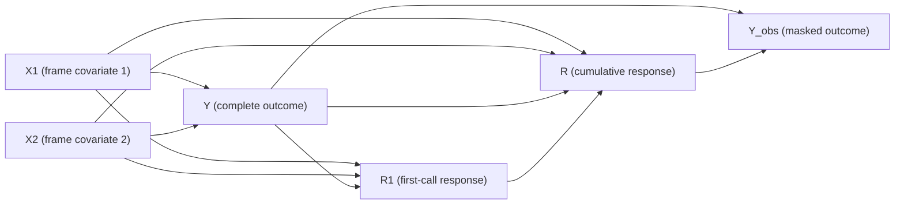

# Full-data population mean in a two-contact MNAR callback survey

## Research question

- **Question and intended use.** Estimate the full-data population mean $\mu = \mathbb{E}[Y] \approx -0.814580$ and construct a nominal 95% confidence interval from a two-contact survey subject to outcome-dependent nonresponse (MNAR), using observed frame covariates $(X_1, X_2)$ and first-call and cumulative two-call response indicators $(R_1, R)$ (where the late-only indicator is $R - R_1$). This case is proposed as an evaluation benchmark candidate for multi-contact nonresponse adjustment and doubly robust MNAR inference.
- **Behavior under test.** Under the FT specification of Miao et al. (2025), all callback estimators correctly specify the first-call baseline $a_1(X)$ and shared outcome-resistance term $\Gamma(X, Y) = \gamma Y$, while the doubly robust estimator requires **either** the second-call baseline $a_2(X)$ **or** the late-respondent outcome density $f_2(y \mid x)$ to be correctly specified. Because $a_2(x) = -0.5 + 1.8 x_1^2 + x_2^2$ is quadratic whereas $f_2(y \mid x) = \mathcal{N}(m(x), 4)$ has linear mean $m(x)$, a linear working $a_2(X)$ is misspecified while a linear-Gaussian working $f_2$ is correctly specified (note that supplying a quadratic working $a_2$ alters that comparison).

## Study design and data source

- **Motivation and references.** Miao, Li, Zhang and Sun (2025), *A stableness of resistance model for nonresponse adjustment with callback data*, *Journal of the Royal Statistical Society Series B: Statistical Methodology* 87(2), 433–456, [DOI](https://doi.org/10.1093/jrsssb/qkae097), verified against the author manuscript [arXiv:2112.02822v5](https://arxiv.org/html/2112.02822v5), Sections 3.2 and 4.1 (Proposition 1, Theorem 1, eq. (8)), Theorems 3–4, and Section 7 (Table 2, column FT, pp. 448–449). All covariate laws, linear and quadratic baseline logits, shared resistance slope $0.12$, late-respondent Gaussian parameters, and sample size $n = 5000$ follow the source verbatim. Adaptations extract $\mu = \mathbb{E}[Y]$ as the scalar benchmark target (whereas the source also scores $\gamma$), sample $f(y \mid x)$ directly via its exact four-component Gaussian mixture representation, draw a vectorized latent second-call Bernoulli for all rows combined via `R = R1 | R2` (law-equivalent to drawing $R_2$ only when $R_1 = 0$), and encode missing outcomes as finite placeholder `0` (serialized as float `0.0`) in `Y_obs`.
- **Population and sampling.** Units are $n = 5000$ i.i.d. survey subjects. Units responding on call 1 ($R_1 = 1$) are observed immediately ($R = 1$); first-call nonrespondents ($R_1 = 0$) receive a second attempt yielding late-only response ($R - R_1 = 1$) with probability $p_2(Y, X)$ or final nonresponse ($R = 0$). Overall theoretical final missingness is $27.0718\%$.

## DAG and identification

- **Variables and causal structure.** $X_1$ (`X1`) and $X_2$ (`X2`) are fully observed survey frame covariates, $Y$ is the latent complete outcome, $R_1$ (`R1`) is the first-call response indicator, $R$ (`R`) is the cumulative response indicator after two calls (with late-only response $R - R_1$), and $Y_{\mathrm{obs}}$ (`Y_obs`) is the masked observed outcome.
- **DAG edges.** `X1 -> Y, X2 -> Y, X1 -> R1, X2 -> R1, Y -> R1, X1 -> R, X2 -> R, Y -> R, R1 -> R, Y -> Y_obs, R -> Y_obs`
- **Assumptions.** Units are i.i.d., only first-call nonrespondents enter the second-call risk set, common support and $0 < p_j(y, x) < 1$ hold, and the log-odds outcome departure $\Gamma(x, y) = \gamma y$ is shared across both contact attempts (stableness of resistance). Defining the observed contact-history subdensities $A(y, x) = f(y, R_1 = 1 \mid x)$ and $B(y, x) = f(y, R_1 = 0, R = 1 \mid x)$ and $D(x) = a_2(x) - a_1(x)$, Bayes' rule gives $A(y, x)/B(y, x) = e^{a_1(x) + \gamma y} + e^{-D(x)}$ with $e^{D(x)} A(y, x)/B(y, x) > 1$. By Proposition 1 and Theorem 1 of Miao et al. (2025), equating the strictly decreasing integral equation in $D(x)$ to the observed odds of never responding versus responding late among first-call nonrespondents uniquely identifies $D(x)$, hence $p_1(y, x)$, $p_2(y, x)$, $\gamma$, and $f(y \mid x)$. (Note that the paper's flexible $\sqrt{n}$-asymptotic theory assumes bounded outcomes and uniform overlap, whereas this unbounded Gaussian-mixture / logistic-tail simulation tests parametric comparators empirically.)



## Variables and data-generating process

- **Variables and observed input.** Each row represents one sampled unit. Every estimator receives the five observed columns `X1`, `X2`, `R1`, `R`, and `Y_obs`, where `R1 <= R` always holds (late-only respondents satisfy `R1 == 0` and `R == 1`) and `Y_obs` equals finite placeholder `0` (serialized as float `0.0`) whenever `R == 0`. Unobserved outcomes and oracle contact propensities are excluded from estimator inputs.
- **Draw order and scenarios.** Under the single scenario `original` ($n = 5000$): draw $X_{i1}, X_{i2} \overset{\mathrm{iid}}{\sim} \mathrm{Uniform}(-1, 1)$, evaluate $a_1(X_i), a_2(X_i), m(X_i), C(X_i)$, sample $Y_i$ from the exact four-component Gaussian mixture $f(y \mid X_i)$ (each component having variance $4$), draw $R_{i1} \sim \operatorname{Bernoulli}\{p_1(Y_i, X_i)\}$ and a vectorized latent second-call draw $\tilde{R}_{i2} \sim \operatorname{Bernoulli}\{p_2(Y_i, X_i)\}$ for all rows, set $R_i = \max(R_{i1}, \tilde{R}_{i2})$ (so $\tilde{R}_{i2}$ enters only when $R_{i1} = 0$), and record $Y_{\mathrm{obs},i} = R_i Y_i$.

### Structural equations

- **Structural parents.** `X1 -> Y, X2 -> Y, X1 -> R1, X2 -> R1, Y -> R1, X1 -> R, X2 -> R, Y -> R, R1 -> R, Y -> Y_obs, R -> Y_obs`

```math
\begin{aligned}
X_{i1}, X_{i2} &\overset{\mathrm{iid}}{\sim} \mathrm{Uniform}(-1, 1), && i = 1, \ldots, n, \quad n = 5000, \\
a_1(x) &= -0.35 - 0.5 x_1 + 0.7 x_2, \qquad a_2(x) = -0.5 + 1.8 x_1^2 + x_2^2, && \\
m(x) &= -0.8 + 5 x_1 + 3.5 x_2, \qquad f_2(y \mid x) = \mathcal{N}(y;\, m(x), 4), && \\
p_j(y, x) &= \operatorname{expit}\bigl(a_j(x) + 0.12 y\bigr), && j \in \{1, 2\}, \\
C(x) &= 1 + e^{a_1(x) - a_2(x)} + e^{a_1(x) + 0.12 m(x) + 2(0.12)^2} + e^{-a_2(x) - 0.12 m(x) + 2(0.12)^2}, && \\
f(y \mid x) &= \frac{f_2(y \mid x)}{C(x)} \bigl\{1 + e^{a_1(x) + 0.12 y}\bigr\}\bigl\{1 + e^{-a_2(x) - 0.12 y}\bigr\}, && \\
R_{i1} \mid (X_i, Y_i) &\sim \operatorname{Bernoulli}\bigl\{p_1(Y_i, X_i)\bigr\}, && \\
R_i \mid (R_{i1} = 1, X_i, Y_i) &= 1, \qquad R_i \mid (R_{i1} = 0, X_i, Y_i) \sim \operatorname{Bernoulli}\bigl\{p_2(Y_i, X_i)\bigr\}, && \\
Y_{\mathrm{obs},i} &= R_i Y_i.
\end{aligned}
```

Expanding the product factor in $f(y \mid x)$ yields an exact mixture of **four Gaussian components, each with variance $4$ (SD $2$)** and component means $m(x)$, $m(x)$, $m(x) + 0.48$, and $m(x) - 0.48$ (the full conditional mixture variance is $4 + 0.48^2[w_+ + w_- - (w_+ - w_-)^2] > 4$, where $w_+, w_-$ are the shifted-component weights). Missing outcomes ($R_i = 0$) carry finite placeholder $Y_{\mathrm{obs},i} = 0$.

| Symbol | Meaning | Definition or setting |
| --- | --- | --- |
| $i, n$ | Unit index and sample size | $i = 1, \ldots, n$; fixed $n = 5000$ from source Section 7, Table 2 column FT (`original`). |
| $X_{i1}, X_{i2}, X_i$ | Survey frame covariates | Independent $\mathrm{Uniform}(-1, 1)$ draws; observed in columns `X1`, `X2`. |
| $a_1(x), a_2(x)$ | Contact baseline log-odds | $a_1(x) = -0.35 - 0.5x_1 + 0.7x_2$ (linear first call) and $a_2(x) = -0.5 + 1.8x_1^2 + x_2^2$ (quadratic second call). |
| $m(x), f_2(y \mid x)$ | Late-respondent outcome law | Second-call respondent density $\mathcal{N}(m(x), 4)$ with linear mean $m(x) = -0.8 + 5x_1 + 3.5x_2$ and variance $4$ (SD $2$). |
| $p_j(y, x)$ | Call-specific response probability | $p_j(y, x) = \operatorname{expit}(a_j(x) + 0.12y)$ for $j \in \{1, 2\}$, sharing resistance slope $\gamma = 0.12$. |
| $C(x), f(y \mid x)$ | Normalizing constant and full-data outcome density | Exact four-component Gaussian mixture (each component having variance $4$) implied by Bayes' rule from $f_2$ and $p_1, p_2$; expected final missingness $27.07\%$. |
| $R_{i1}$ | First-call response indicator | Drawn from $\operatorname{Bernoulli}\{p_1(Y_i, X_i)\}$; observed in column `R1`. |
| $R_i$ | Cumulative two-call response indicator | Equals $1$ if $R_{i1} = 1$, else drawn from $\operatorname{Bernoulli}\{p_2(Y_i, X_i)\}$ (late-only flag is $R_i - R_{i1}$); column `R`. |
| $Y_i, Y_{\mathrm{obs},i}$ | Complete and masked outcomes | Complete $Y_i$ drawn from $f(\cdot \mid X_i)$; `Y_obs` $= R_i Y_i$ with placeholder `0` when $R_i = 0$. |
| $\mu$ | Full-data population mean | $\mu = \mathbb{E}[Y] \approx -0.8145800350$. |

## Data-generating process and estimand

- **Estimand.** The scalar target is the full-data population mean $\mu = \mathbb{E}[Y] = \tfrac{1}{4}\int_{-1}^1\int_{-1}^1 \mathbb{E}[Y \mid X = x]\,dx_2\,dx_1 \approx -0.8145800350$.
- **Truth check.** `truth.py` integrates the closed-form mixture mean $\mathbb{E}[Y \mid X = x] = m(x) + 0.48\,C(x)^{-1}\bigl\{e^{a_1(x)+0.12m(x)+2(0.12)^2} - e^{-a_2(x)-0.12m(x)+2(0.12)^2}\bigr\}$ over $[-1, 1]^2$ with adaptive quadrature. Independent 3D verification in `verify.py` integrates the inverse-callback-weighted late-respondent density directly (agreeing within $6 \times 10^{-12}$), checks the zero-resistance limit $\mu = -0.8$ when $\gamma = 0$, verifies binary domains and `R1 <= R`, and validates generated early ($R_1 = 1$), late-only ($R_1 = 0, R = 1$), and never-response ($R = 0$) pattern frequencies and respondent outcome moments.

## Benchmark comparison

- **Output and comparator.** Methods output a scalar point estimate of $\mu$ and a nominal 95% confidence interval where applicable from `X1`, `X2`, `R1`, `R`, and `Y_obs`. Under the FT protocol, all comparators use correctly specified linear $a_1(X)$ and shared $\gamma Y$, with misspecified linear working $a_2(X)$ and correctly specified linear-Gaussian $f_2(y \mid x)$: (1) callback inverse probability weighting (source parametric IPW with FT working models and a sandwich Wald interval from the fitted stacked scores; inconsistent under linear $a_2$), (2) callback outcome regression (source parametric regression with FT working models and its plug-in sandwich Wald interval), and (3) the Miao–Li–Zhang–Sun callback doubly robust estimator (source parametric DR estimator with FT working models and its sandwich Wald interval; consistent under FT).
- **Scoring and replication.** Evaluate all methods on 1,000 paired independent replicate tables at $n = 5000$. Report bias, RMSE, empirical 95% coverage, mean interval width, Monte Carlo uncertainty, valid denominators, and all failure or nonconvergence counts.

## Materials and access

- **Public materials.** The simulation design is documented in Miao, Li, Zhang and Sun (2025), [DOI](https://doi.org/10.1093/jrsssb/qkae097) and [arXiv:2112.02822v5](https://arxiv.org/html/2112.02822v5), governed by publisher terms.
- **Reproduction and protected materials.** The private review archive `mdi-miao-li-zhang-sun-2025-callback-mean-v1.zip` (SHA-256 `d50bf646d883ff088c481d4f0c151ac7b71b4f63c7b60ba8a44ceaff34918b7f`) bundles `generator.py`, `truth.py`, `verify.py`, `reproduce.py`, `collection.json`, `config.json`, `schema.csv`, `card.md`, `PROVENANCE.md`, `source_audit.json`, `requirements.txt` (`numpy==2.3.5`, `scipy==1.16.3`), check records, and `MANIFEST.json`. After verifying the manifest in Python 3.12, run:

```bash
python3 reproduce.py --scenario original --n 5000 --seed 1729 --out ../miao-li-2025-check
```

The command validates all quadrature, three-pattern callback, generated-outcome, and actual-table checks and writes `observed.csv` (`X1,X2,R1,R,Y_obs`, 5,000 rows) separately from `reference.json`.
