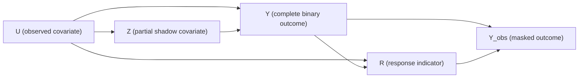

# Binary logistic regression with covariate-and-outcome MNAR and a partial shadow variable

## Research question

- **Question and intended use.** Estimate the full-data logistic regression log-odds slope $`\beta_Z = -0.3`$ and construct a nominal 95% confidence interval for a binary outcome whose missingness depends jointly on the unobserved binary outcome $Y$ and a correlated covariate $U$, while excluding the partial shadow covariate $Z$ conditional on $(U, Y)$. This case is proposed as an evaluation benchmark candidate for discrete-outcome MNAR inference.
- **Behavior under test.** Letting $`r_y(u) = \Pr(R = 1 \mid U = u, Y = y)`$, exact conditional exclusion $R \perp Z \mid (U, Y)$ yields the complete-case log-odds $`\mathrm{logit}\Pr(Y = 1 \mid U = u, Z = z, R = 1) = 0.3 u - 0.3 z + \log\{r_1(u)/r_0(u)\}`$, which preserves the fixed-$`U`$ slope $`\beta_Z = -0.3`$ under a flexible partially linear nuisance term $`h(U) + \beta_Z Z`$ (whereas an ordinary complete-case logistic regression linear in $U$ is misspecified because $`\log\{r_1(u)/r_0(u)\}`$ is nonlinear in $`u`$). Meanwhile, MAR estimators have limits depending on their nuisance specifications and ignore the MNAR selection bias, whereas partial-shadow estimators recover the full parameter vector and leverage unlabeled covariates.

## Study design and data source

- **Motivation and references.** Zhao and Ma (2022), *A Versatile Estimation Procedure Without Estimating the Nonignorable Missingness Mechanism*, *Journal of the American Statistical Association* 117(540), 1916–1930, [DOI](https://doi.org/10.1080/01621459.2021.1893176), verified from the [NSF PAR advance PDF](https://par.nsf.gov/servlets/purl/10282419), Sections 2, 4, and 6.2 (first study under assumption (1), Table 3, pp. 10–12). The bivariate normal covariate correlation $0.5$, logistic outcome parameters $(0.3, -0.3)$, response propensity $\mathrm{expit}(1 + Y + U)$, and sample size $n = 1000$ follow the source verbatim. Adaptations extract the scalar $Z$-slope $`\beta_Z = -0.3`$ from the two-element source coefficient vector, store masked binary outcomes as finite placeholder `0` in `Y_obs` paired with `R`, and permit off-design sizes via the CLI.
- **Population and sampling.** Units are $n = 1000$ i.i.d. draws from $(U, Z, Y, R)$. The theoretical response rate is $76.8352\%$ (expected missingness $`23.1648\%`$).

## DAG and identification

- **Variables and causal structure.** $U$ (`U`) is an observed covariate affecting both $Y$ and $R$, $Z$ (`Z`) is the correlated partial shadow covariate affecting $Y$ and excluded from $R$ conditional on $(U, Y)$ (note $Z$ remains marginally associated with $R$ through $Y$ and $`U`$), $Y$ is the latent complete binary outcome, $R$ (`R`) is the response indicator, and $`Y_{\mathrm{obs}}`$ (`Y_obs`) is the masked observed outcome. The arrow `U -> Z` represents the exact bivariate Gaussian dependence factorization.
- **DAG edges.** `U -> Z, U -> Y, Z -> Y, U -> R, Y -> R, Y -> Y_obs, R -> Y_obs`
- **Assumptions.** Units are i.i.d., $`r_y(u) = \Pr(R = 1 \mid U = u, Y = y) \in (0, 1)`$ for $y \in \{0, 1\}$, and partial shadow exclusion $R \perp Z \mid (U, Y)$ holds with $\mathrm{Var}(Z \mid U) = 0.75 > 0$ and $`\beta_Z \neq 0`$. Defining observable subprobabilities $`a(z) = \Pr(R = 1, Y_{\mathrm{obs}} = 1 \mid u, z)`$ and $`b(z) = \Pr(R = 1, Y_{\mathrm{obs}} = 0 \mid u, z)`$, the identity $`a(z)/r_1(u) + b(z)/r_0(u) = 1`$ evaluated at two distinct $z$ values forms a nonsingular rank-2 system (since $\Pr(Y = 1 \mid u, z)$ varies with $`z`$), identifying $`(r_0(u), r_1(u))`$ and hence the full-data logistic vector $`(\beta_U, \beta_Z)`$ without parametric restrictions on $`r_y(u)`$. Note that the paper's formal partial-shadow theorem imposes compact-support and bounded-score conditions not literally satisfied by unbounded Gaussian covariates.



## Variables and data-generating process

- **Variables and observed input.** Each row is one unit. Every estimator receives the four observed columns `U`, `Z`, `R`, and `Y_obs`. Because `Y` is binary ($`\{0, 1\}`$), `Y_obs == 0` occurs both for observed negative outcomes (`R == 1`) and masked outcomes (`R == 0`); estimators must always condition on `R == 1` when reading outcomes. Unobserved $`Y_i`$ values and oracle propensities are excluded.
- **Draw order and scenarios.** Under the single scenario `original` ($`n = 1000`$): independently per row, draw $`(U_i, Z_i)^{\top} \sim \mathcal{N}_2(\mathbf{0}_2, \Sigma)`$ with $`\Sigma_{12} = 0.5`$, draw $`Y_i \mid (U_i, Z_i) \sim \mathrm{Bernoulli}\{\mathrm{expit}(0.3U_i - 0.3Z_i)\}`$, draw $`R_i \mid (U_i, Y_i) \sim \mathrm{Bernoulli}\{\mathrm{expit}(1 + Y_i + U_i)\}`$, and record $`Y_{\mathrm{obs},i} = R_i Y_i`$.

### Structural equations

- **Structural parents.** `U -> Z, U -> Y, Z -> Y, U -> R, Y -> R, Y -> Y_obs, R -> Y_obs`

$$
\begin{aligned}
(U_i, Z_i)^{\top} &\overset{\mathrm{iid}}{\sim} \mathcal{N}_2\!\left(\mathbf{0}_2,\, \begin{pmatrix} 1 & 0.5 \\ 0.5 & 1 \end{pmatrix}\right), && i = 1, \ldots, n, \quad n = 1000, \\
Y_i \mid (U_i, Z_i) &\sim \mathrm{Bernoulli}\bigl\{\mathrm{expit}(0.3 U_i - 0.3 Z_i)\bigr\}, && \\
R_i \mid (U_i, Z_i, Y_i) &\sim \mathrm{Bernoulli}\bigl\{\mathrm{expit}(1 + Y_i + U_i)\bigr\}, && \\
Y_{\mathrm{obs},i} &= R_i Y_i.
\end{aligned}
$$

Rows are i.i.d. across units and tables; equivalently $`U_i \sim \mathcal{N}(0, 1)`$ and $`Z_i = 0.5 U_i + \sqrt{0.75}\,\epsilon_{Z,i}`$ with $`\epsilon_{Z,i} \sim \mathcal{N}(0, 1)`$ independent of $`U_i`$, and $\mathrm{expit}(t) = (1 + e^{-t})^{-1}$.

| Symbol | Meaning | Definition or setting |
| --- | --- | --- |
| $i, n$ | Unit index and sample size | $i = 1, \ldots, n$; fixed $n = 1000$ from source Section 6.2 (`original`). |
| $`U_i`$ | Observed covariate entering response | Standard normal marginal $\mathcal{N}(0, 1)$; column `U`. |
| $`Z_i`$ | Observed partial shadow covariate | Correlated with $`U_i`$ ($`\mathrm{Corr}(U_i, Z_i) = 0.5`$, $`\mathrm{Var}(Z_i \mid U_i) = 0.75`$); excluded from response law conditional on $`(U_i, Y_i)`$; column `Z`. |
| $`Y_i`$ | Complete binary outcome | Drawn from $`\mathrm{Bernoulli}\{\mathrm{expit}(0.3U_i - 0.3Z_i)\}`$; latent when $`R_i = 0`$. |
| $\mathrm{expit}(t)$ | Logistic link function | $\mathrm{expit}(t) = 1/(1 + e^{-t})$; response law $`\mathrm{expit}(1 + Y_i + U_i)`$ yields expected missingness $23.16\%$. |
| $`R_i`$ | Response indicator | Drawn from $`\mathrm{Bernoulli}\{\mathrm{expit}(1 + Y_i + U_i)\}`$ given $`(U_i, Y_i)`$; column `R`. |
| $`Y_{\mathrm{obs},i}`$ | Observed masked outcome | Equals $`Y_i \in \{0, 1\}`$ when $`R_i = 1`$ and finite placeholder `0` when $`R_i = 0`$; column `Y_obs`. |
| $`\beta_Z`$ | Target log-odds slope | $`\beta_Z = \partial_z \mathrm{logit}\Pr(Y = 1 \mid U = u, Z = z) = -0.3`$. |

## Data-generating process and estimand

- **Estimand.** The scalar target is the conditional log-odds slope $`\beta_Z = \frac{\partial}{\partial z}\mathrm{logit}\Pr(Y = 1 \mid U = u, Z = z) = -0.3`$ (log-odds per unit of $`Z`$).
- **Truth check.** The logistic model directly gives $`\beta_Z = -0.3`$. Independent verification in `verify.py` evaluates the fixed-$`U`$ complete-case log-odds contrast at $u \in \{-1, 0, 1\}$ (confirming $-0.3$ within $`10^{-12}`$), verifies rank-2 recovery of $`(r_0(u), r_1(u))`$ from the observable $2 \times 2$ subprobability system, checks the expected response rate $0.76835154$ by adaptive integration, checks binary outcome domain, and verifies generated respondent outcome calibration.

## Benchmark comparison

- **Output and comparator.** Methods output a scalar point estimate of $`\beta_Z`$ and a nominal 95% confidence interval where applicable using `U`, `Z`, `R`, and `Y_obs`. Comparators follow the protocol: (1) partially linear complete-case logistic regression using a restricted cubic spline $h(U)$ with knots at the respondent 5th, 35th, 65th, and 95th percentiles and a sandwich Wald interval for $`\beta_Z`$ (noting that an ordinary linear in $U$ complete-case logistic fit is generally misspecified and is not a scored comparator), (2) Zhao–Shao pseudo-likelihood (method-specific SE with 95% normal quantile), and (3) Zhao–Ma estimating equations (method-specific SE with 95% normal quantile).
- **Scoring and replication.** Evaluate all methods on 1,000 paired independent replicate tables at $n = 1000$. Report bias, RMSE, empirical 95% coverage, mean interval length, Monte Carlo uncertainty, valid denominators, and all failure counts.

## Materials and access

- **Public materials.** The simulation design is published in Zhao and Ma (2022), [DOI](https://doi.org/10.1080/01621459.2021.1893176) and the [NSF PAR advance PDF](https://par.nsf.gov/servlets/purl/10282419), governed by publisher terms.
- **Reproduction and protected materials.** The private review archive `mdi-zhao-ma-2022-bernoulli-shadow-logodds-v1.zip` (SHA-256 `73d4947af8568b4fda470c81de130a74601b7869fd3fd623e26f29146fca55a3`) contains `generator.py`, `truth.py`, `verify.py`, `reproduce.py`, `collection.json`, `config.json`, `schema.csv`, `card.md`, `PROVENANCE.md`, `source_audit.json`, `requirements.txt` (`numpy==2.3.5`, `scipy==1.16.3`), check records, and `MANIFEST.json`. After verifying the manifest in Python 3.12, run:

```bash
python3 reproduce.py --scenario original --n 1000 --seed 1729 --out ../zhao-ma-2022-bernoulli-check
```

The command validates all truth, rank-identification, generated-outcome, and actual-table checks and exports `observed.csv` (`U,Z,R,Y_obs`, 1,000 rows) separately from `reference.json`.
