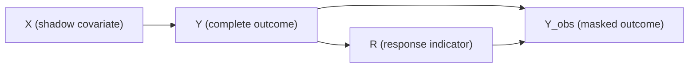

# Gaussian regression slope under outcome-dependent MNAR with a shadow covariate

## Research question

- **Question and intended use.** Estimate the full-data linear regression slope $`\beta_1 = -0.5`$ and construct a nominal 95% confidence interval when response depends directly on the unobserved outcome $Y$ (MNAR) and the fully observed predictor $X$ serves as a shadow variable. This design is proposed as an evaluation benchmark candidate for semiparametric MNAR regression inference.
- **Behavior under test.** Outcome-dependent selection $R \mid Y \sim \mathrm{Bernoulli}\{\mathrm{expit}(1 + Y)\}$ ($`30.49\%`$ expected missingness) distorts the observed conditional distribution of $Y \mid (X, R = 1)$, biasing both complete-case OLS and MAR imputation estimators. Because $R \perp X \mid Y$, the conditional distribution of $X \mid (Y, R = 1)$ matches the full-data $X \mid Y$, enabling consistent estimation of $`\beta_1`$ without specifying the unknown nonignorable propensity score.

## Study design and data source

- **Motivation and references.** Zhao and Ma (2022), *A Versatile Estimation Procedure Without Estimating the Nonignorable Missingness Mechanism*, *Journal of the American Statistical Association* 117(540), 1916–1930, [DOI](https://doi.org/10.1080/01621459.2021.1893176), verified from the [NSF PAR advance PDF](https://par.nsf.gov/servlets/purl/10282419), Sections 2–3 and 6.1 (first situation, Table 1, pp. 8–10). The Gaussian covariate law $\mathcal{N}(0.5, 0.25)$, linear outcome parameters $(0.25, -0.5, \sigma^2 = 1)$, logistic response law $\mathrm{expit}(1 + Y)$, and sample size $n = 500$ follow the source verbatim. Adaptations extract the scalar slope $`\beta_1 = -0.5`$, represent missing outcomes as finite placeholder `0` (serialized as float `0.0`) in `Y_obs` paired with `R`, and permit off-design sample sizes via the CLI.
- **Population and sampling.** Each replicate draws $n = 500$ i.i.d. units from the joint superpopulation $(X, Y, R)$. The theoretical response rate is $69.5113\%$ (expected missingness $`30.4887\%`$).

## DAG and identification

- **Variables and causal structure.** $X$ (`X`) is the fully observed shadow covariate, $Y$ is the latent complete outcome, $R$ (`R`) is the response indicator depending solely on $Y$, and $`Y_{\mathrm{obs}}`$ (`Y_obs`) is the masked observed outcome. The absence of an arrow $X \to R$ encodes the shadow-variable exclusion restriction.
- **DAG edges.** `X -> Y, Y -> R, Y -> Y_obs, R -> Y_obs`
- **Assumptions.** Units are i.i.d. from the **joint Gaussian** model $(X, Y)$ with $\mathrm{Var}(X) = 0.25 > 0$, strictly positive response probabilities, and shadow exclusion $R \perp X \mid Y$ with $X$ associated with $Y$ ($`\beta_1 \neq 0`$). By exclusion, the observed reverse regression $X \mid (Y, R = 1)$ equals the full-data $X \mid Y$, identifying its slope $b = -2/17 \neq 0$ and residual variance $v = 4/17$; combined with the marginal $\mathrm{Var}(X)$ from all units, $`\beta_1 = (\mathrm{Var}(X) - v)/(b \mathrm{Var}(X)) = -0.5`$ is identified without restricting $\Pr(R = 1 \mid Y)$. Note that the paper's formal full-shadow asymptotic theorem imposes compact supports and bounded scores, whereas the source simulation and this benchmark use unbounded Gaussian variables (supporting finite-moment identification and empirical comparison of the source estimators).



## Variables and data-generating process

- **Variables and observed input.** Each row is one unit. Methods receive the three observed columns `X`, `R`, and `Y_obs`. Missing outcomes (`R == 0`) carry finite placeholder `0` (serialized as float `0.0`) in `Y_obs` and must be masked using `R == 1`. Unobserved outcomes, Gaussian disturbances, and oracle selection probabilities are excluded from estimator inputs.
- **Draw order and scenarios.** Under the single scenario `original` ($`n = 500`$): independently per row, draw $`X_i \sim \mathcal{N}(0.5, 0.25)`$ and $`\epsilon_i \sim \mathcal{N}(0, 1)`$, compute $`Y_i = 0.25 - 0.5X_i + \epsilon_i`$, draw $`R_i \sim \mathrm{Bernoulli}\{\mathrm{expit}(1 + Y_i)\}`$, and set $`Y_{\mathrm{obs},i} = R_i Y_i`$.

### Structural equations

- **Structural parents.** `X -> Y, Y -> R, Y -> Y_obs, R -> Y_obs`

$$
\begin{aligned}
X_i &\overset{\mathrm{iid}}{\sim} \mathcal{N}(0.5, 0.25), && i = 1, \ldots, n, \quad n = 500, \\
\epsilon_i &\overset{\mathrm{iid}}{\sim} \mathcal{N}(0, 1), && \epsilon_i \perp X_i, \\
Y_i &= 0.25 - 0.5 X_i + \epsilon_i, && \\
R_i \mid (X_i, Y_i) &\sim \mathrm{Bernoulli}\bigl\{\mathrm{expit}(1 + Y_i)\bigr\}, && \\
Y_{\mathrm{obs},i} &= R_i Y_i.
\end{aligned}
$$

Rows are i.i.d. across units and tables; $\mathrm{expit}(t) = (1 + e^{-t})^{-1}$, and unobserved outcomes ($`R_i = 0`$) take finite placeholder $`Y_{\mathrm{obs},i} = 0`$.

| Symbol | Meaning | Definition or setting |
| --- | --- | --- |
| $i, n$ | Unit index and sample size | $i = 1, \ldots, n$; fixed $n = 500$ from source Section 6.1 (`original`). |
| $`X_i`$ | Fully observed shadow covariate | Drawn from $\mathcal{N}(0.5, 0.25)$ (mean $0.5$, variance $0.25$, SD $`0.5`$); column `X`. |
| $`\epsilon_i`$ | Outcome disturbance | Independent $\mathcal{N}(0, 1)$ noise, independent of $`X_i`$; latent. |
| $`Y_i`$ | Complete continuous outcome | Linear Gaussian model $`Y_i = 0.25 - 0.5X_i + \epsilon_i`$; latent when $`R_i = 0`$. |
| $\mathrm{expit}(t)$ | Logistic response link | $\mathrm{expit}(t) = 1/(1 + e^{-t})$; response propensity $\Pr(R = 1 \mid Y = y) = \mathrm{expit}(1 + y)$ gives expected missingness $30.49\%$. |
| $`R_i`$ | Response indicator | Drawn from $`\mathrm{Bernoulli}\{\mathrm{expit}(1 + Y_i)\}`$ given $`Y_i`$; column `R`. |
| $`Y_{\mathrm{obs},i}`$ | Observed masked outcome | Equals $`Y_i`$ when $`R_i = 1`$ and placeholder `0` when $`R_i = 0`$; column `Y_obs`. |
| $`\beta_1`$ | Target regression slope | $`\beta_1 = \mathrm{Cov}(X, Y) / \mathrm{Var}(X) = (\mathrm{Var}(X) - v)/(b \mathrm{Var}(X)) = -0.5`$. |

## Data-generating process and estimand

- **Estimand.** The scalar target is the full-data regression slope $`\beta_1 = \mathrm{Cov}(X, Y)/\mathrm{Var}(X) = -0.5`$ (outcome units per $X$ unit).
- **Truth check.** The structural equation directly implies $`\beta_1 = -0.5`$. Independent verification in `verify.py` evaluates $\mathrm{Cov}(X, Y)/\mathrm{Var}(X)$ by univariate quadrature over $X$ after conditioning analytically on $X$ (matching $-0.5$ within $`10^{-11}`$), confirms the exact shadow reverse-regression parameters $b = -2/17$ and $v = 4/17$, fits the reverse regression $X \mid (Y, R = 1)$ on generated respondents combined with all generated $X$ to recover $`\beta_1`$, and verifies the theoretical response rate $0.69511265$ via Gaussian quadrature.

## Benchmark comparison

- **Output and comparator.** Methods output a scalar estimate of $`\beta_1`$ and a nominal 95% confidence interval where applicable from `X`, `R`, and `Y_obs`. Comparators follow the protocol: (1) complete-case least squares with a nominal robust Wald interval as a selection-sensitive baseline, (2) Gaussian reverse-moment estimator $(\widehat{\mathrm{Var}}(X) - \hat{v})/(\hat{b}\widehat{\mathrm{Var}}(X))$ estimating $b$ and $v$ on respondents and $\mathrm{Var}(X)$ on all rows with a delta-method sandwich normal interval for the stacked all-row and respondent moments, (3) shadow-variable pseudo-likelihood (method-specific SE with 95% normal quantile), and (4) Zhao–Ma estimating equations (method-specific SE with 95% normal quantile).
- **Scoring and replication.** Evaluate all methods across 1,000 paired independent replicate tables at $n = 500$. Report bias, RMSE, empirical 95% coverage, mean interval width, Monte Carlo standard errors, valid denominators, and all failure or nonconvergence counts.

## Materials and access

- **Public materials.** The design is published in Zhao and Ma (2022), [DOI](https://doi.org/10.1080/01621459.2021.1893176) and the [NSF PAR advance PDF](https://par.nsf.gov/servlets/purl/10282419), governed by publisher terms.
- **Reproduction and protected materials.** The private review archive `mdi-zhao-ma-2022-normal-shadow-slope-v1.zip` (SHA-256 `fc621f52babd7f7d7ca90216d30bf3da1fb6f8566a767e9d28bc9495630e3c49`) bundles `generator.py`, `truth.py`, `verify.py`, `reproduce.py`, `collection.json`, `config.json`, `schema.csv`, `card.md`, `PROVENANCE.md`, `source_audit.json`, `requirements.txt` (`numpy==2.3.5`, `scipy==1.16.3`), check records, and `MANIFEST.json`. After verifying the manifest in Python 3.12, run:

```bash
python3 reproduce.py --scenario original --n 500 --seed 1729 --out ../zhao-ma-2022-normal-check
```

The command validates all truth, generated reverse-regression, and actual-table checks and writes `observed.csv` (`X,R,Y_obs`, 500 rows) separately from `reference.json`.
