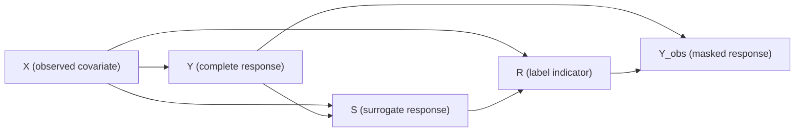

# Surrogate-assisted linear regression with covariate- and surrogate-dependent labeling

## Research question

- **Question and intended use.** Estimate the population linear regression slope $`\beta_2 = \mathrm{Cov}(X, Y) / \mathrm{Var}(X) = 2.0`$ and construct a nominal 95% confidence interval from $n = 1,000$ observations when a covariate $X$ and a strongly informative continuous surrogate $S$ are observed for every unit, while the true response $Y$ is stochastically ascertained with probability depending on $(X, S)$. This design is proposed as an evaluation benchmark candidate for surrogate-assisted semi-supervised inference under non-uniform validation sampling.
- **Behavior under test.** Because the validation indicator $R$ depends directly on the surrogate $S$ (which is downstream of $`Y`$), the labeled subsample is outcome-selected conditional on $X$ alone, rendering complete-case OLS of $Y$ on $X$ inconsistent. Conversely, $R \perp Y \mid (X, S)$ holds by design, allowing inverse-probability-weighted, augmented Robins–Rotnitzky–Zhao, and surrogate-assisted empirical likelihood estimators to restore consistency under the applicable estimating-equation and nuisance-model conditions and leverage the unlabeled surrogate cohort for substantial variance reduction.

## Study design and data source

- **Motivation and references.** Chen, Leung and Qin (2008), *Improving Semiparametric Estimation by Using Surrogate Data*, *Journal of the Royal Statistical Society Series B: Statistical Methodology* 70(4), 803–823, [DOI](https://doi.org/10.1111/j.1467-9868.2008.00662.x), from the publisher version of record ([OUP](https://academic.oup.com/jrsssb/article/70/4/803/7109505)), Section 4 (Numerical study, Model 1, equation (21) and Table 1, third labeling setting). The retrieved publisher extract verifies the logistic labeling coefficients $(-1, 0.35, 0.35)$, outcome regression coefficients $(1, 2)$, and sample size $n = 1,000$; the typeset Model 1 Gaussian display itself was unavailable in the retrieved extract and is implemented from our transcribed source record, which yields $49.295\%$ exact population missingness (compared with the paper's approximate $47\%$ summary), as documented in `PROVENANCE.md`. Adaptations denote the validation indicator $\delta$ by `R`, store masked unlabeled responses as finite placeholder `0` (serialized as float `0.0`) in `Y_obs`, and draw independent rows from the same law at any requested $n$.
- **Population and sampling.** Units are $n = 1,000$ i.i.d. draws from the joint Gaussian-logistic law $(X, Y, S, R)$. Total sample size is fixed at $1,000$ while the realized labeled count is stochastic (exact marginal labeling rate $\approx 50.71\%$; $483$ labeled and $517$ unlabeled rows at seed `1729`).

## DAG and identification

- **Variables and causal structure.** $X$ (`X`) is the observed standard normal covariate, $Y$ is the latent complete response, $S$ (`S`) is the always-observed continuous surrogate caused by both $X$ and $Y$, $R$ (`R`) is the stochastic validation indicator driven by $(X, S)$, and $`Y_{\mathrm{obs}}`$ (`Y_obs`) is the masked observed outcome.
- **DAG edges.** `X -> Y, X -> S, Y -> S, X -> R, S -> R, Y -> Y_obs, R -> Y_obs`
- **Assumptions.** Units are i.i.d. with $\mathrm{Var}(X) = 1 > 0$ and finite second moments; the validation mechanism is missing at random given $(X, S)$ ($`R \perp Y \mid X, S`$) with pointwise positivity $0 < w(S, X) < 1$ almost surely (note that the Gaussian logit takes values arbitrarily close to $0$ and $1$ in the tails, so overlap is pointwise rather than uniformly bounded). Consequently, $\mathbb{E}[Y \mid X, S]$ is identified from the labeled rows and integrating over the full marginal distribution of $(X, S)$ uniquely identifies $`\beta_2 = 2`$.



## Variables and data-generating process

- **Variables and observed input.** Each row is one unit. Every method receives the four observed columns `X`, `S`, `R`, and `Y_obs`. Unlabeled rows (`R == 0`) store finite placeholder `0` (serialized as float `0.0`) in `Y_obs` and must be masked using `R == 1`. Unobserved outcomes ($`R = 0`$) and disturbances $`(E_Y, E_S)`$ are excluded from estimator inputs.
- **Draw order and scenarios.** Under the single scenario `original` ($`n = 1,000`$): independently for $i = 1, \ldots, 1000$, draw $`X_i, E_{Yi}, E_{Si} \sim \mathcal{N}(0, 1)`$, set $`Y_i = 1 + 2 X_i + E_{Yi}`$ and $`S_i = 1 + 2 Y_i + X_i + E_{Si}`$, draw $`R_i \sim \mathrm{Bernoulli}(\mathrm{expit}(-1 + 0.35 S_i + 0.35 X_i))`$, and set $`Y_{\mathrm{obs},i} = R_i Y_i`$.

### Structural equations

- **Structural parents.** `X -> Y, X -> S, Y -> S, X -> R, S -> R, Y -> Y_obs, R -> Y_obs`

$$
\begin{aligned}
X_i, E_{Yi}, E_{Si} &\overset{\mathrm{iid}}{\sim} \mathcal{N}(0, 1), && i = 1, \ldots, n, \\
Y_i &= 1 + 2 X_i + E_{Yi}, \qquad S_i = 1 + 2 Y_i + X_i + E_{Si}, && \\
w(s, x) &= \mathrm{expit}(-1 + 0.35 s + 0.35 x), && R_i \mid (S_i, X_i, Y_i) \sim \mathrm{Bernoulli}\bigl(w(S_i, X_i)\bigr), \\
n &= 1000, && Y_{\mathrm{obs},i} = R_i Y_i.
\end{aligned}
$$

The total sample size is fixed at $n = 1,000$ while the labeled count $`\sum_{i=1}^{n} R_i`$ is stochastic (exact marginal labeling probability $\approx 0.5071$, i.e., $49.30\%$ missingness); unlabeled rows ($`R_i = 0`$) carry finite placeholder $`Y_{\mathrm{obs},i} = 0`$.

| Symbol | Meaning | Definition or setting |
| --- | --- | --- |
| $i, n$ | Row index and sample size | $i = 1, \ldots, n$; source total size $n = 1,000$ with stochastic labeled count ($`483`$ labeled, $517$ unlabeled at seed `1729`). |
| $`X_i`$ | Observed covariate | Independent $\mathcal{N}(0, 1)$ predictor observed for every unit; column `X`. |
| $`E_{Yi}, E_{Si}`$ | Independent Gaussian disturbances | Independent $\mathcal{N}(0, 1)$ outcome and surrogate errors, mutually independent and independent of $`X_i`$; latent. |
| $`Y_i`$ | Complete continuous outcome | Linear regression outcome $`Y_i = 1 + 2 X_i + E_{Yi}`$; latent when $`R_i = 0`$. |
| $`S_i`$ | Observed continuous surrogate | $`S_i = 1 + 2 Y_i + X_i + E_{Si}`$, measured for every unit; column `S`. |
| $\mathrm{expit}, w(s, x)$ | Logistic labeling probability | $\mathrm{expit}(z) = (1 + e^{-z})^{-1}$; $w(s, x) = \mathrm{expit}(-1 + 0.35 s + 0.35 x)$. |
| $`R_i`$ | Stochastic label indicator | $`\mathrm{Bernoulli}(w(S_i, X_i))`$ draw equal to $1$ when $`Y_i`$ is revealed and $0$ otherwise; column `R`. |
| $`Y_{\mathrm{obs},i}`$ | Observed masked response | Equals $`Y_i`$ when $`R_i = 1`$ and finite placeholder `0` when $`R_i = 0`$; column `Y_obs`. |
| $`\beta_2`$ | Population regression slope | $`\beta_2 = \mathrm{Cov}(X, Y) / \mathrm{Var}(X) = 2`$. |

## Data-generating process and estimand

- **Estimand.** The scalar target is the population linear regression slope $`\beta_2 = \mathrm{Cov}(X, Y) / \mathrm{Var}(X) = 2.0`$ (response units per covariate unit).
- **Truth check.** The slope $`\beta_2 = 2`$ is exact by linear Gaussian construction. Independent verification in `verify.py` computes the conditional expectation $\mathbb{E}[Y \mid X, S] = -0.2 + 0.4 S$ (with residual variance $`0.2`$) and integrates over $\mathbb{E}[S \mid X] = 3 + 5X$ to recover $`\beta_2 = 0.4 \times 5 = 2.0`$ to within $10^{-13}$, while validating the generated labeled conditional intercept ($`-0.2`$), slopes, residual variance, labeling logit moments (mean $0.05$, variance $`5.0225`$), quintile propensity calibration, stochastic label counts, and outcome masking.

## Benchmark comparison

- **Output and comparator.** Methods output a scalar estimate of $`\beta_2`$, standard error, and nominal 95% confidence interval using `X`, `S`, `R`, and `Y_obs`. Comparators include the surrogate-assisted empirical likelihood estimator, the augmented Robins–Rotnitzky–Zhao estimator, inverse-probability-weighted complete-case estimation, and naive complete-case OLS (illustrating selection bias).
- **Scoring and replication.** Evaluate all methods on 2,000 paired independent replicate tables at $n = 1,000$. Report bias, RMSE, empirical 95% coverage, mean interval width, Monte Carlo uncertainty, valid denominators, and all failure counts.

## Materials and access

- **Public materials.** The simulation design is published in Chen, Leung and Qin (2008), [DOI](https://doi.org/10.1111/j.1467-9868.2008.00662.x), [publisher article](https://academic.oup.com/jrsssb/article/70/4/803/7109505), and [JSTOR](https://www.jstor.org/stable/20203856), governed by publisher terms.
- **Reproduction and protected materials.** The private review archive `sspi-chen-leung-qin-2008-surrogate-linear-v1.zip` (SHA-256 `f41d1c4620a559c6da333e8548762923e38ce5d725a0e137f2e38c0e978bb629`) contains `generator.py`, `truth.py`, `verify.py`, `reproduce.py`, `collection.json`, `config.json`, `schema.csv`, `card.md`, `PROVENANCE.md`, `source_audit.json`, `requirements.txt` (`numpy==2.3.5`), check records, and `MANIFEST.json`. After verifying the manifest in Python 3.12, run:

```bash
python3 reproduce.py --scenario original --n 1000 --seed 1729 --out ../chen-2008-surrogate-linear-check
```

The command validates all truth, conditional-regression, and table-contract checks and writes `observed.csv` (`X,S,R,Y_obs`, 1,000 rows) separately from `reference.json`.
