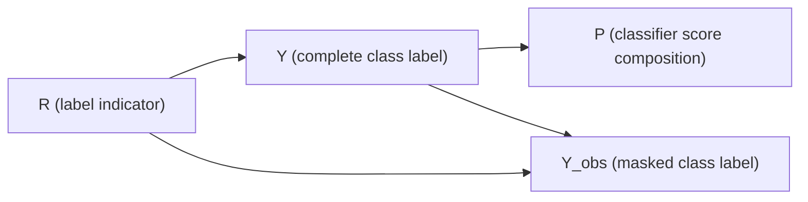

# Target class prevalence from compositional classifier scores under label shift

## Research question

- **Question and intended use.** Estimate the target-cohort prevalence of class 3, $`p^{\mathrm{U}}_3 = \Pr(Y = 3 \mid R = 0) = 0.27`$, and construct a nominal 95% confidence or credible interval from $`n_{\mathrm{L}} = 300`$ labeled calibration units and $`n_{\mathrm{U}} = 1,000`$ unlabeled target units whose observed predictors are five-class probabilistic classifier score vectors $`P = (P_1, \ldots, P_5)`$. This design is proposed as an evaluation benchmark candidate for prediction-assisted quantification learning under label shift.
- **Behavior under test.** The classifier score matrix $M$ introduces substantial cross-class confusion—most notably, both class 2 ($`M_{2,3} = 0.65`$) and class 3 ($`M_{3,3} = 0.60`$) place their highest average probability mass on class 3—so naive classify-and-count estimators severely overestimate $`p^{\mathrm{U}}_3`$. At the same time, the target distribution differs from the uniform calibration distribution ($`p^{\mathrm{L}} \neq p^{\mathrm{U}}`$) and the five classes exhibit distinct structural-zero support patterns inherited directly from the source paper's verbal-autopsy classifier model, allowing benchmarks to compare generalized Bayes quantification, Dirichlet-mixture calibration, linear score-moment inversion, and support-pattern classifiers.

## Study design and data source

- **Motivation and references.** Fiksel, Datta, Amouzou and Zeger (2022), *Generalized Bayes Quantification Learning under Dataset Shift*, *Journal of the American Statistical Association* 117(540), 2163–2181, [DOI](https://doi.org/10.1080/01621459.2021.1909599), verified from the journal version of record (pp. 2174–2175) and the author manuscript [arXiv:2001.05360v2](https://arxiv.org/html/2001.05360v2), Sections 2, 5, and S4.4 (equation (21), prevalence scenario `p1`, first data-generating mechanism with known calibration labels, Figure 2 left panel). The five-class target prevalence vector `p1`, independent uniform-probability calibration draws, $5 \times 5$ mean score matrix $M$, Dirichlet concentration $5$ via normalized Gamma draws preserving structural zeros, and cohort counts $`n_{\mathrm{L}} = 300`$, $`n_{\mathrm{U}} = 1,000`$ follow Section 5 verbatim. Adaptations encode classes as integers `1`–`5`, extract the scalar estimand $`p^{\mathrm{U}}_3`$, store masked unlabeled labels as integer `0` in `Y_obs` paired with `R`, and apply proportionate rounding for non-source $n$.
- **Population and sampling.** Units consist of $`n_{\mathrm{L}} = 300`$ independent draws from the labeled calibration cohort ($`R = 1`$, uniform class probabilities $p^{\mathrm{L}}$, yielding $\mathrm{Multinomial}(300; 1/5, \ldots, 1/5)$ calibration class counts) and $`n_{\mathrm{U}} = 1,000`$ independent draws from the unlabeled target cohort ($`R = 0`$, class probabilities $`p^{\mathrm{U}}`$), for $n = 1,300$ rows in total.

## DAG and identification

- **Variables and causal structure.** $R$ (`R`) is the observed cohort indicator that shifts the class prevalence of the latent complete class label $Y$. Given $Y$, the five-dimensional compositional classifier score vector $P$ (`P1`–`P5`) follows an invariant class-conditional law across both cohorts. Together, $(Y, R)$ determine the masked integer label $`Y_{\mathrm{obs}}`$ (`Y_obs`).
- **DAG edges.** `R -> Y, Y -> P, Y -> Y_obs, R -> Y_obs`
- **Assumptions.** Observations are independent within and across cohorts; all five classes have positive calibration coverage ($`p_k^{\mathrm{L}} = 1/5 > 0`$); the class-conditional score distribution is invariant across cohorts ($`P \perp R \mid Y`$, i.e., pure label shift); and the $5 \times 5$ class-conditional mean score matrix $M$ is full rank ($`\det M = 0.0663 \neq 0`$). Under these conditions, $\mathbb{E}[P \mid R = 0] = M^{\top} p^{\mathrm{U}}$ uniquely identifies $p^{\mathrm{U}} = (M^{\top})^{-1} \mathbb{E}[P \mid R = 0]$ from $`(P, R, Y_{\mathrm{obs}})`$. Independently, because the five rows of $M$ have pairwise distinct positive-coordinate supports, a learned support-pattern map from the calibration cohort also identifies $`p^{\mathrm{U}}_3`$ almost surely.



## Variables and data-generating process

- **Variables and observed input.** Each row represents one unit. Every method receives the seven observed columns `P1`, `P2`, `P3`, `P4`, `P5`, `R`, and `Y_obs`. Rows of `P1`–`P5` are nonnegative and sum to $1$. Labeled rows (`R == 1`) store integer class labels `1`–`5` in `Y_obs`, while unlabeled target rows (`R == 0`) store integer placeholder `0` in `Y_obs`; estimators must use `R == 1` to select labeled calibration rows and `R == 0` to select unlabeled target rows. Latent target labels ($`R = 0`$) and unnormalized Gamma variables $`G_{ij}`$ are withheld from estimator inputs.
- **Draw order and scenarios.** Under the single scenario `original` ($`n_{\mathrm{L}} = 300`$, $`n_{\mathrm{U}} = 1,000`$): assign $`R_i = 1`$ for $i = 1, \ldots, 300$ and $`R_i = 0`$ for $i = 301, \ldots, 1300$; draw $`Y_i \sim \mathrm{Cat}(p^{\mathrm{L}})`$ for $`R_i = 1`$ and $`Y_i \sim \mathrm{Cat}(p^{\mathrm{U}})`$ for $`R_i = 0`$; conditional on $`Y_i = k`$, draw independent $`G_{ij} \sim \mathrm{Gamma}(5 M_{kj}, 1)`$ for $`M_{kj} > 0`$ (and set $`G_{ij} = 0`$ where $`M_{kj} = 0`$), normalize $`P_{ij} = G_{ij} / \sum_{h=1}^{5} G_{ih}`$, and set $`Y_{\mathrm{obs},i} = R_i Y_i`$ (as integer).

### Structural equations

- **Structural parents.** `R -> Y, Y -> P, Y -> Y_obs, R -> Y_obs`

$$
\begin{aligned}
p^{\mathrm{L}} &= (1/5, 1/5, 1/5, 1/5, 1/5)^{\top}, \qquad p^{\mathrm{U}} = (0.20, 0.19, 0.27, 0.27, 0.07)^{\top}, \\
Y_i \mid R_i = 1 &\sim \mathrm{Cat}(p^{\mathrm{L}}), \qquad Y_i \mid R_i = 0 \sim \mathrm{Cat}(p^{\mathrm{U}}), \\
M &= \begin{pmatrix}
0.65 & 0.35 & 0 & 0 & 0 \\
0 & 0.35 & 0.65 & 0 & 0 \\
0.10 & 0.10 & 0.60 & 0.10 & 0.10 \\
0 & 0 & 0 & 0.80 & 0.20 \\
0 & 0.40 & 0 & 0 & 0.60
\end{pmatrix}, \\
G_{ij} \mid (Y_i = k) &\overset{\mathrm{ind}}{\sim} \begin{cases} 0, & M_{kj} = 0, \\ \mathrm{Gamma}(5 M_{kj}, 1), & M_{kj} > 0, \end{cases} \qquad P_{ij} = \frac{G_{ij}}{\sum_{h=1}^{5} G_{ih}}, \\
n_{\mathrm{L}} &= 300, \qquad n_{\mathrm{U}} = 1000, \qquad n = n_{\mathrm{L}} + n_{\mathrm{U}} = 1300, \\
R_i &= \mathbf{1}\{i \le n_{\mathrm{L}}\}, \qquad Y_{\mathrm{obs},i} = R_i Y_i.
\end{aligned}
$$

The 300 calibration rows are independent categorical draws from $p^{\mathrm{L}}$ (so realized calibration class counts follow $`\mathrm{Multinomial}(300; 1/5, \ldots, 1/5)`$). Conditional on $`Y_i = k`$, positive coordinates of $`P_i`$ follow a Dirichlet distribution with mean $`M_{k,\cdot}`$ and concentration $5$, preserving exact structural zeros wherever $`M_{kj} = 0`$; unlabeled rows ($`R_i = 0`$) carry integer placeholder $`Y_{\mathrm{obs},i} = 0`$.

| Symbol | Meaning | Definition or setting |
| --- | --- | --- |
| $i, j, h, k$ | Unit, score, and class indices | $i = 1, \ldots, n$; $j, h, k \in \{1, 2, 3, 4, 5\}$. |
| $`n_{\mathrm{L}}, n_{\mathrm{U}}, n`$ | Cohort and total sample sizes | Fixed source sizes $`n_{\mathrm{L}} = 300`$ labeled calibration rows and $`n_{\mathrm{U}} = 1,000`$ unlabeled target rows ($`n = 1,300`$). |
| $p^{\mathrm{L}}, p^{\mathrm{U}}$ | Cohort class prevalence vectors | Uniform calibration probabilities $p^{\mathrm{L}} = (0.2, 0.2, 0.2, 0.2, 0.2)^{\top}$; target scenario `p1` $p^{\mathrm{U}} = (0.20, 0.19, 0.27, 0.27, 0.07)^{\top}$. |
| $`R_i`$ | Labeled cohort indicator | Equals $1$ for the $300$ labeled calibration rows and $0$ for the $1,000$ unlabeled target rows; column `R`. |
| $`Y_i`$ | Complete class label | Categorical draw in $\{1, 2, 3, 4, 5\}$ from $\mathrm{Cat}(p^{\mathrm{L}})$ when $`R_i = 1`$ and $\mathrm{Cat}(p^{\mathrm{U}})$ when $`R_i = 0`$; latent when $`R_i = 0`$. |
| $`M, M_{kj}`$ | Class-conditional mean score matrix | Row-stochastic $5 \times 5$ matrix from equation (21) with $\det M = 0.0663 \neq 0$; row $k$ gives $`\mathbb{E}[P_i \mid Y_i = k]`$. |
| $`G_{ij}`$ | Latent unnormalized score draws | Independent $`\mathrm{Gamma}(5 M_{kj}, 1)`$ (shape $`5 M_{kj}`$, scale $`1`$) where $`M_{kj} > 0`$, and identically $0$ where $`M_{kj} = 0`$; latent. |
| $`P_i, P_{ij}`$ | Observed classifier score composition | Simplex vector $`P_{ij} = G_{ij} / \sum_{h=1}^{5} G_{ih}`$ with $`\sum_{j=1}^{5} P_{ij} = 1`$; columns `P1`–`P5`. |
| $`Y_{\mathrm{obs},i}`$ | Observed masked integer class label | Integer $`Y_i \in \{1, \ldots, 5\}`$ when $`R_i = 1`$ and integer placeholder `0` when $`R_i = 0`$; column `Y_obs`. |
| $`p^{\mathrm{U}}_3`$ | Target class-3 prevalence | $\Pr(Y = 3 \mid R = 0) = 0.27$. |

## Data-generating process and estimand

- **Estimand.** The scalar target is the population prevalence of class 3 in the unlabeled target cohort, $`p^{\mathrm{U}}_3 = \Pr(Y = 3 \mid R = 0) = 0.27`$ (probability units).
- **Truth check.** The parameter $`p^{\mathrm{U}}_3 = 0.27`$ is exact by construction. Independent verification in `verify.py` solves the population score-moment system $(M^{\top})^{-1} \mathbb{E}[P \mid R = 0]$ to confirm $`p^{\mathrm{U}}_3 = 0.27`$ within $10^{-13}$, checks simplex normalization, exact class-conditional zero supports and one-to-one support coverage, the Beta marginal variance $`\mathrm{Var}(P_3 \mid Y = 3) = 0.04`$, empirical score-moment inversion, raw Python integer types for `Y_obs` and `R` before casting, and integer CSV token serialization.

## Benchmark comparison

- **Output and comparator.** Methods output a scalar point estimate of $`p^{\mathrm{U}}_3`$, standard error, and nominal 95% confidence or credible interval from `P1`–`P5`, `R`, and `Y_obs`. Comparators include generalized Bayes quantification learning, Dirichlet mixture calibration (either support-aware or using the paper's $\epsilon = 0.001$ zero-replacement and row renormalization applied inside that estimator's input only, preserving structural zeros in the shared table), naive classify-and-count, linear moment-matrix inversion, and support-pattern classification learned from labeled rows.
- **Scoring and replication.** Evaluate all methods on 500 paired independent replicate tables at $n = 1,300$. Report bias, RMSE, empirical 95% coverage, mean interval width, Monte Carlo uncertainty, valid denominators, and all failure counts.

## Materials and access

- **Public materials.** The simulation design is published in Fiksel et al. (2022), [DOI](https://doi.org/10.1080/01621459.2021.1909599) and [arXiv:2001.05360v2](https://arxiv.org/html/2001.05360v2), subject to publisher terms.
- **Reproduction and protected materials.** The private review archive `sspi-fiksel-datta-amouzou-zeger-2022-quantification-v1.zip` (SHA-256 `c17d5767f67257d88213cba8ab9910cb834510eb5181033818831c1c9330c2ef`) contains `generator.py`, `truth.py`, `verify.py`, `reproduce.py`, `collection.json`, `config.json`, `schema.csv`, `card.md`, `PROVENANCE.md`, `source_audit.json`, `requirements.txt` (`numpy==2.3.5`), check records, and `MANIFEST.json`. After verifying the manifest in Python 3.12, run:

```bash
python3 reproduce.py --scenario original --n 1300 --seed 1729 --out ../fiksel-2022-quantification-check
```

The command validates all truth, integer-schema, support-pattern, and table-contract checks and exports `observed.csv` (`P1,...,P5,R,Y_obs`, 1,300 rows) separately from `reference.json`.
