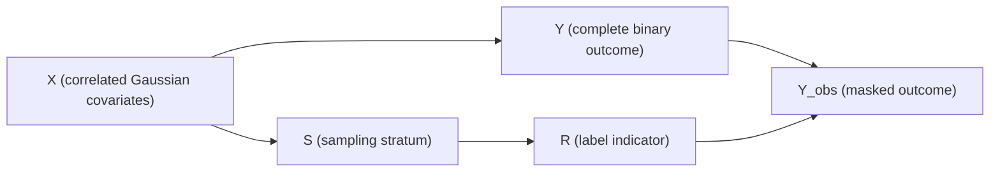

# Population Brier score evaluation under stratified semi-supervised labeling

## Research question

- **Question and intended use.** Estimate the population Brier score $`B = \mathbb{E}_{P_0}[\{Y^0 - g(X^0)\}^2] \approx 0.087985`$ of the logistic prediction model and construct a nominal 95% confidence interval when $`n_{\mathrm{L}} = 200`$ labels are acquired via equal-quota stratified sampling ($`100`$ per stratum) across two noisy covariate-defined strata alongside $`n_{\mathrm{U}} = 20,000`$ independent unlabeled population records. This design is proposed as an evaluation benchmark candidate for stratified semi-supervised model evaluation.
- **Behavior under test.** Because the two strata have unequal population shares ($`P_0(S^0 = 1) \approx 0.4013`$, $`P_0(S^0 = 2) \approx 0.5987`$) and strongly different outcome risks via $`X_1`$, naive unweighted supervised evaluation is biased, while inverse-probability stratum-weighted supervised evaluation discards the massive unlabeled cohort ($`100\times`$ larger than the labeled set). The design tests whether semi-supervised and density-ratio evaluation methods realize the large variance reduction available from the unlabeled covariates while maintaining valid 95% coverage.

## Study design and data source

- **Motivation and references.** Gronsbell, Liu, Tian and Cai (2022), *Efficient Evaluation of Prediction Rules in Semi-Supervised Settings under Stratified Sampling*, *Journal of the Royal Statistical Society Series B: Statistical Methodology* 84(4), 1353–1391, [DOI](https://doi.org/10.1111/rssb.12502), verified from the author manuscript [arXiv:2010.09443v2](https://arxiv.org/html/2010.09443v2), Section 2.1, Section 7 (two strata, Setting (i)), and Supplement Tables S2–S3, and cross-checked against [`DataGeneration.R`](https://github.com/jlgrons/Stratified-SSL/blob/master/stratifiedSSL/R/DataGeneration.R). The 10-dimensional AR(1) Gaussian covariance $`\Sigma_{jk} = 3(0.4)^{\lvert j-k \rvert}`$, noisy stratum indicator $`S^0 = 1 + \mathbf{1}\{X_1^0 + \epsilon_S^0 \le 0.5\}`$, published Section 7 Setting (i) logistic risk model $g(X)$ with intercept $-2$ (noting that the authors' public `DataGeneration.R` example uses threshold $0$ instead of $2$; our implementation follows the published equation), equal labeled stratum quotas ($`100 + 100`$), and $`n_{\mathrm{U}} = 20,000`$ follow the published text. **Key sampling adaptation:** whereas Gronsbell et al. draw a single shared finite pool of $`n_{\mathrm{L}} + n_{\mathrm{U}}`$ units and sample labeled quotas without replacement (taking the complement as unlabeled), this implementation draws $`n_{\mathrm{U}} = 20,000`$ independent unlabeled population units from $`P_0`$ and separately draws $`q_1 = 100`$ and $`q_2 = 100`$ independent labeled units from the stratum-conditional laws $`P_0(\cdot \mid S^0 = 1)`$ and $`P_0(\cdot \mid S^0 = 2)`$ via acceptance sampling. Additional adaptations encode unlabeled outcomes with finite placeholder `0` in `Y_obs` paired with `R` and allocate off-design quotas $`(\lfloor n_{\mathrm{L}}/2\rfloor, \lceil n_{\mathrm{L}}/2\rceil)`$ (note that $`n_{\mathrm{L}} < 2`$ leaves stratum 1 empty and is not suitable for two-stratum nonparametric evaluation).
- **Population and sampling.** Each table stacks three mutually independent blocks: $`q_1 = 100`$ i.i.d. labeled draws from $`P_0(\cdot \mid S^0 = 1)`$, $`q_2 = 100`$ i.i.d. labeled draws from $`P_0(\cdot \mid S^0 = 2)`$ ($`R = 1`$), and $`n_{\mathrm{U}} = 20,000`$ i.i.d. unlabeled draws from $`P_0`$ ($`R = 0`$). Only the unlabeled rows follow the marginal Gaussian covariate law $`\mathcal{N}_{10}(\mathbf{0}_{10}, \Sigma)`$; labeled rows follow stratum-conditioned densities.

## DAG and identification

- **Variables and causal structure.** $X$ (`X1`–`X10`) is the observed ten-dimensional covariate vector, $S$ (`S`) is the observed binary sampling stratum formed by thresholding $`X_1 + \epsilon_S`$, $R$ (`R`) is the label indicator governed by fixed stratum quotas on $S$, $Y$ is the latent complete binary outcome, and $`Y_{\mathrm{obs}}`$ (`Y_obs`) is the masked label.
- **DAG edges.** `X -> S, S -> R, X -> Y, Y -> Y_obs, R -> Y_obs`
- **Assumptions.** Conditional on $S = s$, labeled observations are i.i.d. draws from $`P_0(\cdot \mid S^0 = s)`$ ($`R \perp (X, Y) \mid S`$); both strata have positive population shares $`P_0(S^0 = s) > 0`$ and positive quotas $`q_s > 0`$; and the independent unlabeled cohort is an i.i.d. sample from $`P_0`$. Under stratum-conditional invariance and positivity, both the population stratum shares $`P_0(S^0 = s)`$, the population logistic projection $g(X)$, and the population Brier score $`B = \sum_{s=1}^2 P_0(S^0 = s)\mathbb{E}_{P_0}[\{Y^0 - g(X^0)\}^2 \mid S^0 = s]`$ are identified from $`(X, S, R, Y_{\mathrm{obs}})`$.



## Variables and data-generating process

- **Variables and observed input.** Each row represents one unit. Every method receives the 13 observed columns `X1,...,X10`, `S`, `R`, and `Y_obs`, where `S` takes values in $\{1, 2\}$, `R` is binary, and `Y_obs` equals $`Y_i \in \{0, 1\}`$ when `R == 1` and finite placeholder `0` when `R == 0`. Unobserved labels ($`R = 0`$), stratum noise $`\epsilon_S^0`$, and oracle risk probabilities $g(X)$ are excluded from estimator inputs.
- **Draw order and scenarios.** Under the single scenario `original` ($`n_{\mathrm{L}} = 200`$, $`n_{\mathrm{U}} = 20,000`$): draw $20,000$ i.i.d. unlabeled units $`(X_j, S_j)`$ from $`P_0`$; separately collect $100$ accepted draws from $`P_0(\cdot \mid S^0 = 1)`$ and $100$ accepted draws from $`P_0(\cdot \mid S^0 = 2)`$; stack the $200$ labeled rows ($`R = 1`$) ahead of the $20,000$ unlabeled rows ($`R = 0`$); draw $`Y_i \mid X_i \sim \mathrm{Bernoulli}\{\mathrm{expit}(-2 + X_{i1} + X_{i2} + 0.5 X_{i3} + 0.5 X_{i4})\}`$ for all rows; and record $`Y_{\mathrm{obs},i} = R_i Y_i`$.

### Structural equations

- **Structural parents.** `X -> S, S -> R, X -> Y, Y -> Y_obs, R -> Y_obs`

$$
\begin{aligned}
X^0 &\sim \mathcal{N}_{10}(\mathbf{0}_{10},\, \Sigma), && \Sigma_{jk} = 3(0.4)^{|j - k|}, \quad j, k \in \{1, \ldots, 10\}, \\
\epsilon_S^0 &\sim \mathcal{N}(0, 1), && \epsilon_S^0 \perp X^0, \qquad S^0 = 1 + \mathbf{1}\{X_1^0 + \epsilon_S^0 \le 0.5\}, \\
g(x) &= \mathrm{expit}(-2 + x_1 + x_2 + 0.5 x_3 + 0.5 x_4), && Y^0 \mid (X^0, S^0) \sim \mathrm{Bernoulli}\bigl\{g(X^0)\bigr\}, \\
F_j^{\mathrm{U}} &\overset{\mathrm{iid}}{\sim} P_0 \quad (j = 1, \ldots, n_{\mathrm{U}}), && F_{s,j}^{\mathrm{L}} \overset{\mathrm{iid}}{\sim} P_0(\cdot \mid S^0 = s) \quad (s \in \{1, 2\},\; j = 1, \ldots, q_s), \\
n_{\mathrm{L}} &= q_1 + q_2 = 100 + 100 = 200, \qquad n_{\mathrm{U}} = 20000, && n = n_{\mathrm{L}} + n_{\mathrm{U}} = 20200, \qquad Y_{\mathrm{obs},i} = R_i Y_i.
\end{aligned}
$$

Here $`P_0`$ denotes the population joint law of $`F^0 = (X^0, \epsilon_S^0, S^0, Y^0)`$. The exported table stacks three mutually independent blocks: $`q_1 = 100`$ labeled draws from $`P_0(\cdot \mid S^0 = 1)`$, $`q_2 = 100`$ labeled draws from $`P_0(\cdot \mid S^0 = 2)`$ ($`R_i = 1`$), and $`n_{\mathrm{U}} = 20,000`$ unlabeled draws from $`P_0`$ ($`R_i = 0`$). Conditioning on $S^0 = s$ reweights the labeled covariate density (e.g., $`f_{X \mid S=2}(x) = f_X(x)\Phi(0.5 - x_1)/\Phi(0.25)`$) and couples $`(X, \epsilon_S^0)`$ within labeled rows; unlabeled rows store finite placeholder $`Y_{\mathrm{obs},i} = 0`$.

| Symbol | Meaning | Definition or setting |
| --- | --- | --- |
| $`F^0, P_0`$ | Population proposal tuple and law | $`F^0 = (X^0, \epsilon_S^0, S^0, Y^0) \sim P_0`$ defining the target superpopulation. |
| $j, k$ | Coordinate and within-block indices | $j, k \in \{1, \ldots, 10\}$ for covariance entries; $j$ also indexes i.i.d. draws within each cohort block. |
| $X^0, \Sigma$ | Population correlated covariates | $`\mathcal{N}_{10}(\mathbf{0}_{10}, \Sigma)`$ with AR(1) covariance $`\Sigma_{jk} = 3(0.4)^{\lvert j-k \rvert}`$; exported in columns `X1`–`X10`. |
| $`\epsilon_S^0`$ | Population stratum disturbance | Independent $\mathcal{N}(0, 1)$ noise (denoted $D$ in the source), independent of $X^0$ under $`P_0`$; latent. |
| $`S^0, S_i`$ | Observed sampling stratum | $`S^0 = 1 + \mathbf{1}\{X_1^0 + \epsilon_S^0 \le 0.5\} \in \{1, 2\}`$, with $`P_0(S^0 = 2) = \Phi(0.5/2) \approx 0.5987`$; column `S`. |
| $g(x)$ | True logistic risk function | $`g(x) = \mathrm{expit}(-2 + x_1 + x_2 + 0.5x_3 + 0.5x_4)`$ depending on the first four coordinates. |
| $`Y^0, Y_i`$ | Complete binary outcome | Drawn from $\mathrm{Bernoulli}\{g(X)\}$ conditionally independent of $`\epsilon_S^0`$ given $X$; latent when $`R_i = 0`$. |
| $`F_j^{\mathrm{U}}, F_{s,j}^{\mathrm{L}}`$ | Independent unlabeled and labeled cohort blocks | $`n_{\mathrm{U}} = 20,000`$ i.i.d. unlabeled draws from $`P_0`$ ($`R_i = 0`$) and $`q_1 = q_2 = 100`$ i.i.d. labeled draws from $`P_0(\cdot \mid S^0 = s)`$ ($`R_i = 1`$). |
| $`i, n, R_i, Y_{\mathrm{obs},i}`$ | Exported row index, size, label flag, masked outcome | $n = 20,200$ stacked rows (labeled first, then unlabeled); `R` $\in \{0, 1\}$; `Y_obs` $`= R_i Y_i`$ with placeholder `0` when $`R_i = 0`$. |
| $B$ | Population Brier score | $`B = \sum_{s=1}^2 P_0(S^0 = s)\mathbb{E}_{P_0}[\{Y^0 - g(X^0)\}^2 \mid S^0 = s] = \mathbb{E}_{P_0}[g(X^0)\{1 - g(X^0)\}] \approx 0.0879848583`$. |

## Data-generating process and estimand

- **Estimand.** The scalar target is the population Brier score $`B = \sum_{s=1}^2 P_0(S^0 = s)\mathbb{E}_{P_0}[\{Y^0 - g(X^0)\}^2 \mid S^0 = s] = \mathbb{E}_{P_0}[g(X^0)\{1 - g(X^0)\}] \approx 0.0879848583`$.
- **Truth check.** With weight vector $w = (1, 1, 0.5, 0.5)^{\top}$, the population Gaussian linear predictor $`\eta^0 = -2 + w^{\top} X_{1:4}^0`$ follows $\mathcal{N}(-2, v)$ with exact variance $`v = w^{\top}\Sigma_{1:4,1:4} w = 3[2.5 + 2(1.75\cdot 0.4 + 1\cdot 0.4^2 + 0.5\cdot 0.4^3)] = 12.852`$. `truth.py` integrates $\mathrm{expit}(\eta)\{1 - \mathrm{expit}(\eta)\}$ over $\mathcal{N}(-2, 12.852)$, while `verify.py` independently computes the logistic–Gaussian density convolution (agreeing within $`10^{-10}`$), verifies both 100-unit stratum quotas, checks the unlabeled stratum probability $\Phi(0.25) \approx 0.5987$, and validates labeled stratum-conditional covariate moments and signed labeled outcome calibration (ensuring intercept sign flips fail verification).

## Benchmark comparison

- **Output and comparator.** Methods output a scalar point estimate of $B$ and a nominal 95% confidence interval from `X1`–`X10`, `S`, `R`, and `Y_obs`. Under this independent-cohort adaptation, comparators estimate population stratum shares $`\hat{P}_0(S = s)`$ from the unlabeled cohort $R = 0$ (rather than finite-pool inclusion weights $`N_s/q_s`$); comparators include the stratum-weighted supervised Brier estimator using $`\hat{P}_0(S = s)/q_s`$, the Gronsbell et al. semi-supervised augmented Brier estimator, and a density-ratio weighted Brier estimator.
- **Scoring and replication.** Evaluate all methods on 1,000 paired independent replicate tables at $n = 20,200$. Report bias, RMSE, empirical 95% coverage, mean interval width, Monte Carlo uncertainty, valid denominators, and full failure counts.

## Materials and access

- **Public materials.** The simulation design is documented in Gronsbell et al. (2022), [DOI](https://doi.org/10.1111/rssb.12502), [arXiv:2010.09443v2](https://arxiv.org/html/2010.09443v2), and the [author repository](https://github.com/jlgrons/Stratified-SSL), subject to publisher and repository terms.
- **Reproduction and protected materials.** The private review archive `sspi-gronsbell-liu-tian-cai-2022-stratified-brier-v1.zip` (SHA-256 `a5d97f8975cdc116737f4b3b4e8c2cefd8405859d3155247a33d55a6e16ded9f`) bundles `generator.py`, `truth.py`, `verify.py`, `reproduce.py`, `collection.json`, `config.json`, `schema.csv`, `card.md`, `PROVENANCE.md`, `source_audit.json`, `requirements.txt` (`numpy==2.3.5`, `scipy==1.16.3`), check records, and `MANIFEST.json`. After verifying the manifest in Python 3.12, run:

```bash
python3 reproduce.py --scenario original --n 20200 --seed 1729 --out ../gronsbell-2022-brier-check
```

The command validates all truth, stratum-quota, labeled calibration, and table-contract checks and writes `observed.csv` (`X1,...,X10,S,R,Y_obs`, 20,200 rows) separately from `reference.json`.
