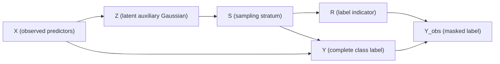

# Misspecified marginal logistic projection intercept under stratified sign-reversing interactions

## Research question

- **Question and intended use.** Estimate the pre-selection superpopulation intercept $\theta_0 \approx 0.442956$ of the marginal working logistic projection of $Y$ onto $(1, X_1, X_2)$ and construct a nominal 95% confidence interval under equal-quota without-replacement stratified semi-supervised labeling ($q_1 = q_2 = 200$ labels drawn from a shared phase-one pool of $n = 20,400$, leaving $n_{\mathrm{U}} = 20,000$ unlabeled complement rows) when the true outcome law contains a strong stratum-reversing interaction $\pm 5 X_1 X_2$. This case is proposed as an evaluation benchmark candidate for semi-supervised M-estimation under severe model misspecification.
- **Behavior under test.** Because the working model omits both $S$ and the sign-reversing interaction $\pm 5 X_1 X_2$ while the rarer stratum ($S = 2$, superpopulation prevalence $15.87\%$) is heavily oversampled in the labeled set ($50\%$ of labels), unweighted logistic regression is heavily biased, and standard inverse-probability weighted supervised regression suffers inflated variance. The design tests whether semi-supervised and intrinsically efficient projection estimators achieve substantial efficiency gains without requiring correct specification of the working logistic model.

## Study design and data source

- **Motivation and references.** Gronsbell, Liu, Tian and Cai (2022), *Efficient Evaluation of Prediction Rules in Semi-Supervised Settings under Stratified Sampling*, *Journal of the Royal Statistical Society Series B: Statistical Methodology* 84(4), 1353–1391, [DOI](https://doi.org/10.1111/rssb.12502), verified from the author manuscript [arXiv:2010.09443v2](https://arxiv.org/html/2010.09443v2#A4), Sections 2.1–2.2, Section 7 (common $n_{\mathrm{U}} = 20,000$), and Supplement S4 (Setting (a), Table S6, intercept row), cross-checked against [`IE_helper_functions.R`](https://github.com/jlgrons/Stratified-SSL/blob/master/Simulation%20Studies/IE_helper_functions.R). The trivariate AR(1) Gaussian covariance ($\rho = 0.4$), stratum threshold $Z \ge 1$ (zero-probability boundary equivalent to source $Z > 1$, recoded from $0/1$ to $1/2$), stratum-dependent logistic model with $\pm 5 x_1 x_2$ interaction, shared finite-pool without-replacement sampling, and $200$ labels per stratum follow the source. Adaptations include redrawing the pool if **either** stratum falls short of its quota ($N_1 < q_1$ or $N_2 < q_2$; negligible probability at $n = 20,400$, material at tiny off-design $n$), ordering labeled rows before unlabeled rows, off-design floor/ceiling quotas $(\lfloor n_{\mathrm{L}}/2\rfloor, \lceil n_{\mathrm{L}}/2\rceil)$ (with $n = 2$ yielding $(q_1, q_2) = (0, 1)$), and finite `0` masking in `Y_obs` paired with `R`.
- **Population and sampling.** Units come from a shared phase-one cohort of $n = 20,400$ draws conditioned on feasibility $A = \{N_1 \ge 200, N_2 \ge 200\}$; exactly $200$ units per stratum are sampled uniformly without replacement for labeling ($n_{\mathrm{L}} = 400$), and the remaining $n_{\mathrm{U}} = 20,000$ units form the unlabeled complement. Note that estimators reconstruct the phase-one population stratum shares using **all** $n = 20,400$ rows ($R \in \{0, 1\}$), not the depleted unlabeled complement alone.

## DAG and identification

- **Variables and causal structure.** $X = (X_1, X_2)$ (`X1`, `X2`) are the observed predictors, $Z$ is the latent third AR(1) Gaussian coordinate correlated with $X$, $S$ (`S`) is the observed sampling stratum determined by $Z \ge 1$, $R$ (`R`) is the stratified label indicator determined by $S$, $Y$ is the latent complete binary outcome driven by both $X$ and $S$, and $Y_{\mathrm{obs}}$ (`Y_obs`) is the masked label.
- **DAG edges.** `X -> Z, Z -> S, S -> R, S -> Y, X -> Y, Y -> Y_obs, R -> Y_obs`
- **Assumptions.** Within each stratum $s \in \{1, 2\}$ of the shared phase-one pool, labeling is simple random sampling without replacement ($R \perp (X, Y) \mid S$) with positive stratum probabilities and quotas; the expected working logistic **log-likelihood** under the pre-selection superpopulation $P_0$ is strictly concave with negative-definite Hessian $-\mathbb{E}_{P_0}[\tilde{X}\tilde{X}^{\top} p_\theta(1 - p_\theta)]$ (where $\tilde{X} = (1, X_1, X_2)^{\top}$), so its score equation has a unique zero $\theta^* = (\theta_0, \theta_1, \theta_2)$. Thus the pre-selection superpopulation intercept $\theta_0$ is well-defined and identified from $(X, S, R, Y_{\mathrm{obs}})$ despite working-model misspecification.



## Variables and data-generating process

- **Variables and observed input.** Each row represents one unit from the shared phase-one pool. Every method receives the five observed columns `X1`, `X2`, `S`, `R`, and `Y_obs`. `S` takes values in $\{1, 2\}$, `R` is binary, and `Y_obs` equals $Y_i \in \{0, 1\}$ when `R == 1` and finite placeholder `0` when `R == 0`. The latent auxiliary variable $Z_i$ and unlabeled outcomes $Y_i$ ($R_i = 0$) are excluded from estimator inputs.
- **Draw order and scenarios.** Under the single scenario `original` ($n_{\mathrm{L}} = 400$, $n_{\mathrm{U}} = 20,000$): draw proposed phase-one pools of $20,400$ i.i.d. triples $(X_{j1}^0, X_{j2}^0, Z_j^0) \sim \mathcal{N}_3(\mathbf{0}_3, C)$ with $S_j^0 = 1 + \mathbf{1}\{Z_j^0 \ge 1\}$ until $N_1 \ge 200$ and $N_2 \ge 200$; draw uniform without-replacement subsets of size $200$ within each stratum for $R = 1$; reorder labeled rows ahead of the $20,000$ unlabeled complement rows; draw $Y_i \sim \operatorname{Bernoulli}\{p(X_{i1}, X_{i2}, S_i)\}$ conditionally on $(X_i, S_i)$ (law-equivalent to drawing $Y$ prior to selection because outcomes use independent randomness); and record $Y_{\mathrm{obs},i} = R_i Y_i$.

### Structural equations

- **Structural parents.** `X -> Z, Z -> S, S -> R, S -> Y, X -> Y, Y -> Y_obs, R -> Y_obs`

```math
\begin{aligned}
F_j^0 &= (X_{j1}^0, X_{j2}^0, Z_j^0)^{\top} \overset{\mathrm{iid}}{\sim} \mathcal{N}_3(\mathbf{0}_3,\, C), && C_{ab} = (0.4)^{|a - b|}, \quad j = 1, \ldots, n, \quad n = 20400, \\
S_j^0 &= 1 + \mathbf{1}\{Z_j^0 \ge 1\}, && N_s = \sum_{j=1}^{n} \mathbf{1}\{S_j^0 = s\}, \quad A = \{N_1 \ge q_1,\; N_2 \ge q_2\}, \\
q_1 &= q_2 = 200, \qquad n_{\mathrm{L}} = 400, \qquad n_{\mathrm{U}} = 20000, && \text{accept pool conditional on } A, \\
\mathcal{I}_s &\sim \mathrm{Uniform}\bigl\{B \subseteq \{j : S_j^0 = s\} : |B| = q_s\bigr\}, && R_j^0 = \mathbf{1}\{j \in \mathcal{I}_1 \cup \mathcal{I}_2\}, \\
p(x_1, x_2, s) &= \operatorname{expit}\Bigl(2 x_1 - 2 x_2 + 5\bigl[\mathbf{1}\{s = 1\} - \mathbf{1}\{s = 2\}\bigr] x_1 x_2\Bigr), && Y_j^0 \mid (X_j^0, S_j^0) \sim \operatorname{Bernoulli}\bigl\{p(X_{j1}^0, X_{j2}^0, S_j^0)\bigr\}, \\
(X_i, S_i, R_i, Y_i) &= (X_{\pi(i)}^0, S_{\pi(i)}^0, R_{\pi(i)}^0, Y_{\pi(i)}^0), && Y_{\mathrm{obs},i} = R_i Y_i.
\end{aligned}
```

The proposed phase-one pool $F_1^0, \ldots, F_n^0$ is redrawn until feasibility $A = \{N_1 \ge q_1, N_2 \ge q_2\}$ holds (so accepted stratum counts follow a truncated binomial law); uniform size-$q_s$ labeled subsets are chosen without replacement per stratum, and the deterministic permutation $\pi(i)$ places the $n_{\mathrm{L}} = 400$ labeled rows ($R_i = 1$) ahead of the $n_{\mathrm{U}} = 20,000$ unlabeled complement rows ($R_i = 0$, finite placeholder $Y_{\mathrm{obs},i} = 0$). Consequently, the unlabeled complement's expected stratum-2 share is $\mathbb{E}[(N_2 - q_2)/n_{\mathrm{U}} \mid A] \approx 0.151828$, whereas the pooled table ($R \in \{0, 1\}$) reflects the phase-one share $\Phi(-1) \approx 0.158655$.

| Symbol | Meaning | Definition or setting |
| --- | --- | --- |
| $j, i, n, n_{\mathrm{L}}, n_{\mathrm{U}}$ | Proposed-pool index, exported-row index, and sizes | $j, i = 1, \ldots, n$; shared phase-one pool $n = 20,400$ yielding $n_{\mathrm{L}} = 400$ ($q_1 = q_2 = 200$) labeled and $n_{\mathrm{U}} = 20,000$ unlabeled complement rows. |
| $X_{j1}^0, X_{j2}^0, Z_j^0, C$ | Proposed phase-one Gaussian variables and covariance | Trivariate AR(1) Gaussian $\mathcal{N}_3(\mathbf{0}_3, C)$ with $C_{ab} = 0.4^{|a-b|}$; $X_1, X_2$ observed (`X1`, `X2`), $Z$ latent. |
| $S_j^0, N_s, A$ | Sampling stratum, pool counts, and feasibility event | $S_j^0 = 1 + \mathbf{1}\{Z_j^0 \ge 1\} \in \{1, 2\}$ ($P_0(S^0 = 2) = 1 - \Phi(1) \approx 0.1587$); $A = \{N_1 \ge q_1, N_2 \ge q_2\}$; column `S`. |
| $\mathcal{I}_s, R_j^0, \pi(i)$ | Stratified labeled subsets, indicator, and row ordering | Uniform without-replacement subsets of size $q_s = 200$ per stratum; $\pi(i)$ orders labeled rows ($R_i = 1$) before unlabeled rows ($R_i = 0$); column `R`. |
| $p(x_1, x_2, s)$ | True stratum-dependent risk | $\operatorname{expit}(2x_1 - 2x_2 + 5[\mathbf{1}\{s=1\} - \mathbf{1}\{s=2\}]x_1 x_2)$; flips sign of the $+5/-5$ interaction across strata. |
| $Y_j^0, Y_{\mathrm{obs},i}$ | Complete and masked binary outcomes | $Y_j^0 \sim \operatorname{Bernoulli}\{p(X_{j1}^0, X_{j2}^0, S_j^0)\}$; `Y_obs` $= R_i Y_i$ with placeholder `0` when $R_i = 0$. |
| $\theta_0$ | Pre-selection superpopulation projection intercept | First coordinate of $(\theta_0, \theta_1, \theta_2)$ solving $\mathbb{E}_{P_0}[(1, X_1^0, X_2^0)^{\top}\{Y^0 - \operatorname{expit}(\theta_0 + \theta_1 X_1^0 + \theta_2 X_2^0)\}] = 0$; $\theta_0 \approx 0.4429564042$. |

## Data-generating process and estimand

- **Estimand.** The scalar target is the pre-selection superpopulation intercept $\theta_0 \approx 0.4429564042$ (log-odds scale) of the marginal working logistic projection onto $(1, X_1, X_2)$.
- **Truth check.** Integrating out $Z \mid (X_1, X_2) \sim \mathcal{N}(0.4 X_2, 0.84)$ analytically yields $P_0(S^0 = 2 \mid X_1, X_2) = 1 - \Phi((1 - 0.4 X_2)/\sqrt{0.84})$ and exact conditional mean $\mathbb{E}_{P_0}[Y^0 \mid X_1, X_2]$. `truth.py` solves the 3D population score equation via segmented Gaussian quadrature with mesh refinement; independent verification in `verify.py` re-solves the score system directly in the original bivariate Gaussian coordinates (matching $\theta_0$ within $2 \times 10^{-10}$, enforcing score-residual tolerance $10^{-12}$ with observed residual $< 10^{-15}$), checks the pooled phase-one stratum-2 share against $\mathbb{E}[N_2/n \mid A]$ and the exact complement identity $N_{\mathrm{U},2} = N_2 - q_2$, validates small-$n$ feasibility redrawing, and runs signed stratum-specific interaction outcome calibration checks.

## Benchmark comparison

- **Output and comparator.** Methods output a scalar point estimate of $\theta_0$ and a nominal 95% confidence interval using `X1`, `X2`, `S`, `R`, and `Y_obs` (using both cohorts' $(X, S)$ for phase-one design weights and population reconstruction). Comparators include stratum-weighted supervised logistic regression (using weights $N_s/q_s$), semi-supervised logistic projection, and the Gronsbell et al. intrinsically efficient semi-supervised projection estimator.
- **Scoring and replication.** Evaluate all methods on 1,000 paired independent replicate tables at $n = 20,400$. Report bias, RMSE, empirical 95% coverage, mean interval width, Monte Carlo uncertainty, valid denominators, and full failure counts.

## Materials and access

- **Public materials.** The simulation design is documented in Gronsbell et al. (2022), [DOI](https://doi.org/10.1111/rssb.12502), [arXiv:2010.09443v2 Supplement S4](https://arxiv.org/html/2010.09443v2#A4), and [`IE_helper_functions.R`](https://github.com/jlgrons/Stratified-SSL/blob/master/Simulation%20Studies/IE_helper_functions.R), subject to publisher and repository terms.
- **Reproduction and protected materials.** The private review archive `sspi-gronsbell-liu-tian-cai-2022-stratified-interaction-v1.zip` (SHA-256 `609616421093f28dd95d7bacb44283917ec4989098bd5beb361eb59bce5c630b`) contains `generator.py`, `truth.py`, `verify.py`, `reproduce.py`, `collection.json`, `config.json`, `schema.csv`, `card.md`, `PROVENANCE.md`, `source_audit.json`, `requirements.txt` (`numpy==2.3.5`, `scipy==1.16.3`), check records, and `MANIFEST.json`. After verifying the manifest in Python 3.12, run:

```bash
python3 reproduce.py --scenario original --n 20400 --seed 1729 --out ../gronsbell-2022-interaction-check
```

The command validates all truth, pooled stratum-count, signed interaction calibration, and table-contract checks and writes `observed.csv` (`X1,X2,S,R,Y_obs`, 20,400 rows) separately from `reference.json`.
