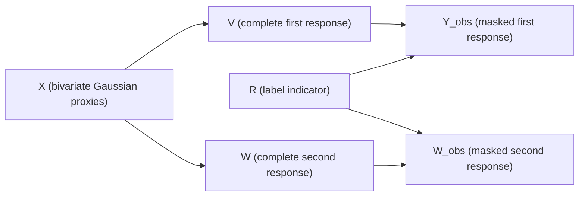

# Semi-supervised Kendall rank correlation inference with bivariate Gaussian proxies

## Research question

- **Question and intended use.** Estimate the population Kendall rank correlation $`\tau = \mathbb{E}[\mathrm{sign}(V_i - V_j)\mathrm{sign}(W_i - W_j)] \approx 0.012701`$ ($`i \neq j`$) and construct a nominal 95% confidence interval from $`n_{\mathrm{L}} = 5,000`$ labeled outcome pairs and $`n_{\mathrm{U}} = 50,000`$ unlabeled high-fidelity proxy pairs under the weak-dependence alternative $\rho = 0.02$. This design adapts the paper's independence-testing power experiment into an evaluation benchmark candidate for scalar semi-supervised rank-correlation estimation and interval inference.
- **Behavior under test.** Because the true dependence is weak ($`\rho = 0.02`$, $`\tau \approx 0.012701`$), the classical labeled-only Kendall's $\tau$ estimator has low precision at $`n_{\mathrm{L}} = 5,000`$. Because the observed proxies $`(X_1, X_2)`$ closely track $(V, W)$ (measurement-noise SD $`0.05`$), semi-supervised U-statistics leveraging the $10\times$ larger unlabeled cohort achieve substantial RMSE reduction; note that the source paper also documents finite-sample anti-conservatism for naive plug-in tests, and evaluating Type-I error size requires a separate null simulation at $\rho = 0$ (where $`H_0: \rho = 0`$, $`H_0: \tau = 0`$, and independence coincide in this Gaussian family).

## Study design and data source

- **Motivation and references.** Kim, Wasserman, Balakrishnan and Neykov (2025), *Semi-supervised U-statistics*, *The Annals of Statistics* 53(6), 2488–2515, [DOI](https://doi.org/10.1214/25-AOS2550), verified from the author manuscript [arXiv:2402.18921v2](https://arxiv.org/html/2402.18921v2), Sections 2 and 8.3 (Figure 3 right panel at $\rho = 0.020$, pp. 27–28). The bivariate normal proxy correlation $\rho = 0.02$, paired additive Gaussian perturbations with SD $0.05$, and cohort counts $`n_{\mathrm{L}} = 5,000`$, $`n_{\mathrm{U}} = 50,000`$ follow Section 8.3 verbatim. Adaptations frame the single $\rho = 0.02$ alternative as a scalar estimation and 95% CI benchmark (distinct from a null size experiment), store masked response pairs as finite placeholder `0` (serialized as float `0.0`) in `Y_obs` and `W_obs` alongside `R`, and allocate proportionate sizes at non-source $n$.
- **Population and sampling.** Units are $n = 55,000$ i.i.d. complete rows drawn from the common population $`(X_1, X_2, V, W)`$, with the first $`n_{\mathrm{L}} = 5,000`$ rows deterministically labeled ($`R_i = 1`$) and the remaining $`n_{\mathrm{U}} = 50,000`$ rows unlabeled ($`R_i = 0`$).

## DAG and identification

- **Variables and causal structure.** $`X = (X_1, X_2)`$ (`X1`, `X2`) is the observed bivariate Gaussian proxy vector, $V$ and $W$ are the two latent complete continuous responses, $R$ (`R`) is the fixed-index cohort label indicator independent of $(X, V, W)$, and $`Y_{\mathrm{obs}}`$ (`Y_obs`) and $`W_{\mathrm{obs}}`$ (`W_obs`) are the jointly masked observed responses.
- **DAG edges.** `X -> V, V -> Y_obs, R -> Y_obs, X -> W, W -> W_obs, R -> W_obs`
- **Assumptions.** Labeled and unlabeled observations are independent draws from the identical joint population $(X, V, W)$ (MCAR labeling), disturbances $`(\epsilon_{i1}, \epsilon_{i2})`$ are independent of $`X_i`$, and both response coordinates $`(V_i, W_i)`$ are observed together whenever $`R_i = 1`$. Under identical cohort distributions, the bivariate rank functional $\tau$ is nonparametrically identified from $`(X, R, Y_{\mathrm{obs}}, W_{\mathrm{obs}})`$.



## Variables and data-generating process

- **Variables and observed input.** Each row is one unit. Every estimator receives the five observed columns `X1`, `X2`, `R`, `Y_obs`, and `W_obs`. Unlabeled rows (`R == 0`) store finite placeholders `(0, 0)` (serialized as `(0.0, 0.0)`) in `(Y_obs, W_obs)` and must be masked using `R == 1`. Unobserved responses ($`R = 0`$) and disturbances are excluded from estimator inputs.
- **Draw order and scenarios.** Under the single scenario `original` ($`n_{\mathrm{L}} = 5000`$, $`n_{\mathrm{U}} = 50,000`$): independently for $i = 1, \ldots, 55000$, draw $`X_i \sim \mathcal{N}_2(\mathbf{0}_2, \Sigma)`$ and $`\epsilon_{i1}, \epsilon_{i2} \sim \mathcal{N}(0, 1)`$, set $`V_i = X_{i1} + 0.05\epsilon_{i1}`$ and $`W_i = X_{i2} + 0.05\epsilon_{i2}`$, assign $`R_i = \mathbf{1}\{i \le 5000\}`$, and set $`Y_{\mathrm{obs},i} = R_i V_i`$ and $`W_{\mathrm{obs},i} = R_i W_i`$.

### Structural equations

- **Structural parents.** `X -> V, V -> Y_obs, R -> Y_obs, X -> W, W -> W_obs, R -> W_obs`

$$
\begin{aligned}
X_i &\overset{\mathrm{iid}}{\sim} \mathcal{N}_2\!\left(\mathbf{0}_2,\, \begin{pmatrix} 1 & 0.02 \\ 0.02 & 1 \end{pmatrix}\right), && i = 1, \ldots, n, \\
\epsilon_{i1}, \epsilon_{i2} &\overset{\mathrm{iid}}{\sim} \mathcal{N}(0, 1), && (\epsilon_{i1}, \epsilon_{i2}) \perp X_i, \\
V_i &= X_{i1} + 0.05 \epsilon_{i1}, \qquad W_i = X_{i2} + 0.05 \epsilon_{i2}, && \\
n_{\mathrm{L}} &= 5000, \qquad n_{\mathrm{U}} = 50000, && n = n_{\mathrm{L}} + n_{\mathrm{U}} = 55000, \\
R_i &= \mathbf{1}\{i \le n_{\mathrm{L}}\}, \qquad Y_{\mathrm{obs},i} = R_i V_i, \qquad W_{\mathrm{obs},i} = R_i W_i.
\end{aligned}
$$

All $n = 55,000$ rows are i.i.d. draws from the identical joint population $(X, V, W)$ with fixed-index labeling $`R_i = \mathbf{1}\{i \le 5000\}`$; unlabeled rows ($`R_i = 0`$) carry finite placeholders $`Y_{\mathrm{obs},i} = 0`$ and $`W_{\mathrm{obs},i} = 0`$.

| Symbol | Meaning | Definition or setting |
| --- | --- | --- |
| $`i, n, n_{\mathrm{L}}, n_{\mathrm{U}}`$ | Row index and cohort sizes | $i = 1, \ldots, n$; fixed source sizes $`n_{\mathrm{L}} = 5000`$ labeled and $`n_{\mathrm{U}} = 50,000`$ unlabeled rows ($`n = 55,000`$). |
| $`X_i, \Sigma`$ | Observed bivariate proxy vector | $`\mathcal{N}_2(\mathbf{0}_2, \Sigma)`$ with unit variances and correlation $\rho = 0.02$; columns `X1`, `X2`. |
| $`\epsilon_{i1}, \epsilon_{i2}`$ | Paired response disturbances | Independent $\mathcal{N}(0, 1)$ noise scaled by $0.05$ (variance $`0.0025`$), independent of $`X_i`$; latent. |
| $`V_i, W_i`$ | Complete paired responses | $`V_i = X_{i1} + 0.05\epsilon_{i1}`$, $`W_i = X_{i2} + 0.05\epsilon_{i2}`$ with bivariate normal correlation $0.02/1.0025$; latent when $`R_i = 0`$. |
| $`R_i`$ | Labeled cohort indicator | Deterministically $1$ for $i \le 5000$ and $0$ for $i > 5000$; column `R`. |
| $`Y_{\mathrm{obs},i}, W_{\mathrm{obs},i}`$ | Observed masked response pair | Equal $`(V_i, W_i)`$ when $`R_i = 1`$ and finite placeholders `(0, 0)` when $`R_i = 0`$; columns `Y_obs`, `W_obs`. |
| $\tau$ | Population Kendall's $\tau$ | $`\tau = \mathbb{E}[\mathrm{sign}(V_i - V_j)\mathrm{sign}(W_i - W_j)] = \frac{2}{\pi}\arcsin(0.02/1.0025) \approx 0.0127014865`$. |

## Data-generating process and estimand

- **Estimand.** The scalar target is the dimensionless population Kendall rank correlation $`\tau = \mathbb{E}[\mathrm{sign}(V_i - V_j)\mathrm{sign}(W_i - W_j)] \approx 0.0127014865`$ ($`i \neq j`$).
- **Truth check.** Since $`(V_i, W_i)`$ is bivariate normal with correlation $`\rho_{V,W} = 0.02 / (1 + 0.05^2) = 0.02 / 1.0025`$, Greiner's identity gives $`\tau = \frac{2}{\pi}\arcsin(\rho_{V,W}) \approx 0.0127014865`$. Independent verification in `verify.py` integrates the bivariate Gaussian orthant probability of pairwise differences $`(V_i - V_j, W_i - W_j)`$ via conditional Gaussian quadrature (matching to within $`10^{-12}`$), checks the independence limit ($`\rho = 0 \Rightarrow \tau = 0`$) and reflection antisymmetry, and verifies generated labeled response moments and measurement-noise variance.

## Benchmark comparison

- **Output and comparator.** Methods output a scalar estimate of $\tau$ and a nominal 95% confidence interval using `X1`, `X2`, `R`, `Y_obs`, and `W_obs`. Comparators include the classical labeled-only Kendall U-statistic, the cross-fitted semi-supervised Kendall estimator, and the plug-in semi-supervised Kendall estimator.
- **Scoring and replication.** Evaluate all methods on 2,000 paired independent replicate tables at $n = 55,000$. Report bias, RMSE, empirical 95% coverage, mean interval width, Monte Carlo uncertainty, valid denominators, and full failure counts. If evaluating independence testing alongside estimation, report power at $\rho = 0.02$ together with size from a separate $\rho = 0$ null run at the same cohort sizes.

## Materials and access

- **Public materials.** The simulation design is published in Kim et al. (2025), [DOI](https://doi.org/10.1214/25-AOS2550), [arXiv:2402.18921v2](https://arxiv.org/html/2402.18921v2), and the [author repository](https://github.com/Ilmunk/ss-ustat), subject to publisher terms.
- **Reproduction and protected materials.** The private review archive `sspi-kim-wasserman-balakrishnan-neykov-2025-kendall-v1.zip` (SHA-256 `154ed9bbb04eef2fc8ab3e8831053f88df6e8771172cc91907a2e1012bd0746d`) contains `generator.py`, `truth.py`, `verify.py`, `reproduce.py`, `collection.json`, `config.json`, `schema.csv`, `card.md`, `PROVENANCE.md`, `source_audit.json`, `requirements.txt` (`numpy==2.3.5`, `scipy==1.16.3`), check records, and `MANIFEST.json`. After verifying the manifest in Python 3.12, run:

```bash
python3 reproduce.py --scenario original --n 55000 --seed 1729 --out ../kim-2025-kendall-check
```

The command validates all truth, generated-response, and table-contract checks and writes `observed.csv` (`X1,X2,R,Y_obs,W_obs`, 55,000 rows) separately from `reference.json`.
