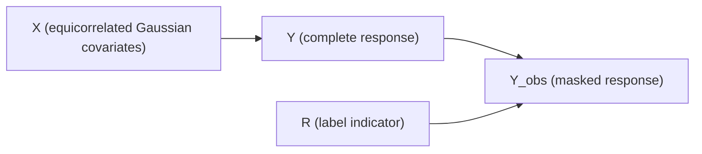

# Semi-supervised U-statistic inference for a squared mean under nonlinear sine regression

## Research question

- **Question and intended use.** Estimate the degree-2 U-statistic functional $`\psi = (\mathbb{E}[Y])^2 = \mathbb{E}[Y_i Y_j]`$ ($`i \neq j`$) $= 0.25$ and construct a nominal 95% confidence interval from $`n_{\mathrm{L}} = 500`$ labeled and $`n_{\mathrm{U}} = 10,000`$ unlabeled observations when the conditional mean contains oscillatory sine components in two of four equicorrelated covariates. This design is proposed as an evaluation benchmark candidate for semi-supervised U-statistic inference at a regular (non-degenerate) mean $\mu = 0.5$.
- **Behavior under test.** The signal terms $`\sin(5X_1) + \sin(3X_2)`$ contribute substantially larger variance than the residual noise ($`\sigma^2 = 0.09`$), yet integrate to zero by Gaussian symmetry. Standard supervised U-statistics ignore the $20\times$ larger unlabeled covariate sample, whereas semi-supervised U-statistics can harness nonparametric regression predictions over the unlabeled cohort to achieve major variance reductions—provided they accurately capture oscillatory nonlinearities without overfitting. (Because $\mu = 0.5 \neq 0$, this single setting evaluates regular semi-supervised efficiency rather than degeneracy adaptation at $\mu = 0$.)

## Study design and data source

- **Motivation and references.** Kim, Wasserman, Balakrishnan and Neykov (2025), *Semi-supervised U-statistics*, *The Annals of Statistics* 53(6), 2488–2515, [DOI](https://doi.org/10.1214/25-AOS2550), verified from the author manuscript [arXiv:2402.18921v2](https://arxiv.org/html/2402.18921v2), Sections 2, 7.2, and 8.2 (Model 2, Figure 2 right panel at $\mathbb{E}[Y] = 0.5$, pp. 25–26). The equicorrelated 4-dimensional Gaussian covariate distribution ($`\rho = 0.7`$), oscillatory regression model $`0.5 + \sin(5X_1) + \sin(3X_2) + 0.3\epsilon`$, and cohort counts $`n_{\mathrm{L}} = 500`$, $`n_{\mathrm{U}} = 10,000`$ follow Section 8.2 verbatim. Adaptations store missing responses as finite placeholder `0` (serialized as float `0.0`) in `Y_obs` paired with `R`, add pointwise 95% interval coverage alongside the paper's MSE ratio comparison, and preserve proportionate allocation at off-design sample sizes (with $n = 1$ retaining one unlabeled row for generator contract completeness only).
- **Population and sampling.** Units are $n = 10,500$ i.i.d. draws from the identical joint population $(X, Y)$, with the first $`n_{\mathrm{L}} = 500`$ rows deterministically labeled ($`R_i = 1`$) and the remaining $`n_{\mathrm{U}} = 10,000`$ rows unlabeled ($`R_i = 0`$).

## DAG and identification

- **Variables and causal structure.** $X$ (`X1`–`X4`) is the observed four-dimensional equicorrelated Gaussian feature vector, $Y$ is the latent complete continuous outcome, $R$ (`R`) is the fixed-index cohort label indicator independent of $(X, Y)$, and $`Y_{\mathrm{obs}}`$ (`Y_obs`) is the masked observed outcome.
- **DAG edges.** `X -> Y, Y -> Y_obs, R -> Y_obs`
- **Assumptions.** Labeled and unlabeled cohorts are independent i.i.d. samples from the same joint distribution (MCAR labeling), disturbances are independent of covariates with finite second moments, and the symmetric degree-2 product kernel $`h(y_1, y_2) = y_1 y_2`$ is evaluated on distinct units. Under identical cohort distributions, both $\mathbb{E}[Y]$ and $\psi = (\mathbb{E}[Y])^2$ are nonparametrically identified from $`(X, R, Y_{\mathrm{obs}})`$.



## Variables and data-generating process

- **Variables and observed input.** Each row is one unit. Every method receives the six observed columns `X1,...,X4`, `R`, and `Y_obs`. Unlabeled rows (`R == 0`) hold the finite placeholder `0` (serialized as float `0.0`) in `Y_obs` and must be masked using `R == 1`. Unobserved outcomes ($`R = 0`$) and disturbances $`\epsilon_i`$ are excluded from estimator inputs.
- **Draw order and scenarios.** Under the single scenario `original` ($`n_{\mathrm{L}} = 500`$, $`n_{\mathrm{U}} = 10,000`$): independently for $i = 1, \ldots, 10500$, draw $`X_i \sim \mathcal{N}_4(\mathbf{0}_4, 0.3I_4 + 0.7\mathbf{1}_4\mathbf{1}_4^{\top})`$ and $`\epsilon_i \sim \mathcal{N}(0, 1)`$, set $`Y_i = 0.5 + \sin(5X_{i1}) + \sin(3X_{i2}) + 0.3\epsilon_i`$, assign $`R_i = \mathbf{1}\{i \le 500\}`$, and set $`Y_{\mathrm{obs},i} = R_i Y_i`$.

### Structural equations

- **Structural parents.** `X -> Y, Y -> Y_obs, R -> Y_obs`

$$
\begin{aligned}
X_i &\overset{\mathrm{iid}}{\sim} \mathcal{N}_4\bigl(\mathbf{0}_4,\, 0.3 I_4 + 0.7 \mathbf{1}_4 \mathbf{1}_4^{\top}\bigr), && i = 1, \ldots, n, \\
\epsilon_i &\overset{\mathrm{iid}}{\sim} \mathcal{N}(0, 1), && \epsilon_i \perp X_i, \\
Y_i &= 0.5 + \sin(5 X_{i1}) + \sin(3 X_{i2}) + 0.3 \epsilon_i, && \\
n_{\mathrm{L}} &= 500, \qquad n_{\mathrm{U}} = 10000, && n = n_{\mathrm{L}} + n_{\mathrm{U}} = 10500, \\
R_i &= \mathbf{1}\{i \le n_{\mathrm{L}}\}, \qquad Y_{\mathrm{obs},i} = R_i Y_i.
\end{aligned}
$$

All $n = 10,500$ rows are i.i.d. draws from the identical joint population $(X, Y)$ with fixed-index labeling $`R_i = \mathbf{1}\{i \le 500\}`$; unlabeled rows ($`R_i = 0`$) store finite placeholder $`Y_{\mathrm{obs},i} = 0`$.

| Symbol | Meaning | Definition or setting |
| --- | --- | --- |
| $`i, n, n_{\mathrm{L}}, n_{\mathrm{U}}`$ | Row index and cohort sizes | $i = 1, \ldots, n$; fixed source sizes $`n_{\mathrm{L}} = 500`$ labeled and $`n_{\mathrm{U}} = 10,000`$ unlabeled rows ($`n = 10,500`$). |
| $`X_i, \Sigma`$ | Observed 4-dimensional covariates | Equicorrelated Gaussian $`\mathcal{N}_4(\mathbf{0}_4, 0.3I_4 + 0.7\mathbf{1}_4\mathbf{1}_4^{\top})`$ (unit variances, pairwise correlation $`0.7`$); columns `X1`–`X4`. |
| $`\epsilon_i`$ | Outcome disturbance | Independent $\mathcal{N}(0, 1)$ noise scaled by $0.3$ (residual variance $`0.09`$), independent of $`X_i`$; latent. |
| $`Y_i`$ | Complete continuous outcome | $`Y_i = 0.5 + \sin(5X_{i1}) + \sin(3X_{i2}) + 0.3\epsilon_i`$ (only $`X_1, X_2`$ enter directly); latent when $`R_i = 0`$. |
| $`R_i`$ | Labeled cohort indicator | Deterministically $1$ for $i \le 500$ and $0$ for $i > 500$; column `R`. |
| $`Y_{\mathrm{obs},i}`$ | Observed masked outcome | Equals $`Y_i`$ when $`R_i = 1`$ and finite placeholder `0` when $`R_i = 0`$; column `Y_obs`. |
| $\psi$ | Target squared mean U-statistic | $`\psi = (\mathbb{E}[Y])^2 = \mathbb{E}[Y_i Y_j]`$ ($`i \neq j`$) $= 0.25$. |

## Data-generating process and estimand

- **Estimand.** The scalar target is the squared marginal response mean $`\psi = (\mathbb{E}[Y])^2 = \mathbb{E}[Y_i Y_j]`$ ($`i \neq j`$) $= 0.25$ in squared response units.
- **Truth check.** Because $`X_{i1}`$ and $`X_{i2}`$ are centered Gaussians, the odd functions $`\sin(5X_{i1})`$ and $`\sin(3X_{i2})`$ have exact expectation zero, yielding $\mathbb{E}[Y] = 0.5$ and $\psi = 0.25$. Independent verification in `verify.py` integrates both sine expectations via Gaussian quadrature, confirming $\psi = 0.25$ within $10^{-12}$, checks reflection invariance, and verifies the empirical residual variance ($`0.09`$), labeled outcome moments, and cohort masking.

## Benchmark comparison

- **Output and comparator.** Methods output a scalar estimate of $\psi$ and a nominal 95% confidence interval from `X1`–`X4`, `R`, and `Y_obs`. Comparators include the supervised product-kernel U-statistic on labeled rows, the adaptive semi-supervised U-statistic, and the cross-fitted semi-supervised U-statistic with nonparametric regression.
- **Scoring and replication.** Evaluate all methods on 2,000 paired independent replicate tables at $n = 10,500$. Report bias, RMSE, MSE ratio defined as $`\mathrm{MSE}(\widehat{\psi}_{\mathrm{supervised}}) / \mathrm{MSE}(\widehat{\psi}_{\mathrm{method}})`$ (values $> 1$ favor the method, matching Figure 2), empirical 95% coverage (benchmark addition), mean interval width, Monte Carlo uncertainty, valid denominators, and all failure counts.

## Materials and access

- **Public materials.** The simulation design is published in Kim et al. (2025), [DOI](https://doi.org/10.1214/25-AOS2550), [arXiv:2402.18921v2](https://arxiv.org/html/2402.18921v2), and the [author repository](https://github.com/Ilmunk/ss-ustat), subject to publisher terms.
- **Reproduction and protected materials.** The private review archive `sspi-kim-wasserman-balakrishnan-neykov-2025-sine-mean2-v1.zip` (SHA-256 `f6cf6fad5435609b00bacc7faa9d6677a66763a6cc53ac7ea575f0663e2d0ef3`) contains `generator.py`, `truth.py`, `verify.py`, `reproduce.py`, `collection.json`, `config.json`, `schema.csv`, `card.md`, `PROVENANCE.md`, `source_audit.json`, `requirements.txt` (`numpy==2.3.5`, `scipy==1.16.3`), check records, and `MANIFEST.json`. After verifying the manifest in Python 3.12, run:

```bash
python3 reproduce.py --scenario original --n 10500 --seed 1729 --out ../kim-2025-sine-mean2-check
```

The command validates all truth, generated-outcome, and table-contract checks and writes `observed.csv` (`X1,...,X4,R,Y_obs`, 10,500 rows) separately from `reference.json`.
