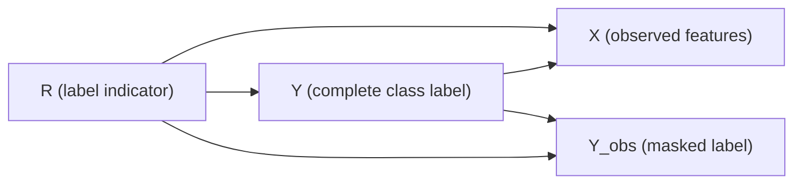

# Target positive-class prevalence under class-shifted positive-unlabeled sampling

## Research question

- **Question and intended use.** Estimate the positive class prevalence $\pi = \Pr(Y = 1 \mid R = 0) = 0.3$ and construct a nominal 95% confidence interval from a positive-unlabeled (PU) dataset in which the labeled positive cohort and the unlabeled target positive subpopulation experience covariate mean shift across 7 of 15 Gaussian features. This case is proposed as an evaluation benchmark candidate for semi-supervised and PU inference under distribution shift.
- **Behavior under test.** Conventional PU estimators assume selected-completely-at-random (SCAR) equality between the labeled-positive density and the target-positive density. Under this DD design, $`\mu_{1,1} = \mathbf{0}_{15}`$ differs from $`\mu_{0,1} = (\mathbf{1}_7, \mathbf{0}_8)^{\top}`$ while target negatives have mean $`\mu_{0,0} = \mathbf{1}_{15}`$, creating severe bias for single-tilt SCAR methods and testing double-exponential-tilting mixture (DETM) inference under the declared minority-positive orientation $0 < \pi < 1/2$.

## Study design and data source

- **Motivation and references.** Liu, Yeh, Zhang, Tian and Li (2025), *Positive and Unlabeled Data: Model, Estimation, Inference, and Classification*, *Journal of the American Statistical Association* 120(552), 2547–2558, [DOI](https://doi.org/10.1080/01621459.2025.2474266), verified from the author manuscript [arXiv:2407.09735v3](https://arxiv.org/html/2407.09735v3), Section 2.3 (Theorem 1 and Remark 1 on label-switching orientation) and Section 5 (Estimations and Confidence Intervals for the Mixture Proportion, DD case, Table 2 and Figure 2 at $`\pi = 0.3`$). The three 15-dimensional identity-covariance Gaussian component laws, target prevalence $\pi = 0.3$, and sample sizes $`n_{\mathrm{L}} = 1000`$ and $`n_{\mathrm{U}} = 1000`$ follow the source verbatim. Adaptations explicitly impose the paper's minority-positive orientation $0 < \pi < 1/2$ as part of the benchmark model specification, encode missing labels with finite placeholder `0` in `Y_obs` paired with `R`, and allocate proportionate cohort sizes when non-source total $n$ is requested.
- **Population and sampling.** Each table stacks two independent case-control-style cohorts: $`n_{\mathrm{L}} = 1000`$ i.i.d. labeled positives ($`R = 1`$) and $`n_{\mathrm{U}} = 1000`$ i.i.d. draws from the two-component unlabeled target mixture ($`R = 0`$).

## DAG and identification

- **Variables and causal structure.** $R$ (`R`) indicates cohort membership (labeled source vs. unlabeled target), $Y$ is the latent complete binary class label ($`\Pr(Y = 1 \mid R = 1) = 1`$), $X$ (`X1`–`X15`) is the 15-dimensional observed feature vector whose mean depends on both $R$ and $Y$, and $`Y_{\mathrm{obs}}`$ (`Y_obs`) is the masked label.
- **DAG edges.** `R -> Y, R -> X, Y -> X, Y -> Y_obs, R -> Y_obs`
- **Assumptions.** Labeled observations are verified positives ($`\Pr(Y = 1 \mid R = 1) = 1`$); draws are independent within and across cohorts; all three component densities share full support $\mathbb{R}^{15}$ and obey the double exponential-tilting model $`f_U(x) = f_S(x)\{\pi \Lambda_+(x) + (1 - \pi)\Lambda_-(x)\}`$ with distinct nonzero tilts ($`\|\mu_{0,1} - \mu_{0,0}\|_2^2 = 8 > 0`$). Because exchanging $`(\pi, \Lambda_+, \Lambda_-) \leftrightarrow (1 - \pi, \Lambda_-, \Lambda_+)`$ leaves the entire observed law of $`(X, R, Y_{\mathrm{obs}})`$ invariant (admitting both $0.3$ and $`0.7`$), Theorem 1 and Remark 1 of Liu et al. (2025) identify the mixture only up to label switching; imposing the minority-positive orientation restriction $0 < \pi < 1/2$ supplied equally to all estimators uniquely identifies the positive component and point-identifies $\pi = 0.3$.



## Variables and data-generating process

- **Variables and observed input.** Each row is one observation. Every estimator receives the 17 observed columns `X1,...,X15`, `R`, and `Y_obs`, together with the shared model orientation restriction $0 < \pi < 1/2$. Labeled rows have `R == 1` and `Y_obs == 1`; unlabeled target rows have `R == 0` and finite placeholder `Y_obs == 0` (serialized as float in `Y_obs`). Unobserved target labels $`Y_i`$ ($`R_i = 0`$) and component indices are excluded from estimator inputs.
- **Draw order and scenarios.** Under the single scenario `original` ($`n_{\mathrm{L}} = 1000`$, $`n_{\mathrm{U}} = 1000`$): generate $1000$ labeled positive rows with $`R_i = 1`$, $`Y_i = 1`$, and $`X_i \sim \mathcal{N}_{15}(\mathbf{0}_{15}, I_{15})`$; generate $1000$ unlabeled target rows with $`R_i = 0`$, $`Y_i \sim \mathrm{Bernoulli}(0.3)`$, and $`X_i \mid Y_i \sim \mathcal{N}_{15}(\mu_{0, Y_i}, I_{15})`$; mask labels as $`Y_{\mathrm{obs},i} = R_i Y_i`$.

### Structural equations

- **Structural parents.** `R -> Y, R -> X, Y -> X, Y -> Y_obs, R -> Y_obs`

```math
\begin{aligned}
n_{\mathrm{L}} &= 1000, \qquad n_{\mathrm{U}} = 1000, \qquad n = n_{\mathrm{L}} + n_{\mathrm{U}} = 2000, \\
\Pr(Y_i = 1 \mid R_i = 1) &= 1, \qquad Y_i \mid (R_i = 0) \overset{\mathrm{iid}}{\sim} \mathrm{Bernoulli}(\pi), \qquad \pi = 0.3 \in (0, 1/2), \\
X_i \mid (R_i = r, Y_i = y) &\sim \mathcal{N}_{15}(\mu_{r,y},\, I_{15}), \\
\mu_{1,1} &= \mathbf{0}_{15}, \qquad \mu_{0,1} = (\mathbf{1}_7, \mathbf{0}_8)^{\top}, \qquad \mu_{0,0} = \mathbf{1}_{15}, \\
Y_{\mathrm{obs},i} &= R_i Y_i.
\end{aligned}
```

The labeled sample consists of $`n_{\mathrm{L}} = 1000`$ independent source positives ($`R_i = 1`$) and the unlabeled sample consists of $`n_{\mathrm{U}} = 1000`$ independent target units ($`R_i = 0`$). Positive-class orientation in the double exponential-tilting mixture model is fixed by the minority-positive condition $0 < \pi < 1/2$. Unlabeled rows carry finite placeholder $`Y_{\mathrm{obs},i} = 0`$.

| Symbol | Meaning | Definition or setting |
| --- | --- | --- |
| $`i, n, n_{\mathrm{L}}, n_{\mathrm{U}}`$ | Row index and cohort sizes | $i = 1, \ldots, n$; fixed source sizes $`n_{\mathrm{L}} = 1000`$ labeled positives, $`n_{\mathrm{U}} = 1000`$ unlabeled target rows, $n = 2000$. |
| $`R_i`$ | Labeled cohort indicator | Equals $1$ for labeled source positives and $0$ for unlabeled target units; column `R`. |
| $`Y_i`$ | Complete binary class label | Degenerate at $1$ when $`R_i = 1`$, and $\mathrm{Bernoulli}(\pi)$ when $`R_i = 0`$; latent when $`R_i = 0`$. |
| $`X_i`$ | Observed 15-dimensional features | Independent Gaussian draws $`\mathcal{N}_{15}(\mu_{R_i, Y_i}, I_{15})`$; columns `X1`–`X15`. |
| $`\mu_{1,1}, \mu_{0,1}, \mu_{0,0}`$ | Component mean vectors | $`\mu_{1,1} = \mathbf{0}_{15}`$ (source positives), $`\mu_{0,1} = (\mathbf{1}_7, \mathbf{0}_8)^{\top}`$ (shifted target positives), $`\mu_{0,0} = \mathbf{1}_{15}`$ (target negatives). |
| $`Y_{\mathrm{obs},i}`$ | Observed masked class label | Equals $1$ when $`R_i = 1`$ and finite placeholder `0` when $`R_i = 0`$; column `Y_obs`. |
| $\pi$ | Target positive prevalence | $\pi = \Pr(Y = 1 \mid R = 0) = 0.3$, oriented as the minority target component via $0 < \pi < 1/2$. |

## Data-generating process and estimand

- **Estimand.** The scalar target is the target-population positive prevalence $\pi = \Pr(Y = 1 \mid R = 0) = 0.3$ under the minority-positive orientation $0 < \pi < 1/2$.
- **Truth check.** The target Bernoulli weight equals $0.3$ analytically. Independent verification in `verify.py` confirms observational equivalence of $`(0.3, \mu_{0,1}, \mu_{0,0})`$ and $`(0.7, \mu_{0,0}, \mu_{0,1})`$ on the unlabeled mixture density, verifies that the declared orientation rule $0 < \pi < 1/2$ uniquely selects $0.3$ and rejects the $\pi = 0.5$ tie, performs an oracle-conditional mixture-CDF inversion on the discriminating coordinates $`X_8, \ldots, X_{15}`$, confirms $`\|\mu_{0,1} - \mu_{0,0}\|_2^2 = 8`$, and validates generated source and target feature moments.

## Benchmark comparison

- **Output and comparator.** Methods return a scalar point estimate of $\pi \in (0, 1/2)$ and a nominal 95% confidence interval using `X1`–`X15`, `R`, `Y_obs`, and the minority-positive orientation restriction $0 < \pi < 1/2$. Comparators include the Liu et al. double exponential-tilting PU mixture (DETM) estimator and interval constrained to the smaller-weight component ($`\hat{\pi} < 1/2`$) and a misspecified single exponential-tilting SCAR mixture baseline.
- **Scoring and replication.** Evaluate all methods on 1,000 paired independent replicate tables at $n = 2000$. Report bias, RMSE, empirical 95% coverage, mean interval width, Monte Carlo standard errors, valid denominators, and all failure or nonconvergence counts.

## Materials and access

- **Public materials.** The simulation design is documented in Liu et al. (2025), [DOI](https://doi.org/10.1080/01621459.2025.2474266) and [arXiv:2407.09735v3](https://arxiv.org/html/2407.09735v3), governed by publisher terms.
- **Reproduction and protected materials.** The private review archive `sspi-liu-yeh-zhang-tian-li-2025-shifted-pu-v1.zip` (SHA-256 `e0b69e89541a72d59c168065ffc7e3c8acd8ec8745d74d1c76544ec6e58a056a`) bundles `generator.py`, `truth.py`, `verify.py`, `reproduce.py`, `collection.json`, `config.json`, `schema.csv`, `card.md`, `PROVENANCE.md`, `source_audit.json`, `requirements.txt` (`numpy==2.3.5`, `scipy==1.16.3`), check records, and `MANIFEST.json`. After verifying the manifest in Python 3.12, run:

```bash
python3 reproduce.py --scenario original --n 2000 --seed 1729 --out ../liu-2025-pu-check
```

The command validates all truth, orientation, and generated-table checks and exports `observed.csv` (`X1,...,X15,R,Y_obs`, 2,000 rows) separately from `reference.json`.
