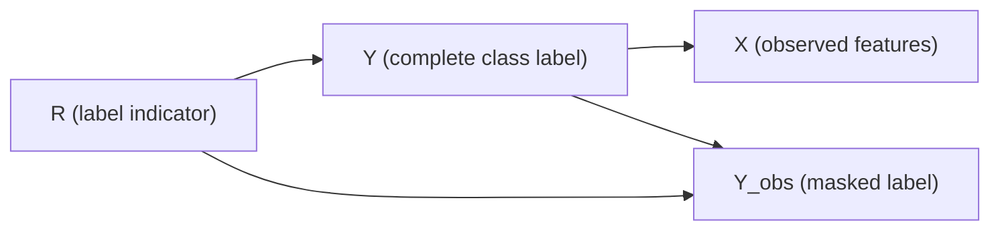

# Unlabeled positive-class prevalence under nonlinear additive density-ratio PU screening

## Research question

- **Question and intended use.** Estimate the unlabeled target positive prevalence $\pi_0 = \Pr(Y = 1 \mid R = 0) = 0.4$ and construct a nominal 95% confidence interval when positive and negative feature densities obey a strongly nonlinear generalized additive log-density-ratio model across five unit-interval covariates. This case is proposed as an evaluation benchmark candidate for semi-supervised and positive-unlabeled mixture inference.
- **Behavior under test.** Because the log-density ratio $\log\{f_1(x)/f_0(x)\}$ combines linear, quadratic, reciprocal, oscillatory cosine, and exponential coordinate effects, the benchmark tests the hypothesis that parametric linear exponential-tilting PU estimators incur substantial misspecification bias at $n = 1,500$ ($n_{\mathrm{U}} = 250$), whereas generalized additive density-ratio estimators control bias and maintain valid 95% interval coverage.

## Study design and data source

- **Motivation and references.** Sang, Sun, Tian, Zeng and Li (2026), *Modelling positive and unlabelled data with a generalized additive density ratio model*, *Journal of the Royal Statistical Society Series B: Statistical Methodology*, advance online publication, [DOI](https://doi.org/10.1093/jrsssb/qkag130), Sections 1.1, 2 (Theorem 1), and 6.3.1 (Setting 3, Table 1), cross-verified against the official Setting 3 driver [`Tab1_Set3.R`](https://github.com/syf6250/GAET_PU/blob/main/simulation/Tab1_Set3.R) and shared generator [`FUN-gendata.R`](https://github.com/syf6250/GAET_PU/blob/main/simulation/FUN-gendata.R) (`gendata.logistic`). The five unit-interval uniform proposal coordinates, additive screening log-odds $m(x)$, prevalence $\pi_0 = 0.4$, and sample sizes $n_{\mathrm{L}} = 1250$, $n_{\mathrm{U}} = 250$ follow the published paper and driver script verbatim. Adaptations consist of uniformly permuting unlabeled rows to prevent class-block order leakage (unlike the unpermuted class blocks returned by the R helper), safely handling empty-class draws ($K = 0$ or $K = n_{\mathrm{U}}$ at small off-design $n_{\mathrm{U}}$ where the R helper errors), batched acceptance screening, and finite `0` masking in `Y_obs` paired with `R`.
- **Population and sampling.** Each table stacks $n_{\mathrm{L}} = 1250$ i.i.d. labeled positive units ($R = 1$, $Y = 1$) and $n_{\mathrm{U}} = 250$ unlabeled mixture units ($R = 0$) generated by drawing $K \sim \operatorname{Binomial}(250, 0.4)$, sampling $K$ positives and $250 - K$ negatives independently, and uniformly permuting the unlabeled block (which is distributionally identical to i.i.d. $\operatorname{Bernoulli}(0.4)$ unlabeled draws).

## DAG and identification

- **Variables and causal structure.** $R$ (`R`) indicates cohort membership, $Y$ is the latent complete binary class label, $X$ (`X1`–`X5`) is the five-dimensional observed feature vector drawn from the shared class-conditional screening distribution $\mathcal{L}(X^0 \mid C = Y)$, and $Y_{\mathrm{obs}}$ (`Y_obs`) is the masked label.
- **DAG edges.** `R -> Y, Y -> X, Y -> Y_obs, R -> Y_obs`
- **Assumptions.** All labeled observations are verified positives ($\Pr(Y = 1 \mid R = 1) = 1$) and follow the same positive density $f_1(x)$ as unlabeled positives (SCAR, $X \perp R \mid Y = 1$), anchoring $f_1$ and orienting the positive class. Following Theorem 1 of Sang et al. (2026, §2), identification of $\pi_0$ additionally requires an interior prevalence $\pi_0 \in (0, 1)$, strictly positive densities $f_1, f_0 > 0$ on the compact product support $[0, 1]^5$ (guaranteed by the bounded logistic screen), centered additive log-density-ratio components $u_j(x_j) = m_j(x_j) - \int_0^1 m_j(t)\,dt$ with **at least two nonconstant coordinate components** (here all five coordinates are nonconstant). Together these conditions uniquely identify $\pi_0 = 0.4$ and $f_0$ from $(X, R, Y_{\mathrm{obs}})$.



## Variables and data-generating process

- **Variables and observed input.** Each row is one unit. Every method receives the seven observed columns `X1,...,X5`, `R`, and `Y_obs`. Each covariate takes values in $[0, 1)$ drawn from the screened positive density $f_1$ (for $R = 1$) or the target mixture $\pi_0 f_1 + (1 - \pi_0) f_0$ (for $R = 0$), labeled rows have `R == 1` and `Y_obs == 1`, and unlabeled rows have `R == 0` and finite placeholder `Y_obs == 0`. Unobserved unlabeled labels and proposal indices are excluded from estimator inputs.
- **Draw order and scenarios.** Under the single scenario `original` ($n_{\mathrm{L}} = 1250$, $n_{\mathrm{U}} = 250$): draw $K \sim \operatorname{Binomial}(250, 0.4)$; collect $1250 + K$ positive draws from $\mathcal{L}(X^0 \mid C = 1)$ and $250 - K$ negative draws from $\mathcal{L}(X^0 \mid C = 0)$ in batches; assign the first $1250$ positives to $R = 1$, combine the remaining $K$ positives and $250 - K$ negatives into the unlabeled block ($R = 0$), uniformly permute the unlabeled block, and set $Y_{\mathrm{obs},i} = R_i Y_i$.

### Structural equations

- **Structural parents.** `R -> Y, Y -> X, Y -> Y_obs, R -> Y_obs`

```math
\begin{aligned}
X_j^0 &\overset{\mathrm{iid}}{\sim} \mathrm{Uniform}(0, 1), && j = 1, \ldots, 5, \\
m(x) &= -13 + 6 x_1 + 24(x_2 - 0.3)^2 + \frac{1}{x_3 + 0.1} - 5\cos(5 x_4) + 2\exp(4 x_5 - 2), && \\
C \mid X^0 &\sim \operatorname{Bernoulli}\bigl\{\operatorname{expit}(m(X^0))\bigr\}, && a = \Pr(C = 1), \\
\log\frac{f_1(x)}{f_0(x)} &= m(x) + \log\frac{1 - a}{a}, && u_j(x_j) = m_j(x_j) - \int_0^1 m_j(t)\,dt, \\
n_{\mathrm{L}} &= 1250, \qquad n_{\mathrm{U}} = 250, \qquad n = n_{\mathrm{L}} + n_{\mathrm{U}} = 1500, && K \sim \operatorname{Binomial}(n_{\mathrm{U}}, \pi_0), \quad \pi_0 = 0.4, \\
\Pr(Y_i = 1 \mid R_i = 1) &= 1, \qquad Y_i \mid (R_i = 0) \overset{\mathrm{iid}}{\sim} \operatorname{Bernoulli}(\pi_0), && \\
X_i \mid (Y_i = y) &\sim \mathcal{L}(X^0 \mid C = y), \qquad Y_{\mathrm{obs},i} = R_i Y_i.
\end{aligned}
```

The auxiliary proposal pair $(X^0, C)$ defines the class-conditional densities $f_1(x) = p(x \mid C = 1)$ and $f_0(x) = p(x \mid C = 0)$ with screening acceptance probability $a = \Pr(C = 1)$, distinct from target prevalence $\pi_0 = 0.4$. After drawing $K \sim \operatorname{Binomial}(n_{\mathrm{U}}, 0.4)$, the $K$ positive and $n_{\mathrm{U}} - K$ negative unlabeled rows are uniformly permuted, yielding i.i.d. $\operatorname{Bernoulli}(0.4)$ unlabeled rows; unlabeled rows store finite placeholder $Y_{\mathrm{obs},i} = 0$.

| Symbol | Meaning | Definition or setting |
| --- | --- | --- |
| $i, n, n_{\mathrm{L}}, n_{\mathrm{U}}$ | Row index and cohort sizes | $i = 1, \ldots, n$; fixed source sizes $n_{\mathrm{L}} = 1250$ labeled positives, $n_{\mathrm{U}} = 250$ unlabeled target rows, $n = 1500$. |
| $X^0, C, a$ | Screening proposal, label, and acceptance rate | $X_1^0, \ldots, X_5^0 \overset{\mathrm{iid}}{\sim} \mathrm{Uniform}(0, 1)$, $C \mid X^0 \sim \operatorname{Bernoulli}\{\operatorname{expit}(m(X^0))\}$, $a = \Pr(C = 1)$ (distinct from $\pi_0$). |
| $m(x), m_j, u_j$ | Generalized additive screening log-odds | $m(x) = -13 + 6x_1 + 24(x_2 - 0.3)^2 + (x_3 + 0.1)^{-1} - 5\cos(5x_4) + 2\exp(4x_5 - 2)$; centered additive components $u_j(x_j) = m_j(x_j) - \int_0^1 m_j(t)\,dt$ (all five nonconstant). |
| $f_1, f_0$ | Class-conditional feature densities | $f_1(x) = p(x \mid C = 1)$ and $f_0(x) = p(x \mid C = 0)$ on $[0, 1]^5$, satisfying $\log\{f_1(x)/f_0(x)\} = m(x) + \log\{(1-a)/a\}$. |
| $K$ | Unlabeled positive count | $K = \sum_{i: R_i = 0} Y_i \sim \operatorname{Binomial}(n_{\mathrm{U}}, 0.4)$; target rows are uniformly permuted conditional on $K$. |
| $R_i$ | Labeled cohort indicator | Equals $1$ for labeled positives and $0$ for unlabeled target rows; column `R`. |
| $Y_i$ | Complete binary class label | Degenerate at $1$ for $R_i = 1$, and $\operatorname{Bernoulli}(0.4)$ marginally for $R_i = 0$; latent when $R_i = 0$. |
| $X_i$ | Observed 5-dimensional features | Drawn from $\mathcal{L}(X^0 \mid C = Y_i)$ via exact batched acceptance sampling on $[0, 1)^5$; columns `X1`–`X5`. |
| $Y_{\mathrm{obs},i}$ | Observed masked class label | Equals $1$ when $R_i = 1$ and finite placeholder `0` when $R_i = 0$; column `Y_obs`. |
| $\pi_0$ | Unlabeled positive prevalence | $\pi_0 = \Pr(Y = 1 \mid R = 0) = 0.4$. |

## Data-generating process and estimand

- **Estimand.** The scalar target is the unlabeled target mixture prevalence $\pi_0 = \Pr(Y = 1 \mid R = 0) = 0.4$.
- **Truth check.** The mixture proportion equals $0.4$ analytically. Independent verification in `verify.py` evaluates the exact binomial expectation $n_{\mathrm{U}}^{-1}\sum_{k=0}^{250} k\binom{250}{k}0.4^k 0.6^{250-k} = 0.4$ to within $10^{-12}$, independently integrates coordinate-sensitive screened-feature expectations $\mathbb{E}[h(X) \mid C = 1]$ and $\mathbb{E}[h(X) \mid C = 0]$ (including $\cos(5 X_4)$) against generated labeled and $0.4/0.6$-weighted target sample moments, tests empty-class generator draws ($K = 0$ and $K = n_{\mathrm{U}}$), and validates cohort counts and masking.

## Benchmark comparison

- **Output and comparator.** Methods output a scalar point estimate of $\pi_0$ and a nominal 95% confidence interval using `X1`–`X5`, `R`, and `Y_obs`. Comparators include the Sang et al. generalized additive exponential-tilting (GAET) estimator and a linear exponential-tilting PU estimator.
- **Scoring and replication.** Evaluate all methods on 1,000 paired independent replicate tables at $n = 1500$. Report bias, RMSE, empirical 95% coverage, mean interval width, Monte Carlo uncertainty, valid denominators, and all failure or nonconvergence counts.

## Materials and access

- **Public materials.** The design is published in Sang et al. (2026), [DOI](https://doi.org/10.1093/jrsssb/qkag130), and implemented in the authors' repository scripts [`Tab1_Set3.R`](https://github.com/syf6250/GAET_PU/blob/main/simulation/Tab1_Set3.R) and [`FUN-gendata.R`](https://github.com/syf6250/GAET_PU/blob/main/simulation/FUN-gendata.R), subject to publisher and repository terms.
- **Reproduction and protected materials.** The private review archive `sspi-sang-sun-tian-zeng-li-2026-additive-pu-v1.zip` (SHA-256 `1422d8232e2ac461af533f19540369d7417663b33de44f7a12821e3d616a16a4`) contains `generator.py`, `truth.py`, `verify.py`, `reproduce.py`, `collection.json`, `config.json`, `schema.csv`, `card.md`, `PROVENANCE.md`, `source_audit.json`, `requirements.txt` (`numpy==2.3.5`, `scipy==1.16.3`), check records, and `MANIFEST.json`. After verifying the manifest in Python 3.12, run:

```bash
python3 reproduce.py --scenario original --n 1500 --seed 1729 --out ../sang-2026-additive-pu-check
```

The command validates all truth, screened-feature moment, and table-contract checks and writes `observed.csv` (`X1,...,X5,R,Y_obs`, 1,500 rows) separately from `reference.json`.
