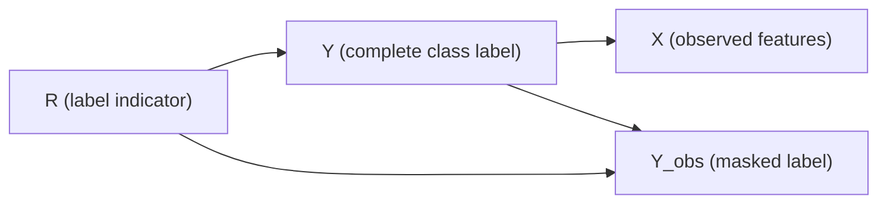

# Target Bayes classification risk under linear density-ratio positive-unlabeled screening

## Research question

- **Question and intended use.** Estimate the unlabeled target-population Bayes classification-risk functional $B = \Pr_{R=0}\{Y \neq g_B(X)\} \approx 0.125369$ and construct a nominal 95% confidence interval from a positive-unlabeled sample generated by linear logistic screening over five unit-interval covariates. This design is proposed as an evaluation benchmark candidate for semi-supervised classification-risk functional inference (distinct from evaluating a fitted classifier's realized misclassification rate).
- **Behavior under test.** In positive-unlabeled data, negative labels are never directly observed, so estimating the Bayes-risk functional requires jointly recovering both the unlabeled prevalence $\pi_0 = 0.4$ and the affine log-density ratio $\log\{f_1(x)/f_0(x)\}$ across the Bayes boundary $s^* \approx 2.672982$. Because the true log-density ratio is linear, the design tests the efficiency tradeoff between parametric linear exponential-tilting estimators and flexible generalized additive estimators when the linear model is correctly specified.

## Study design and data source

- **Motivation and references.** Sang, Sun, Tian, Zeng and Li (2026), *Modelling positive and unlabelled data with a generalized additive density ratio model*, *Journal of the Royal Statistical Society Series B: Statistical Methodology*, advance online publication, [DOI](https://doi.org/10.1093/jrsssb/qkag130), Sections 2 and 6.3.1–6.3.2 (Setting 1, $n = 1500$, Table 1 rounded Bayes comparator `0.125`), cross-verified against the official Setting 1 driver [`Tab1_Set1.R`](https://github.com/syf6250/GAET_PU/blob/main/simulation/Tab1_Set1.R) and shared generator [`FUN-gendata.R`](https://github.com/syf6250/GAET_PU/blob/main/simulation/FUN-gendata.R). The five unit-interval uniform proposal coordinates, linear screening log-odds $m(x) = -16 + 6\sum_{j=1}^5 x_j$, unlabeled prevalence $0.4$, and sample sizes $n_{\mathrm{L}} = 1250$, $n_{\mathrm{U}} = 250$ follow the source verbatim. Adaptations consist of uniformly permuting unlabeled rows, safely handling empty-class draws ($K \in \{0, n_{\mathrm{U}}\}$, unlike the R helper), batched acceptance screening, and finite `0` masking in `Y_obs` paired with `R`.
- **Population and sampling.** Each table stacks $n_{\mathrm{L}} = 1250$ i.i.d. labeled positives ($R = 1$) and $n_{\mathrm{U}} = 250$ unlabeled mixture observations ($R = 0$) drawn by sampling $K \sim \operatorname{Binomial}(250, 0.4)$, generating $K$ positives and $250 - K$ negatives, and uniformly permuting the unlabeled block.

## DAG and identification

- **Variables and causal structure.** $R$ (`R`) indicates labeled versus unlabeled cohort membership, $Y$ is the latent complete binary label, $X$ (`X1`–`X5`) is the observed five-dimensional feature vector drawn conditionally on $Y$, and $Y_{\mathrm{obs}}$ (`Y_obs`) is the masked label.
- **DAG edges.** `R -> Y, Y -> X, Y -> Y_obs, R -> Y_obs`
- **Assumptions.** All labeled rows are positive ($\Pr(Y = 1 \mid R = 1) = 1$) and share the target positive density $f_1(x)$ (SCAR, $X \perp R \mid Y = 1$), anchoring $f_1$. Target prevalence lies in the interior $\pi_0 \in (0, 1)$, densities are strictly positive on $[0, 1]^5$, and the affine log-density ratio is nonconstant (common slope $6 \neq 0$ across all five coordinates, satisfying both parametric linear exponential-tilting identification and Theorem 1's two-coordinate GAET condition; note that zero slope makes $f_1 = f_0$ and renders unknown $\pi_0$ and $B$ unidentifiable). Together these identify $\pi_0$, the Bayes posterior $\Pr(Y = 1 \mid X = x, R = 0)$, and the Bayes-risk functional $B$ from $(X, R, Y_{\mathrm{obs}})$.



## Variables and data-generating process

- **Variables and observed input.** Each row is one observation. Every estimator receives the seven observed columns `X1,...,X5`, `R`, and `Y_obs`, with covariates taking values in $[0, 1)$ drawn from the screened positive density $f_1$ (for $R = 1$) or the target mixture $\pi_0 f_1 + (1 - \pi_0) f_0$ (for $R = 0$), `R == 1` paired with `Y_obs == 1`, and `R == 0` paired with finite placeholder `Y_obs == 0`. Unobserved target labels are excluded.
- **Draw order and scenarios.** Under the single scenario `original` ($n_{\mathrm{L}} = 1250$, $n_{\mathrm{U}} = 250$): draw $K \sim \operatorname{Binomial}(250, 0.4)$; sample $1250 + K$ positive vectors from $\mathcal{L}(X^0 \mid C = 1)$ and $250 - K$ negative vectors from $\mathcal{L}(X^0 \mid C = 0)$ in batches; assign $1250$ positives to $R = 1$, uniformly permute the remaining $K$ positives and $250 - K$ negatives for $R = 0$, and record $Y_{\mathrm{obs},i} = R_i Y_i$.

### Structural equations

- **Structural parents.** `R -> Y, Y -> X, Y -> Y_obs, R -> Y_obs`

```math
\begin{aligned}
X_j^0 &\overset{\mathrm{iid}}{\sim} \mathrm{Uniform}(0, 1), && j = 1, \ldots, 5, \qquad S^0 = \sum_{j=1}^{5} X_j^0, \\
m(x) &= -16 + 6\sum_{j=1}^{5} x_j, && C \mid X^0 \sim \operatorname{Bernoulli}\bigl\{\operatorname{expit}(m(X^0))\bigr\}, \qquad a = \Pr(C = 1), \\
f_{1,S}(s) &= \frac{f_{\mathrm{IH}}(s)\operatorname{expit}(-16 + 6s)}{a}, && f_{0,S}(s) = \frac{f_{\mathrm{IH}}(s)\operatorname{expit}(16 - 6s)}{1 - a}, \\
n_{\mathrm{L}} &= 1250, \qquad n_{\mathrm{U}} = 250, \qquad n = n_{\mathrm{L}} + n_{\mathrm{U}} = 1500, && K \sim \operatorname{Binomial}(n_{\mathrm{U}}, \pi_0), \quad \pi_0 = 0.4, \\
\Pr(Y_i = 1 \mid R_i = 1) &= 1, \qquad Y_i \mid (R_i = 0) \overset{\mathrm{iid}}{\sim} \operatorname{Bernoulli}(\pi_0), && \\
X_i \mid (Y_i = y) &\sim \mathcal{L}(X^0 \mid C = y), \qquad Y_{\mathrm{obs},i} = R_i Y_i.
\end{aligned}
```

Here $f_{\mathrm{IH}}(s)$ is the proposal Irwin–Hall(5) density of $S^0 = \sum_{j=1}^5 X_j^0$ on $[0, 5]$, so the log density ratio $\log\{f_1(x)/f_0(x)\} = -16 + 6\sum_{j=1}^5 x_j + \log\{(1 - a)/a\}$ is affine in $s$ with unique Bayes threshold $s^* = [16 + \log\{a(1 - \pi_0)/[(1 - a)\pi_0]\}]/6 \approx 2.672982$. Unlabeled rows are uniformly permuted conditional on $K$ and store finite placeholder $Y_{\mathrm{obs},i} = 0$.

| Symbol | Meaning | Definition or setting |
| --- | --- | --- |
| $i, n, n_{\mathrm{L}}, n_{\mathrm{U}}$ | Row index and cohort sizes | $i = 1, \ldots, n$; fixed source sizes $n_{\mathrm{L}} = 1250$ labeled positives, $n_{\mathrm{U}} = 250$ unlabeled target rows, $n = 1500$. |
| $X^0, S^0, C, a$ | Screening proposal, sum, label, and acceptance rate | $X_1^0, \ldots, X_5^0 \overset{\mathrm{iid}}{\sim} \mathrm{Uniform}(0, 1)$, $S^0 = \sum_{j=1}^5 X_j^0$ with Irwin–Hall(5) density $f_{\mathrm{IH}}$, $C \mid X^0 \sim \operatorname{Bernoulli}\{\operatorname{expit}(m(X^0))\}$, $a = \Pr(C = 1)$. |
| $m(x)$ | Linear screening log-odds | $m(x) = -16 + 6\sum_{j=1}^5 x_j$; fixed source Setting 1 intercept $-16$ and common slope $6$. |
| $f_{1,S}, f_{0,S}, s^*$ | Class-conditional sum densities and Bayes threshold | $f_{1,S}(s) = f_{\mathrm{IH}}(s)\operatorname{expit}(-16+6s)/a$, $f_{0,S}(s) = f_{\mathrm{IH}}(s)\operatorname{expit}(16-6s)/(1-a)$; threshold $s^* = [16 + \log\{a(1-\pi_0)/[(1-a)\pi_0]\}]/6 \approx 2.672982$. |
| $K, \pi_0$ | Unlabeled positive count and prevalence | $K = \sum_{i:R_i=0} Y_i \sim \operatorname{Binomial}(n_{\mathrm{U}}, \pi_0)$ with $\pi_0 = 0.4$. |
| $R_i$ | Labeled cohort indicator | Equals $1$ for labeled positives and $0$ for unlabeled target rows; column `R`. |
| $Y_i$ | Complete binary class label | Degenerate at $1$ for $R_i = 1$, and $\operatorname{Bernoulli}(0.4)$ marginally for $R_i = 0$; latent when $R_i = 0$. |
| $X_i$ | Observed 5-dimensional features | Drawn from $\mathcal{L}(X^0 \mid C = Y_i)$ via exact batched screening on $[0, 1)^5$; columns `X1`–`X5`. |
| $Y_{\mathrm{obs},i}$ | Observed masked class label | Equals $1$ when $R_i = 1$ and finite placeholder `0` when $R_i = 0$; column `Y_obs`. |
| $B$ | Target Bayes classification risk | $B = \Pr_{R=0}\{Y \neq g_B(X)\} \approx 0.1253688641$, where $g_B(x) = \mathbf{1}\{\Pr(Y = 1 \mid X = x, R = 0) \ge 1/2\}$ (boundary $s^*$ has zero probability mass, matching $> 1/2$). |

## Data-generating process and estimand

- **Estimand.** The scalar target is the population Bayes classification-risk functional $B = \Pr_{R=0}\{Y \neq g_B(X)\} \approx 0.1253688641$ (independent of sample size; consistent with the three-decimal Table 1 Bayes comparator `0.125`). The tie convention $\ge 1/2$ versus the paper's $> 1/2$ yields the identical risk because $\Pr(S^0 = s^*) = 0$.
- **Truth check.** Using the piecewise-quartic proposal Irwin–Hall(5) density $f_{\mathrm{IH}}$ on $[0, 5]$, `truth.py` normalizes $f_{1,S}$ and $f_{0,S}$ by quadrature and integrates $\min\{\pi_0 f_{1,S}(s), (1 - \pi_0) f_{0,S}(s)\}$ on $[0, s^*]$ and $[s^*, 5]$. Independent verification in `verify.py` evaluates the inclusion–exclusion polynomial density directly (matching within $2 \times 10^{-11}$), verifies the oracle zero-slope limit $B = 0.4$, and checks generated labeled-positive and target moments of the feature sum and individual coordinates against independent class-conditional integrals.

## Benchmark comparison

- **Output and comparator.** Methods output a scalar plug-in or debiased estimate of the population Bayes-risk functional $B$ (computed from estimated $\hat{\pi}_0$ and $\hat{f}_1/\hat{f}_0$ over the unlabeled covariates) and a nominal 95% confidence interval (e.g., bootstrap or influence-function interval) using `X1`–`X5`, `R`, and `Y_obs`. Comparators include linear exponential-tilting PU risk estimation (assuming an affine log-density ratio) and generalized additive exponential-tilting (GAET) PU risk estimation (assuming an additive log-density ratio with $\ge 2$ nonconstant coordinates).
- **Scoring and replication.** Evaluate all methods on 1,000 paired independent replicate tables at $n = 1500$. Report bias, RMSE, empirical 95% coverage, mean interval width, Monte Carlo uncertainty, valid denominators, and all failure counts.

## Materials and access

- **Public materials.** The design is published in Sang et al. (2026), [DOI](https://doi.org/10.1093/jrsssb/qkag130), and implemented in [`Tab1_Set1.R`](https://github.com/syf6250/GAET_PU/blob/main/simulation/Tab1_Set1.R) and [`FUN-gendata.R`](https://github.com/syf6250/GAET_PU/blob/main/simulation/FUN-gendata.R), subject to publisher and repository terms.
- **Reproduction and protected materials.** The private review archive `sspi-sang-sun-tian-zeng-li-2026-linear-pu-v1.zip` (SHA-256 `ae489593085552cf3e87b051df8a9638a742d4513c2fe1c966d72a2d9c0b0d5e`) bundles `generator.py`, `truth.py`, `verify.py`, `reproduce.py`, `collection.json`, `config.json`, `schema.csv`, `card.md`, `PROVENANCE.md`, `source_audit.json`, `requirements.txt` (`numpy==2.3.5`, `scipy==1.16.3`), check records, and `MANIFEST.json`. After verifying the manifest in Python 3.12, run:

```bash
python3 reproduce.py --scenario original --n 1500 --seed 1729 --out ../sang-2026-linear-pu-check
```

The command validates all truth, feature-sum moment, and table-contract checks and writes `observed.csv` (`X1,...,X5,R,Y_obs`, 1,500 rows) separately from `reference.json`.
