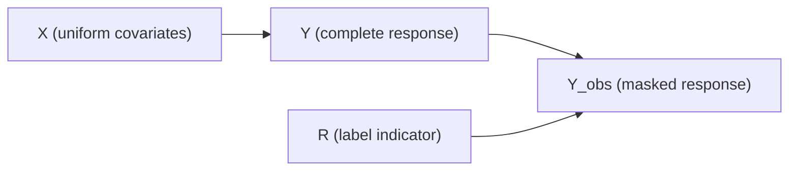

# Semi-supervised population mean under nonlinear polynomial interaction regression

## Research question

- **Question and intended use.** Estimate the marginal population mean $`\theta^* = \mathbb{E}[Y] = -233/150 \approx -1.553333`$ and construct a nominal 95% confidence interval from $`n_{\mathrm{L}} = 1,000`$ labeled and $`n_{\mathrm{U}} = 9,000`$ unlabeled observations ($`\gamma = 0.9`$) when the conditional outcome mean is a four-term higher-order interaction polynomial of two unit-interval uniform covariates. This design is proposed as an evaluation benchmark candidate for semiparametrically efficient semi-supervised and prediction-powered inference.
- **Behavior under test.** Because the conditional mean $`g(X_1, X_2)`$ is strongly nonlinear and non-additive with large signal-to-noise ratio relative to the unit Gaussian residual variance, linear working-model imputation leaves substantial unexplained variance, while cross-fitted semi-supervised estimators can narrow intervals using the $9\times$ larger unlabeled covariate pool to the extent that their fitted nuisance regression approximates $`g(X_1, X_2)`$ accurately—a tradeoff directly measured by the benchmark.

## Study design and data source

- **Motivation and references.** Xu, Witten and Shojaie (2026), *Semiparametrically efficient semi-supervised statistical inference*, *Biometrika* 113(4), asag050, [DOI](https://doi.org/10.1093/biomet/asag050), transcribed from the author manuscript [arXiv:2502.17741v2](https://arxiv.org/html/2502.17741v2), Section 8 (common covariates), Section 8.1 (Setting 2 at $\gamma = 0.9$, Figure 1 center), and Appendix F.1 (Table 1). The two independent unit-interval uniform covariates, four-term interaction polynomial coefficients $(-1.70, -6.94, -1.35, 2.28)$, standard normal noise, and sample sizes $`n_{\mathrm{L}} = 1000`$, $`n_{\mathrm{U}} = 9000`$ follow the read manuscript verbatim. Adaptations store missing responses as finite placeholder `0` (serialized as float `0.0`) in `Y_obs` paired with `R` and allocate proportionate sizes for non-source $n$.
- **Population and sampling.** Units are $n = 10,000$ i.i.d. draws from the common population $`(X_1, X_2, Y)`$, with the first $`n_{\mathrm{L}} = 1000`$ rows deterministically assigned to the labeled cohort ($`R_i = 1`$) and the remaining $`n_{\mathrm{U}} = 9000`$ rows unlabeled ($`R_i = 0`$).

## DAG and identification

- **Variables and causal structure.** $`X = (X_1, X_2)`$ (`X1`, `X2`) are the observed unit-interval uniform covariates, $Y$ is the latent complete continuous outcome, $R$ (`R`) is the fixed-index cohort label indicator independent of $(X, Y)$, and $`Y_{\mathrm{obs}}`$ (`Y_obs`) is the masked observed outcome.
- **DAG edges.** `X -> Y, Y -> Y_obs, R -> Y_obs`
- **Assumptions.** Labeled and unlabeled observations are independent draws from the identical joint population $(X, Y)$ (common covariate law $`P_X`$, transport of $\mathbb{E}[Y \mid X]$ across cohorts, MCAR labeling) with finite outcome variance, nonparametrically identifying $`\theta^* = \mathbb{E}[Y]`$ from $`(X, R, Y_{\mathrm{obs}})`$.



## Variables and data-generating process

- **Variables and observed input.** Each row is one observation. Every method receives the four observed columns `X1`, `X2`, `R`, and `Y_obs`. Covariates are unit-interval uniform draws (implemented on $`[0, 1)`$), and unlabeled rows (`R == 0`) carry finite placeholder `0` (serialized as float `0.0`) in `Y_obs`. Unobserved outcomes ($`R = 0`$) and disturbances are excluded from estimator inputs.
- **Draw order and scenarios.** Under the single scenario `original` ($`n_{\mathrm{L}} = 1000`$, $`n_{\mathrm{U}} = 9000`$): independently for $i = 1, \ldots, 10000$, draw $`X_{i1}, X_{i2} \sim \mathrm{Uniform}(0, 1)`$ and $`\epsilon_i \sim \mathcal{N}(0, 1)`$, compute $`Y_i = g(X_{i1}, X_{i2}) + \epsilon_i`$, assign $`R_i = \mathbf{1}\{i \le 1000\}`$, and set $`Y_{\mathrm{obs},i} = R_i Y_i`$.

### Structural equations

- **Structural parents.** `X -> Y, Y -> Y_obs, R -> Y_obs`

$$
\begin{aligned}
X_{i1}, X_{i2} &\overset{\mathrm{iid}}{\sim} \mathrm{Uniform}(0, 1), && i = 1, \ldots, n, \\
g(x_1, x_2) &= -1.70 x_1 x_2 - 6.94 x_1 x_2^2 - 1.35 x_1^2 x_2 + 2.28 x_1^2 x_2^2, && \\
\epsilon_i &\overset{\mathrm{iid}}{\sim} \mathcal{N}(0, 1), && \epsilon_i \perp X_i, \\
Y_i &= g(X_{i1}, X_{i2}) + \epsilon_i, && \\
n_{\mathrm{L}} &= 1000, \qquad n_{\mathrm{U}} = 9000, && n = n_{\mathrm{L}} + n_{\mathrm{U}} = 10000, \quad \gamma = \frac{n_{\mathrm{U}}}{n} = 0.9, \\
R_i &= \mathbf{1}\{i \le n_{\mathrm{L}}\}, \qquad Y_{\mathrm{obs},i} = R_i Y_i.
\end{aligned}
$$

All $n = 10,000$ rows are i.i.d. draws from the identical joint population $`(X_1, X_2, Y)`$ with fixed-index labeling $`R_i = \mathbf{1}\{i \le 1000\}`$; unlabeled rows ($`R_i = 0`$) carry finite placeholder $`Y_{\mathrm{obs},i} = 0`$.

| Symbol | Meaning | Definition or setting |
| --- | --- | --- |
| $`i, n, n_{\mathrm{L}}, n_{\mathrm{U}}`$ | Row index and cohort sizes | $i = 1, \ldots, n$; fixed source sizes $`n_{\mathrm{L}} = 1000`$ labeled and $`n_{\mathrm{U}} = 9000`$ unlabeled rows ($`n = 10,000`$, unlabeled share $`\gamma = 0.9`$). |
| $`X_{i1}, X_{i2}, X_i`$ | Observed unit-interval uniform covariates | Independent $\mathrm{Uniform}(0, 1)$ draws (implemented on $`[0, 1)`$); columns `X1`, `X2`. |
| $`g(x_1, x_2)`$ | Nonlinear conditional mean | $`g(x_1, x_2) = -1.70 x_1 x_2 - 6.94 x_1 x_2^2 - 1.35 x_1^2 x_2 + 2.28 x_1^2 x_2^2`$; fixed manuscript Setting 2 coefficients. |
| $`\epsilon_i`$ | Outcome disturbance | Independent $\mathcal{N}(0, 1)$ noise, independent of $`X_i`$; latent. |
| $`Y_i`$ | Complete continuous outcome | $`Y_i = g(X_{i1}, X_{i2}) + \epsilon_i`$; latent when $`R_i = 0`$. |
| $`R_i`$ | Labeled cohort indicator | Deterministically $1$ for $i \le 1000$ and $0$ for $i > 1000$; column `R`. |
| $`Y_{\mathrm{obs},i}`$ | Observed masked outcome | Equals $`Y_i`$ when $`R_i = 1`$ and finite placeholder `0` when $`R_i = 0`$; column `Y_obs`. |
| $`\theta^*`$ | Marginal population mean | $`\theta^* = \mathbb{E}[Y] = \int_0^1\int_0^1 g(x_1, x_2)\,dx_1\,dx_2 = -233/150 \approx -1.5533333333`$. |

## Data-generating process and estimand

- **Estimand.** The scalar target is the marginal population mean $`\theta^* = \mathbb{E}[Y] = -233/150 \approx -1.5533333333`$ in response units.
- **Truth check.** Using $`\mathbb{E}[X_1^a X_2^b] = \{(a+1)(b+1)\}^{-1}`$ for independent $\mathrm{Uniform}(0, 1)$ variables yields the exact rational sum $-1.70/4 - 6.94/6 - 1.35/6 + 2.28/9 = -233/150$. Independent verification in `verify.py` evaluates $`\int_0^1\int_0^1 g(x_1, x_2)\,dx_1\,dx_2`$ via nested quadrature (matching $-233/150$ to within $`10^{-12}`$), checks the zero-signal limit, checks generated labeled residual mean and variance against $`g(X_1, X_2)`$ (sensitive to swapping $-6.94$ and $`-1.35`$), and verifies $[0, 1)$ covariate support across both cohorts.

## Benchmark comparison

- **Output and comparator.** Methods output a scalar estimate of $`\theta^*`$ and a nominal 95% confidence interval using `X1`, `X2`, `R`, and `Y_obs`. Comparators include the labeled-only sample mean, safe semi-supervised linear imputation, cross-fitted semiparametrically efficient semi-supervised estimation, and prediction-powered mean estimation.
- **Scoring and replication.** Evaluate all methods on 1,000 paired independent replicate tables at $n = 10,000$. Report bias, RMSE, empirical 95% coverage, mean interval width, Monte Carlo uncertainty, valid denominators, and all failure counts.

## Materials and access

- **Public materials.** The simulation design is documented in Xu, Witten and Shojaie (2026), [DOI](https://doi.org/10.1093/biomet/asag050) and [arXiv:2502.17741v2](https://arxiv.org/html/2502.17741v2), governed by publisher terms.
- **Reproduction and protected materials.** The private review archive `sspi-xu-witten-shojaie-2026-polynomial-mean-v1.zip` (SHA-256 `9c27575a1a61f87105e0ba98f07248f2d541bd1174526e52764fd7aa0cc58c99`) contains `generator.py`, `truth.py`, `verify.py`, `reproduce.py`, `collection.json`, `config.json`, `schema.csv`, `card.md`, `PROVENANCE.md`, `source_audit.json`, `requirements.txt` (`numpy==2.3.5`, `scipy==1.16.3`), check records, and `MANIFEST.json`. After verifying the manifest in Python 3.12, run:

```bash
python3 reproduce.py --scenario original --n 10000 --seed 1729 --out ../xu-2026-polynomial-mean-check
```

The command validates all truth, generated-residual, and table-contract checks and exports `observed.csv` (`X1,X2,R,Y_obs`, 10,000 rows) separately from `reference.json`.
